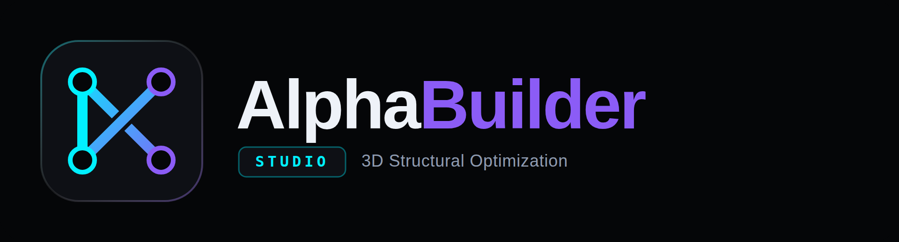

<p align="center">
  
</p>

# AlphaBuilder Studio v4.0

Aplicativo desktop cross-platform para inspeção de datasets **v3.3**, design estrutural generativo, MCTS ao vivo e comparação A/B — construído com **Tauri v2 (Rust)**, **Three.js imperative** e um **Compute & Inference Server** Python local/remoto.

O núcleo científico `v3.3` continua sendo a fonte única de verdade: `alphabuilder/src/**`, `scripts/**`, `run_*.py`, `tests/unit/**`, `tests/test_integration_v31.py` e `docs/tcc/**` permanecem intocados.

## Artefatos

| Artefato | Caminho | Tecnologia |
| :--- | :--- | :--- |
| Núcleo Rust | `crates/ab-core/` | matemática v3.3, `.npy`/`COO1`, ABMESH01/ABWIRE01, SQLite RO, mesher, topologia, exportadores |
| Desktop Studio | `apps/studio/` | Tauri v2 + React 19 + Zustand + Three.js vanilla + Tailwind v4 |
| Compute Engine | `alphabuilder/server/` | FastAPI + WebSocket + ABWIRE01 + ComputeWorker thread única |
| Testes do Studio | `apps/studio/src/**/*.test.ts` + `tests/server/` | Vitest + pytest + cross-language Python→Rust |

## Início rápido

### Desktop (dev)

```bash
cd apps/studio
npm install
npm run tauri dev
```

### Desktop (release)

```bash
cd apps/studio
npm run build
npm run tauri build
```

### Compute Engine local

```bash
python -m alphabuilder.server \
  --host 127.0.0.1 --port 8765 \
  --checkpoints-dir checkpoints --data-dir data
```

### Compute Engine remoto (Tailscale/LAN/HTTPS)

```bash
python -m alphabuilder.server \
  --host 0.0.0.0 --port 8765 \
  --api-token "<SEGREDO_FORTE>" \
  --checkpoints-dir checkpoints --data-dir data
```

O servidor recusa bind não-loopback sem token, salvo `--allow-insecure-remote` explícito. Perfis `Local Sidecar`, `Localhost/WSL2` e `Remoto` são gerenciados no Studio.

## Verificação

```bash
cargo test -p ab-core
cargo clippy -p ab-core --all-targets -- -D warnings
cargo check --manifest-path apps/studio/src-tauri/Cargo.toml
pytest tests/unit/ -v
pytest tests/server/ -v
cd apps/studio && npm run typecheck && npm run test && npm run build
```

## Recursos principais

- **Inspetor:** replay de Harvest v3.3 e Self-Play MCTS, malha surface-culled com AO, 7 lentes, Blueprint Ghost Fresnel, planos de corte X/Y/Z, deformação/exagero com colormap Turbo, filmstrip com fases/sparklines/refutações, exportação STL/OBJ/VTI/PNG 4K.
- **Estúdio:** templates, escultura 3D, suporte/carga com snap inteiro, Raio-X Neural (debounce 120 ms), FEM real, SIMP e MCTS ao vivo com Pausar → Editar → Continuar.
- **Comparador:** dois viewports sincronizados (câmera e timeline por índice ou fração normalizada), IoU 3D e deltas calculados em Rust, PNG A/B 4K.
- **Offline-first:** abrir `.db` locais sem Python; o Compute Engine é opcional.

## Release

Tags seguem `studio-vX.Y.Z` e disparam `.github/workflows/studio-release.yml` (Windows `.msi`/`.exe`, Linux `.AppImage`/`.deb`/`.rpm`, macOS `.dmg`, engine `.tar.gz` + `SHA256SUMS.txt`). O build Windows publicado é unsigned por padrão; o procedimento de Authenticode (Azure Trusted Signing, token EV/OV ou PFX em CI) está documentado em `apps/studio/README.md`. O workflow exige a mesma versão em `apps/studio/package.json`, `apps/studio/src-tauri/tauri.conf.json`, `apps/studio/src-tauri/Cargo.toml` e `alphabuilder/server/__init__.py`.

A especificação normativa completa está em [`specs/app_v4_spec.md`](specs/app_v4_spec.md).
