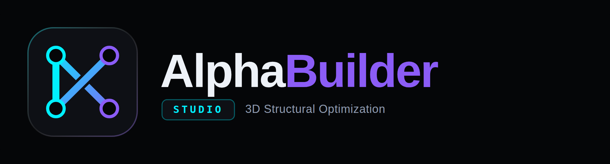

<p align="center">
  
</p>

# AlphaBuilder Studio v4.0

Desktop cross-platform para inspecionar e editar estruturas AlphaBuilder v3.3.

## Requisitos

- Node.js 20+ e npm
- Rust stable + Cargo
- Linux: `libwebkit2gtk-4.1-dev`, `libappindicator3-dev`, `librsvg2-dev`, `patchelf`, `libsqlite3-dev`
- Opcional: Python 3.10+ com o Compute Engine (`alphabuilder/server`)

## Desenvolvimento

```bash
npm install
npm run tauri dev
```

O Vite sobe em `http://localhost:1420`; o binário Tauri abre a janela nativa.

## Build

```bash
npm run build          # typecheck + Vite
npm run tauri build    # instaladores nativos
```

## Compute Engine

Local (sidecar gerenciado pelo app ou manual):

```bash
python -m alphabuilder.server --host 127.0.0.1 --port 8765 \
  --checkpoints-dir checkpoints --data-dir data
```

Remoto (Tailscale/LAN/HTTPS):

```bash
python -m alphabuilder.server --host 0.0.0.0 --port 8765 \
  --api-token "<TOKEN>" --checkpoints-dir checkpoints --data-dir data
```

No Studio, abra o pill **Compute**, edite/selecione o perfil e conecte. O token é persistido em `profiles.json` com permissões restritas do usuário.

## Testes

```bash
npm run typecheck
npm run test
cargo test -p alphabuilder-studio
cargo clippy -p alphabuilder-studio --all-targets -- -D warnings
```

A fixture `src/lib/__fixtures__/abmesh_fixture.bin` é gerada por `cargo run -p ab-core --example abmesh_fixture -- <path>`.

## Estrutura

- `src/engine3d/` — ViewportEngine, VoxelMeshLayer, BlueprintLayer, OverlayLayer, BoundaryLayer, VoxelPicker, CameraRig.
- `src/components/` — TopBar, LibraryDrawer, LensToolbar, TimelineDock, Inspector/Studio/Compare e modais.
- `src/store/` — Zustand stores (app, compute, inspector, studio, compare).
- `src/lib/` — IPC tipado, parser zero-copy ABMESH01, Turbo, formatters.
- `src-tauri/` — comandos IPC, cache LRU, sidecar, ws_bridge e contratos snake_case.

## Filmstrip ao vivo no Estúdio

Durante uma sessão MCTS, o mesmo dock inferior do Inspetor aparece no Estúdio:

- sparkline de `Value` e `Volume` sendo construída a cada passo;
- fases `GROWTH`/`REFINEMENT` e marcadores de refutação;
- clique/arraste para revisar qualquer frame já recebido;
- badge **AO VIVO**/ **REPLAY** e botão **Voltar ao vivo**;
- as mesmas lentes, Blueprint e Modo TCC do Inspetor.

Ao revisar um frame antigo, o Estúdio fica em modo leitura; volte ao vivo para editar/pintar novamente.

## Visualizador v3.3

- **Blueprint** inicia sempre desativado e só aparece quando você liga explicitamente (`B` ou botão ghost). Atualizações de frame não reativam a camada sozinhas.
- Em bancos de **treino/warmup sem `displacement_blob`**, as lentes **Deslocamento** e **Tensão** e o controle de exagero ficam ocultos. Use um banco Harvest com `displacement_map`/`displacement_blob` ou rode FEM no Estúdio para visualizá-los.
- No Estúdio, **arrastar com o botão esquerdo orbita a câmera e nunca cria voxels**; um clique curto (sem arrastar) aplica a ferramenta de pintura/remoção/suporte.
- Clique ou arraste no filmstrip para saltar imediatamente ao frame correspondente; a reprodução é pausada durante o scrub.
- A lente **Refutação** compara o argmax da Policy Head com a ação mais visitada pelo MCTS e mostra coordenadas, `N` e `Q` no painel MCTS & PV.

## Tela cheia

- Botão **Tela cheia** na pill bar superior (ícone maximizar/minimizar).
- Atalho **F11** em qualquer modo.
- O app mantém a barra de janela nativa do Windows/macOS/Linux; o botão usa `Window.setFullscreen` do Tauri v2.

## Assinatura de código no Windows

O build publicado sem certificado é **unsigned**. Para remover o aviso do SmartScreen é preciso uma assinatura **Authenticode** com certificado de code signing (OV ou EV). Desde 2023 as CAs públicas exigem que a chave privada de certificados OV/EV fique em **HSM/token físico ou cloud HSM**; um `.pfx` solto não é aceito pela maioria das CAs para novos certificados.

### Opção A — Azure Trusted Signing (recomendado para CI)

1. Crie uma conta **Azure Trusted Signing**, valide a identidade da organização e um **Certificate Profile**.
2. No GitHub, configure `AZURE_TENANT_ID`, `AZURE_CLIENT_ID`, `AZURE_CLIENT_SECRET`, `AZURE_TRUSTED_SIGNING_ENDPOINT` e o nome do profile.
3. Assine os binários com `signtool` + `TrustedSigning` dlib (ou `signCommand` do Tauri v2) após o `tauri build`, antes de subir os artefatos.
4. Valide com `signtool verify /pa /v "AlphaBuilder.Studio_4.0.1_x64-setup.exe"`.

### Opção B — token EV/OV local

Com o token conectado e o certificado importado em `Cert:\CurrentUser\My`:

```json
"bundle": {
  "windows": {
    "certificateThumbprint": "THUMBPRINT_SHA1_DO_CERTIFICADO",
    "digestAlgorithm": "sha256",
    "timestampUrl": "http://timestamp.digicert.com"
  }
}
```

Depois:

```powershell
npm run tauri build
signtool verify /pa /v "target\release\bundle\msi\AlphaBuilder Studio_4.0.1_x64_en-US.msi"
```

### Opção C — PFX em CI (somente se a CA permitir chave exportável)

Guarde o PFX em base64 nos secrets `WINDOWS_CERTIFICATE` e `WINDOWS_CERTIFICATE_PASSWORD`, importe no certificate store do runner e passe o thumbprint ao Tauri:

```powershell
$bytes = [Convert]::FromBase64String($env:WINDOWS_CERTIFICATE)
[IO.File]::WriteAllBytes("cert.pfx", $bytes)
$cert = Import-PfxCertificate -FilePath cert.pfx -CertStoreLocation Cert:\CurrentUser\My `
  -Password (ConvertTo-SecureString $env:WINDOWS_CERTIFICATE_PASSWORD -AsPlainText -Force)
npm run tauri build -- --config "{`"bundle`":{`"windows`":{`"certificateThumbprint`":`"$($cert.Thumbprint)`",`"digestAlgorithm`":`"sha256`",`"timestampUrl`":`"http://timestamp.digicert.com`"}}}"
```

A assinatura resolve a identidade do publicador, mas a reputação do SmartScreen é construída ao longo do tempo (EV/Trusted Signing reduz o período de carência).
