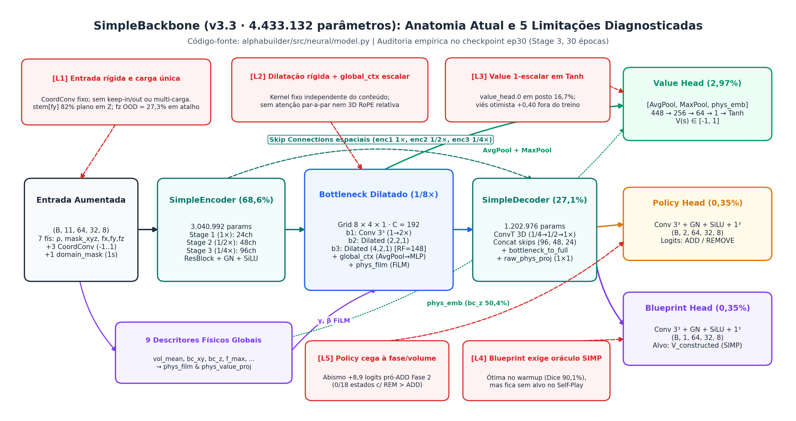
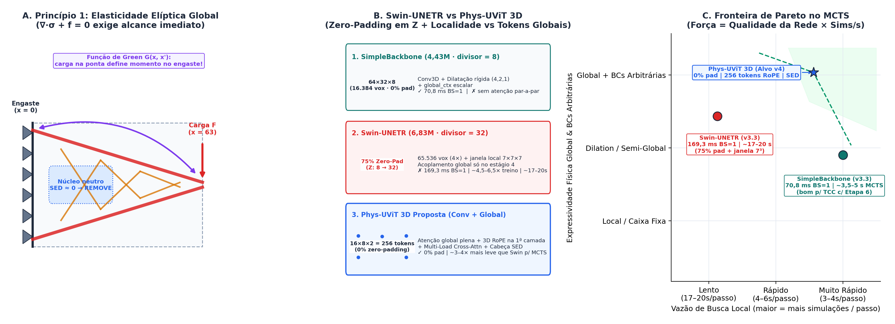
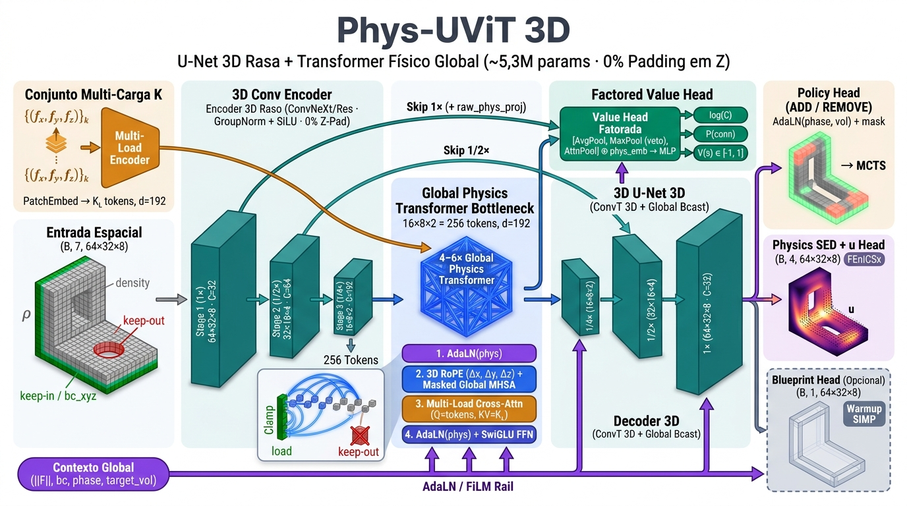
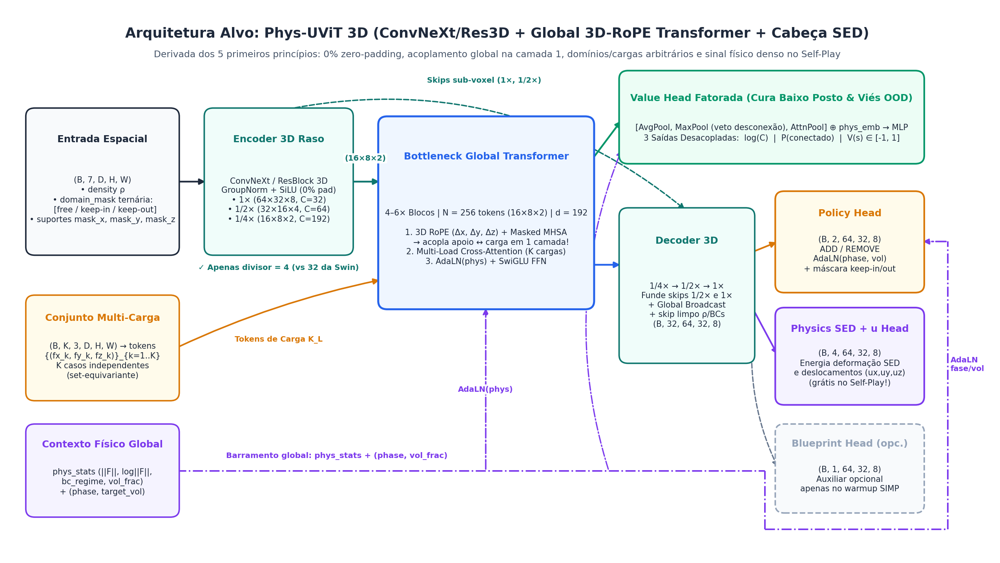
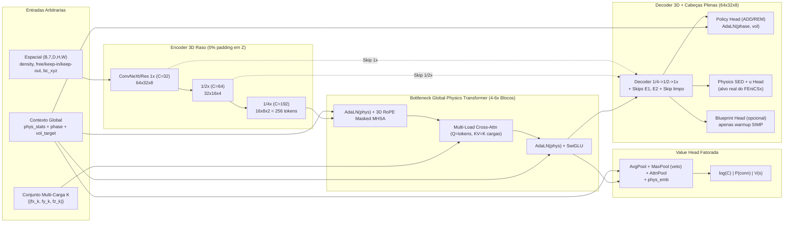
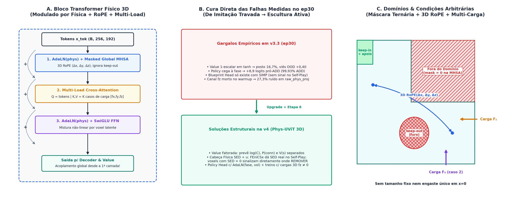
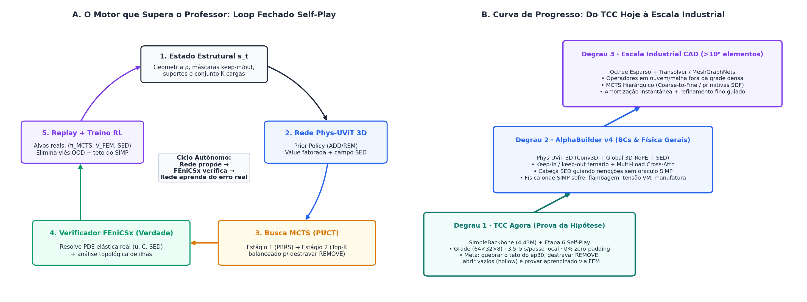

# Arquitetura Neural Ótima para Otimização Topológica Guiada por MCTS sob Condições Arbitrárias

**Documento Técnico de Arquitetura (Primeiros Princípios → `Phys-UViT 3D`)**  
**Base empírica no projeto:** auditoria de treinamento e inferência real (`ep2 → ep30`) em [`eval_inference_report_v3_3.md`](file:///c:/Users/admin/Projetos/alphabuild/data/analysis/eval_inference_report_v3_3.md) e implementação atual em [`alphabuilder/src/neural/model.py`](file:///c:/Users/admin/Projetos/alphabuild/alphabuilder/src/neural/model.py).  
**Diagramas gerados por:** [`scripts/generate_architecture_diagrams.py`](file:///c:/Users/admin/Projetos/alphabuild/scripts/generate_architecture_diagrams.py).

---

## 1. Ponto de Partida: O que é a `SimpleBackbone` (v3.3), Seus Méritos e Suas 5 Limitações

Antes de propor qualquer salto arquitetural, precisamos diagnosticar com precisão cirúrgica o que a rede atual do projeto — **`SimpleBackbone`** (`4.433.132` parâmetros em [`model.py#L402-L509`](file:///c:/Users/admin/Projetos/alphabuild/alphabuilder/src/neural/model.py#L402-L509)) — já faz muito bem e exatamente onde sua estrutura limita a ambição de esculpir peças arbitrárias ótimas via MCTS.

### 1.1 Como a `SimpleBackbone` funciona hoje

A `SimpleBackbone` é uma **U-Net Residual 3D condicional por física** inspirada em arquiteturas voxel-para-voxel como 3D U-Net para topologias estruturais [`zheng2021generating`], combinando blocos modernos para evitar colapso de escala:

1. **Entrada aumentada em tempo real (`11` canais):** concatena aos `7` canais físicos originais (`density`, `mask_x`, `mask_y`, `mask_z`, `fx`, `fy`, `fz`) `3` grades normalizadas `CoordConv` (`cd, ch, cw ∈ [-1, 1]`) [`liu2018coordconv`] e `1` `domain_mask`, fornecendo referência posicional explícita para que convoluções invariantes à translação distingam engastes em `x = 0` de pontas livres.
2. **Encoder e Decoder em 3 resoluções com `GroupNorm` [`wu2018group`]:** diferente de *InstanceNorm* ou *BatchNorm*, o `GroupNorm` (`affine=True`, `max_groups=8`) preserva a escala relativa entre máscaras esparsas de contorno/força sem depender do tamanho de batch durante o MCTS (`BS = 1` ou `8`).
3. **Bottleneck dilatado na resolução `1/8×` (`8 × 4 × 1`, `192` canais):** aplica convoluções dilatadas `(2, 2, 1)` e `(4, 2, 1)` que elevam o campo receptivo teórico ao longo do eixo $X$ para `D-RF = 148 >= 64` [`model.py#L420`](file:///c:/Users/admin/Projetos/alphabuild/alphabuilder/src/neural/model.py#L420), somadas a um ramo `global_ctx` (`AdaptiveAvgPool3d → MLP`) e condicionamento **`FiLM`** [`perez2018film`] (`phys_film`) computado sobre `9` estatísticas físicas invariantes a simetrias `D4 × Z2`.
4. **Três cabeças na saída + atalho direto:** `Value Head` (`[AvgPool, MaxPool, phys_emb] → MLP → Tanh`), `Policy Head` (`(B, 2, D, H, W)` *ADD/REMOVE*) e cabeça auxiliar `Blueprint Head` inspirada em KataGo [`wu2019accelerating`], além de um skip linear `raw_phys_proj(x)` somado diretamente às features do decoder.

### 1.2 O que ela já conquistou — e suas 5 limitações estruturais medidas

Na avaliação do checkpoint `ep30` ([`simple_v3_3_stage3_best.pt`](file:///c:/Users/admin/Projetos/alphabuild/checkpoints/simple_v3_3_stage3_best.pt)), a `SimpleBackbone` mostrou que **não saturou capacidade**: atingiu `90,05%` de *Blueprint Dice* e `0,0134` de `Value MAE` na validação, corrigiu o afilamento raiz→ponta em `6/6` cenários e reduziu a compliance média de inferência MCTS+FEM em `-69,9%` frente à época 2 (inclusive batendo o SIMP binarizado em `S6` com metade da massa). Entretanto, a anatomia dos pesos revelou **5 limitações concretas**:



| ID | Limitação Arquitetural na `SimpleBackbone` | Evidência Empírica Medida no `ep30` | Impacto sob Condições Arbitrárias & Self-Play |
|---|---|---|---|
| **`[L1]`** | **Entrada rígida, carga única e atalho `raw_phys_proj` vulnerável** | Filtros de entrada `stem[fy]` ficaram quasi-2D (`flatness Z = 0,821`, `dX/dZ = 2,25×`); canal `fz` não-visto reteve `27,31%` de energia residual em `raw_phys_proj` (`ΔVal = +0,865` se `fz ≠ 0`). | Sem máscara ternária (`free`/`keep-in`/`keep-out`) nem conjunto variável de $K$ casos de carga; não representa furos, obstáculos internos ou múltiplos carregamentos simultâneos. |
| **`[L2]`** | **Dilatação fixa + `global_ctx` meramente aditivo no bottleneck `8×4×1`** | Em `1/8×`, o eixo `Z` colapsa para **1 único plano (`8×4×1`)**; `global_ctx` resume tudo a um vetor médio global sem interações par-a-par dependentes do conteúdo. | Em domínios recortados (em L, furos, obstáculos) e esforços 3D complexos (`S5 RAIL_XY` com `z_cent = 2,99` vs `0,99` do SIMP), a rede não modela roteamento condicional entre pontos distantes no 3D real. |
| **`[L3]`** | **`Value Head` 1-escalar em `Tanh` sem fatoração física** | `value_head.0` colapsou em posto efetivo de apenas **`16,7%`** (`42,6/256`, `s_max/s_min = 56,7`), com viés pré-tanh `+0,1059` e **viés otimista de `+0,401` OOD** (`MAE = 0,401` na Fase 2 vs `0,0134` na val). | Ao esmagar rigidez (escala logarítmica), validade topológica e penalidade de volume num único escalar saturado por `tanh`, a rede generaliza mal para geometrias fora do *manifold* SIMP [`nakamoto2023calql`]. |
| **`[L4]`** | **`Blueprint Head` acoplada exclusivamente ao oráculo SIMP** | Atinge `90,05%` de Dice imitando `V_constructed` do SIMP, e ajudou o decoder a separar forma global vs fronteira (`r = -0,5317`). | Durante a **Etapa 6 (Self-Play)**, em que a rede deve *superar* o SIMP em regimes novos ou discretos, não existe mais "resposta pronta" do SIMP — a rede perde seu sinal denso auxiliar. |
| **`[L5]`** | **`Policy Head` sem condicionamento explícito de fase/orçamento** | Abismo médio de **`+8,9` logits** pró-`ADD` nos `18` estados de Fase 2 (`max ADD = +8,86` vs `max REM = -0,01`; `0/18` estados com `REM > ADD`), travando Fase 2 em **`99,93% ADD`**. | A mesma cabeça tenta crescer a ponte na Fase 1 (`ADD`) e esculpir vazios na Fase 2 (`REMOVE`) sem saber em que fase/orçamento está nem quais voxels têm baixa energia de deformação. |

---

## 2. Por que a Nova Arquitetura (`Phys-UViT 3D`) Supera a `SimpleBackbone` e a `Swin-UNETR`

A alternativa já presente no código — **`Swin-UNETR`** [`hatamizadeh2022swin`], baseada no *Swin Transformer* [`liu2021swin`] — foi originalmente projetada para segmentação de imagens médicas volumétricas isotrópicas (`128³–256³`). Ao aplicá-la à otimização topológica em MCTS, ela cai numa posição desfavorável na curva de custo-benefício: **muito cara para buscar em árvore e estruturalmente inadequada à física elástica e às dimensões anisotrópicas da malha**.



### 2.1 Os 4 motivos objetivos pelos quais `Phys-UViT 3D` vence a `Swin-UNETR`

1. **Eliminação de `75%` de computação desperdiçada em zero-padding (`Z: 8 → 32`):**  
   Por usar `4` estágios hierárquicos após *patch merging* `2×2×2`, a `Swin-UNETR` exige espacialidade divisível por **`divisor = 32`** ([`model.py#L258`](file:///c:/Users/admin/Projetos/alphabuild/alphabuilder/src/neural/model.py#L258)). Em grades típicas de placas/vigas estruturais como `(64, 32, 8)`, a profundidade $Z = 8$ é preenchida com zeros até $Z = 32$: **`49.152` dos `65.536` voxels (`75%`) processados são puro zero-padding**. A `Phys-UViT 3D` usa *encoder* convolucional até **`1/4×`** (`divisor = 4`), operando com **`0%` de zero-padding** em `(64, 32, 8)` e mantendo tokens em `16 × 8 × 2` (`256` tokens) onde a espessura em `Z` **não colapsa para 1 plano** como ocorre em `1/8×` da `SimpleBackbone`.

2. **Atenção global na 1ª camada Transformer vs janelas locais cegas (`7 × 7 × 7`):**  
   A `Swin-UNETR` restringe a auto-atenção inicial a janelas locais `(7, 7, 7)` deslocadas gradualmente [`liu2021swin`]. Na mecânica dos sólidos, entretanto, o campo de tensões obedece a uma PDE elíptica global: alterar um voxel no engaste redistribui deslocamentos até a carga no mesmo instante. Já no *bottleneck* `1/4×` da `Phys-UViT 3D`, a sequência espacial tem apenas **$N = 256$ tokens** — menor que uma página curta de texto [`vaswani2017attention`, `dosovitskiy2021image`]! Isso permite rodar **Multi-Head Self-Attention (MHSA) global completa (par-a-par entre todos os 256 tokens)** já no **1º bloco**, ligando diretamente apoio ↔ carga ↔ furos sem precisar de pirâmide com `divisor = 32`.

3. **Preservação da nitidez de fronteira para ações voxel-a-voxel (`Policy`):**  
   Revisões críticas da comunidade de otimização topológica [`woldseth2022use`, `sigmund2022benchmarking`] apontam que redes puramente baseadas em *patches* ou gargalos excessivos borram barras finas e criam desconexões de um único voxel — defeito fatal para conectividade estrutural. Mantendo dois estágios convolucionais 3D em resolução plena (`1×`) e metade (`1/2×`) com *skip connections* diretas até o *decoder*, a `Phys-UViT 3D` garante precisão geométrica local melhor que um ViT puro, ao mesmo tempo em que raciocina globalmente no espaço de `256` tokens.

4. **Velocidade de busca MCTS (`Pareto Superior`):**  
   Em sistemas estilo AlphaZero, a força efetiva do agente é proporcional ao produto **(qualidade da política/valor) × (nº de simulações MCTS por segundo)**. Nossos benchmarks locais na `Intel(R) Graphics [0x7dd1]` mostram que a `Swin-UNETR` custa `169,3 ms` por estado (`~17–20 s/passo` com `160` simulações e `4,5–6,5×` mais cara para treinar no Kaggle). Ao remover o padding de `4×` e confinar o Transformer aos `256` tokens de `1/4×`, a `Phys-UViT 3D` combina **expressividade global real superior à Swin-UNETR** com **custo computacional próximo ao da `SimpleBackbone`**, viabilizando MCTS profundo e Self-Play rápido.

### 2.2 Quadro Comparativo Resumido

| Critério Técnico | `SimpleBackbone` (Atual v3.3) | `Swin-UNETR` (Atual v3.3) | **`Phys-UViT 3D` (Proposta v4)** |
|---|---|---|---|
| **Divisor / Zero-Pad em `(64, 32, 8)`** | `divisor = 8` (`0%` pad) | `divisor = 32` (**`75%` zero-pad em Z!**) | **`divisor = 4` (`0%` zero-pad)** |
| **Resolução no Bottleneck** | `(8 × 4 × 1)` — `Z` colapsado a 1 | `(2 × 1 × 1)` pós 32× | **`(16 × 8 × 2) = 256` tokens** (preserva `Z=2`) |
| **Mecanismo de Alcance Global** | Dilatação fixa `(4,2,1)` + `AvgPool` escalar | Janelas locais `7³`; global só no estágio 4 | **MHSA Global par-a-par + `3D RoPE` na camada 1** |
| **Domínios & Cargas Arbitrárias** | Caixa implícita + `1` campo `[fx,fy,fz]` | Igual à SimpleBackbone | **Máscara ternária (`keep-in/out`) + `Multi-Load` Cross-Attn** |
| **Sinal Denso no Self-Play** | Apenas *Blueprint SIMP* (some no RL) | Apenas *Blueprint SIMP* | **Cabeça Física `SED + u`** (fornecida grátis pelo FEniCSx) |
| **Custo p/ MCTS (`160 sims`, xpu)** | **`~3,5–5,0 s/passo`** (medido) | `~17–20 s/passo` (est., pesado) | **`~4,5–6,5 s/passo`** (est., Pareto ótimo) |

---

## 3. Fundamentação em 5 Primeiros Princípios

Em vez de escolher blocos por moda, cada peça da **`Phys-UViT 3D`** decorre logicamente de cinco princípios físicos e algorítmicos:

### Princípio 1 — Elasticidade Linear é uma PDE Elíptica Global ($\nabla \cdot \boldsymbol{\sigma} + \mathbf{f} = 0$)
Na mecânica do contínuo sólido [`bendsoe2003topology`, `sigmund2013topology`], a matriz de rigidez global $\mathbf{K}(\boldsymbol{\rho})$ acopla toda a estrutura conectada: $\mathbf{K}(\boldsymbol{\rho})\mathbf{u} = \mathbf{f}$, cuja inversa $\mathbf{K}^{-1}$ atua como uma **função de Green $G(\mathbf{x}, \mathbf{x}')$** com suporte global. Para saber se vale a pena colocar uma barra diagonal partindo de um apoio em $\mathbf{x}_a$, a rede precisa olhar **simultaneamente** onde está a carga $\mathbf{x}_f$, se o caminho oposto já formou um binário de forças (*truss action*) e se há apoios secundários em qualquer coordenada do espaço.  
**Consequência arquitetural:** o centro da rede precisa de **atenção global dependente do conteúdo (*Multi-Head Self-Attention*)** em toda a malha latente (`256 tokens` em `1/4×`), onde qualquer par $(i, j)$ interage em $\mathcal{O}(1)$ saltos.

### Princípio 2 — Dualidade de Escala: Decisão Global vs Precisão Geométrica Sub-Voxel
Embora a física seja global, as ações do MCTS são estritamente **locais na superfície** (*adicionar ou remover 1 voxel adjacente sem gerar ilhas desconectadas* [`behzadi2023taming`, `huang2022closer`]). Transformers que tokenizam diretamente a imagem perdem localização fina nas bordas, enquanto U-Nets convolucionais perdem contexto longo sem muitos estágios de *pooling*.  
**Consequência arquitetural:** adotar um esquema **U-Net Híbrido** (*ConvNeXt/ResBlock 3D* [`liu2022convnext`] nos níveis `1×` e `1/2×` + *Global Transformer* em `1/4×`), fundindo as *skip connections* rasas no *decoder* para que a `Policy Head` tenha nitidez exata de 1 voxel na casca da estrutura.

### Princípio 3 — Invariância de Condições de Contorno e Geometrias Arbitrárias
Peças de engenharia reais raramente são blocos retangulares puros com engaste fixo em `x = 0` e uma única carga vertical `fy`: elas têm **regiões proibidas (*keep-out*, furos de montagem, passagens de eixo)**, **regiões obrigatórias (*keep-in*)**, fronteiras recortadas, suportes parciais e **$K$ casos de carga independentes** $\mathcal{L} = \{\mathbf{f}^{(1)}, \dots, \mathbf{f}^{(K)}\}$ (com componentes em $x, y, z$).  
**Consequência arquitetural:**
- Substituir o *padding* absoluto de coordenadas fixas por **`3D RoPE` (*Rotary Position Embedding* tridimensional)** [`su2024roformer`]: ao codificar apenas deslocamentos relativos $(\Delta x, \Delta y, \Delta z)$ dentro do produto interno $q_i^\top R(\Delta \mathbf{x}) k_j$, a atenção torna-se invariante a translações e generaliza para caixas de dimensões distintas [`nobari2025optimize`, `zhao2026variable`].
- Embutir **máscara ternária de domínio** (`free / keep-in / keep-out`), aplicando *Attention Masking* nos tokens `keep-out` ou fora do sólido CAD para que não participem do roteamento de tensões.
- Tratar cargas via **Multi-Load Cross-Attention (*Set-Equivariant*)**: em vez de esmagar múltiplos casos de carga num único tensor `[fx, fy, fz]` (onde cargas opostas $\mathbf{f}^{(1)} = -\mathbf{f}^{(2)}$ se anulariam!), cada caso $k \in \{1..K\}$ vira um conjunto de tokens físicos consultados por *Cross-Attention* [`lutheran2026diffusion`].

### Princípio 4 — Sinal Físico Interno (`SED`) + Avaliação Fatorada contra *Covariate Shift*
Os dois bloqueios centrais que medimos no checkpoint `ep30` foram: (1) a `Value Head` 1-escalar em `tanh` memorizou o *manifold* SIMP em posto efetivo `16,7%`, errando em `+0,40` fora da distribuição, e (2) sem *Blueprint SIMP* no Self-Play, a `Policy Head` manteve `+8,9` logits de vantagem pró-`ADD` (`99,93% ADD`), ignorando que remover material de baixa tensão melhora a relação rigidez/peso.  
Na teoria clássica de otimização topológica [`bendsoe2003topology`, `nie2021topologygan`, `yan2022deep`], o gradiente físico que dita onde esculpir é a **Densidade de Energia de Deformação (*Strain Energy Density* — $\text{SED}(\mathbf{x}) = \frac{1}{2}\boldsymbol{\varepsilon}(\mathbf{x}) : \mathbf{C}(\boldsymbol{\rho}) : \boldsymbol{\varepsilon}(\mathbf{x})$)**: voxels altamente solicitados ($\text{SED}$ alta) pedem reforço (`ADD`), enquanto voxels ociosos ($\text{SED} \approx 0$) são candidatos naturais à escavação (`REMOVE`).  
**Consequência arquitetural:**
- Trocar a dependência exclusiva do *Blueprint SIMP* por uma cabeça auxiliar **`Physics SED + Deslocamento (u)`**: em todo passo de Fase 2 (e em todo episódio de Self-Play!), o FEniCSx **já resolve o campo $\mathbf{u}$ e entrega a SED real de graça**; obrigar a rede a prevê-la ensina mecânica dos sólidos real ao *backbone*.
- Fatorar a `Value Head` em **3 saídas desacopladas** (`log(C)`, `P(conectado)` e `V(s)` final) usando `[AvgPool, MaxPool, AttnPool]`, e modular a `Policy Head` via **`AdaLN(phase, vol_frac)`** [`peebles2023dit`] para separar o regime de ponte (*Fase 1*) do regime de escavação (*Fase 2*).

### Princípio 5 — Lei de Pareto no MCTS (Orçamento Computacional × Profundidade de Busca)
No paradigma AlphaZero [`silver2018general`], expandir `160–800` nós de árvore por passo requer **latência baixa de *batch*** (`BS = 8–32`), caso contrário nem o Self-Play converge em tempo viável nem a ferramenta interativa no Studio funciona em tempo real. Toda complexidade da `Phys-UViT 3D` deve concentrar-se no espaço comprimido de `256` tokens (`1/4×`), mantendo `decoder` e cabeças espaciais enxutas.

---

## 4. A Arquitetura Completa (`Phys-UViT 3D`) e Seus Mecanismos Internos

Combinando os 5 princípios acima, obtemos a ilustração volumétrica 3D completa de todas as camadas e, em seguida, o diagrama esquemático técnico ponta a ponta:





### 4.1 Fluxo Lógico em Mermaid



### 4.2 Tabela de Módulos, Dimensões e Orçamento Computacional (`64 × 32 × 8`)

| Estágio / Módulo | Operação Principal | Shape de Saída (`B = batch`) | Orçamento Estimado | Papel Estrutural |
|---|---|---|---|---|
| **Input Espacial + Mask** | `ρ`, `domain_mask(3)`, `bc_xyz` | `(B, 7, 64, 32, 8)` | — | Define sólido atual, suportes, `keep-in` e `keep-out` |
| **Multi-Load Encoder** | `PatchEmbed` leve por caso de carga $k$ | `(B, K·n_L, 192)` | ~`0,2M` | Preserva casos de carga ortogonais sem cancelamento |
| **Encoder 3D (ConvNeXt/Res)** | `1× → 1/2× → 1/4×` (`GroupNorm + SiLU`) | `(B, 192, 16, 8, 2)` | ~`1,2M` | Extrai bordas sub-voxel; **0% padding** (`divisor=4`) |
| **Global Physics Transformer** | `4–6×` [`AdaLN` + `3D RoPE MHSA` + `CrossAttn` + `SwiGLU`] | `(B, 256, 192)` | ~`2,4M` | Fluxo de carga global ($G$) na 1ª camada Transformer |
| **Factored Value Head** | `[AvgPool, MaxPool, AttnPool] ⊕ phys_emb → MLP` | `log(C), P(conn), V(s)` | ~`0,3M` | Impede colapso espectral e calibra escala de rigidez |
| **Decoder 3D + Global Bcast** | `ConvT 3D` + skips `(1×, 1/2×)` + `raw_phys_proj` | `(B, 32, 64, 32, 8)` | ~`1,0M` | Reconstrói campo espacial nítido para seleção de ações |
| **Spatial Heads (3×)** | `Policy (ADD/REM)` + `SED + u` + `Blueprint` | `(B, 2/4/1, 64, 32, 8)` | ~`0,2M` | Seleção condicionada à fase + aprendizado denso de física |
| **Total `Phys-UViT 3D`** | Arquitetura Híbrida Completa | — | **~`5,3M` params** | **`~0,8×` params da Swin**, sem padding e global desde o Bloco 1 |

### 4.3 Mecanismos Internos: Bloco Transformer, Cura do `ep30` e Geometrias Arbitrárias



O painel acima sintetiza os três diferenciais internos que resolvem diretamente as limitações observadas até aqui:
- **(A) Um único bloco unificado:** a modulação **`AdaLN(phys)`** [`peebles2023dit`] escala as ativações normalizadas por magnitude de força e regime de apoio antes da atenção global (`3D RoPE + Masked MHSA`) e da consulta multi-carga (*Cross-Attention*).
- **(B) Conexão direta com a auditoria do `ep30`:** prever **SED real** ensina onde sobram regiões ociosas ($\text{SED} \approx 0 \implies \text{REMOVE}$), enquanto a **Value Fatorada** evita que um *backlog* de vigas subótimas sature `tanh` em `+0,40`.
- **(C) Arbitrariedade real no CAD voxelizado:** em um suporte em **L** com furo `keep-out`, engaste `keep-in` e duas cargas independentes $\mathbf{F}_1, \mathbf{F}_2$, os tokens da região recortada têm atenção mascarada (`mask = 0`), e o **`3D RoPE`** codifica exatamente o vetor deslocamento $(\Delta x, \Delta y, \Delta z)$ entre o engaste e o ponto de aplicação de cada força — sem assumir domínio retangular completo nem engaste em `x = 0`.

---

## 5. Loop Fechado AlphaZero-Estrutural, Prova no TCC e Horizonte Industrial



Uma rede neural mais forte, isoladamente, **não supera o estado-da-arte** se treinada apenas para imitar o SIMP [`woldseth2022use`]: como vimos nos experimentos `ep2 → ep30`, o aprendizado supervisionado estaciona no limite do professor e sofre *covariate shift* ao caminhar em árvore. O avanço real vem do **loop fechado AlphaZero-estrutural** [`silver2018general`, `wang2020warmstart`, `karvanpour2025topology`, `garayalde2025mastering`]:

1. A rede (`Policy + Value + SED`) gera candidatos promissores na busca MCTS (`PUCT`), equilibrando na Fase 2 as expansões `ADD` e `REMOVE` sugeridas pela baixa SED prevista.
2. O verificador exato (**FEniCSx / DOLFINx** [`baratta2023dolfinx`, `jia2024fenitop`]) resolve a equação diferencial parcial da estrutura resultante — devolvendo sem viés a compliance real $C$, conectividade topológica, campo de deslocamentos $\mathbf{u}$ e **SED verdadeira**.
3. Esses estados reais construídos pelo próprio agente retroalimentam o *replay buffer*, corrigindo o viés otimista da `Value Head`, descobrindo padrões discretos inéditos onde heurísticas contínuas falham (ex.: `S6` binarizado) e viabilizando problemas não-lineares futuros (flambagem, restrições de *overhang*, múltiplas físicas).

### Estratégia em 3 Degraus (Do TCC Hoje ao Estado-da-Arte)

- **Degrau 1 — TCC Agora (`Prova da Hipótese`):** usar a própria **`SimpleBackbone` (`4,43M`)** já validada e fechar a **Etapa 6 (Self-Play)** em `(64, 32, 8)`. Como provamos que a `SimpleBackbone` não está saturada e roda em `~3,5–5 s/passo`, ela permite validar em tempo hábil se o Self-Play contra FEniCSx real destrava `REMOVE`, cura o viés `+0,40` e supera o `ep30`.
- **Degrau 2 — `AlphaBuilder v4` (`Phys-UViT 3D`):** com a hipótese validada, evoluir o *bottleneck* para o Transformer Global `3D RoPE` + `Domain Mask` + `Multi-Load Cross-Attn` + `Cabeça SED`, generalizando para condições de contorno arbitrárias e físicas sem adjunto analítico simples.
- **Degrau 3 — Escala Industrial CAD ($>10^6$ elementos):** abandonar grades densas de voxels e migrar para operadores sobre malhas/octrees esparsos (**Transolver** [`wu2024transolver`], **FNO** [`li2021fourier`], **MeshGraphNets** [`pfaff2021meshgraphnets`, `bhuiyan2026graph`], **CViT** [`wang2025cvit`]) acoplados a um **MCTS hierárquico (*coarse-to-fine*)** [`jeon2026multiscale`, `oh2026efficient`], superando o gargalo cúbico de memória e fator de ramificação.

---

## 6. Referências Bibliográficas

### 6.1 Referências já coletadas na bibliografia do TCC ([`docs/tcc/referencias.bib`](file:///c:/Users/admin/Projetos/alphabuild/docs/tcc/referencias.bib))

- **[`bendsoe2003topology`]** Bendsøe, M. P.; Sigmund, O. *Topology Optimization: Theory, Methods, and Applications*. Springer, 2003. `doi:10.1007/978-3-662-05086-6`
- **[`sigmund2013topology`]** Sigmund, O.; Maute, K. Topology optimization approaches. *Structural and Multidisciplinary Optimization*, v. 48, p. 1031–1055, 2013.
- **[`baratta2023dolfinx`]** Baratta, I. A. et al. *DOLFINx: The next generation FEniCS problem solving environment*. Zenodo, 2023. `doi:10.5281/zenodo.10447666`
- **[`jia2024fenitop`]** Jia, Y.; Wang, C.; Zhang, X. S. FEniTop: a simple FEniCSx implementation for 2D and 3D topology optimization supporting parallel computing. *Structural and Multidisciplinary Optimization*, v. 67, art. 140, 2024. `doi:10.1007/s00158-024-03818-7`
- **[`woldseth2022use`]** Woldseth, R. V. et al. On the use of artificial neural networks in topology optimisation. *Structural and Multidisciplinary Optimization*, v. 65, art. 294, 2022. `doi:10.1007/s00158-022-03347-1`
- **[`sigmund2022benchmarking`]** Sigmund, O. On benchmarking and good scientific practise in topology optimization. *Structural and Multidisciplinary Optimization*, v. 65, art. 315, 2022. `doi:10.1007/s00158-022-03427-2`
- **[`zheng2021generating`]** Zheng, S.; He, Z.; Liu, H. Generating three-dimensional structural topologies via a U-Net convolutional neural network. *Thin-Walled Structures*, v. 159, p. 107263, 2021. `doi:10.1016/j.tws.2020.107263`
- **[`nie2021topologygan`]** Nie, Z. et al. TopologyGAN: Topology Optimization Using Generative Adversarial Networks Based on Physical Fields Over the Initial Domain. *ASME Journal of Mechanical Design*, v. 143, n. 3, 2021. `doi:10.1115/1.4049533`
- **[`yan2022deep`]** Yan, J. et al. Deep learning driven real time topology optimisation based on initial stress learning. *Advanced Engineering Informatics*, v. 51, 2022. `doi:10.1016/j.aei.2021.101472`
- **[`hatamizadeh2022swin`]** Hatamizadeh, A. et al. Swin UNETR: Swin Transformers for Semantic Segmentation of Brain Tumors in MRI Images. *BrainLes 2021 / LNCS*, Springer, 2022. `doi:10.1007/978-3-031-08999-2_22`
- **[`liu2021swin`]** Liu, Z. et al. Swin Transformer: hierarchical vision transformer using shifted windows. *ICCV*, 2021.
- **[`dosovitskiy2021image`]** Dosovitskiy, A. et al. An image is worth 16x16 words: transformers for image recognition at scale. *ICLR*, 2021.
- **[`vaswani2017attention`]** Vaswani, A. et al. Attention is All you Need. *NeurIPS*, 2017.
- **[`nobari2025optimize`]** Nobari, A. H. et al. Optimize Any Topology: A Foundation Model for Shape- and Resolution-Free Structural Topology Optimization. *arXiv:2510.23667* (aceito no NeurIPS 2025), 2025.
- **[`zhao2026variable`]** Zhao, Z.; Sun, B. Variable-Resolution Topology Optimization Based on Dynamic Vision Transformer. *ASME Journal of Mechanical Design*, v. 148, n. 12, 2026. `doi:10.1115/1.4072316`
- **[`lutheran2026diffusion`]** Lutheran, A.; Das, S.; Tabarraei, A. Diffusion Transformers with Hybrid Conditioning for Structural Optimization. *Structural and Multidisciplinary Optimization*, v. 69, art. 231, 2026. `doi:10.1007/s00158-026-04429-0`
- **[`behzadi2023taming`]** Behzadi, M. Taming Connectedness in Machine-Learning-based Topology Optimization with Connectivity Graphs. *Computer-Aided Design*, v. 160, 2023.
- **[`bhuiyan2026graph`]** Bhuiyan, S. A.; Tabarraei, A. Graph neural network-based topology optimization for efficient support structure design in additive manufacturing. *Engineering with Computers*, v. 42, art. 103, 2026. `doi:10.1007/s00366-026-02344-y`
- **[`wang2025cvit`]** Wang, Z. et al. CViT: Continuous Vision Transformer for Operator Learning. *arXiv:2405.13998*, 2025.
- **[`silver2018general`]** Silver, D. et al. A general reinforcement learning algorithm that masters chess, shogi, and Go through self-play. *Science*, 2018.
- **[`wu2019accelerating`]** Wu, D. J. Accelerating Self-Play Learning in Go. *arXiv:1902.10565* (KataGo), 2019.
- **[`wang2020warmstart`]** Wang, H.; Preuss, M.; Plaat, A. Warm-Start AlphaZero Self-Play Search Enhancements. *PPSN XVI / LNCS*, v. 12270, p. 528–542, 2020. `doi:10.1007/978-3-030-58115-2_37`
- **[`nakamoto2023calql`]** Nakamoto, M. et al. Cal-QL: Calibrated Offline RL Pre-Training for Efficient Online Fine-Tuning. *NeurIPS*, v. 36, 2023. `arXiv:2303.05479`
- **[`huang2022closer`]** Huang, S.; Ontañón, S. A Closer Look at Invalid Action Masking in Policy Gradient Algorithms. *FLAIRS*, v. 35, 2022. `doi:10.32473/flairs.v35i.130584`
- **[`luo2022alphatruss`]** Luo, R. et al. AlphaTruss: Monte Carlo Tree Search for Optimal Truss Layout Design. *Buildings*, v. 12, n. 5, p. 641, 2022. `doi:10.3390/buildings12050641`
- **[`garayalde2025mastering`]** Garayalde, G.; Rosafalco, L.; Torzoni, M.; Corigliano, A. Mastering Truss Structure Optimization With Tree Search. *ASME Journal of Mechanical Design*, v. 147, n. 10, 2025. `doi:10.1115/1.4068300`
- **[`karvanpour2025topology`]** Karvanpour. *Topology optimization via Monte Carlo tree search in linear-elastic continua*. Dissertação (Mestrado) — Politecnico di Milano, 2025.
- **[`jeon2026multiscale`]** Jeon; Yoon; Kim. Multi-scale multi-resolution reinforcement learning topology optimization: application to elastic-wave metamaterial design. *Structural and Multidisciplinary Optimization*, v. 69, n. 3, art. 80, 2026. `doi:10.1007/s00158-026-04268-z`
- **[`oh2026efficient`]** Oh, K. S. et al. An efficient reinforcement learning action strategy for topology optimization: application to muffler design. *Structural and Multidisciplinary Optimization*, v. 69, n. 3, art. 51, 2026. `doi:10.1007/s00158-025-04244-z`

### 6.2 Novas referências citadas na fundamentação arquitetural (BibTeX pronto para `referencias.bib`)

```bibtex
@inproceedings{wu2018group,
  author    = {Wu, Yuxin and He, Kaiming},
  title     = {Group Normalization},
  booktitle = {Proceedings of the European Conference on Computer Vision (ECCV)},
  pages     = {3--19},
  year      = {2018},
  publisher = {Springer},
  doi       = {10.1007/978-3-030-01261-8_1}
}

@inproceedings{liu2018coordconv,
  author    = {Liu, Rosanne and Lehman, Joel and Molino, Piero and Petroski Such, Felipe and Frank, Eric and Sergeev, Alex and Yosinski, Jason},
  title     = {An Intriguing Failing of Convolutional Neural Networks and the {CoordConv} Solution},
  booktitle = {Advances in Neural Information Processing Systems (NeurIPS)},
  volume    = {31},
  pages     = {9658--9667},
  year      = {2018}
}

@inproceedings{perez2018film,
  author    = {Perez, Ethan and Strub, Florian and de Vries, Harm and Dumoulin, Vincent and Courville, Aaron},
  title     = {{FiLM}: Visual Reasoning with a General Conditioning Layer},
  booktitle = {Proceedings of the AAAI Conference on Artificial Intelligence (AAAI)},
  year      = {2018}
}

@inproceedings{li2021fourier,
  author    = {Li, Zongyi and Kovachki, Nikola and Azizzadenesheli, Kamyar and Liu, Burigede and Bhattacharya, Kaushik and Stuart, Andrew and Anandkumar, Anima},
  title     = {Fourier Neural Operator for Parametric Partial Differential Equations},
  booktitle = {International Conference on Learning Representations (ICLR)},
  year      = {2021}
}

@inproceedings{pfaff2021meshgraphnets,
  author    = {Pfaff, Tobias and Fortunato, Meire and Sanchez-Gonzalez, Alvaro and Battaglia, Peter W.},
  title     = {Learning Mesh-Based Simulation with Graph Networks},
  booktitle = {International Conference on Learning Representations (ICLR)},
  year      = {2021}
}

@inproceedings{liu2022convnext,
  author    = {Liu, Zhuang and Mao, Hanzi and Wu, Chao-Yuan and Feichtenhofer, Christoph and Darrell, Trevor and Xie, Saining},
  title     = {A {ConvNet} for the 2020s},
  booktitle = {Proceedings of the IEEE/CVF Conference on Computer Vision and Pattern Recognition (CVPR)},
  year      = {2022}
}

@inproceedings{peebles2023dit,
  author    = {Peebles, William and Xie, Saining},
  title     = {Scalable Diffusion Models with Transformers},
  booktitle = {Proceedings of the IEEE/CVF International Conference on Computer Vision (ICCV)},
  year      = {2023}
}

@article{su2024roformer,
  author  = {Su, Jianlin and Ahmed, Murtadha H. M. and Lu, Yu and Pan, Shengfeng and Bo, Wen and Liu, Yunfeng},
  title   = {{RoFormer}: Enhanced transformer with rotary position embedding},
  journal = {Neurocomputing},
  volume  = {568},
  pages   = {127063},
  year    = {2024},
  doi     = {10.1016/j.neucom.2023.127063}
}

@inproceedings{wu2024transolver,
  author    = {Wu, Haixu and Luo, Huakun and Wang, Haowen and Wang, Jianmin and Long, Mingsheng},
  title     = {{Transolver}: A Fast Transformer Solver for {PDEs} on General Geometries},
  booktitle = {Proceedings of the 41st International Conference on Machine Learning (ICML)},
  year      = {2024}
}
```
