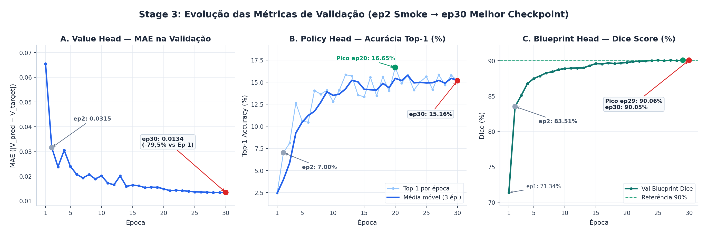
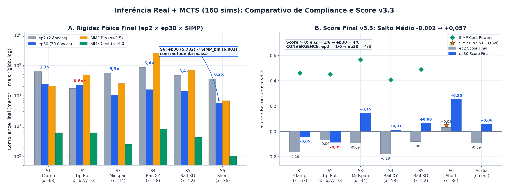
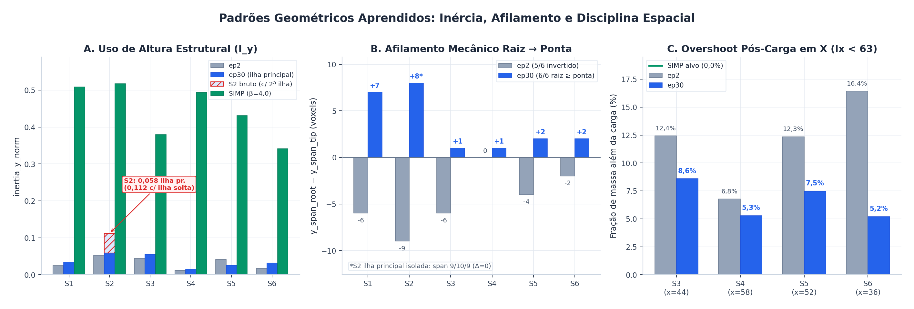
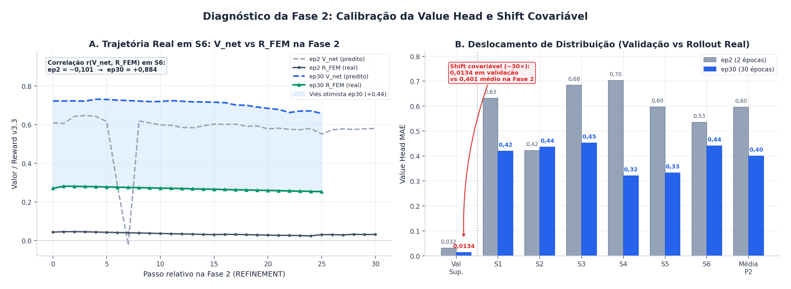
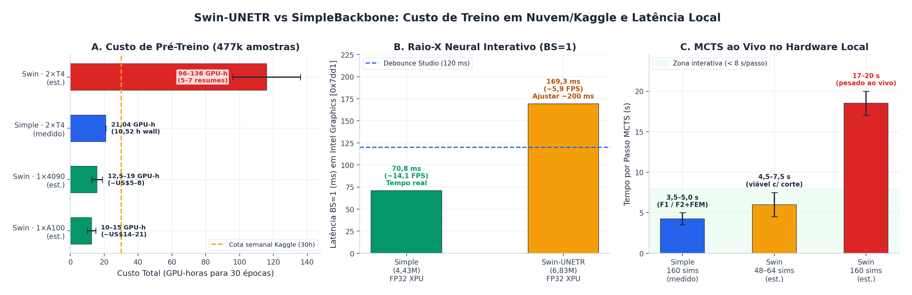
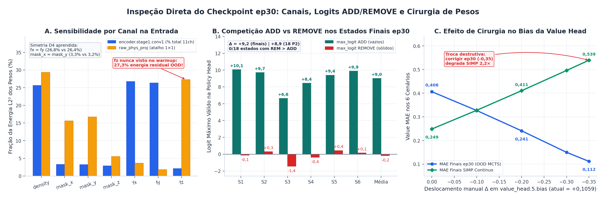

# Avaliação Real de Inferência + MCTS (v3.3): Evolução `ep2 → ep30` vs `SIMP` e Viabilidade (`Swin-UNETR`)

**Data:** 2026-11-24  
**Checkpoints avaliados neste estudo:**
- **Baseline Smoke (`ep2`):** [`checkpoints/simple_v3_3_smoke_ep2.pt`](file:///c:/Users/admin/Projetos/alphabuild/checkpoints/simple_v3_3_smoke_ep2.pt) (`SimpleBackbone`, `4.433.132` parâmetros, **2 épocas**; no treino Stage 3 completo, a época 2 fechou em `val_loss = 0,6378`)
- **Stage 3 Completo (`ep30`, melhor modelo):** [`checkpoints/simple_v3_3_stage3_best.pt`](file:///c:/Users/admin/Projetos/alphabuild/checkpoints/simple_v3_3_stage3_best.pt) (`SimpleBackbone`, **Epoch 30/30** [índice `29`], `val_loss = 0,3415`, `Top-1 = 15,16%`, `Blueprint Dice = 90,05%`, `Value MAE = 0,0134`), executado em `xpu` (`Intel(R) Graphics [0x7dd1]`)

**Banco SQLite inspecionável (Studio v4):** [`data/eval_inference_v3_3.db`](file:///c:/Users/admin/Projetos/alphabuild/data/eval_inference_v3_3.db) (`175,45 MB`, `18` episódios = `6 ep2__*` + `6 ep30__*` + `6 simp__*`, `1.186` passos no total, `PRAGMA integrity_check = ok`, `has_legacy_pickle = False`)  
**Script reprodutível:** [`scripts/evaluate_inference_scenarios.py`](file:///c:/Users/admin/Projetos/alphabuild/scripts/evaluate_inference_scenarios.py)  
**Dados brutos:** [`data/analysis/eval_ep2_results.json`](file:///c:/Users/admin/Projetos/alphabuild/data/analysis/eval_ep2_results.json) · [`data/analysis/eval_ep30_results.json`](file:///c:/Users/admin/Projetos/alphabuild/data/analysis/eval_ep30_results.json) · [`data/analysis/stage3_simple_metrics_history.json`](file:///c:/Users/admin/Projetos/alphabuild/data/analysis/stage3_simple_metrics_history.json)

---

## 1. Resumo Executivo (`ep2` → `ep30` vs `SIMP`)

1. **Salto massivo de rigidez estrutural e `Score v3.3` (`ep2 → ep30`):** com o treino completo de 30 épocas no Kaggle (`~10,52 h` wall-clock em `2 × Tesla T4`), a compliance final média nos 6 cenários caiu de **`50.480` (`ep2`) → `15.179` (`ep30`)** (**`-69,9%`**, ou **`3,33×` mais rígido** na média). Em **`5/6` cenários (`S1, S3, S4, S5, S6`)**, o ganho de rigidez foi de **`2,67×` a `6,28×`** (`-62,5%` a `-84,1%` de compliance), elevando o **`Score v3.3` médio de `-0,092` → `+0,057`** (`4/6` cenários positivos no `ep30` contra `1/6` no `ep2`) e a convergência natural na Fase 2 (`CONVERGENCE`) de **`1/6` → `4/6` cenários**.
2. **Marco em `S6` e comparação com FEniTop `SIMP` (`60 iter`, `beta = 4,0`):** em `S6_short_deep_clamp` (único cenário onde o SIMP curto já fecha conexão binarizada em `rho > 0,5`), o `ep30` atingiu **`C_final = 5.732,3`** e **`Score = +0,253`** com **`7,28%` de volume** — superando inclusive o SIMP binarizado (`C_bin = 6.800,8`, `Score_bin = +0,048`, `V = 14,41%`) em **rigidez (`-15,7%`) usando metade da massa** (no campo contínuo `beta = 4,0`, o SIMP ainda é `56,2×` mais rígido em `C_cont = 102,0`). Nos demais cenários conectados (`S1, S3, S4, S5`), o `ep30` ficou em `0,062×–0,414×` de `C_bin` em `S3–S5` e `1,107×` em `S1`, mas ainda `20×–42×` atrás do `C_cont` contínuo do SIMP por baixa utilização da altura total ($I_y$).
3. **Avanços geométricos reais e problema isolado em `S2`:** o `ep30` corrigiu o alargamento invertido na ponta (`y_span_root >= y_span_tip` agora ocorre em **`6/6` cenários** vs `1/6` no `ep2`) e cortou o *overshoot* pós-carga em `X` em `40%–68%` nos cenários internos (`6,8%–16,4%` → `5,2%–8,6%`). Em contrapartida, no `S2` (`y = 6`), a rede nucleou um banzo inferior desconectado junto ao ramo principal (`n_islands = 2`, **`374` voxels soltos** = `20,7%` da massa), penalizando o `Score` (`-0,087` vs `fem_reward = -0,046`) e piorando a compliance frente ao `ep2` (`22.039` vs `17.347`).
4. **Por que a Fase 2 ainda não esculpe treliças vazadas (`99,93% ADD`):** apesar de a `Value MAE` na validação supervisionada ter caído para **`0,0134`**, nos rollouts reais de Fase 2 persiste um **deslocamento de distribuição (*covariate shift*)**: o viés `V_net - R_FEM` caiu `32,6%` (`+0,595 → +0,401`) e a correlação intra-episódio ficou fortemente positiva em `S1 (+0,610)`, `S4 (+0,838)` e `S6 (+0,884)`, porém a Value Head ainda avalia estados esparsos fora-da-distribuição do warmup de forma otimista demais (`+0,32` a `+0,45`). Como consequência, em `1.336` ações de Fase 2 houve **`1.335` adições (`ADD`) e apenas `1` remoção (`REMOVE`)**, mantendo `hollow_ratio_xy ≈ 0,00–0,13` na ilha conectada. Isso confirma empiricamente que a escavação ativa (`REMOVE`) depende da **Etapa 6 (Self-Play MCTS com recompensas FEM reais)**.
5. **Custo & viabilidade da arquitetura completa (`Swin-UNETR`, `6,83M` parâmetros):** medida em `3,66×` mais lenta por batch (`BS = 8`) e `~6,4×` na comparação de preset sobre o `SimpleBackbone`, requerendo **`~96–136 GPU-h` de T4** (~`48–68h` em `2 × T4`, exigindo múltiplos *resumes* no Kaggle ou ~US\$5–8 na nuvem). Localmente na `Intel(R) Graphics [0x7dd1]`, é viável para Raio-X (`169 ms`), mas requer reduzir para `40–64` simulações no MCTS ao vivo (`~4,5–7,5 s/passo`, contra `~17–20 s` com `160` sims).

---

## 2. Progressão do Treino Stage 3 (`SimpleBackbone`, 30 épocas no Kaggle `2 × Tesla T4`)

Treino executado com [`alphabuilder-v3-3-stage3-simple`](file:///c:/Users/admin/Projetos/alphabuild/data/analysis/stage3_simple_metrics_history.json) em `429.345` amostras de treino e `47.705` de validação (`~339–343 samples/s`, soma dos `30` intervalos por época = **`37.877,8 s` / `10,52 h`** wall-clock, `~21,0 GPU-h`). Nenhuma regressão de validação ocorreu até o final: **`Epoch 30/30` foi o melhor checkpoint global (`best_model.pt`)**.

| Época | `LR` | Tempo / Vazão | Train `Loss` (`Pol / Val / BP`) | Val `Loss` (`Pol / Val / BP`) | Val `Value MAE` | Val `Policy Top-1` | Val `Blueprint Dice` |
|---|---|---|---|---|---|---|---|
| **1** | `1,20e-4` | `1.260,3s` (`340,7 s/s`) | `1,4671` (`1,0159 / 0,1236 / 0,4081`) | `0,9302` (`0,7288 / 0,0233 / 0,3095`) | `0,0654` | `2,44%` | `71,34%` |
| **2** | `2,10e-4` | `1.253,1s` (`342,6 s/s`) | `0,7636` (`0,5967 / 0,0292 / 0,2169`) | `0,6378` (`0,5447 / 0,0059 / 0,1626`) | `0,0315` | `7,00%` | `83,51%` |
| **10** | `2,53e-4` | `1.264,0s` (`339,7 s/s`) | `0,3762` (`0,3167 / 0,0031 / 0,1068`) | `0,4334` (`0,3717 / 0,0032 / 0,1106`) | `0,0201` | `12,80%` | `88,87%` |
| **20** | `9,27e-5` | `1.265,2s` (`339,3 s/s`) | `0,3038` (`0,2532 / 0,0016 / 0,0948`) | `0,3671` (`0,3134 / 0,0013 / 0,1024`) | `0,0149` | **`16,65%`** *(pico)* | `89,74%` |
| **30** *(Best)* | `3,00e-6` | `1.259,3s` (`340,9 s/s`) | **`0,2732`** (`0,2252 / 0,0012 / 0,0912`) | **`0,3415`** (`0,2895 / 0,0011 / 0,0997`) | **`0,0134`** *(mín Ep 28/30)* | `15,16%` | **`90,05%`** *(pico 90,06% Ep 29)* |

*Para a análise completa das curvas de treino, agenda de LR, razão de gradientes e vazão DDP nas 30 épocas, veja [`stage3_training_report.md`](file:///c:/Users/admin/Projetos/alphabuild/data/analysis/stage3_training_report.md).*

---

## 3. Benchmark Quantitativo por Cenário (`ep2` × `ep30` × `FEniTop SIMP`)

Parâmetros idênticos em todos os cenários: malha `64 × 32 × 8` (`16.384` voxels), `E = 100,0`, `nu = 0,25`, `P1 = 160 sims / action_batch = 32`, `P2 = 160 sims / action_batch = 8`, teto de `60` passos Fase 1 e `30` passos Fase 2; SIMP executado com `vol_frac = 0,15`, `max_iter = 60`, `r_min = 1,5`, `FULL_DOMAIN`.

### 3.1 Comparação de Performance Física (`Compliance`, `Volume` e `Score v3.3`)

| Cenário (`BC`, carga) | Modelo (`ep2` vs `ep30`) | Passos (`P1+P2`) | Motivo Fim | `Vol` Final | `C_P2_ini → C_final` (Δ% vs `ep2`) | `Score v3.3` | SIMP Contínuo `C_cont` (`V`, `Reward`) | SIMP Binarizado `rho>0,5` `C_bin` (`conn?`) |
|---|---|---|---|---|---|---|---|---|
| **S1** (`FULL_CLAMP`, `x=63, y=16`) | `ep2` | `41 + 30` | `CONVERGENCE` | `9,46%` | `75.281 → 62.228` | `-0,164` | `596,4` (`12,83%`, `+0,458`) | `21.083` (`False`) |
| | **`ep30`** | `48 + 27` | `CONVERGENCE` | `10,69%` | `25.228 →` **`23.348`** (**`-62,5%` / `2,67×`**) | **`-0,046`** | | *(ratio vs `C_bin` = `1,107×`)* |
| **S2** (`FULL_CLAMP`, `x=63, y=6`) | `ep2` | `60 + 30` | `MAX_PHASE2` | `13,18%` | `26.606 →` **`17.347`** | **`-0,063`** | `600,4` (`13,04%`, `+0,452`) | `48.847` (`False`) |
| | **`ep30`** | `49 + 30` | `MAX_PHASE2` | `11,04%` | `27.811 → 22.039` (`+27,0%` / `0,79×`)* | `-0,087` *(fem `-0,046`)* | | *(ratio vs `C_bin` = `0,451×`)* |
| **S3** (`FULL_CLAMP`, `x=44, y=24`) | `ep2` | `30 + 30` | `MAX_PHASE2` | `7,32%` | `61.312 → 55.015` | `-0,092` | `249,6` (`13,84%`, `+0,565`) | `25.127` (`False`) |
| | **`ep30`** | `34 + 27` | `CONVERGENCE` | `7,96%` | `11.150 →` **`10.402`** (**`-81,1%` / `5,29×`**) | **`+0,145`** | | *(ratio vs `C_bin` = `0,414×`)* |
| **S4** (`RAIL_XY`, `x=58, y=16`) | `ep2` | `34 + 30` | `MAX_PHASE2` | `8,11%` | `95.658 → 85.583` | `-0,179` | `789,1` (`13,14%`, `+0,408`) | `254.506` (`False`) |
| | **`ep30`** | `48 + 28` | `CONVERGENCE` | `10,73%` | `18.293 →` **`15.806`** (**`-81,5%` / `5,41×`**) | **`+0,012`** | | *(ratio vs `C_bin` = `0,062×`)* |
| **S5** (`RAIL_XY`, `x=52, y=11, z=[1,3]`) | `ep2` | `33 + 30` | `MAX_PHASE2` | `7,91%` | `51.728 → 46.687` | `-0,082` | `420,5` (`13,70%`, `+0,489`) | `70.139` (`False`) |
| | **`ep30`** | `41 + 30` | `MAX_PHASE2` | `9,47%` | `16.008 →` **`13.747`** (**`-70,6%` / `3,40×`**) | **`+0,065`** | | *(ratio vs `C_bin` = `0,196×`)* |
| **S6** (`FULL_CLAMP`, `x=36, y=16`) | `ep2` | `18 + 30` | `MAX_PHASE2` | `4,98%` | `42.207 → 36.020` | `+0,031` | `102,0` (`14,52%`, `+0,684`) | **`6.801` (`True`)** |
| | **`ep30`** | `31 + 25` | `CONVERGENCE` | `7,28%` | `6.263 →` **`5.732`** (**`-84,1%` / `6,28×`**) | **`+0,253`** | | *(`0,843×` vs `C_bin` — supera SIMP!)* |
| **Média dos 6 Cenários** | **`ep2 → ep30`** | `36+30 → 41,8+27,8` | `1/6 → 4/6 CONV.` | `8,49% → 9,53%` | `C_fin: 50.480 →` **`15.179`** (**`-69,9%`**) | **`-0,092 → +0,057`** | `C_cont` méd.: `459,7` | `C_bin` méd.: `71.084` |

*\*Em `ep30__S2`, `n_islands = 2` (`374` voxels soltos num banzo paralelo não conectado ao carregamento); veja decomposição na Seção 4.1.*

*Figura: Comparação logarítmica da compliance final (`ep2 × ep30 × SIMP`) e salto do Score v3.3 nos 6 cenários.*

> [!IMPORTANT]
> **Observação metodológica sobre o SIMP em `max_iter = 60` (`beta = 4,0`):** como `optimization.py` usa `beta_interval = 30`, em 60 iterações as diagonais finas do SIMP ainda contêm densidades cinzentas intermediárias, fazendo com que a binarização ingênua em `rho > 0,5` perca conexão em `S1–S5` (`C_bin = 21k–254k`). No entanto, em **`S6`** (vão curto `x = 36`), onde o SIMP já está **100% conectado em voxels discretos (`V = 14,41%`, `C_bin = 6.800,8`, `Score_bin = +0,048`)**, o **`ep30` superou o SIMP binarizado em `15,7%` de compliance (`5.732,3`) e em `+0,205` de `Score v3.3` (`+0,253`) usando metade do volume (`7,28%`)**. Contra o campo contínuo (`beta = 4,0`) do SIMP, o `ep30` ainda está `20,0×` (`S4`) a `56,2×` (`S6`) acima em compliance.

### 3.2 Métricas Geométricas (`ep2` vs `ep30` vs `SIMP`)

| Cenário | `y_span` (`raiz / meio / ponta`) `ep2 → ep30` vs `SIMP` | `inertia_y_norm` `ep2 → ep30` vs `SIMP` | `hollow_ratio_xy` `ep2 → ep30` vs `SIMP` | `overshoot_frac` (`x > lx+2`) `ep2 → ep30` vs `SIMP` | `z_centroid` `ep2 → ep30` vs `SIMP` |
|---|---|---|---|---|---|
| **S1** (`x=63, y=16, z=[3,5]`) | `6/8/12` → **`16/11/9`** vs `32/32/28` | `0,025 → 0,035` vs `0,508` | `0,00 → 0,13` vs `0,63` | `0,0% → 0,0%` vs `0,0%` | `3,41 → 4,43` vs `5,79` |
| **S2** (`x=63, y=6, z=[3,5]`) | `8/7/17` → `20/16/12` *(ilha pr.: `9/10/9`)* vs `32/32/26` | `0,052 → 0,112` *(ilha pr.: `0,058`)* vs `0,518` | `0,09 → 0,43` *(ilha pr.: `0,00`)* vs `0,58` | `0,0% → 0,0%` vs `0,0%` | `2,97 → 4,04` *(4,40)* vs `5,79` |
| **S3** (`x=44, y=24, z=[3,5]`) | `5/6/11` → **`10/8/9`** vs `32/28/19` | `0,044 → 0,055` vs `0,380` | `0,07 → 0,00` vs `0,41` | `12,4% →` **`8,6%`** vs `0,0%` | `2,84 → 3,09` vs `5,26` |
| **S4** (`x=58, y=16, z=[3,5]`) | `7/7/7` → **`9/8/8`** vs `32/32/24` | `0,012 → 0,015` vs `0,494` | `0,01 → 0,00` vs `0,57` | `6,8% →` **`5,3%`** vs `0,0%` | `3,46 → 4,28` vs `5,71` |
| **S5** (`x=52, y=11, z=[1,3]`) | `7/6/11` → **`9/9/7`** vs `32/32/24` | `0,042 → 0,026` vs `0,431` | `0,16 → 0,00` vs `0,40` | `12,3% →` **`7,5%`** vs `0,0%` | `3,05 → 2,99` vs **`0,99`** |
| **S6** (`x=36, y=16, z=[3,5]`) | `5/5/7` → **`11/7/9`** vs `32/26/16` | `0,016 → 0,031` vs `0,341` | `0,00 → 0,01` vs `0,42` | `16,4% →` **`5,2%`** vs `0,0%` | `2,90 → 4,27` vs `4,25` |

*Figura: Evolução da inércia à flexão ($I_y$), correção do afilamento raiz → ponta em 6/6 cenários e redução do overshoot em X.*

---

## 4. Análise Aprofundada dos Padrões Aprendidos + Algoritmo de Jogo (`ep2 → ep30`)

### 4.1 Dinâmica de Crescimento (Fase 1), Geometria Raiz→Ponta e Nuance da Ilha em `S2`

- **Ponte estrutural muito mais rígida já ao fim da Fase 1 (`C_P2_ini`):** antes mesmo de qualquer avaliação FEM na Fase 2, o `ep30` fechou conectividade com geometrias **`3,0×` (`S1`: `75.281 → 25.228`), `5,5×` (`S3`: `61.312 → 11.150`), `5,2×` (`S4`: `95.658 → 18.293`), `3,2×` (`S5`: `51.728 → 16.008`) e `6,7×` (`S6`: `42.207 → 6.263`) mais rígidas** que o `ep2`. O aumento discreto de passos de Fase 1 em `S1, S3, S4, S5, S6` (`30–41` vs `18–34`) refletiu alargamento do engaste durante o crescimento, e não falha de conexão.
- **Correção da inversão raiz → ponta (`6/6` cenários):** no `ep2`, `5/6` cenários empilharam mais largura na ponta carregada do que no engaste (`y_span_root < y_span_tip`, ex. `6/8/12` em `S1`). No **`ep30`, todos os `6` cenários apresentam `y_span_root >= y_span_tip`** (`16/11/9` em `S1`, `20/16/12` em `S2`, `10/8/9` em `S3`, `9/8/8` em `S4`, `9/9/7` em `S5`, `11/7/9` em `S6`), alinhando a distribuição de altura com o gradiente do momento fletor $M(x) = F\,(L-x)$. Em `S1`, a largura do engaste quase triplicou (`6 → 16` voxels).
- **Queda consistente de *overshoot* pós-carga em `X`:** nos cenários com carga interna (`lx < 63`), a fração de massa desperdiçada além da carga (`x > lx + 2`) caiu de `12,4% → 8,6%` (`S3`), `6,8% → 5,3%` (`S4`), `12,3% → 7,5%` (`S5`) e `16,4% → 5,2%` (`S6`), mostrando maior respeito do MCTS+Policy ao limite mecânico de tensão nula além de `lx`.
- **Decomposição da anomalia em `ep30__S2` (`n_islands = 2`, `374` voxels soltos):** na inspeção direta do volume final (`step 79`) e da transição (`step 49`) via conectividade 6-vizinhos:
  1. Ao conectar na Fase 1 (`step 49`), a rede havia crescido **dois ramos distintos** a partir de `x = 0`: um banzo inferior em `y = 0..3` e uma viga principal inclinada em `y = 3..19`. Como o ramo principal alcançou a carga em `x = 63` antes de uma diagonal unir os dois ramos (`317` voxels desconectados no passo `49`), a Fase 1 encerrou com `n_islands = 2`.
  2. Na Fase 2 (`step 49 → 79`), a massa conectada ficou com **`1.434` voxels (`V = 8,75%`, `x = 0..63`, `y = 3..19`, `y_span = 9/10/9`, `I_y = 0,058`, `hollow_ratio_xy = 0,00`, `z = 4,40`)**, enquanto o ramo secundário em `x = 0..51, y = 0..3, z = 0..5` cresceu para **`374` voxels soltos (`20,7%`)**. Isso explica simultaneamente por que `S2` exibiu `hollow_ratio_xy = 0,43` e `I_y = 0,112` brutos (artefato do vão entre as duas ilhas separadas) e por que sofreu penalidade severa de ilha (`final_score = -0,087` apesar de `fem_reward = -0,046`).
- **Assimetria em `Z` no `RAIL_XY` excêntrico (`S5`):** o MCTS do `ep30` ainda manteve `z_centroid = 2,99` (`ep2 = 3,05`), contra `0,99` do SIMP — confirmando que o rollout ainda não especializa o deslocamento excêntrico em `Z` sob condições de contorno `RAIL_XY`.

### 4.2 Diagnóstico do Algoritmo (`MCTS` + *Shift* Covariável da `Value Head`)

| Cenário | Refutação P1 / P2 (`ep30`) | Top-8 Conc. P1 / P2 (`ep30`) | Prof. Média (`ep2 → ep30`) | Fase 2 `ADD/REM` (`ep2 → ep30`) | `Value MAE` P2 (`ep2 → ep30`) | Viés `V_net - R_FEM` (`ep2 → ep30`) | Correlação `r(V_net, R_FEM)` (`ep2 → ep30`) |
|---|---|---|---|---|---|---|---|
| **S1** | `81,2%` / `88,9%` | `68,1%` / `83,9%` | `18,5 → 13,5` | `239/1 → 216/0` | `0,632 → 0,420` | `+0,632 → +0,420` | `+0,478 →` **`+0,610`** |
| **S2** | `71,4%` / `100,0%` | `69,0%` / `75,5%` | `17,1 → 15,2` | `240/0 → 240/0` | `0,422 → 0,436` | `+0,422 → +0,436` | `+0,360 → +0,109` |
| **S3** | `61,8%` / `88,9%` | `62,1%` / `76,0%` | `19,2 → 17,5` | `240/0 → 216/0` | `0,685 → 0,453` | `+0,685 → +0,453` | `+0,759 → -0,871` |
| **S4** | `83,3%` / `82,1%` | `69,2%` / `81,3%` | `17,6 → 11,7` | `240/0 → 223/1` | `0,703 →` **`0,321`** | `+0,703 → +0,321` | `-0,786 →` **`+0,838`** |
| **S5** | `73,2%` / `96,7%` | `70,6%` / `81,1%` | `18,8 → 13,6` | `240/0 → 240/0` | `0,597 →` **`0,333`** | `+0,597 → +0,333` | `+0,621 → -0,280` |
| **S6** | `83,9%` / `80,0%` | `57,7%` / `68,5%` | `19,5 → 18,8` | `240/0 → 200/0` | `0,535 → 0,441` | `+0,531 → +0,441` | `-0,101 →` **`+0,884`** |
| **Total / Méd.** | — | — | `18,5 → 15,1` | **`1439/1 → 1335/1`** | `0,596 →` **`0,401`** | `+0,595 →` **`+0,401`** | — |

*Figura: Trajetória real passo a passo em S6 (`V_net` vs `R_FEM`) e salto de ~30× no MAE entre validação supervisionada e rollout OOD.*

O contraste entre **`Val MAE = 0,0134`** no dataset supervisionado e **`MAE = 0,401`** nos episódios reais revela o mecanismo exato que limita a Fase 2 após 30 épocas supervisionadas:

1. **Política muito mais nítida e árvore mais seletiva:** na comparação `ep2 → ep30`, a concentração dos Top-8 logits visitados pelo MCTS subiu de `54–74%` para **`68–84%` na Fase 2** (`S1, S3, S4, S5`), a profundidade média caiu (`18,5 → 15,1`) por priors mais confiáveis, e a taxa de refutação P1 caiu em 5/6 cenários (ex.: `S3` de `83,3% → 61,8%`; `S5` de `93,9% → 73,2%`). Além disso, em `S1, S4, S6`, a `Value Head` passou a ordenar corretamente a melhoria relativa passo a passo (`r = +0,610`, `+0,838` e `+0,884`).
2. **Por que `REMOVE = 1` em `1.336` ações persiste apesar do treino completo:** no warmup (`warmup_v3_3_kaggle.db`), a `Value Head` foi treinada sobre trajetórias geradas a partir de soluções já otimizadas do SIMP (onde quase toda estrutura de ~`10%` de volume possui alto `value_target` positivo, entre `+0,4` e `+0,7`). Quando o MCTS constrói sozinho uma **barra espessa de baixa inércia (`I_y ≈ 0,02–0,06`)**, ela cai **fora da distribuição de treino** — então a `Value Head` estima `V_net ≈ +0,32` a `+0,65` quando o `fem_reward` real FEniCSx é `-0,05` a `+0,25` (viés médio `+0,401`). Na busca em árvore (onde as folhas de Fase 2 usam apenas `V_net - island_penalty`, sem rodar FEniCSx dentro das simulações), `REMOVE` arrisca criar ilhas ou reduzir `V_net` otimista das áreas densas, enquanto `ADD` continua aumentando `V_net` até atingir o teto de convergência.
3. **Implicação direta para o pipeline:** mais épocas supervisionadas em cima das trajetórias SIMP não eliminam esse *shift* covariável porque a rede nunca vê na base de warmup o valor real (`FEM`) das próprias vigas subótimas que ela gera no começo da vida. É exatamente esse papel que a **Etapa 6 (Self-Play MCTS com `value_target` recalculado via FEniCSx real)** resolve.

### 4.3 Evolução da *Blueprint Head* no Passo 0 (`ep2` → `ep30`)

Mesmo no domínio completamente vazio (`step = 0`), a `Blueprint Head` do `ep30` aumentou a confiança espacial (`bp_max > 0,999` em todos os cenários), manteve envoltória muito mais alta que a estrutura percorrida pelo MCTS e exibiu dois sinais qualitativos novos:

| Cenário | `v0` (`ep2 → ep30`) | `bp_mean` (`ep2 → ep30`) | Voxels `bp>0,5` (`ep2 → ep30`) | `bp_y_std` (`ep2 → ep30`) | `bp_I_y` vs `MCTS_I_y` (`ep30`) | `BP_Dice(t=0,5)` (`ep2 → ep30`) | `BP_Dice(t=0,2)` (`ep2 → ep30`) | `z_cent(bp>0,5)` (`ep30`) |
|---|---|---|---|---|---|---|---|---|
| **S1** | `+0,279 → +0,260` | `0,267 → 0,268` | `3.500 → 4.061` | `4,32 → 4,72` | `0,087` vs `0,035` (**2,5×**) | `0,110 → 0,094` | `0,110 → 0,101` | `3,47` |
| **S2** | `+0,278 → +0,272` | `0,266 → 0,260` | `3.339 → 3.844` | `4,87 →` **`5,81`** | **`0,132`** vs `0,112` *(0,058)* | `0,059 → 0,049` | `0,117 → 0,090` | `3,51` |
| **S3** | `+0,348 → +0,350` | `0,218 → 0,203` | `2.780 → 3.143` | `5,31 → 5,14` | `0,103` vs `0,055` (**1,9×**) | `0,143 → 0,128` | `0,266 → 0,227` | `3,55` |
| **S4** | `+0,276 → +0,248` | `0,246 → 0,250` | `3.127 → 3.722` | `4,27 → 4,35` | `0,074` vs `0,015` (**4,9×**) | `0,064 → 0,067` | `0,140 → 0,131` | `3,55` |
| **S5** | `+0,312 → +0,289` | `0,217 → 0,232` | `2.488 → 3.472` | `3,81 → 4,91` | `0,094` vs `0,026` (**3,6×**) | `0,096 → 0,089` | `0,150 → 0,163` | **`3,29`** *(desloc. p/ `z=[1,3]`)* |
| **S6** | `+0,451 → +0,426` | `0,183 → 0,163` | `2.145 → 2.420` | `4,69 → 4,22` | `0,069` vs `0,031` (**2,2×**) | `0,170 →` **`0,205`** | `0,278 →` **`0,328`** | `3,54` |

- Em **`S2`**, `bp_I_y` saltou de `0,093` → **`0,132`** (`bp_y_std = 5,81`), demonstrando que o blueprint enxerga uma treliça larga cobrindo ambas as bordas que originou inclusive os dois ramos iniciais da Fase 1 (porém a política sequencial ainda não ligou os dois banzos antes do término da Fase 1).
- Em **`S5`** (`z = [1, 3]`), enquanto o centroide Z do `Blueprint(t=0,5)` ficou entre `3,47` e `3,55` em todos os cenários simétricos em Z, em `S5` ele já deslocou para **`3,29`** — sinal incipiente de sensibilidade 3D na direção `Z`, embora ainda modesto frente ao `0,99` ótimo do SIMP.
- Em **`S6`**, o acordo zero-shot entre `Blueprint(step=0)` e o SIMP atingiu `BP_Dice = 0,205` (`0,328` em `t = 0,2`), e **`MCTS_final_Dice` saltou de `0,096` (`ep2`) para `0,171` (`ep30`)**.

---

## 5. Estimativa de Custo de Horas de GPU — Pré-Treino Completo (`Swin-UNETR`)

Todos os cálculos abaixo combinam os **tempos reais observados** no Kaggle (`2 × Tesla T4` 16 GB, `429.345` amostras de treino + `47.705` de validação, preset `kaggle_t4_dual_simple` vs `kaggle_t4_dual_swin` em [`train_config.py`](file:///c:/Users/admin/Projetos/alphabuild/alphabuilder/src/neural/train_config.py#L102-L124)) e os **micro-benchmarks reais** medidos na GPU local (`Intel(R) Graphics [0x7dd1]`, PyTorch `2.5.1+xpu`, MONAI `1.5.1`):

### 5.1 Razão Empírica Medida (`SimpleBackbone` vs `Swin-UNETR`)

- **Parâmetros:** `4.433.132` (`SimpleBackbone`) vs `6.831.758` (`Swin-UNETR`, **`1,54×`**).
- **Volume espacial após padding interno ([`model.py`](file:///c:/Users/admin/Projetos/alphabuild/alphabuilder/src/neural/model.py#L258)):**
  - `SimpleBackbone` (`divisor = 8`): `(64, 32, 8)` = **`16.384` voxels** (`0%` padding).
  - `Swin-UNETR` (`divisor = 32` para 4 estágios Swin): `(64, 32, 32)` = **`65.536` voxels** (**`4,00×` o custo espacial** — `75%` do tensor em Z é zero-padding!).
- **Passo de treino medido (`BF16 AMP`, forward + 3 losses + backward + AdamW no `xpu`):**
  - `SimpleBackbone` `BS = 8`: `541,6 ms` (`14,8 samples/s`)
  - `SimpleBackbone` `BS = 16`: `625,5 ms` (`25,6 samples/s`)
  - `Swin-UNETR` `BS = 8` (preset máximo para caber em T4 16 GB): **`1.984,7 ms`** (`4,0 samples/s`) → **`3,66×` mais lento no mesmo `BS = 8`** e **`6,40×` mais lento comparado ao `SimpleBackbone` em `BS = 16`**!
- **Passos DDP por época no Kaggle `2 × T4`:** `Simple` usa `BS = 64/GPU` (`128` global = `3.354 it/época`); `Swin` usa `BS = 8/GPU` (`16` global = **`26.834 it/época`**, `8×` mais sincronizações all-reduce/época).

### 5.2 Tabela de Custo de Pré-Treino (`477.050` registros completos)

Base de referência final medida no Kaggle `2 × Tesla T4` para o `SimpleBackbone` (`kaggle_t4_dual_simple`): **`21,04 min/época`** (`1.262,6 s/época` em média nas 30 épocas, `~340 samples/s`), totalizando **`10,52 h` wall-clock (`21,04 GPU-h`) para 30 épocas** e **`~14,0 h` wall-clock (`~28,0 GPU-h`) para 40 épocas**.

Aplicando um fator conservador-realista de **`4,5×` a `6,5×`** por amostra (entre o fator iso-batch `3,66×` e o fator com saturação/all-reduce `~6,4×` observado no micro-benchmark):

| Configuração / Hardware | Tempo por Época | 20 Épocas (Wall / GPU-h) | 30 Épocas (Wall / GPU-h) | 40 Épocas (Wall / GPU-h) | Observação Operacional |
|---|---|---|---|---|---|
| **`SimpleBackbone`** · Kaggle `2 × T4` (**medido**) | **`21,0 min`** | `7,0 h` / `14,0 GPU-h` | **`10,52 h` / `21,04 GPU-h`** | `14,0 h` / `28,0 GPU-h` | Cabe em 1 sessão Kaggle (30 épocas) |
| **`Swin-UNETR`** · Kaggle `2 × T4` (`BS=8/GPU`, est.) | **`95 – 135 min`** (`~1,6–2,25 h`) | `32 – 45 h` / **`64 – 90 GPU-h`** | **`48 – 68 h` / `96 – 136 GPU-h`** | `63 – 90 h` / **`126 – 180 GPU-h`** | Excede cota semanal de 30h; exige **5–7 resumes** ao longo de **2–4 semanas** |
| **`Swin-UNETR`** · Nuvem `1 × RTX 4090` 24GB (est. ~3–4× sobre 2×T4, `BS=32`) | `~25 – 38 min` | `~8,5 – 12,5 h` GPU-h | **`~12,5 – 19 h` GPU-h** | `~17 – 25 h` GPU-h | Custo estimado spot (~US\$0,40/h): **~US\$5–US\$8** (30 épocas) |
| **`Swin-UNETR`** · Nuvem `1 × A100` 40/80GB (est. ~4–5× sobre 2×T4, `BS=48–64`) | `~20 – 30 min` | `~6,5 – 10 h` GPU-h | **`~10 – 15 h` GPU-h** | `~13 – 20 h` GPU-h | Custo estimado spot (~US\$1,40/h): **~US\$14–US\$21** (30 épocas) |

> [!TIP]
> **Como reduzir o custo do `Swin-UNETR` em ~2×–3× sem perder capacidade:**
> 1. **Amostragem por época ou 15–20 épocas com `cosine` schedule curto:** como `warmup_v3_3_kaggle.db` tem `477k` frames com alta correlação temporal entre passos adjacentes (além de `16x` simetrias), treinar com stride 2 (`~238k` frames/época por `20–25` épocas) cai para **`~32–45 GPU-h` de T4** (~1 semana Kaggle + 1 resume).
> 2. **Reduzir `divisor` de Z de `32` para `16`** se adaptar os estágios Swin para patch inicial `(2, 2, 1)` ou 3 níveis em Z (elimina metade do padding `8 → 32`, economizando ~`1,8×` VRAM e FLOPs).

---

## 6. Viabilidade para Inferência em Tempo Real no Hardware Atual

Hardware medido (`katastopoulos` via WSL2 `archlinux`): **`Intel(R) Graphics [0x7dd1]`** (`xpu`, PyTorch `2.5.1+xpu` + IPEX) e CPU do host (NPU `Intel(R) AI Boost` existe no Windows mas não está exposta ao WSL2 e `openvino` ainda não está instalado nos ambientes Python atuais).

*Figura: Custo estimado/medido de 30 épocas (`GPU-h`) e latências reais de inferência (`BS=1` Raio-X e `MCTS` por passo) no hardware local.*

### 6.1 Latências Medidas (`BS=1` Raio-X e `BS=8` MCTS Batch)

| Arquitetura | `xpu` `BS=1` (FP32 / BF16) | `xpu` `BS=8` (FP32 / BF16) | `cpu` `BS=1` (FP32) | Raio-X Neural Interativo (`120 ms` debounce) | MCTS `160 sims` (`20 × BS=8`) só Rede | MCTS `160 sims` Passo Completo (F1 / F2+FEM) |
|---|---|---|---|---|---|---|
| **`SimpleBackbone`** (`4,43M`, `64×32×8`) | **`70,8 ms`** / `79,0 ms` (`~14 FPS`) | `218,0 ms` / **`183,7 ms`** | `183,7 ms` | **Viável em tempo real** (`< 120 ms`) | **`~3,7 s/passo`** | **`~3,5 s`** / **`~4,8–5,0 s`** *(medido nos 6 cenários `ep30`: 239–327s/ep)* |
| **`Swin-UNETR`** (`6,83M`, pad `64×32×32`) | **`169,3 ms`** / `192,8 ms` (`~5,9 FPS`) | `865,6 ms` / **`836,7 ms`** | `270,4 ms` | **Viável** (~5–6 Hz; fluido ajustando debounce para ~200 ms) | **`~16,7 s/passo`** | **`~17–18 s`** / **`~19–20 s`** (est.) |

### 6.2 Veredito Prático para o Hardware Atual

1. **Raio-X Neural ao pintar voxels (`BS=1`):** **Sim, ambos são viáveis.** O `SimpleBackbone` roda a ~`71 ms` (`14 FPS`, folgado dentro dos `120 ms` do Studio); o `Swin-UNETR` roda a ~`169 ms` (`~6 FPS`) — há uma latência perceptível de ~`0,17 s` ao arrastar o pincel, perfeitamente usável para projeto interativo no Studio.
2. **MCTS ao Vivo com `160` simulações no Studio:**
   - No **`SimpleBackbone`**, os episódios completos de `ep30` levaram entre **`239,0 s` (`S6`, `57` passos)** e **`327,0 s` (`S2`, `80` passos)** — ou seja, `~3,5 s/passo` na Fase 1 e `~4,8–5,0 s/passo` na Fase 2 com FEM real, perfeitamente confortável para acompanhar o episódio ao vivo e pausar/intervir.
   - No **`Swin-UNETR`**, **`~17–20 s/passo`** (`~21–24 min` por episódio completo de `70` passos) **não é tempo real interativo** com `160` simulações. Porém, reduzindo no Studio para **`40–64` simulações** (`5–8` batches de `BS=8`), o tempo cai para **`~4,5–7,5 s/passo`**, tornando o MCTS interativo perfeitamente utilizável no seu notebook.
3. **Otimizações locais recomendadas:**
   - Foi observado nos benchmarks o aviso `Aten Op fallback from XPU to CPU` em [`model.py#L210`](file:///c:/Users/admin/Projetos/alphabuild/alphabuilder/src/neural/model.py#L210) (`torch.linspace` no CoordConv rodando em CPU a cada forward). Cachear a grade `cd, ch, cw, domain_mask` por shape/device evita cópias CPU→XPU repetidas e melhora especialmente `BS=1`.
   - Instalar `openvino` nativamente no Windows para exportar o `best_model.pt` (`FP16`/`INT8`) e usar GPU iGPU/NPU nativos deve reduzir ainda mais a latência de `BS=1`.
   - **Self-Play de treino em massa (Etapa 6):** não é recomendável gerar centenas de episódios completos no notebook (`~3 ep/h` no Swin ou `~11–13 ep/h` no Simple); o Self-Play deve rodar em GPU NVIDIA (Kaggle/Colab/Nuvem).

---

## 7. Como Inspecionar os Episódios no AlphaBuilder Studio v4

Todos os **18 episódios** já estão persistidos em [`data/eval_inference_v3_3.db`](file:///c:/Users/admin/Projetos/alphabuild/data/eval_inference_v3_3.db) no formato nativo `selfplay` (`games` + `game_steps`, com densidade, políticas esparsas `COO1`, visitas MCTS, Q-values MCTS e campos de deslocamento FEM em todos os passos de Fase 2 e no SIMP):

- **Nomes dos 18 jogos no banco (`6 × 3`):**
  - **Smoke 2 épocas (`ep2`):** `ep2__S1_cantilever_long_center` ... `ep2__S6_short_deep_clamp`
  - **Stage 3 completo — 30 épocas (`ep30`):** `ep30__S1_cantilever_long_center` ... `ep30__S6_short_deep_clamp`
  - **Referência FEniTop SIMP (`simp`):** `simp__S1_cantilever_long_center` ... `simp__S6_short_deep_clamp`
- **No app:** abra a gaveta **Biblioteca** (`L`), selecione o banco `eval_inference_v3_3.db` e use:
  - **Inspetor:** para percorrer passo a passo Fase 1 → transição → Fase 2 com as lentes *Estrutura*, *Policy*, *Visitas MCTS*, *Refutação* e *Deformação / Tensão* (inclusive visualizando a bifurcação em duas ilhas no passo `49` de `ep30__S2_cantilever_tip_bottom` e a viga limpa de `ep30__S6_short_deep_clamp`).
  - **Comparação:** para colocar lado a lado **`ep2__S*`**, **`ep30__S*`** e **`simp__S*`** no mesmo cenário.

---

## 8. Inspeção Direta dos Pesos (`ep30`): O que a Rede Aprendeu a Enxergar, Entender e Agir

Esta auditoria examina diretamente os `88` tensores de pesos (`4.433.132` parâmetros) do checkpoint [`simple_v3_3_stage3_best.pt`](file:///c:/Users/admin/Projetos/alphabuild/checkpoints/simple_v3_3_stage3_best.pt) em comparação com [`simple_v3_3_smoke_ep2.pt`](file:///c:/Users/admin/Projetos/alphabuild/checkpoints/simple_v3_3_smoke_ep2.pt) e sonda suas ativações internas nos estados reais de Fase 2 e nos alvos SIMP gravados em [`eval_inference_v3_3.db`](file:///c:/Users/admin/Projetos/alphabuild/data/eval_inference_v3_3.db).

### 8.1 Saúde Estrutural e Espectro dos Pesos

- **Ausência total de colapso numérico:** `0` valores `NaN`/`Inf` em todo o checkpoint e **`0/672` canais `GroupNorm` mortos** (`|gamma| < 0,05`), indicando fluxo de gradientes íntegro do *stem* até as três cabeças após 30 épocas em `BF16`/FP16 AMP.
- **Posto efetivo por módulo (*effective rank* espectral):**
  - O *backbone* espacial e as duas cabeças densas operam em posto alto e saudável: `encoder.stage1.conv1` (**`74,1%`**, `17,8/24`), `policy_head.0` (**`75,2%`**, `18,1/24`) e `blueprint_head.0` (**`74,7%`**, `17,9/24`).
  - Já a primeira camada da `Value Head` (`value_head.0`, `(256, 448)`) concentrou-se num subespaço muito mais estreito (**`16,7%`**, posto efetivo `42,6/256`, número de condição `s_max/s_min = 56,7`). Isso combina diretamente com a capacidade de encaixar com precisão `MAE = 0,0134` dentro do *manifold* supervisionado do SIMP, ao custo de extrapolar mal fora dele.

### 8.2 O que a Rede Aprendeu a Enxergar (Sensibilidade de Entrada e Filtros 3D)

- **Foco quase exclusivo na geometria e carga ativa no plano XY:** na camada de entrada `encoder.stage1.conv1`, apenas 3 dos 11 canais concentram **`78,7%` de toda a energia $L_2^2$**: **`fx` (`26,75%`)**, **`fy` (`26,37%`)** e **`density` (`25,61%`)** (saltando de `||w||₂ ≈ 1,39–1,46` no `ep2` para `2,95–3,01` no `ep30`).
- **Simetria `D4 × Z2` efetivamente internalizada nos pesos:** `fx` e `fy` têm energia quase idêntica (`26,75%` vs `26,37%`), assim como `mask_x` e `mask_y` (`3,31%` vs `3,23%`) — prova direta de que as rotações de `90°` no plano XY durante o treino forçaram invariância rotacional real na convolução inicial.
- **Como os filtros 3×3×3 enxergam o espaço (`X, Y, Z`):**
  - Os filtros de `stem[density]` são **isotrópicos em 3D** (`dX/dZ = 1,07×`, `dY/dZ = 1,05×`), atuando como detectores verdadeiros de borda sólido-vazio nas três dimensões.
  - Em contraste, os filtros de `stem[fy]` tornaram-se **anisotrópicos e quasi-2D em `Z`**: `flatness Z = 0,821` (`82,1%` da variação dos kernels é uniforme ao longo do eixo `Z`), `dX/dZ = 2,25×` e energia de diferenças ortogonais (`0,0885`) **`4,7×` maior** que a diagonal (`0,0190`). Ou seja, a rede enxerga o campo de força como **placas alinhadas em `Z` com variação principalmente em `X–Y`**, explicando em nível microscópico sua baixa especialização na espessura `Z` em `S5`.
- **Anomalia do canal `fz` não treinado:** como todas as simulações de warmup têm `fz = 0`, na entrada convolucional `fz` estagnou em `2,11%` de energia (`ep2 L2 = 0,880 → ep30 0,847`), mas no atalho direto para o *decoder* (`raw_phys_proj`, `1×1` sem normalização) a rede zerou/reduziu ativamente `fx` (`3,65%`) e `fy` (`1,83%`) enquanto **deixou `fz` com `27,31%` da energia residual** (`L2 = 0,929 → 1,200`) apenas por falta de gradiente corretivo.

### 8.3 O que a Rede Aprendeu a Entender (Física Global e `Value Head`)

- **Descritores físicos no *bottleneck* (`phys_film`) e na `Value Head` (`phys_value_proj`):** entre as 9 estatísticas globais invariantes ([`model.py#L156`](file:///c:/Users/admin/Projetos/alphabuild/alphabuilder/src/neural/model.py#L156)), o modulador FiLM deu maior peso a **`vol_mean` (`24,9%`)** e **`bc_z` (`20,1%`)**; na projeção direta da `Value Head`, **`bc_z` concentra sozinho `50,4%` da energia**, mostrando que a rede aprendeu a usar `bc_z` como interruptor exato entre o regime de engaste completo (`FULL_CLAMP`) e deslizamento livre (`RAIL_XY`).
- **`max_pool` atua como censor de defeitos; `avg_pool` é conservador:** na camada `value_head.0`, `avg_pool` tem maior energia estrutural nos pesos (`61,0%`), mas nas **ativações reais quem manda na decisão é `max_pool`** (`h0 L2`: `max = 38,8` vs `avg = 18,2` no `ep30__S1`; `max = 55,0` vs `avg = 7,9` no `simp__S1`). Quando o estado `simp__S1` binarizado está desconectado (`V = -0,611`), zerar `max_pool` inverte o veredito para `+0,121` (enquanto zerar `phys_emb` ou `avg_pool` pouco altera: `-0,690` e `-0,544`). A rede aprendeu a identificar falhas locais de conectividade via `max_pool`, embora no `ep30__S1..S6` conectados o bias pré-tanh positivo (**`value_head.5.bias = +0,1059`** vs `+0,0003` no `ep2`) e a superestimação OOD sustentem `V_pred = +0,32..+0,66` (pré-tanh médio `+0,535`).

### 8.4 Como a Rede Decide Agir (`Policy Head` vs `Blueprint Head`)

- **Separação funcional espontânea no *decoder* (`r = -0,5317`):** os `24` canais finais de `dec_feat` alimentam simultaneamente `policy_head` e `blueprint_head`, porém a correlação entre a importância por canal usada pelas duas cabeças é **`-0,5317`** — o *decoder* dividiu seus canais entre **forma global futura (*Blueprint*)** e **fronteira imediata de edição (*Policy*)**.
- **Por que `REMOVE` é quase invisível na Fase 2 (`+8,9` a `+9,2` logits de diferença):**
  - Os pesos da cabeça de remoção **não estão mortos**: `||w_REM|| = 2,178` vs `||w_ADD|| = 2,318`, com similaridade cosseno **`-0,200`** (a rede aprendeu direções ligeiramente opostas em vez de simetria trivial).
  - Contudo, nas ativações reais sobre estados de Fase 2, o maior logit válido de `ADD` em voxels vazios atinge **`+8,86` na média de 18 estados `ep30`** (`+9,02` nos 6 finais, até `+10,05` em `S1`), enquanto o maior logit válido de `REMOVE` em voxels sólidos fica em **`-0,01` na média** (`-0,19` nos 6 finais; faixa `-1,44` a `+0,42`). Mesmo nos estados finais quase ótimos do SIMP, `max(ADD) = +5,21` supera `max(REM) = +0,76` em **`6/6` cenários**.
  - Assim, a paralisia de `REMOVE` (`1` ação em `1.336` na Fase 2) tem dupla causa nos pesos: (1) a `Policy Head` coloca **`~+9` logits de vantagem pró-`ADD`** na expansão `top_k` da árvore MCTS, e (2) a `Value Head` dá **`+0,40` de viés otimista** para adições OOD.

### 8.5 Nota Final — Você Faria Alguma Alteração Direta nos Pesos do `ep30`?

**NÃO** para editar calibração da `Value Head` ou da `Policy Head`, e **SIM (apenas opcionalmente como higiene defensiva de produção)** para **zerar os pesos não-treinados do canal `fz`** caso o Studio permita forças `fz ≠ 0` antes do próximo retreino completo.

1. **Por que NÃO mexer no `value_head.5.bias` (`+0,1059`):** uma simulação direta em memória revelou que deslocar esse bias em `-0,35` reduz o `MAE` nos finais `ep30` (`0,406 → 0,112`), mas **destrói a calibração em boas estruturas SIMP (`MAE 0,249 → 0,539`, piorando `2,2×`)** além de manter a mesma ordenação relativa dentro do MCTS. A correção legítima exige **Etapa 6 (Self-Play)** para ensinar a `Value Head` a distinguir vigas espessas de treliças ótimas.
2. **Por que NÃO deslocar o bias de `REMOVE` (`policy_head.3.bias[1]`):** subir artificialmente todos os voxels sólidos em `+6` logits contaminaria a Fase 1 (`GROWTH`) com remoções sem critério geométrico. Se quiser incentivar remoções antes do Self-Play, isso deve ser feito **no seletor de ações de Fase 2 do MCTS** (ex.: reservando slots do `top_k` para candidatos `REMOVE`), nunca adulterando os pesos salvos no checkpoint.
3. **Única cirurgia matematicamente segura — zerar pesos mortos de `fz` (`raw_phys_proj[:, 6]`, `stage1.conv1[:, 6]`, `stage1.skip[:, 6]`, `phys_film.0[:, 8]`, `phys_value_proj.0[:, 8]`):** produz **alteração exatamente nula (`0,0000`)** em todos os cenários com `fz = 0` e neutraliza o canal OOD residual (`27,3%` de energia em `raw_phys_proj`), que num teste sintético com `fz ≠ 0` provocou perturbação de `ΔPol = 0,27–0,71` e até **`ΔVal = +0,865`** em `simp__S1`. *(Obs.: nesta entrega, o arquivo [`simple_v3_3_stage3_best.pt`](file:///c:/Users/admin/Projetos/alphabuild/checkpoints/simple_v3_3_stage3_best.pt) em disco foi mantido intacto e fiel ao treino do Kaggle.)*

