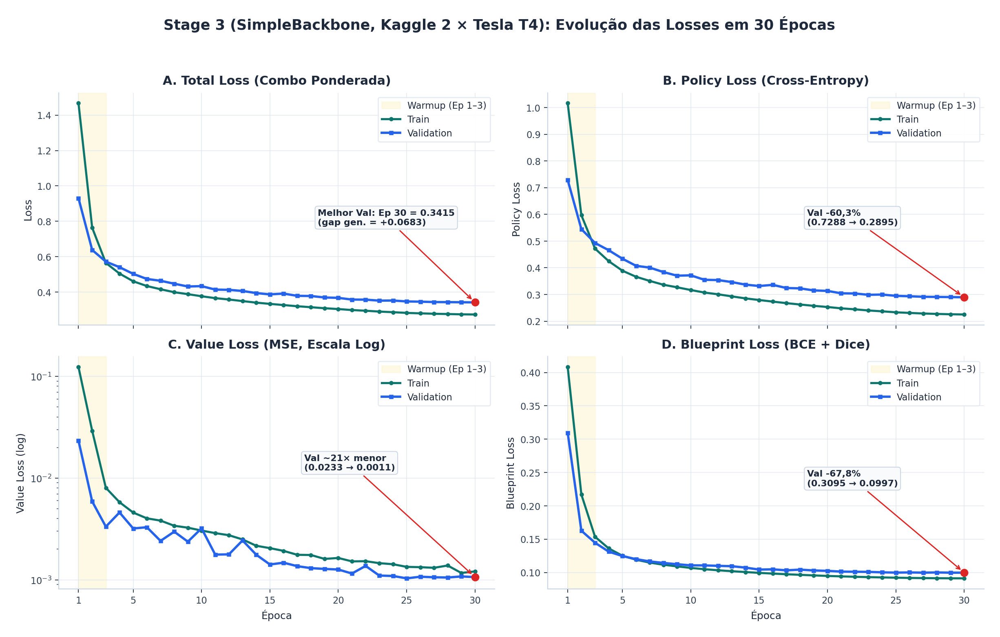
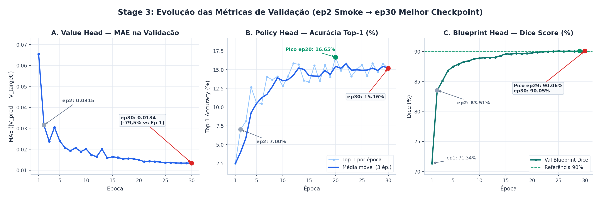
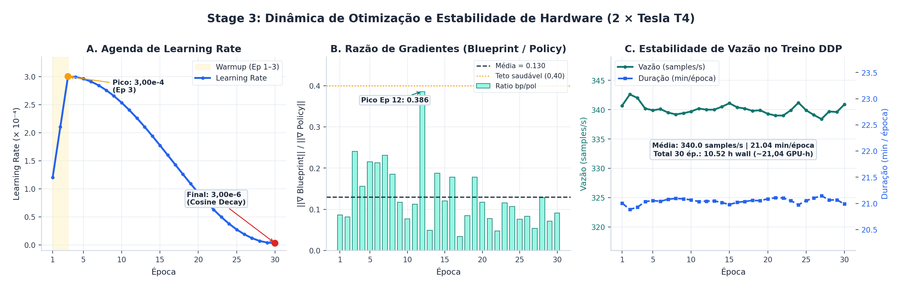

# Relatório de Treinamento — Stage 3 (`SimpleBackbone`, Kaggle `2 × Tesla T4`)

**Data:** 2026-11-24  
**Run / Kernel Kaggle:** `gustavomello9600/alphabuilder-v3-3-stage3-simple` (log bruto capturado em `data/kaggle_stage/stage3_simple_out/`, [`stage3_simple_metrics_history.json`](file:///c:/Users/admin/Projetos/alphabuild/data/analysis/stage3_simple_metrics_history.json))  
**Configuração:** `SimpleBackbone` (`4.433.132` parâmetros), preset `kaggle_t4_dual_simple` (`BS = 64/GPU` → `128` global DDP), `Warmup 3 épocas → 3,00e-4 → Cosine Decay até 3,00e-6`  
**Dataset:** `429.345` amostras de treino (`3.354` iter/época, aumentação `D4 × Z2 = 16×` + *negative sampling*) e `47.705` de validação (`split_v3_3.json`)  
**Tempo total:** **`37.877,8 s`** (**`10,52 h` wall-clock** / **`~21,04 GPU-h`** em 30 épocas; média de `21,04 min/época` e `340,0 samples/s`)  
**Melhor checkpoint (`best_model.pt`):** **`Epoch 30/30`** (`val_loss = 0,3415`), salvo em [`checkpoints/simple_v3_3_stage3_best.pt`](file:///c:/Users/admin/Projetos/alphabuild/checkpoints/simple_v3_3_stage3_best.pt)

---

## 1. Marcos Quantitativos (Época 1 → 30)

| Época | `LR` | Tempo (`samples/s`) | Train `Loss` (`Pol / Val / BP`) | Val `Loss` (`Pol / Val / BP`) | Gap (`Val − Tr`) | `Value MAE` | `Policy Top-1` | `Blueprint Dice` |
|---|---|---|---|---|---|---|---|---|
| **1** | `1,20e-4` | `1.260,3s` (`340,7`) | `1,4671` (`1,0159 / 0,1236 / 0,4081`) | `0,9302` (`0,7288 / 0,0233 / 0,3095`) | `-0,5369` | `0,0654` | `2,44%` | `71,34%` |
| **2** | `2,10e-4` | `1.253,1s` (`342,6`) | `0,7636` (`0,5967 / 0,0292 / 0,2169`) | `0,6378` (`0,5447 / 0,0059 / 0,1626`) | `-0,1258` | `0,0315` | `7,00%` | `83,51%` |
| **10** | `2,53e-4` | `1.264,0s` (`339,7`) | `0,3762` (`0,3167 / 0,0031 / 0,1068`) | `0,4334` (`0,3717 / 0,0032 / 0,1106`) | `+0,0572` | `0,0201` | `12,80%` | `88,87%` |
| **20** | `9,27e-5` | `1.265,2s` (`339,3`) | `0,3038` (`0,2532 / 0,0016 / 0,0948`) | `0,3671` (`0,3134 / 0,0013 / 0,1024`) | `+0,0633` | `0,0149` | **`16,65%`** *(pico)* | `89,74%` |
| **30** *(Best)* | `3,00e-6` | `1.259,3s` (`340,9`) | **`0,2732`** (`0,2252 / 0,0012 / 0,0912`) | **`0,3415`** (`0,2895 / 0,0011 / 0,0997`) | `+0,0683` | **`0,0134`** *(mín Ep 28–30)* | `15,16%` | **`90,05%`** *(pico 90,06% Ep 29)* |

---

## 2. Evolução das Losses (Treino vs Validação)

- **Convergência monotônica sem overfitting:** a *Val Total Loss* caiu continuamente até a **última época (`0,9302 → 0,3415`)**, fechando com *generalization gap* controlado de apenas **`+0,0683`** (`Val 0,3415 − Train 0,2732`).
- **Todas as três cabeças evoluíram em conjunto:** em validação, `Policy Loss` caiu **`-60,3%`** (`0,7288 → 0,2895`), `Blueprint Loss` caiu **`-67,8%`** (`0,3095 → 0,0997`) e `Value Loss` despencou **`~21×`** (`0,0233 → 0,0011`).

---

## 3. Métricas das Cabeças (`Value`, `Policy` e `Blueprint`)

- **Calibração supervisionada da `Value Head`:** `Value MAE` caiu **`-79,5%`** (`0,0654 → 0,0134`, estabilizando em `0,0134–0,0136` entre as épocas 25 e 30).
- **Acurácia espacial da `Policy Head`:** *Top-1 Accuracy* subiu de `2,44%` (Ep 1) e `7,00%` (Ep 2) para o pico de **`16,65%`** (Ep 20), oscilando em **`14,2%–15,8%`** no terço final (`15,16%` na Ep 30) — comportamento esperado numa distribuição de alvos densos multiponto do SIMP onde centenas de voxels da fronteira dividem probabilidade alta.
- **Saturação limpa da `Blueprint Head`:** *Blueprint Dice* cruzou `88%` já na Ep 7 (`88,25%`) e atingiu platô em **`90,05%–90,06%`** (`Ep 25–30`), demonstrando convergência precoce da geometria alvo.

---

## 4. Dinâmica de Otimização e Estabilidade no Kaggle

- **Cosine schedule bem aproveitado:** após o warmup de 3 épocas até `3,00e-4`, o decaimento cosseno continuou refinando `Policy Loss` (`0,3671 → 0,3415` entre Ep 20 e 30) até `3,00e-6`.
- **Equilíbrio entre cabeças espaciais (`Blueprint / Policy`):** a razão de normas de gradiente manteve média **`0,130`** (pico isolado de `0,386` na Ep 12, sempre abaixo de `0,40`), confirmando que a cabeça auxiliar Blueprint guiou o *backbone* sem sufocar os gradientes da Policy.
- **Vazão DDP constante:** o pipeline sustentou **`340,0 samples/s`** (`20,88–21,15 min/época`) sem degradação térmica ou gargalo de CPU ao longo das **`10,52 h`** contínuas.

---

## 5. Impacto na Inferência Real

A comparação direta de rollouts MCTS + FEniCSx (`160` sims/passo) entre **`ep2`** e **`ep30`** está detalhada em [`data/analysis/eval_inference_report_v3_3.md`](file:///c:/Users/admin/Projetos/alphabuild/data/analysis/eval_inference_report_v3_3.md): na prática, o `ep30` reduziu a compliance final média em **`-69,9%`** (`50.480 → 15.179`), elevou o `Score v3.3` médio de `-0,092 → +0,057` (`4/6` positivos) e superou o SIMP binarizado em `S6`, além de expor o próximo gargalo a atacar na **Etapa 6 (Self-Play)** (*covariate shift* da Value Head e repressão de logits `REMOVE`).
