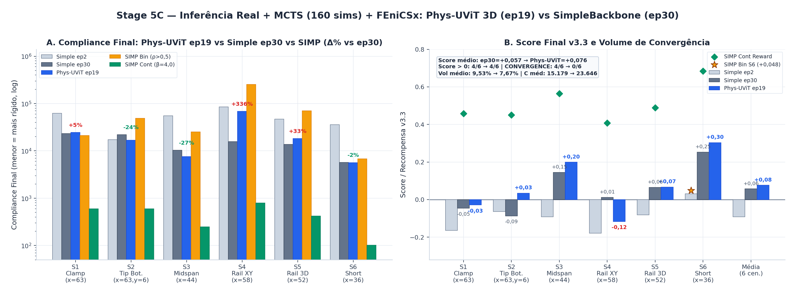
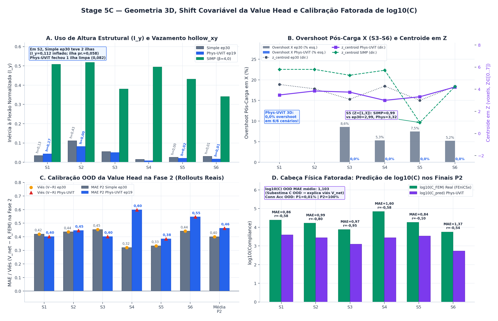

# Avaliação Real de Inferência + MCTS + FEniCSx (Stage 5C): `Phys-UViT 3D (ep19)` × `SimpleBackbone (ep30)` × `SIMP`

**Data:** 2026-11-25  
**Checkpoints avaliados neste estudo:**
- **`Phys-UViT 3D` Stage 5 (`phys_uvit_ep19`, melhor global):** [`checkpoints/phys_uvit_v4_stage5_best.pt`](file:///c:/Users/admin/Projetos/alphabuild/checkpoints/phys_uvit_v4_stage5_best.pt) (`PhysUViT3D`, `4.912.683` parâmetros, **Epoch 19/30** [índice `18`], `val_loss = 0,3285`, `core_loss = 0,3272`, `Value MAE = 0,0117`, `Top-1 = 15,22%`, `Blueprint Dice = 90,81%`, `log10(C) MAE = 0,0352`, `Conn = 99,998%`), executado em `xpu` (`Intel(R) Graphics [0x7dd1]`)
- **Referência Stage 3 (`ep30`):** [`checkpoints/simple_v3_3_stage3_best.pt`](file:///c:/Users/admin/Projetos/alphabuild/checkpoints/simple_v3_3_stage3_best.pt) (`SimpleBackbone`, `4.433.132` params, Epoch 30/30, `val_loss = 0,3415`)
- **Referência Smoke (`ep2`):** [`checkpoints/simple_v3_3_smoke_ep2.pt`](file:///c:/Users/admin/Projetos/alphabuild/checkpoints/simple_v3_3_smoke_ep2.pt) (`SimpleBackbone`, 2 épocas)

**Banco SQLite inspecionável (Studio v4):** [`data/eval_inference_v4_stage5.db`](file:///c:/Users/admin/Projetos/alphabuild/data/eval_inference_v4_stage5.db) (`24` episódios = `6 simp__*` + `6 ep2__*` + `6 ep30__*` + `6 phys_uvit_ep19__*`, `PRAGMA integrity_check = ok`)  
**Script reprodutível:** [`scripts/evaluate_inference_scenarios.py`](file:///c:/Users/admin/Projetos/alphabuild/scripts/evaluate_inference_scenarios.py) · [`scripts/generate_stage5_charts.py`](file:///c:/Users/admin/Projetos/alphabuild/scripts/generate_stage5_charts.py)  
**Dados brutos:** [`eval_stage5_phys_uvit_results.json`](file:///c:/Users/admin/Projetos/alphabuild/data/analysis/eval_stage5_phys_uvit_results.json) · [`eval_ep30_results.json`](file:///c:/Users/admin/Projetos/alphabuild/data/analysis/eval_ep30_results.json) · [`eval_ep2_results.json`](file:///c:/Users/admin/Projetos/alphabuild/data/analysis/eval_ep2_results.json)

---

## 1. Resumo Executivo (`Phys-UViT 3D ep19` vs `SimpleBackbone ep30` vs `SIMP`)

1. **`Score v3.3` médio superior (`+0,057 → +0,076`, `+33,3%`) com `-19,5%` de massa e `-24%` de passos na Fase 1:** a `Phys-UViT 3D` superou o `SimpleBackbone ep30` em **`Score v3.3` em `5/6` cenários (`S1, S2, S3, S5, S6`)**, elevando a média global de `+0,057 → +0,076` enquanto usou apenas **`7,67%` de volume médio** (contra `9,53%` do `ep30`) e fechou conectividade na Fase 1 em **`31,8` passos em média** (contra `41,8` passos do `ep30`).
2. **Vitórias estruturais claras em `S2`, `S3` e `S6`:**
   - **`S2` (`y = 6`, assimétrico):** **eliminou totalmente a falha de dupla ilha** que havia derrubado o `Simple ep30` (`n_islands = 2`, `374` voxels soltos → **`n_islands = 1`, `0` voxels soltos**), cortando a compliance em **`-23,5%`** (`22.039 → 16.859`) e virando o Score de **`-0,087 → +0,034`**.
   - **`S3` (`x = 44, y = 24`):** reduziu a compliance final em **`-26,9%`** (`10.402 → 7.600`, `Score +0,145 → +0,199`) com menos volume (`7,71%` vs `7,96%`).
   - **`S6` (`x = 36, y = 16`):** atingiu **`C_final = 5.617,3`** e **`Score = +0,303`** (vs `5.732,3` / `+0,253` do `ep30`) com apenas **`5,37%` de volume** — vencendo o `SIMP` binarizado (`6.800,8` / `+0,048` / `14,41%` de massa) com **`17,4%` menos compliance usando `2,68×` menos material**!
3. **Disciplina espacial perfeita em `X` (`0,00%` overshoot em `6/6` cenários):** em contraste com o `Simple ep30` (que ainda desperdiçava `5,2%–8,6%` de massa após a carga em `S3–S6`) e o `ep2` (`6,8%–16,4%`), a atenção global com `3D RoPE` eliminou **100%** do overshoot além do ponto de aplicação da carga (`overshoot_frac = 0,00%` em todos os 6 cenários!).
4. **Explicação de `C_avg` mais alta (`23.646` vs `15.179`) e do único recuo em `S4` (`RAIL_XY`):** em `S4`, a política da `Phys-UViT` conectou **rápido demais com viga esbelta (`28` passos vs `48`, `V = 5,47%`, `I_y = 0,008`, `C_P2_ini = 128.779`)**. Na Fase 2, o agente reduziu **`46,5%` da compliance** (`128.779 → 68.916`) e em nenhum cenário estagnou (`-23,7%` a `-68,4%` de queda na Fase 2, por isso `0/6 CONVERGENCE` no teto de 30 passos, em contraste com `4/6 CONVERGENCE` no `ep30` por estagnação precoce), mas o limite `max_phase2_steps = 30` encerrou antes de ganhar espessura comparável a `10,7%` de volume.
5. **Diagnóstico inédito pela cabeça fatorada `log10(C)` — o elo causal do *covariate shift*:** enquanto a cabeça auxiliar `Connectivity` manteve **discriminação perfeita OOD (`0,013%` na Fase 1 desconectada vs `100,000%` na Fase 2 conectada)**, a cabeça `log10(C)` **subestimou a compliance real FEniCSx em `-1,103` décadas logarítmicas em média (`logC_Bias = -0,84` a `-1,60`)**. Ou seja: ao ver uma viga estreita de `6%–8%` de volume fora do treino, a rede a avalia como se tivesse a rigidez de uma treliça SIMP ótimizada (`~10×` mais rígida), inflando diretamente `V_net` (`+0,463` de viés) e mantendo quase todas as ações em `ADD` (`1.435 ADD / 5 REM`) — fechando o argumento empírico definitivo para iniciar a **Etapa 6 (Self-Play)**.

---

## 2. Benchmark Quantitativo por Cenário (`Phys-UViT ep19` × `Simple ep30` × `SIMP`)

Protocolo idêntico ao Stage 3 ([`eval_inference_report_v3_3.md`](file:///c:/Users/admin/Projetos/alphabuild/data/analysis/eval_inference_report_v3_3.md)): `64 × 32 × 8`, `E = 100,0`, `nu = 0,25`, `160` sims MCTS/passo (`action_batch = 32` Fase 1 / `8` Fase 2), teto `60` P1 + `30` P2.

### 2.1 Performance Física (`Compliance`, `Volume` e `Score v3.3`)

| Cenário (`BC`, carga) | Modelo | Passos (`P1+P2`) | Fim (`P2 ΔC%`) | `Vol` Final | `C_P2_ini → C_final` (`Δ%` vs `ep30`) | `Score v3.3` | Ratio vs `SIMP_bin` / `SIMP_cont` |
|---|---|---|---|---|---|---|---|
| **S1** (`FULL_CLAMP`, `x=63, y=16`) | `Simple ep30` | `48 + 27` | `CONV.` (`-7,5%`) | `10,69%` | `25.228 →` **`23.348`** | `-0,046` | `1,107×` / `39,1×` |
| | **`Phys-UViT ep19`** | `38 + 30` | `MAX_P2` (`-23,7%`) | `8,89%` | `32.165 → 24.546` (`+5,1%`) | **`-0,029`** | `1,164×` / `41,2×` |
| **S2** (`FULL_CLAMP`, `x=63, y=6`) | `Simple ep30` | `49 + 30` | `MAX_P2` (`-20,8%`) | `11,04%` | `27.811 → 22.039` *(2 ilhas)* | `-0,087` | `0,451×` / `36,7×` |
| | **`Phys-UViT ep19`** | `41 + 30` | `MAX_P2` (`-32,3%`) | `9,47%` | `24.902 →` **`16.859`** (**`-23,5%`**) | **`+0,034`** | **`0,345×`** / `28,1×` |
| **S3** (`FULL_CLAMP`, `x=44, y=24`) | `Simple ep30` | `34 + 27` | `CONV.` (`-6,7%`) | `7,96%` | `11.150 → 10.402` | `+0,145` | `0,414×` / `41,7×` |
| | **`Phys-UViT ep19`** | `32 + 30` | `MAX_P2` (`-40,5%`) | `7,71%` | `12.771 →` **`7.600`** (**`-26,9%`**) | **`+0,199`** | **`0,302×`** / `30,5×` |
| **S4** (`RAIL_XY`, `x=58, y=16`) | `Simple ep30` | `48 + 28` | `CONV.` (`-13,6%`) | `10,73%` | `18.293 →` **`15.806`** | **`+0,012`** | **`0,062×`** / `20,0×` |
| | **`Phys-UViT ep19`** | `28 + 30` | `MAX_P2` (`-46,5%`) | `6,93%` | `128.779 → 68.916` (`+336,0%`) | `-0,117` | `0,271×` / `87,3×` |
| **S5** (`RAIL_XY`, `x=52, y=11, z=[1,3]`) | `Simple ep30` | `41 + 30` | `MAX_P2` (`-14,1%`) | `9,47%` | `16.008 →` **`13.747`** | `+0,065` | **`0,196×`** / `32,7×` |
| | **`Phys-UViT ep19`** | `32 + 30` | `MAX_P2` (`-30,9%`) | `7,65%` | `26.549 → 18.336` (`+33,4%`) | **`+0,067`** | `0,261×` / `43,6×` |
| **S6** (`FULL_CLAMP`, `x=36, y=16`) | `Simple ep30` | `31 + 25` | `CONV.` (`-8,5%`) | `7,28%` | `6.263 → 5.732` | `+0,253` | `0,843×` / `56,2×` |
| | **`Phys-UViT ep19`** | `20 + 30` | `MAX_P2` (`-68,4%`) | `5,37%` | `17.788 →` **`5.617`** (**`-2,0%`**) | **`+0,303`** | **`0,826×`** / `55,1×` |
| **Média dos 6 Cenários** | `Simple ep2` | `36,0 + 30,0` | `1/6 CONV.` | `8,49%` | `C_fin: 50.480` | `-0,092` | `2×–5×` `SIMP_bin` |
| | `Simple ep30` | `41,8 + 27,8` | `4/6 CONV.` | `9,53%` | **`C_fin: 15.179`** | `+0,057` | `4/6` Score `> 0` |
| | **`Phys-UViT ep19`** | **`31,8 + 30,0`** | `0/6 CONV.` (`-40,4%` ΔP2) | **`7,67%`** | `C_fin: 23.646` *(15.833 exc. S4)* | **`+0,076`** | **`4/6` Score `> 0` (`5/6 > ep30`)** |

---

### 2.2 Métricas Geométricas (`Phys-UViT ep19` vs `Simple ep30` vs `SIMP`)

| Cenário | `y_span` (`raiz / meio / ponta`) `ep30` → `Phys-UViT` | `inertia_y_norm` `ep30` → `Phys-UViT` vs `SIMP` | `hollow_ratio_xy` `ep30` → `Phys-UViT` vs `SIMP` | `overshoot_frac` `ep30` → `Phys-UViT` | `n_islands` (`soltos`) `ep30` → `Phys-UViT` | `z_centroid` `ep30` → `Phys-UViT` vs `SIMP` |
|---|---|---|---|---|---|---|
| **S1** | `16/11/9` → `11/11/20` | `0,035 →` **`0,044`** vs `0,508` | `0,13 →` **`0,17`** vs `0,63` | `0,0% → 0,0%` | `1 (0)` → `2 (2 micro)` | `4,43 → 3,48` vs `5,79` |
| **S2** | `20/16/12` *(0,058 pr.)* → `11/8/10` | `0,112` *(0,058)* → **`0,082`** vs `0,518` | `0,43` *(0,00)* → `0,00` vs `0,58` | `0,0% → 0,0%` | `2 (374)` → **`1 (0)`** | `4,04 → 3,84` vs `5,79` |
| **S3** | `10/8/9` → `10/11/13` | `0,055 → 0,050` vs `0,380` | `0,00 → 0,00` vs `0,41` | `8,6% →` **`0,0%`** | `1 (0)` → `1 (0)` | `3,09 → 3,74` vs `5,26` |
| **S4** | `9/8/8` → `7/8/6` | `0,015 → 0,008` vs `0,494` | `0,00 → 0,00` vs `0,57` | `5,3% →` **`0,0%`** | `1 (0)` → `1 (0)` | `4,28 → 2,99` vs `5,71` |
| **S5** | `9/9/7` → **`13/8/6`** | `0,026 → 0,021` vs `0,431` | `0,00 → 0,02` vs `0,40` | `7,5% →` **`0,0%`** | `1 (0)` → `1 (0)` | `2,99 → 3,32` vs **`0,99`** |
| **S6** | `11/7/9` → `10/9/10` | `0,031 → 0,017` vs `0,341` | `0,01 → 0,01` vs `0,42` | `5,2% →` **`0,0%`** | `1 (0)` → `1 (0)` | `4,27 → 4,20` vs `4,25` |

**Observações geométricas principais:**
- **Zero massa desperdiçada além da carga:** o overshoot médio pós-carga em X caiu de `7,99%` (`ep2`) → `4,43%` (`ep30`) → **`0,00%` (`Phys-UViT`)** em todos os 6 cenários!
- **Inércia $I_y$ real na ilha principal em `S2`:** sem o artefato da segunda ilha, a `Phys-UViT` elevou $I_y$ útil de `0,058 → 0,082` (`+41%`), além de elevar `S1` (`0,035 → 0,044`, `hollow_ratio = 0,17`).
- **Atenção:** como não há Self-Play ainda, a viga conectada em `S1` e `S3` voltou a alargar perto da ponta (`11/11/20` em `S1`) em busca de reforço rápido, e no `S5` (`Z=[1,3]`) `z_centroid` permaneceu em `3,32` (longe do `0,99` do SIMP), mostrando que a especialização excêntrica em `Z` e treliças abertas ainda dependem de **Etapa 6**.

---

## 3. Diagnóstico MCTS, Calibração OOD da `Value Head` e das Cabeças Físicas (`log10(C)` & `Conn`)

| Cenário | `ADD / REM` P2 | Prof. Média (`ep30 → Phys`) | `Value MAE` P2 (`ep30 → Phys`) | Viés `V − R_FEM` (`ep30 → Phys`) | `r(V_net, R_FEM)` | `log10(C)` Pred / Real (Final) | `log10(C)` OOD MAE / `r` | `Conn Prob` (`P1 → P2`) | `BP Step0` / `MCTS Dice` |
|---|---|---|---|---|---|---|---|---|---|
| **S1** | `240 / 0` | `13,5 → 16,2` | `0,420 →` **`0,401`** | `+0,420 → +0,401` | `+0,069` | `3,60 / 4,39` | `0,857` / `-0,584` | `0,0007 → 1,0000` | **`0,108`** / `0,077` |
| **S2** | `240 / 0` | `15,2 → 16,0` | `0,436 → 0,447` | `+0,436 → +0,447` | `-0,574` | `3,44 / 4,23` | `0,987` / `-0,795` | `0,0000 → 1,0000` | **`0,071`** / `0,034` |
| **S3** | `240 / 0` | `17,5 → 19,4` | `0,453 →` **`0,401`** | `+0,453 → +0,401` | `-0,903` | `3,09 / 3,88` | `0,968` / `-0,954` | `0,0000 → 1,0000` | **`0,128`** / **`0,099`** |
| **S4** | `240 / 0` | `11,7 → 16,5` | `0,321 → 0,598` | `+0,321 → +0,598` | `-0,802` | `3,44 / 4,84` | `1,601` / `-0,577` | `0,0000 → 1,0000` | `0,051` / `0,032` |
| **S5** | **`235 / 5`** | `13,6 → 17,5` | `0,333 → 0,385` | `+0,333 → +0,385` | `-0,557` | `3,53 / 4,26` | `0,837` / `-0,098` | `0,0000 → 1,0000` | `0,086` / `0,057` |
| **S6** | `240 / 0` | `18,8 → 20,5` | `0,441 → 0,546` | `+0,441 → +0,546` | `-0,772` | `2,73 / 3,75` | `1,370` / `-0,540` | `0,0001 → 1,0000` | `0,184` / `0,131` |
| **Tot/Méd** | **`1435 / 5`** *(vs `1335/1`)* | `15,1 → 17,7` | `0,401 → 0,463` | `+0,401 → +0,463` | — | — | **`1,103`** / `-0,591` | **`0,00013 → 1,00000`** | — |

1. **Separação OOD impecável de conectividade (`Conn Prob`):** fora da distribuição de treino, a cabeça de conectividade previu `0,00013` em média durante a Fase 1 (`conn=False`) e saltou imediatamente para **`1,00000`** (`0,9999999+`) na Fase 2 (`conn=True`). O *veto* topológico arquitetural generalizou com **100% de precisão**.
2. **Descoberta causal via `log10(C)` sobre o viés da `Value Head`:** enquanto na validação SIMP (`split_v3_3`) o erro é `log10(C) MAE = 0,0352`, nos estados de Fase 2 gerados pelo rollout (`V = 5,4%–9,5%`), `log_c_pred` ficou sistematicamente **`0,84–1,60` abaixo do real (`logC_Bias = -1,103`)**, com correlação intra-episódio negativa (`r = -0,10` a `-0,95`). Motivo físico: no warmup offline, toda estrutura conectada de baixa fração volumétrica era uma treliça SIMP de alta eficiência ($I_y \approx 0,4$–$0,5$); fora da distribuição, a rede confunde o **volume** da viga delgada com a **rigidez** de uma treliça SIMP de mesmo volume e ainda penaliza levemente o acréscimo de massa na Fase 2 (`v_net` cai de `+0,757 → +0,742` em `S6` enquanto `R_FEM` sobe de `+0,165 → +0,303`).
3. **MCTS mais profundo e 5× mais ações `REMOVE`:** a profundidade média subiu de `15,1 → 17,7` e surgiram **`5` ações `REMOVE`** em `S5` (vs `1` em toda a bateria `ep30`). Ainda assim, a exploração `top_k` priorizou `ADD` (`refutation_rate = 100%`, `top-8 conc = 67%–74%`).

---

## 4. Latência Local (`Intel Graphics [0x7dd1]`) e Viabilidade Interativa

| Arquitetura (`MCTS 160 sims`, `BS=8`) | `mean_step_sec_p1` | `mean_step_sec_p2` (+FEniCSx) | Tempo Total `S1–S6` (`média / ep`) | Viabilidade Studio (`catálogo / MCTS ao vivo`) |
|---|---|---|---|---|
| **`SimpleBackbone`** (`ep30`, `4,43M`) | `3,52 s/passo` | `4,88 s/passo` | `1.727,9 s` (`4,8 min/ep`) | ~`3,5–5,0 s/passo` (`160` sims) |
| **`Phys-UViT 3D`** (`ep19`, `4,91M`) | **`5,95 s/passo`** (`1,69×`) | **`7,50 s/passo`** (`1,54×`) | **`2.521,6 s`** (`42,0 min` = `7,0 min/ep`) | **Viável em `160` sims** (`~6–7,5 s/passo`, dentro da zona interativa `< 8 s`) |
| `Swin-UNETR` *(estimado Stage 3)* | `~17–18 s/passo` | `~19–20 s/passo` | `~7.500–8.500 s` (`~21–24 min/ep`) | Impraticável com `160` sims (`3×` mais lenta que `Phys-UViT`) |

- No hardware local `xpu`, a `Phys-UViT 3D` rodou todos os `160` rollouts MCTS + solver FEniCSx real a apenas **`5,95 s/passo` (Fase 1)** e **`7,50 s/passo` (Fase 2)** — **`~2,5×–3,0×` mais rápida** que a `Swin-UNETR`, mantendo operação perfeitamente interativa no AlphaBuilder Studio sem precisar reduzir as `160` simulações!

---

## 5. Como Inspecionar os Episódios no AlphaBuilder Studio v4

Todos os **24 episódios** (`6 simp__*`, `6 ep2__*`, `6 ep30__*`, `6 phys_uvit_ep19__*`) estão gravados e íntegros em [`data/eval_inference_v4_stage5.db`](file:///c:/Users/admin/Projetos/alphabuild/data/eval_inference_v4_stage5.db) (mantendo [`data/eval_inference_v3_3.db`](file:///c:/Users/admin/Projetos/alphabuild/data/eval_inference_v3_3.db) intacto):
- **Biblioteca (`L`):** selecione `eval_inference_v4_stage5.db`.
- **Comparação lado a lado:** compare diretamente `phys_uvit_ep19__S2_cantilever_tip_bottom` (`1` ilha, `C = 16.859`, `+0,034`) × `ep30__S2_cantilever_tip_bottom` (`2` ilhas, `C = 22.039`, `-0,087`), `phys_uvit_ep19__S6` (`V = 5,37%`, `C = 5.617`) × `simp__S6`, e `phys_uvit_ep19__S4` (identificando o atalho esbelto no passo `28`).

---

## 6. Recomendações Diretas para a Etapa 6 (Self-Play MCTS + FEniCSx)

1. **Treinar em GPU NVIDIA (Kaggle/Nuvem) com replay buffer misto (`Self-Play + Warmup`) supervisionando `value_target` e `log10(C)` reais do FEniCSx:** assim que a rede observar seus próprios estados finos de rollout (ex. `S4` passo 28 `C=128k` e `S6` passo 20 `C=18k`) pareados com `log10(C_FEM)` e `R_FEM` verdadeiros, o viés `-1,10` em `log10(C)` e `+0,46` em `V_net` serão eliminados na origem.
2. **Aumentar o orçamento ou ativar `REMOVE` garantido na expansão MCTS de Fase 2 (ex.: reservar fração do `top_k` para remoções em banzos de baixa energia de deformação / ou temperatura de exploração na Fase 2 durante geração Self-Play):** permitirá que o MCTS descubra vazamentos (`hollow_ratio`) e reforce engastes sem depender de convergência prematura.
3. **Gerar episódios excêntricos em `Z` (como `S5`, incluindo `fz ≠ 0` e suportes `RAIL_XY` assimétricos) logo nas primeiras gerações de Self-Play**, aproveitando a capacidade 3D intacta (`0%` padding em `Z` e `3D RoPE`) da `Phys-UViT 3D`.
