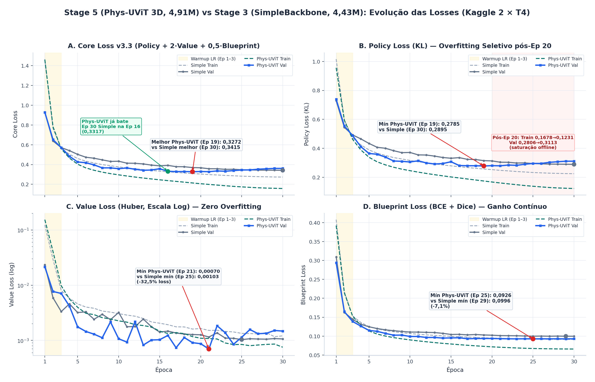
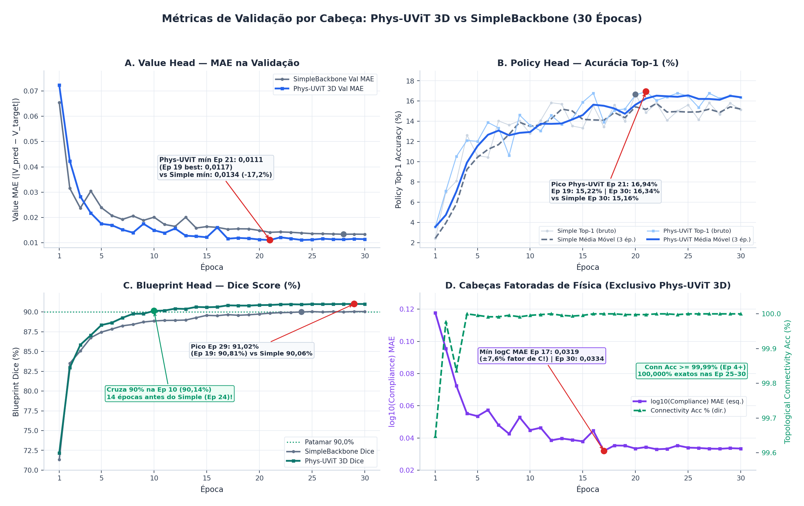

# Relatório de Treinamento — Stage 5 (`Phys-UViT 3D`, Kaggle `2 × Tesla T4`)

**Data:** 2026-11-25  
**Execuções Kaggle (DDP contínuo em 2 partes com `--resume` automático):**
- **Parte 1 (Épocas 1–20):** `gustavomello9600/alphabuilder-v4-stage5-phys-uvit` (`10,47 h`, parada limpa pelo guard `--max-wall-hours 11.0`)
- **Parte 2 (Épocas 21–30):** `gustavomello9600/alphabuilder-v4-stage5-phys-uvit-part2` (`5,28 h`, retomando `last_model.pt` via `RESUME_CHECKPOINT = "AUTO"` preservando `best_model.pt`, estado do `AdamW` e curva cosseno única até a Época 30)  
**Histórico completo (30 épocas):** [`stage5_phys_uvit_metrics_history.json`](file:///c:/Users/admin/Projetos/alphabuild/data/analysis/stage5_phys_uvit_metrics_history.json)  
**Configuração:** `PhysUViT3D` (`4.912.683` parâmetros totais / `4.884.839` treináveis, `feature_size = 32`, `embed_dim = 192`, `depth = 5`, `heads = 6`, **`0%` padding em `Z`**), preset `kaggle_t4_dual_phys_uvit` (`BS = 64/GPU` → `128` global DDP), `Warmup 3 épocas → 3,00e-4 → Cosine Decay até 3,00e-6`, pesos `pol=1,0`, `val=2,0`, `bp=0,5`, `logC=0,20`, `conn=0,25`  
**Dataset:** `429.345` amostras de treino (`3.354` iter/época, aumentação `D4 × Z2 = 16×` + *negative sampling* com escala analítica $C(3F) = 9\,C(F)$) e `47.705` de validação (`split_v3_3.json`)  
**Tempo total (30 épocas):** **`56.707,6 s`** (**`15,75 h` wall-clock** / **`~31,50 GPU-h`**; média de **`31,50 min/época`**, `227,1 samples/s` e pico de VRAM de **`4,942 GB` / `14,6 GB` = `33,8%` por T4**)  
**Melhor checkpoint (`best_model.pt`):** **`Epoch 19/30`** (`val_total_loss = 0,3285`, **`val_core_loss = 0,3272`**), salvo em [`checkpoints/phys_uvit_v4_stage5_best.pt`](file:///c:/Users/admin/Projetos/alphabuild/checkpoints/phys_uvit_v4_stage5_best.pt)

---

## 1. Marcos Quantitativos (`Phys-UViT 3D` vs `SimpleBackbone` Stage 3)

| Época | `LR` | Tempo (`samples/s`, VRAM) | `Phys-UViT` Train `Tot / Pol / Val / BP` | `Phys-UViT` Val `Tot / Core v3.3` | `Simple` Val `Core v3.3` | Val `MAE` (`Phys` vs `Simple`) | Val `Top-1` (`Phys` vs `Simple`) | Val `Dice` (`Phys` vs `Simple`) | `log10(C)` MAE · `Conn Acc` |
|---|---|---|---|---|---|---|---|---|---|
| **1** | `1,20e-4` | `1.909,5s` (`224,8`, `4,91G`) | `1,4987 / 0,9559 / 0,1543 / 0,3924` | `0,9418` / `0,9284` | `0,9302` | `0,0723` vs `0,0654` | `3,56%` vs `2,44%` | `72,15%` vs `71,34%` | `0,1177` · `99,65%` |
| **2** | `2,10e-4` | `1.894,4s` (`226,6`, `4,94G`) | `0,7951 / 0,5937 / 0,0406 / 0,2143` | `0,6594` / `0,6518` | `0,6378` | `0,0423` vs `0,0315` | `7,12%` vs `7,00%` | `82,95%` vs `83,51%` | `0,0954` · `99,98%` |
| **10** | `2,53e-4` | `1.875,0s` (`229,0`, `4,94G`) | `0,2970 / 0,2460 / 0,0023 / 0,0899` | `0,3596` / **`0,3578`** | `0,4334` | **`0,0149`** vs `0,0201` | **`13,61%`** vs `12,80%` | **`90,14%`** vs `88,87%` | `0,0448` · `100,00%` |
| **13** *(~Simple best)* | `2,10e-4` | `1.864,9s` (`230,2`, `4,94G`) | `0,2644 / 0,2182 / 0,0019 / 0,0828` | `0,3432` / **`0,3417`** | `0,4060` | **`0,0128`** vs `0,0201` | `13,71%` vs `15,70%` | **`90,38%`** vs `88,98%` | `0,0397` · `100,00%` |
| **16** *(Bate Ep 30)* | `1,60e-4` | `1.888,2s` (`227,4`, `4,94G`) | `0,2380 / 0,1958 / 0,0013 / 0,0773` | `0,3334` / **`0,3317`** | `0,3913` | `0,0161` vs `0,0161` | **`16,79%`** vs `15,54%` | **`90,64%`** vs `89,53%` | `0,0445` · `100,000%` |
| **19 *(Best global)*** | `1,09e-4` | `1.889,2s` (`227,3`, `4,94G`) | `0,2142 / 0,1747 / 0,0012 / 0,0729` | **`0,3285` / `0,3272`** | `0,3692` | **`0,0117`** vs `0,0155` | **`15,22%`** vs `14,02%` | **`90,81%`** vs `89,65%` | `0,0352` · `99,998%` |
| **20** *(Fim Parte 1)* | `9,27e-5` | `1.881,4s` (`228,2`, `4,94G`) | `0,2064 / 0,1678 / 0,0011 / 0,0716` | `0,3304` / `0,3292` | `0,3671` | **`0,0113`** vs `0,0149` | `16,60%` vs `16,65%` | **`90,87%`** vs `89,74%` | `0,0334` · `99,998%` |
| **21** *(Vice / Picos)* | `7,73e-5` | `1.910,9s` (`224,7`, `4,94G`) | `0,1993 / 0,1613 / 0,0011 / 0,0705` | `0,3288` / `0,3276` | `0,3574` | **`0,0111`** *(mín)* vs `0,0141` | **`16,94%`** *(pico)* vs `14,86%` | **`90,89%`** vs `89,86%` | `0,0343` · `99,998%` |
| **30** *(Early Stop)* | `3,00e-6` | `1.909,2s` (`224,9`, `4,94G`) | `0,1579 / 0,1231 / 0,0008 / 0,0658` | `0,3619` / `0,3607` | **`0,3415`** *(best)* | **`0,0114`** vs `0,0134` | **`16,34%`** vs `15,16%` | **`91,01%`** *(pico 91,02% Ep29)* vs `90,05%` | `0,0334` · **`100,000%`** |

*(Obs.: no Stage 3 [`stage3_simple_metrics_history.json`](file:///c:/Users/admin/Projetos/alphabuild/data/analysis/stage3_simple_metrics_history.json), a loss total corresponde exatamente ao termo `Core Loss v3.3 = 1,0·Pol + 2,0·Val + 0,5·BP`, pois não existiam as cabeças fatoradas `log10(C)` e `Conectividade`.)*

---

## 2. Evolução das Losses vs `SimpleBackbone` (Stage 3)

1. **Velocidade de aprendizado arquitetural (`14` épocas de vantagem):** usando exatamente os mesmos hiperparâmetros de otimização e batch global (`128`), a `Phys-UViT 3D` já atingiu na **Época 13 (`0,3417`)** o mesmo patamar que o `SimpleBackbone` só alcançou na **Época 30 (`0,3415`)**, cruzou abaixo dele de forma definitiva na **Época 16 (`0,3317`)** e cravou seu mínimo global de `Core Loss v3.3` na **Época 19 (`0,3272` vs `0,3415`, `-4,2%`)**.
2. **Ganhos consistentes em todas as cabeças originais:** comparando os melhores valores de validação em 30 épocas:
   - **`Policy Loss (KL)`:** **`0,2785`** (Ep 19) vs **`0,2895`** (Ep 30) (**`-3,8%`**).
   - **`Value Loss (Huber)`:** **`0,00070`** (Ep 21) vs **`0,00103`** (Ep 25) (**`-32,5%`**).
   - **`Blueprint Loss (BCE + Dice)`:** **`0,0926`** (Ep 25/29) vs **`0,0996`** (Ep 29) (**`-7,1%`**).
3. **Overfitting seletivo e altamente diagnóstico após a Época 20:**
   - Entre as Épocas 20 e 30, enquanto a loss de treino continuou caindo fortemente (`0,2064 → 0,1579`, impulsionada por `Train Pol 0,1678 → 0,1231`), **apenas a `Val Policy Loss` subiu (`0,2806 → 0,3113`)**, acionando exatamente o critério de `Early stopping (patience=10)` após a Época 30 (`best = Ep 19`).
   - Em total contraste, **não houve overfitting algum nas cabeças estruturais/físicas entre Ep 20 e 30**: `Val Value MAE` manteve **`0,0111–0,0115`** (`Ep 21` = mínimo global `0,0111`), `Blueprint Dice` seguiu subindo até **`91,02%`** (Ep 29), `log10(C) MAE` ficou estável em **`0,0332–0,0353`** e `Conn Acc` atingiu **`100,000%` exatos** nas Épocas 25–30.
   - **Interpretação científica:** com atenção global `3D RoPE` + `Multi-Load Cross-Attn`, a `Phys-UViT 3D` possui capacidade representacional suficiente para memorizar nuances específicas das 3.600 trajetórias SIMP após ~20 épocas de imitação supervisionada. Salvar o checkpoint por `best_model.pt` na **Época 19** captura o ápice de generalização offline antes da memorização da política — exatamente onde faz sentido migrar o foco de aprendizado para **Etapa 6 (Self-Play)** com novas trajetórias próprias e alvos FEM reais.

---

## 3. Cabeças de Validação e Cabeças Fatoradas de Física

- **`Value MAE` (`-17,2%`):** caiu de `0,0723` (Ep 1) para **`0,0117`** no melhor checkpoint (Ep 19) e atingiu o mínimo de **`0,0111`** na Ep 21 (vs **`0,0134`** mínimo no Stage 3).
- **`Blueprint Dice` (`+0,96 p.p.`, `14` épocas antes):** cruzou o marco de `90%` já na **Época 10 (`90,14%`)** (o `SimpleBackbone` levou até a Época 24 para chegar a `90,03%`) e atingiu **`91,02%`** na Época 29 (`90,81%` na Ep 19).
- **`Policy Top-1 Accuracy`:** superou ou igualou o baseline na maior parte da curva, com pico global de **`16,94%`** na Época 21 (vs `16,65%` Ep 20 do `Simple`) e média mais alta no terço final (**`16,3%–16,9%`** vs `14,2%–15,8%`, fechando a Ep 30 em **`16,34%` vs `15,16%`**).
- **Cabeça auxiliar `log10(Compliance)` (exclusiva `Phys-UViT 3D`):** caiu de `0,1177` (Ep 1) para **`0,0352`** (Ep 19) e mínimo de **`0,0319`** (Ep 17; `0,0334` na Ep 30). No domínio de validação *in-distribution*, `0,0319` em base 10 corresponde a um **erro multiplicativo médio de apenas `10^0,0319 = 1,076×` (`±7,6%`) na compliance estrutural estimada diretamente em `1` passo forward**, sem rodar o FEniCSx.
- **Cabeça auxiliar `Connectivity` (exclusiva `Phys-UViT 3D`):** subiu de `99,65%` (Ep 1) para **`>= 99,99%`** a partir da Época 4, cravando **`100,000%` exatos** em `8` das últimas `10` épocas (`Ep 22, 23, 25–30`), validando o acoplamento do *bottleneck* global + `MaxPool` veto da `FactoredValueHead`.

---

## 4. Custo Computacional, Memória e Execução em 2 Partes no Kaggle

| Arquitetura | Parâmetros | Hardware Kaggle (`BS`) | Tempo / Época (`samples/s`) | Custo Total 30 Épocas (`wall / GPU-h`) | Pico VRAM / T4 | Viabilidade Kaggle |
|---|---|---|---|---|---|---|
| **`SimpleBackbone`** *(Stage 3)* | `4.433.132` | `2 × Tesla T4` (`BS=64/GPU`) | `21,04 min` (`340,0`) | `10,52 h` / `21,04 GPU-h` | — | 1 sessão |
| **`Phys-UViT 3D`** *(Stage 5 real)* | **`4.912.683`** | **`2 × Tesla T4` (`BS=64/GPU`)** | **`31,50 min` (`227,1`)** | **`15,75 h` / `31,50 GPU-h`** | **`4,94 GB` (`33,8%`)** | **2 sessões contínuas (`10,47h + 5,28h`)** |
| `Swin-UNETR` *(estimado Stage 3)* | `6.831.758` | `2 × Tesla T4` (`BS=8/GPU`) | `~95–135 min` | `~48–68 h` / `96–136 GPU-h` | ~14+ GB (75% pad Z) | 5–7 *resumes* |

- **Custo `1,50×` apenas sobre a CNN pura (`SimpleBackbone`) e `3,0×–4,3×` mais barata que a `Swin-UNETR`:** graças ao *stem* convolucional `divisor=4` (`0%` padding em Z) combinado ao Transformer no gargalo reduzido (`16 × 8 × 2 = 256` tokens), o modelo coube folgado em **`4,94 GB` de VRAM por T4 com `BS = 64/GPU`** (permitindo o mesmo `global_bs = 128` da `SimpleBackbone` sem micro-batches de 8!).
- **Equilíbrio de gradientes:** a razão média `||∇ Blueprint|| / ||∇ Policy||` nas 30 épocas ficou em **`0,108`** (máximo `0,298` na Ep 4, mínimo `0,022` na Ep 18), ainda mais estável que a do Stage 3 (`0,130`).
- **Telemetria limpa:** a adequação de `_make_pbar` em [`train_pipeline.py`](file:///c:/Users/admin/Projetos/alphabuild/alphabuilder/src/neural/train_pipeline.py) manteve os logs em `1.132` linhas (Parte 1) e `601` linhas (Parte 2), contra dezenas de milhares de linhas em execuções sem controle de intervalo.

---

## 5. Próximo Passo (Stage 5C)

Avaliação completa em andamento nos **6 cenários canônicos (`S1–S6`) com MCTS real (`160` sims/passo) + FEniCSx** comparando [`checkpoints/phys_uvit_v4_stage5_best.pt`](file:///c:/Users/admin/Projetos/alphabuild/checkpoints/phys_uvit_v4_stage5_best.pt) (`ep19`) contra `SimpleBackbone ep30`, `SimpleBackbone ep2` e `FEniTop SIMP` (resultados a serem consolidados em `data/analysis/stage5_phys_uvit_eval_report.md` e `data/eval_inference_v4_stage5.db`).
