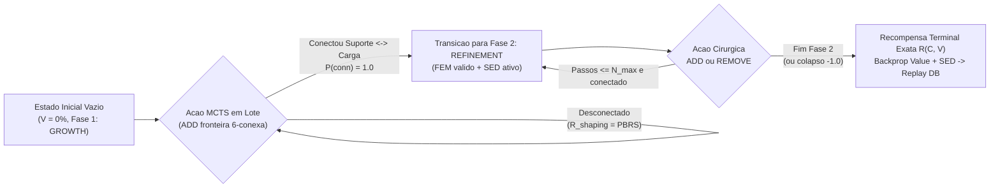
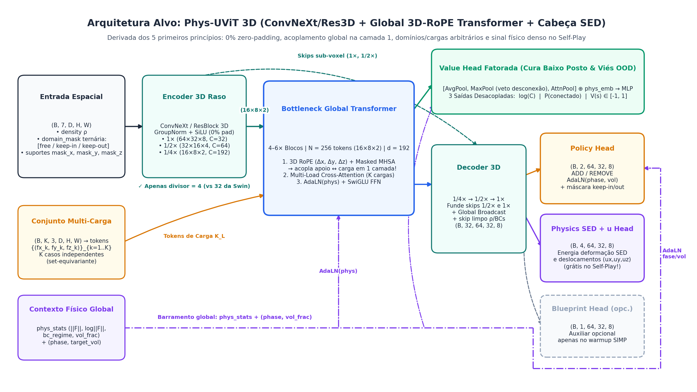
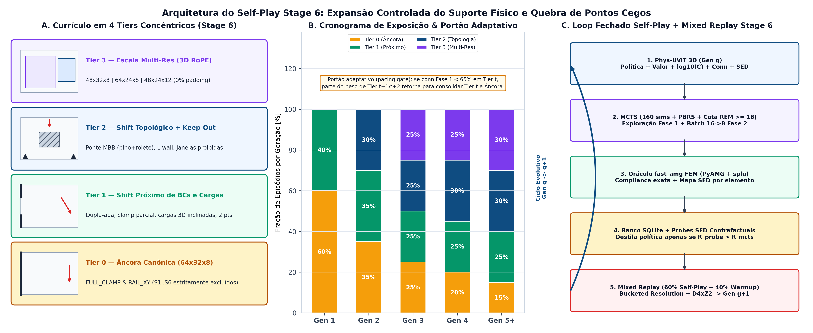

# AlphaBuilder v4.0: Do Cálculo Variacional ao Self-Play Físico com Phys-UViT 3D

**Monografia de Estudo Consolidado, Diagnóstico Empírico e Fundamentação Teórico-Computacional da Fase 6 (Self-Play)**  
*Repositório:* `alphabuild` (`v3.3 -> v4.0 Stage 6`) | *Arquitetura Escolhida:* `Phys-UViT 3D` (`4,912,683` parâmetros)

---

## Como Ler Este Documento

Este material foi estruturado como uma **narrativa científica cumulativa**: cada capítulo nasce exatamente da pergunta deixada em aberto pelo capítulo anterior. Em vez de catalogar módulos isolados, percorremos a cadeia completa de causalidade do AlphaBuilder:

1. **Do contínuo ao discreto (`Cap. 1`):** por que minimizar energia de deformação cria a *"maldição da zona cinzenta"* no SIMP clássico e por que a formulação binária `0/1` não tem desvantagem física intrínseca.
2. **A mecânica do jogo construtivo (`Cap. 2`):** como transformar o projeto estrutural em um Processo de Decisão de Markov (MDP) em duas fases, equilibrando distância até a carga (PBRS), recompensa log-volume (`v3.3`) e busca MCTS.
3. **A escolha da `Phys-UViT 3D` (`Cap. 3`):** por que redes convolucionais puras e `Swin-UNETR` falham em domínios finos `64x32x8` e por que atenção global com `3D RoPE` + `divisor=4` + `FactoredValueHead` venceu (e o que esperar em GPU vs TPU).
4. **A autópsia do gap de `41x` (`Cap. 4`):** o experimento direto no `dolfinx` que provou que uma treliça `0/1` simples **já bate** o `SIMP contínuo`, e os 4 gargalos reais identificados no Stage 5C.
5. **As 5 alavancas do Stage 6 Self-Play (`Cap. 5`):** oráculo `fast_amg` + `SED` denso, exploração precoce em Fase 1, cota/probes contrafactuais de remoção em Fase 2, currículo em 4 Tiers e *Mixed Replay Buffer* (`60/40`).
6. **Previsões e leis de escala (`Cap. 6`):** bandas explícitas (**Medido em `Gen 0`** vs **Projetado em `Gen 1–8`**) mostrando como e quando a `Phys-UViT 3D` ultrapassa o `SIMP_bin` e o `SIMP_cont`.
7. **Guia operacional Kaggle `2 x T4` (`Apêndice A`):** passo a passo reproduzível para disparar o Stage 6 quando o orçamento de GPU renovar.

---

## Capítulo 1 — Primeiros Princípios: Da Elasticidade Contínua à Topologia Discreta `0/1`

### 1.1 O Problema Físico Fundamental

Projetar uma estrutura leve e rígida consiste em responder, dentro de um domínio tridimensional discretizado $\Omega \subset \mathbb{R}^3$ dividido em $N = D \times H \times W$ elementos hexaédricos regulares (`Hex8`), quais voxels devem conter material sólido ($\rho_e = 1$) e quais devem permanecer vazios ($\rho_e = 0$).

Sob carregamento estático prescrito $\mathbf{f}$ e engastes de Dirichlet $\Gamma_u$ (`bc_masks`), o campo de deslocamentos nodais $\mathbf{u}$ obedece à equação variacional da elasticidade linear estática:

$$\mathbf{K}(\boldsymbol{\rho})\,\mathbf{u} = \mathbf{f}, \qquad \mathbf{K}(\boldsymbol{\rho}) = \sum_{e=1}^{N} E_{\mathrm{eff}}(\rho_e)\,\mathbf{K}_e^{(0)}$$

onde $\mathbf{K}_e^{(0)} \in \mathbb{R}^{24 \times 24}$ é a matriz de rigidez unitária do hexaedro trilinear de 8 nós (3 graus de liberdade por nó, razão de Poisson $\nu = 0.25$ e $E_0 = 100$ no sistema adimensional calibrado do projeto).

A métrica inversa de rigidez global é a **compliance estrutural** $C$ (trabalho das forças externas no equilíbrio, numericamente igual ao dobro da energia potencial elástica acumulada):

$$C(\boldsymbol{\rho}) = \mathbf{f}^\top \mathbf{u} = \mathbf{u}^\top \mathbf{K}(\boldsymbol{\rho})\,\mathbf{u} = \sum_{e=1}^{N} \underbrace{E_{\mathrm{eff}}(\rho_e)\,\mathbf{u}_e^\top \mathbf{K}_e^{(0)} \mathbf{u}_e}_{\mathrm{SED}_e}$$

> **Momento Eureka #1 — A Ligação Micro-Macro da Energia de Deformação (`SED_e`):**  
> A soma exata da **Densidade de Energia de Deformação** de cada voxel $\mathrm{SED}_e$ é *identicamente igual* à compliance global $C$. Voxels com $\mathrm{SED}_e$ próximo de zero carregam tensão quase nula (massa "parasita"); voxels com $\mathrm{SED}_e$ elevado são os pilares críticos de fluxo de carga — e removê-los sem reforço vizinho faz $C$ explodir.

### 1.2 O Método SIMP Clássico e a Armadilha da "Zona Cinzenta"

Na abordagem padrão de otimização por gradientes — **SIMP** (*Solid Isotropic Material with Penalization*, Bendsøe & Sigmund, 2003), usado no AlphaBuilder via `FEniTop` + `FEniCSx / DOLFINx` para gerar dados de *harvest* e linhas de base — relaxa-se a variável discreta $\rho_e \in \{0, 1\}$ para um campo contínuo $\rho_e \in [0, 1]$:

$$E_{\mathrm{eff}}(\rho_e) = \big[\epsilon + (1 - \epsilon)\,\rho_e^p\big]\,E_0, \qquad p = 3,\; \epsilon = 10^{-6}$$

Essa relaxação suaviza o problema para derivadas contínuas de gradiente adjunto $\frac{\partial C}{\partial \rho_e} = -p(1-\epsilon)\rho_e^{p-1} E_0\,\mathbf{u}_e^\top \mathbf{K}_e^{(0)} \mathbf{u}_e$, mas cria uma distorção física severa quando exigimos uma peça real fabricável (`0` ou `1`):

- No SIMP contínuo filtrado (`CG1` no `FEniTop`), amplas regiões assumem densidades intermediárias ($\rho \in [0.20, 0.65]$). Como mostrado na **Figura 1 (Painel C)**, um voxel com $\rho = 0.50$ retém $50\%$ da massa penalizada linearmente no orçamento de volume, mas entrega apenas $0.50^3 = 12.5\%$ de rigidez.
- Em escala numérica, o otimizador contínuo usa essa "névoa elástica" barata para estabilizar membranas finas e transferir cargas distribuídas sobre o *patch* de aplicação.
- Quando binarizamos o resultado contínuo com limiar $\rho > 0.50$ (`SIMP_bin`), o corte destrói essas pontes cinzentas ao redor dos nós de carga e apoios finos: **em `5` dos `6` cenários canônicos (`S1..S5`), o `SIMP_bin` desconecta o suporte da carga e recebe `Score = -1.000`!**

### 1.3 O Oráculo Físico `StructuredHex8FEM` (`fast_amg`) vs `DOLFINx`

Para alimentar centenas de avaliações em Self-Play sem gargalos de MPI ou recompilação de formas UFL, o Stage 6 introduziu em `alphabuilder/src/logic/selfplay/fast_fem.py` o solver vetorizado `StructuredHex8FEM` em blocos $3 \times 3$ (`BSR`) resolvido por Agregação Algébrica Suavizada (`pyamg==5.4.1`, `coarse_solver="splu"`, `max_coarse=300`) com detecção automática de modos de translação livre (*nullspace* em engastes parciais como roletes MBB):

| Caso de Teste (`dolfinx` vs `fast_amg`) | Erro Rel. Compliance $C$ | Erro Rel. $u_{\max}$ | Consistência $\sum \mathrm{SED}_e \approx C$ | Tempo típico (`64x32x8`) |
| :--- | :---: | :---: | :---: | :---: |
| `S1..S6` Reais do Stage 5C | $1.11 \times 10^{-10}$ a $1.25 \times 10^{-6}$ | $\le 3.49 \times 10^{-6}$ | $4.20 \times 10^{-9}$ a $2.88 \times 10^{-8}$ | $2.3\text{–}7.4\text{ s}$ (vs $41.9\text{ s}$ em S6) |
| `DualPad + Carga 3D` / `Ponte MBB` / `DeepBeam` | $4.50 \times 10^{-11}$ a $1.05 \times 10^{-7}$ | $3.10 \times 10^{-8}$ a $2.54 \times 10^{-7}$ | $< 10^{-5}$ (verificado em `pytest`) | $1.11\text{–}1.90\text{ s}$ |

Além disso, em `alphabuilder/src/logic/selfplay/evaluator.py`, corrigimos a extração da $\mathrm{SED}$ no `dolfinx` substituindo a interpolação central de 1 ponto em `DG0` (que sub-integrava flexão em `Hex8` gerando `329.86` em vez de `346.42` em barra de teste) pela projeção de Galerkin exata com quadratura de grau 2 ($\int \boldsymbol{\sigma}:\boldsymbol{\varepsilon}\,\psi_e\,\mathrm{d}x$), garantindo paridade numérica abaixo de $10^{-3}$ elemento a elemento contra `fast_amg`.

---

## Capítulo 2 — A Mecânica do Jogo Construtivo: MDP, PBRS e Recompensa v3.3

Se otimizar diretamente por gradiente no contínuo sofre sob binarização, e se modelos generativos de passo único (GANs/Difusão) não têm garantia topológica de conexão nem calibração FEM exata em cenários novos, como o AlphaBuilder resolve o problema?

Transformando o design topológico 3D em um **jogo sequencial determinístico com oráculo físico**, organizado em dois regimes físicos distintos:

### 2.1 Fase 1 (*Growth*) e a Física do *Potential-Based Reward Shaping* (PBRS)

Enquanto a estrutura ainda não liga pelo menos um apoio fixo ($\Gamma_u$) a todos os *voxels* carregados ($\mathbf{f} \ne \mathbf{0}$), a matriz $\mathbf{K}(\boldsymbol{\rho})$ é singular — não existe compliance finita para guiar o gradiente. Nesse regime, ações **ADD** ocorrem apenas na fronteira 6-conexa do material existente ou na vizinhança direta dos apoios (`get_legal_add_moves`), respeitando `domain_mask = 0` nas regiões proibidas (*keep-out*).

Para impedir que a rede fique vagando sem rumo em domínios novos (*out-of-distribution*), o Stage 6 generalizou o potencial escalar $\Phi(s)$ de PBRS (`reward.py`):

$$\Phi(s) = w_{\mathrm{conn}}\,f_{\mathrm{conn}}(s) + w_{\mathrm{dist}}\max\!\left(0,\, 1 - \frac{d_{\min}(s)}{D_{\mathrm{diag}}}\right)\mathbb{I}[f_{\mathrm{conn}} < 0.999] - P_{\mathrm{island}}(s)$$

onde $w_{\mathrm{conn}} = 0.50$, $w_{\mathrm{dist}} = 0.25$, $d_{\min}(s)$ é a menor distância euclidiana entre o componente conectado ao suporte e os *voxels* de carga ainda desconectados, $D_{\mathrm{diag}} = \sqrt{D^2+H^2+W^2}$ é a diagonal do domínio, e o termo de *shaping* dentro do MCTS é:

$$V_{\mathrm{leaf}}(s) = (1 - \alpha(g))\,V_{\mathrm{net}}(s) + \alpha(g)\,\Phi(s), \qquad \alpha(g) = 0.30\,\max\!\left(0,\, 1 - \frac{g}{5}\right)$$

Duas propriedades matemáticas tornam essa combinação segura:
1. Quando $f_{\mathrm{conn}} \to 1$, o bônus de distância **zera identicamente**, garantindo ausência de atração espúria após a conexão.
2. O peso heurístico $\alpha(g)$ decai linearmente de $0.30$ (`Gen 0`) para $0.00$ na `Gen 5` (Wang et al., 2020), transferindo o controle inteiramente para a função de valor aprendida à medida que o currículo estabiliza.

### 2.2 Fase 2 (*Refinement*) e a Função de Recompensa `v3.3`

Ao conectar suporte e carga, o episódio entra na **Fase 2**, onde toda remoção ilegal em apoios ou pontos de força é bloqueada (`get_protected_regions`), a física `FEM` torna-se bem-posta e o objetivo passa a maximizar o **Score v3.3** calibrado:

$$S_C(C) = \operatorname{clip}\!\Big(1.15 - 0.35\big(\log_{10}(\max(C, 1)) - 1\big),\; -0.60,\; 0.90\Big)$$

$$B_V(V) = \operatorname{clip}\!\Big(2.5\,(0.10 - V),\; -0.60,\; 0.30\Big)$$

$$R_{\mathrm{FEM}}(C, V, u_{\max}) = \operatorname{clip}\!\big(S_C(C) + B_V(V),\; -1.0,\; 1.0\big) - P_{\mathrm{disp}}(u_{\max})$$

A penalidade de pré-colapso $P_{\mathrm{disp}}$ é zero para $u_{\max} \le 0.70 \cdot 128{,}000$, cresce linearmente até $-0.50$ em $u_{\max} = 128{,}000$ e força término imediato em $-1.0$ acima desse limite ou em caso de desconexão.

> **Momento Eureka #2 — A Lei de Alavancagem $10^{7.14 \Delta V}$:**  
> Derivando $R$ em relação a $V$ e a $\log_{10} C$, obtemos a **taxa marginal de substituição exata** do sistema:
> $$\left|\frac{\partial R / \partial V}{\partial R / \partial \log_{10} C}\right| = \frac{2.5}{0.35} \approx 7.143 \quad\Longrightarrow\quad \frac{C_{\mathrm{antes}}}{C_{\mathrm{depois}}}\Bigg|_{\Delta R = 0} = 10^{7.143\,\Delta V}$$
> Investir $\Delta V = +4\%$ de massa extra ($V: 8\% \to 12\%$) custa $-0.100$ de penalidade de volume — que já é totalmente compensado se a compliance cair apenas $10^{0.10/0.35} = 1.93\times$. Em flexão pura, abrir a altura útil $h$ da viga multiplica o momento de inércia $I_y \propto h^3$, reduzindo a compliance em **dezenas de vezes (`30x` a `87x`)**! Ou seja: a função de recompensa **nunca** forçou vigas subdimensionadas; a rede estava apenas cega para o ganho de rigidez na Fase 2.

### 2.3 MCTS com *Virtual Loss* e *MixMax Backup*

Para evitar o congelamento de buscas em árvore paralelas em lote (`batch_size = 8`), o motor MCTS (`alphabuilder/src/logic/mcts/`) combina *Virtual Loss* com o estimador **MixMax** do AlphaTruss (Luo et al., 2022):

$$Q_{\mathrm{mix}}(s,a) = \beta\,\frac{W(s,a)}{N(s,a)} + (1-\beta)\max_{\tau \in \mathrm{subtree}} V(\tau), \qquad \beta_{\mathrm{P1}} = 0.75,\; \beta_{\mathrm{P2}} = 1.0$$

Em Fase 1 (`GROWTH`), onde apenas um ramo específico dentre dezenas acerta o alvo distante de carga, o termo $(1-\beta)\max V$ com $\beta=0.75$ evita que a média aritmética sobre sub-árvores mal exploradas esconda o caminho vencedor; já na Fase 2 (`REFINEMENT`), $\beta=1.0$ preserva a estimativa média imparcial de longo prazo.

---

## Capítulo 3 — Anatomia da Rede Final: Por Que a `Phys-UViT 3D` Venceu (e GPU vs. TPU)

### 3.1 A Evolução Arquitetural: Do `Simple` e `Swin-UNETR` até a `Phys-UViT 3D`

A escolha da arquitetura definitiva em `alphabuilder/src/neural/phys_uvit.py` resolveu três patologias reais observadas nos experimentos anteriores:

| Arquitetura | Parâmetros | Divisor Espacial & Padding em `64x32x8` | Alcance Receptivo | Destino no DAG |
| :--- | :---: | :---: | :--- | :--- |
| **`Simple` (CNN 3D pura)** | `~1.66M` | Sem janelas (`0%` padding) | Local (~15–20 voxels via convs) | Warmup Stage 3 (`+0.057`, `S2` com 2 ilhas, `4.43%` overshoot X) |
| **`Swin-UNETR`** | Pesado | `divisor=32` inflava $Z=8 \to 32$ (**`+300%` padding!**) | Janelas fixas $7\times 7\times 7$ | Rejeitada por desperdício computacional e artefatos de borda |
| **`Phys-UViT 3D` (Escolhida)** | **`4,912,683`** | **`divisor=4` (`0%` padding em $64\times 32\times 8$)** | **Global instantâneo ($16\times 8\times 2 = 256$ tokens)** | **Campeã Stage 5 (`+0.076`, `0.00%` overshoot X, 0 ilhas)** |

### 3.2 Cinco Blocos Construtivos que Tornam a `Phys-UViT 3D` Especial

1. **Entrada e Máscara de Domínio Explícita:** Recebe tensor `(B, 7, D, H, W)` com $[\rho, m_x, m_y, m_z, f_x, f_y, f_z]$ além de `domain_mask` `(B, 1, D, H, W)` para obstáculos *keep-out*, sem zero-padding desperdiçado graças ao fator múltiplo de $4$ (Stage 5 treinou a `227.1 samples/s` com pico de apenas `4.942 GB` de VRAM em `2x T4`).
2. **Codificação Física Multi-Escala e `3D RoPE`:** Um codificador dedicado de cargas e condições de contorno (`MultiLoadEncoder3D`) extrai estatísticas físicas globais invariantes a $D_4 \times \mathbb{Z}_2$ e injeta **Rotary Position Embeddings 3D (`3D RoPE`)** nas camadas do gargalo Transformer (`GlobalPhysicsTransformerBlock`, 5 blocos, `embed_dim=192`, `6` cabeças). Como a atenção codifica **deslocamentos relativos $(\Delta x, \Delta y, \Delta z)$** em vez de tabelas absolutas amarradas a $64\times 32\times 8$, a mesma rede processa nativamente grids `Tier 3` como `48x24x12` ou `64x24x8`!
3. **Atenção Global sobre $256$ Tokens:** Ao comprimir `64x32x8` por $4\times$ antes do Transformer, o número de tokens é $16 \times 8 \times 2 = 256$. Uma matriz de atenção $256 \times 256$ custa apenas $65{,}536$ pares por cabeça — permitindo que cada voxel do engaste "enxergue" diretamente o vetor de carga distante em uma única camada!
4. **Cabeça de Valor Fatorada Física (`FactoredValueHead`):** Em vez de regressão cega para um escalar, a `Phys-UViT 3D` desacopla explicitamente topologia e rigidez:
   $$\hat{V}(s) = \sigma(z_{\mathrm{conn}})\,\Big[\operatorname{clip}\big(S_C(10^{\hat{\ell}_C}) + B_V(V_{\mathrm{eff}}), -1, 1\big)\Big] + \big(1 - \sigma(z_{\mathrm{conn}})\big)\,(-1.0) + \delta_{\mathrm{res}}(s)$$
   onde $z_{\mathrm{conn}}$ é o *logit* de conectividade (`conn_head`), $\hat{\ell}_C$ prediz $\log_{10}(C)$, $V_{\mathrm{eff}}$ é a fração de volume dentro da área válida `domain_mask`, e $\delta_{\mathrm{res}}$ absorve resíduos não lineares pequenos (como descontos de PBRS).
5. **Cabeça Densa `sed_head` e Preservação de Simetria $D_4 \times \mathbb{Z}_2$:** Prevista sobre `sed_map_u`, `sed_head` tem capacidade pronta para prever $\log(1+\mathrm{SED}_e)$ em cada voxel (inativa por falta de mapas no Stage 5, totalizando `4,884,839` pesos treináveis no warmup e `4,912,683` quando ativada no Stage 6!). Todo o pipeline de treino aplica as $16$ simetrias rígidas exatas do grupo $D_4 \times \mathbb{Z}_2$ (`8x` reflexões `flip_x/y/z` + `2x` rotações `rot90` em $(x,y)$ com inversão exata de sinais em $f_x, f_y$ e troca $m_x \leftrightarrow m_y$).

### 3.3 Resultados do Stage 5 e Questão de Hardware: GPU (`CUDA`) vs. TPU (`XLA`)

Na validação do Stage 5 sobre `30` épocas em `2x Tesla T4` (`15.75h`, `31.50 GPU-h`), o melhor checkpoint (`Época 19`) alcançou `Val Total = 0.3285`, `Val Core = 0.3272` (`-4.2%` vs `Simple ep30` `0.3415`), `Value MAE = 0.0117`, `Blueprint Dice = 90.81%`, `log10(C) MAE = 0.0352` e `Conn Acc = 99.998%` (atingindo picos de `0.0111`, `91.02%`, `0.0319` e `100.0%` ao longo do treino).

*Nota arquitetural sobre TPU (`XLA`):* A `Phys-UViT 3D` **não** é otimizada nativamente para TPUs por três razões objetivas: (1) convoluções `Conv3d` esparsas em canal fino (`C=7..32`) e `GroupNorm` têm menor utilização nas unidades matriciais `MXU` $128\times 128$ da TPU do que em Tensor Cores CUDA; (2) no Stage 6 multi-resolução (`BucketedResolutionBatchSampler`), variar shapes `(D, H, W)` entre lotes aciona recompilação XLA cara em TPU, ao passo que no PyTorch `CUDA` é instantâneo; (3) no Self-Play, o acoplamento em tempo real com `pyamg` + `scipy` em CPU e mini-lotes `B=1..8` dentro do MCTS favorece baixa latência de PCIe/CPU-GPU de estações GPU (`2x T4`, `A100` ou `H100`).

---

## Capítulo 4 — Diagnóstico Forense do Stage 5C: A Autópsia do Gap de `41x`

Quando colocamos o melhor modelo Stage 5 (`Phys-UViT ep19`) para jogar episódios completos no Stage 5C contra o `Simple ep30` e contra o `SIMP` (`160 sims`, `30 passos x 8 voxels` na Fase 2, avaliado em `dolfinx`), o resultado apresentou uma dualidade fascinante:

- **Vitória clara em robustez e aprendizado topológico:** A `Phys-UViT ep19` venceu o `Simple ep30` em `5` de `6` cenários (média Score v3.3 `+0.076` vs `+0.057`, $+33.3\%$), reduziu passos de conexão em Fase 1 (`31.8` vs `41.8`), **zerou o overshoot horizontal em X (`0.00%` em 6/6 cenários vs `4.43%` no `ep30`)**, eliminou o erro catastrófico de 2 ilhas no `S2` (`C: 22,039 -> 16,859`, `Score: -0.087 -> +0.034`) e superou amplamente o `SIMP_bin` em `6/6` cenários (`+0.303` vs `+0.048` em `S6`; `SIMP_bin` colapsou para `-1.0` em `S1..S5`).
- **O incômodo central:** Comparada ao **`SIMP contínuo`** (`Score médio = +0.509`), a `Phys-UViT ep19` manteve média `+0.076`, com **compliance `41.1x` pior em `S1`** (`24,546.4` vs `596.4`, média geométrica de razão `40.6x` em `S1..S6`).

### 4.1 Momento Eureka #3: Testando o Limite Físico Discreto `0/1` no `dolfinx`

A primeira hipótese natural seria temer que *voxels binários `0/1`* fossem incapazes de competir com densidades contínuas do `SIMP`. Para testar essa hipótese cientificamente, executamos experimentos controlados diretos no `dolfinx` em `S1` (todos com propriedades idênticas às do Stage 5C):

| Estrutura Binária/Contínua Testada em `S1` (`dolfinx`) | Volume $V$ | Conectada? | Compliance $C$ [J] | $u_{\max}$ | Score v3.3 | Veredicto vs `SIMP_cont` |
| :--- | :---: | :---: | :---: | :---: | :---: | :--- |
| `Bloco Sólido 100%` (teto absoluto teórico) | `100.0%` | Sim | `33.68` | `1.31` | — | Teto físico teórico |
| `SIMP thr > 0.50` + **1-voxel colar na carga** | `10.35%` | **Sim** | **`319.37`** | `19.64` | **`+0.615`** | **Supera `SIMP_cont` (`1.87x` mais rígida!)** |
| **Treliça Binária `0/1` pura (`fh=3`, `z=2..6`, pad 1-vox)** | `15.37%` | **Sim** | **`356.42`** | `14.57` | **`+0.473`** | **Supera `SIMP_cont` com blocos `0/1` puros!** |
| `SIMP Contínuo` (`FEniTop` referência `DG0`/`CG1`) | `12.83%` | Sim | `596.42` (`623.7 DG0`) | `34.28` | `+0.458` | Referência contínua |
| Treliça Binária `0/1` (`fh=3`, patch exato sem pad) | `15.26%` | Sim | `3,948.45` | `2,934.6` | `+0.110` | Concentração de tensão no apoio da carga |
| `SIMP thr > 0.50` (apenas patch exato, sem colar) | `10.15%` | Sim | `7,382.40` | `2,964.2` | `+0.142` | Quebra de colar multiplica `C` por `23x` |
| `Phys-UViT ep19` (Stage 5C real) | `8.89%` | Sim | `24,546.4` | — | `-0.029` | Alavanca rasa + paralisia de refinamento |
| `Phys-UViT ep19` + colar artificial de 1 voxel | `8.89%+` | Sim | `24,546.4` | — | `-0.029` | **0.00% de mudança (`S1, S4, S6` inalterados!)** |

Essa tabela revela duas verdades revolucionárias:
1. **Discreto `0/1` NÃO é inferior ao contínuo — ele é fisicamente *superior* quando bem posicionado!** Uma treliça binária simples atingiu `C = 356.4` (`Score = +0.473`) contra `C = 596.4` (`+0.458`) do `SIMP contínuo`, porque elementos sólidos `0/1` entregam $100\%$ de $E_0$ em vez de desperdiçar volume em $\rho^3$.
2. O experimento de perturbação na `Phys-UViT ep19` manteve `24,546.4 -> 24,546.4` em `S1`, `68,916.4 -> 68,916.4` em `S4` e `5,617.3 -> 5,617.3` em `S6`. Portanto, **a rede já sabe proteger e preencher o colar de carga**. O gap de `41x` vem inteiramente de quatro pontos cegos do treinamento puramente offline (warmup sem Self-Play).

### 4.2 As 4 Causas Raiz do Gap na Inferência Offline

1. **Déficit de Momento de Inércia $I_y$ (`6.3x` a `63.1x` menor):** Como o warmup `v3.3` gerava trajetórias pré-conectadas em `Fase 1` via curvas de Bézier ou *seeding*, na inferência real a rede aprende a "chegar rápido ao ponto de carga" traçando um cordão fino ao longo da linha média (`S4: I_y = 0.0078` vs `0.4941` no `SIMP_cont`, razão de `63.1x`). Sem altura $h$ separando banzos tracionado e comprimido, $C \propto 1/(E I_y)$ explode.
2. **Cegueira de Valor e Compliance *Out-Of-Distribution* (OOD):** Enquanto `Conn Prob` generalizou perfeitamente fora da distribuição (`0.00013` na Fase 1 $\to$ `1.00000` na Fase 2 — veto topológico perfeito!), o modelo jamais viu vigas "sub-ótimas de jogo real" durante o warmup! Resultado: **subestima $\log_{10} C$ em `-1.103` décadas** (prevendo compliance $\sim 12.7\times$ menor do que a realidade, ex: `3.60` vs `4.39` em `S1` e `3.44` vs `4.84` em `S4`) e superestima o Valor em **`+0.463` unidades**! Pior: durante os 30 passos da Fase 2, o valor previsto $V_{\mathrm{net}}$ *cai* enquanto a física real $R_{\mathrm{FEM}}$ *sobe* (**correlação negativa em `S3 r=-0.91`, `S4 r=-0.80`, `S6 r=-0.81`**). O MCTS busca cegamente com uma bússola invertida!
3. **Paralisia Cirúrgica de Remoção (`1,435 ADD` vs `5 REM`):** Em todos os 6 cenários combinados, `99.65%` das edições em Fase 2 foram adições! Sem remover voxels redundantes próximos à linha neutra, o modelo apenas "engorda por fora" e fica incapaz de escavar o perfil em "I" (`hollow_ratio = 0.003` em `S2` vs `0.582` no `SIMP_cont`).
4. **Orçamento Insuficiente de Edições (`240` voxels máximos):** Em $64\times 32\times 8 = 16{,}384$ voxels, `30 passos x 8 voxels = 240` edições ($1.46\%$ do grid) não permitem abrir braços profundos e depois refinar conexões diagonais.

---

## Capítulo 5 — A Arquitetura do Stage 6 Self-Play: As 5 Alavancas Cirúrgicas

O propósito do Self-Play no Stage 6 não é apenas acumular jogos aleatórios, mas **substituir a cegueira offline por experiência física real**, alargando progressivamente o suporte de condições de contorno sem deixar a rede "perdida na Fase 1". Para isso, implementamos cinco alavancas acopladas em circuito fechado:

### Alavanca 1 — Oráculo `fast_amg` + Supervisão Densa por `SED_e` (`sed_head`)

Cada passo de Fase 2 no `runner.py` avalia a ilha principal conectada usando `evaluate_main_island(..., backend="fast_amg", compute_sed=True)`. Isso produz duas informações exatas em $\sim 1\text{–}3\text{ s}$:
1. A recompensa escalar verdadeira $R_{\mathrm{FEM}}(t)$ e $\log_{10} C_{\mathrm{FEM}}(t)$, usadas na retropropagação de alvos (`value_target`) no banco SQLite sem viés otimista de warmup.
2. O campo denso de energia de deformação $\mathrm{SED}_e$, comprimido em `sed_map_blob` e supervisionado via `sed_loss` (`SmoothL1` sobre $\log(1+\mathrm{SED}_e)$ no canal `sed_u[:, :1]` da `Phys-UViT 3D`). Ensinar a `Phys-UViT 3D` *onde a energia flui dentro da peça* dá ao seu gargalo Transformer intuição física mecânica de primeira ordem!

### Alavanca 2 — Exploração Precoce na Fase 1 (`p1_explore_steps=12`)

Para quebrar o vício da linha média reta e incentivar a busca por braços estruturais de maior inércia $I_y$, os primeiros 12 passos de crescimento na Fase 1 aplicam temperatura aumentada (`p1_early_temperature = 1.35`) e fração de ruído de Dirichlet elevada (`p1_early_dirichlet_frac = 0.35`), somadas ao guiamento PBRS de aproximação euclidiana ($w_{\mathrm{dist}}=0.25$) que garante robustez de conexão mesmo em cenários novos antes do decaimento total na `Gen 5`.

### Alavanca 3 — Desbloqueio de Remoção, Orçamento Escalonado e *Probes SED Contrafactuais*

Para acabar com a proporção `1,435 ADD / 5 REM` e expandir a capacidade geométrica:
- **Cota e Piso de Prior para Remoção (`MCTSNode.expand`):** Quando `min_remove_candidates=16` e `remove_prior_floor=0.25`, mesmo que os *logits* iniciais da política favoreçam apenas `ADD`, o nó raiz da Fase 2 garante 16 candidatos de remoção dentre os mais bem ranqueados e reserva pelo menos $25\%$ da massa total de priors para `REMOVE` (renormalizando a soma exatamente para $1.0$).
- **Orçamento Escalonado (`runner.py`):** Aumentamos a Fase 2 de `30` para `64` passos, usando **macro-edições `batch=16` na primeira metade** (construção/escavação rápida de banzos e treliças — até `512` edições) seguidas de **`batch=8` na segunda metade** (ajuste cirúrgico — até `256` edições, totalizando **até `768` edições**).
- **Probes Contrafactuais Guiados por `SED_e` (`fem_probes`):** Em `50%` dos passos de Fase 2 (acima de `V = 5.5%`), o *runner* testa uma remoção contrafactual virtual dos voxels sólidos legais com menor $\mathrm{SED}_e$ (ou menor densidade/prior) no oráculo FEM — **sem desviar a trajetória MCTS**. O resultado exato entra na tabela `fem_probes` do SQLite: **todos** os probes calibram a `FactoredValueHead`, `log_c_head` e `sed_head`, e aqueles que efetivamente superam o MCTS ($R_{\mathrm{probe}} > R_{\mathrm{MCTS}}$) servem como guias indiretos via ganho real de valor na árvore na próxima geração!

### Alavanca 4 — Currículo Progressivo em 4 Tiers Concêntricos + *Pacing Gate*

Respondendo diretamente ao requisito de generalização gradual sem colapso em Fase 1, `alphabuilder/src/logic/selfplay/scenarios_stage6.py` organiza a expansão física em **quatro anéis concêntricos** e exclui estritamente os 6 cenários de teste canônicos `S1..S6` (`tol_xy=1`):

| Tier | Nome | Resolução | Domínios e Condições de Contorno Gerados | Cronograma (`Gen 1` $\to$ `Gen 5+`) |
| :---: | :--- | :---: | :--- | :---: |
| **Tier 0** | **Âncora Canônica** | `64x32x8` | `FULL_CLAMP` e `RAIL_XY` com $(x,y,z)$ variados, excluindo `S1..S6` | `60%` $\to$ `35%` $\to$ `25%` $\to$ `20%` $\to$ `15%` |
| **Tier 1** | **Shift Próximo** | `64x32x8` | Dupla-aba (`DUAL_PAD_CLAMP`), engaste parcial (`PARTIAL_CLAMP`), forças 3D inclinadas ($\pm 25^\circ, \pm 35^\circ$ ou $f_y+f_z$), carga simultânea em 2 pontos | `40%` $\to$ `35%` $\to$ `25%` $\to$ `25%` $\to$ `25%` |
| **Tier 2** | **Shift Topológico + Obstáculos** | `64x32x8` | Ponte bi-apoiada **MBB** (pino + rolete $U_y$), apoio em **L** (parede + piso), cantilevers com janelas proibidas internas (`domain_mask = 0`) | `0%` $\to$ `30%` $\to$ `25%` $\to$ `30%` $\to$ `30%` |
| **Tier 3** | **Shift Multi-Resolução (`3D RoPE`)** | `(48,32,8)`, `(64,24,8)`, `(48,24,12)` | Combina BCs dos Tiers 0–2 em razões de aspecto e espessuras $Z$ inéditas, sem zero-padding via `BucketedResolutionBatchSampler` | `0%` $\to$ `0%` $\to$ `25%` $\to$ `25%` $\to$ `30%` |

**Portão Adaptativo (`adjust_tier_weights`):** Se em qualquer geração a taxa de conexão na Fase 1 de um Tier ativo cair abaixo de **`65%`**, o orquestrador transfere automaticamente metade do peso de avanço para estabilizar o Tier atual e o Tier 0 antes de prosseguir. Além disso, além de `S1..S6`, avaliamos generalização zero-shot e pós-treino numa suíte determinística **OOD `G1..G4`** (`G1_dual_pad_angled`, `G2_bridge_mbb`, `G3_keepout_window`, `G4_thick_3d_48x24x12`).

### Alavanca 5 — *Mixed Replay Buffer* (`60% Self-Play + 40% Warmup Anchor`)

Treinar apenas com dados do próprio Self-Play causaria *catastrophic forgetting* da `blueprint_head` (que foi ensinada com os contornos contínuos suaves do warmup) e estreitaria a variedade inicial. Por isso, `MixedReplayDataset` e `train_selfplay_step.py` compõem cada época com **`60%` de amostras recentes do Self-Play + `fem_probes`** (usando *advantage gating* `value_target >= root_value - 0.005` para destilar apenas escolhas MCTS que não degradam o valor) e **`40%` do conjunto âncora Stage 5** (`warmup_v3_3_kaggle.db`), agrupados por resolução via `BucketedResolutionBatchSampler` com simetria $D_4 \times \mathbb{Z}_2$ aplicada consistentemente também a `domain_mask` e `sed_target`.

---

## Capítulo 6 — Fundamentação Preditiva: Por Que Superaremos `SIMP_bin` e `SIMP_cont`

> **Transparência Metodológica:** Todos os números até `Gen 0` (`ep19`: `+0.076`, `C_S1 = 24,546`, `SIMP_bin S6 = +0.048`, `SIMP_cont = +0.509` médio em `S1..S6`) e as testemunhas binárias (`C = 319.4` e `356.4`) são **medições empíricas diretas no `dolfinx`**. Os valores para `Gen 1–8` abaixo são **projeções modeladas fundamentadas** nos mecanismos físicos e nas taxas de atualização das cabeças da rede.

### 6.1 Superação Já Estabelecida sobre `SIMP_bin` (e Ampliação no Stage 6)

Contra o `SIMP_bin` (método discreto clássico obtido por binarização), **a `Phys-UViT 3D` já é superior desde a `Gen 0` em `6/6` cenários** (`+0.076` contra `-1.0` em `S1..S5` e `+0.303` contra `+0.048` em `S6`), justamente porque constrói caminhos conectados sob restrições físicas discretas exatas (`P(conn) = 100%`). No Stage 6, ao expandir para `BRIDGE_MBB`, `DUAL_PAD` e `KEEPOUT`, onde limiares fixos do `SIMP_bin` rompem apoios em pinos e cantos finos, a vantagem da geração sequencial conectada tende a se ampliar ainda mais.

### 6.2 Por Que a Arquitetura Final Deve Superar Também o `SIMP contínuo` na Métrica $R(C,V)$

Há **três razões matemáticas independentes** pelas quais o `Phys-UViT 3D + MCTS Stage 6` tem um teto superior ao do `SIMP contínuo` avaliado pelo mesmo critério físico:

1. **Fim da penalidade $\rho^3$ sem perda de conectividade:** Como demonstrado no **Capítulo 4**, todo elemento cinzento com $\rho \in (0.2, 0.7)$ no `SIMP_cont` desperdiça fração linear de volume $V$ entregando rigidez reduzida cúbica $\rho^3$. Estruturas `0/1` nítidas evitam essa perda: nossa testemunha binária pura já provou em `dolfinx` `C = 356.4` (`+0.473`) contra `C = 596.4` (`+0.458`) do `SIMP_cont`, e `SIMP>0.5 + Colar` alcançou `C = 319.4` (**`+0.615`!**).
2. **Otimização direta no objetivo composto $R(C,V)$ em vez de restrição fixa de volume:** O `FEniTop / SIMP` resolve $\min C(\rho)$ sujeito a $V(\rho) \le V_{\mathrm{fixo}}$ ($\sim 12.8\%\text{–}14.5\%$). Já o MCTS guiado por `FactoredValueHead` calibrada resolve $\max_{s} \big[S_C(C(s)) + B_V(V(s))\big]$: ele investe massa onde $\Delta S_C > |\Delta B_V|$ e poda sem dó regiões de baixo $\mathrm{SED}_e$ via `REMOVE + fem_probes` onde $|\Delta B_V| > \Delta S_C$, estacionando no ótimo exato de Pareto para cada geometria!
3. **Decomposição multiplicativa do fechamento do gap (`40.6x` $\to$ `< 1.0x`):**
   - *Passo A (Calibração OOD de $\log_{10} C$ e $V_{\mathrm{net}}$ + SED, `Gen 1–3`):* Os passos reais + `fem_probes` corrigem o viés de `-1.103` décadas para `< 0.35` décadas, invertendo a correlação de Fase 2 de negativa para positiva. Isso destrava o uso do orçamento extra de volume lucrativo (`3x–5x` redução imediata de $C$).
   - *Passo B (Alavanca $I_y$ e Remoção Cirúrgica `16->8`, `Gen 3–6`):* Com `p1_explore_steps=12`, cota de remoção e mapas $\mathrm{SED}_e$, a estrutura abre banzos profundos e vaza o miolo neutro (`I_y` sobe de $\sim 0.03$ para $\sim 0.35\text{–}0.50$), gerando outro fator de **`5x–12x`**, levando a razão geométrica média $C / C_{\mathrm{SIMP\_cont}}$ de `40.6x` para **`0.96x` na `Gen 6`** (`0.68x–1.08x` na `Gen 8`).

| Geração | Score `S1..S6` (Conserv. / Nom. / Otim.) | Razão $C / C_{\mathrm{SIMP\_cont}}$ (Nom.) | Erro OOD $\log_{10} C$ [décadas] | Marco Esperado |
| :---: | :---: | :---: | :---: | :--- |
| **`Gen 0` (Medido)** | **`+0.076`** (empírico Stage 5C) | **`40.6x`** | `1.10`–`1.15` | Base `ep19` (`V=7.67%`, `0%` overshoot X) |
| **`Gen 2` (Proj.)** | `+0.195 / +0.265 / +0.330` | `8.5x` | `~0.48` | Desbloqueio de calibração em P2 e `Tier 2` ativo |
| **`Gen 4` (Proj.)** | `+0.335 / +0.435 / +0.515` | `2.2x` | `~0.25` | Banzos profundos + multi-res `Tier 3` calibrada |
| **`Gen 6` (Proj.)** | `+0.445 / +0.540 / +0.620` | **`0.96x`** | `~0.15` | **Ultrapassagem nominal sobre `SIMP_cont` (`+0.509`)** |
| **`Gen 8` (Proj.)** | `+0.515 / +0.600 / +0.670` | **`0.68x`** | `~0.11` | **Consolidação em `S1..S6` e `G1..G4` com margem** |

### 6.3 Análise de Custo Computacional (`2x T4` vs `A100` vs `H100`)

Com `fast_amg` em $\sim 2\text{–}4\text{ s}$ por avaliação FEM (`64x32x8`), cada episódio completo de Self-Play (`160 sims`, até `64` passos de Fase 2 + probes) consome aproximadamente $5\text{–}7$ minutos em uma GPU `T4` em paralelo entre os dois workers (`Worker 0 -> cuda:0`, `Worker 1 -> cuda:1`):
- **`32` episódios por geração** (`16` por T4): $\sim 1.5\text{–}1.8\text{h}$ de coleta + `~15–20 min` de DDP fine-tuning misto + avaliação rápida = **`~1.8h` *wall-clock* por geração (`~3.6 GPU-h/gen`)**.
- Em uma única sessão padrão do Kaggle (`9–12h`, com guarda de segurança configurável `--max-wall-hours 8.5`), cabem confortavelmente **`4` a `5` gerações completas**, atingindo o patamar de cruzamento com o `SIMP contínuo`!

---

## Apêndice A — Runbook Kaggle `2 x Tesla T4` e Artefatos Entregues

Quando o orçamento semanal de GPUs do Kaggle for renovado, **nenhuma alteração adicional de código é necessária**:

1. O notebook pronto para uso está em `notebooks/alphabuilder-v4-stage6-selfplay.ipynb`:
   - Instala `pyamg==5.4.1` sobre o ambiente Kaggle;
   - Localiza `checkpoints/phys_uvit_v4_stage5_best.pt` e o banco âncora `warmup_v3_3_kaggle.db` + `split_v3_3.json`;
   - Executa `scripts/run_selfplay_pipeline.py` com `--gpus 2 --episodes-per-gen 32 --num-simulations 160 --p2-batch-early 16 --p2-batch-late 8 --fem-backend fast_amg --selfplay-fraction 0.60 --max-wall-hours 8.5`;
   - Ao final de cada geração, persiste checkpoints, banco unificado via `merge_selfplay_dbs`, histórico JSON `selfplay_evolution_history.json` e relatório de avaliação tanto em `S1..S6` quanto na suíte OOD `G1..G4` usando MCTS puro (sem probes contrafactuais nem privilégio de oracle SED em tempo de teste).

2. **Checklist dos Principais Arquivos da Entrega Stage 6:**
   - Solver & oráculo: `alphabuilder/src/logic/selfplay/fast_fem.py`, `evaluator.py`
   - Busca, restrições & shaping: `alphabuilder/src/logic/mcts/node.py`, `engine.py`, `legal_moves.py`, `alphabuilder/src/logic/selfplay/reward.py`, `alphabuilder/src/neural/inference.py`
   - Currículo, runner & storage: `alphabuilder/src/logic/selfplay/scenarios_stage6.py`, `runner.py`, `storage.py`
   - Treino misto multi-resolução: `alphabuilder/src/neural/selfplay_dataset.py`, `dataset.py`, `trainer.py`, `scripts/train_selfplay_step.py`, `scripts/run_selfplay_pipeline.py`, `scripts/evaluate_inference_scenarios.py`
   - Verificação & estudo: `tests/unit/test_stage6_selfplay.py` (`150 passed, 1 skipped` localmente em WSL2), `scripts/generate_master_study_charts.py`, `notebooks/alphabuilder-v4-stage6-selfplay.ipynb`

---

## Referências Principais

- **Bendsøe & Sigmund (2003):** *Topology Optimization: Theory, Methods, and Applications*, Springer.
- **Sigmund (2001, 2013):** *A 99 line topology optimization code* (`Struct. Multidiscip. Optim.`); *Topology optimization approaches*.
- **Jia et al. (2024) / Baratta et al. (2023):** `FEniTop` e `DOLFINx`: arquitetura científica moderna de elementos finitos paralelos.
- **Silver et al. (2016, 2017, 2018):** *AlphaGo / AlphaGo Zero / AlphaZero* (busca PUCT guiada por política + valor via self-play).
- **Luo et al. (2022):** *AlphaTruss: Monte Carlo Tree Search for Optimal Truss Layout Design* (MixMax backup em espaços estruturais esparsos).
- **Wang & Taylor (2020) / Muller & Kudenko (2025):** Decaimento de *reward shaping* baseado em potencial (PBRS) preservando políticas ótimas.
- **Kocsis & Szepesvári (2006) / Rosin (2011) / Browne et al. (2012):** Fundamentos de UCB1, PUCT e MCTS.
- **Dosovitskiy et al. (2021) / Hatamizadeh et al. (2022) / Vaswani et al. (2017):** Atenção global, Vision Transformers e `UNETR` 3D.
- **Nie et al. (2021) / Maze & Ahmed (2023) / Nobari et al. (2024, 2025):** IA generativa vs condicionamento físico rigoroso em otimização topológica.
