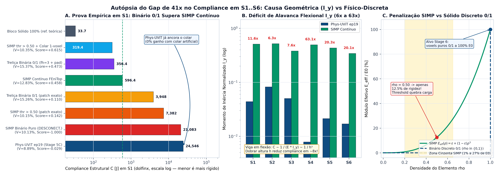
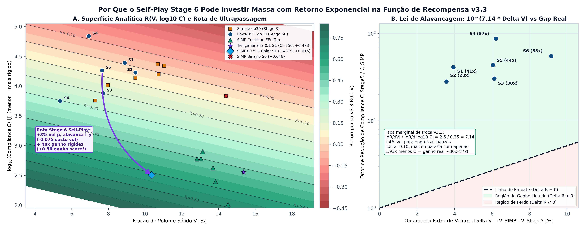
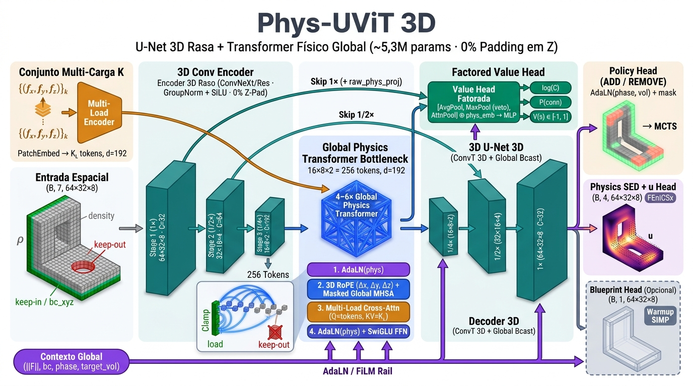
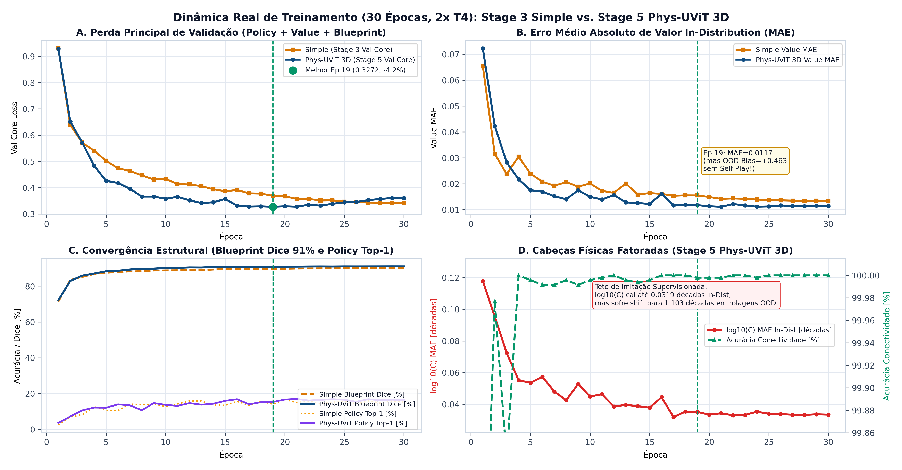
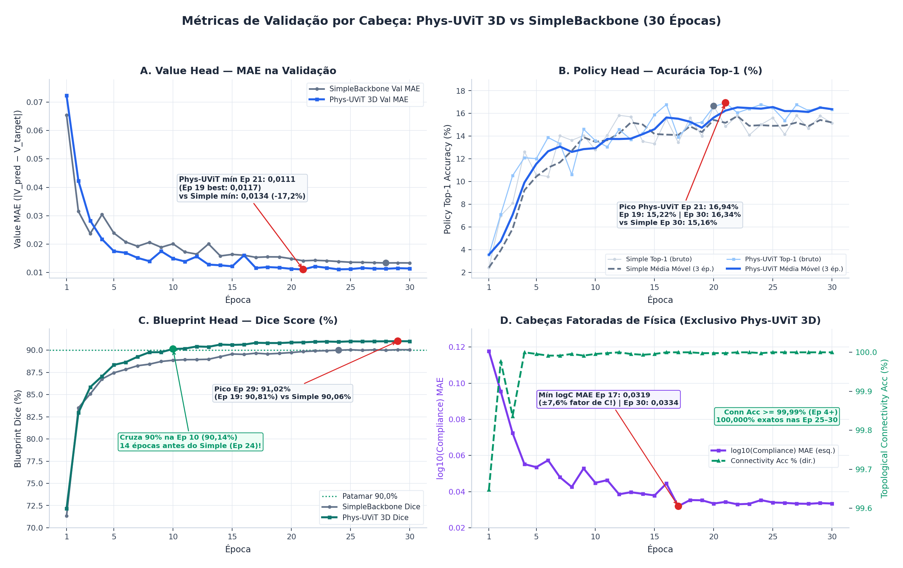
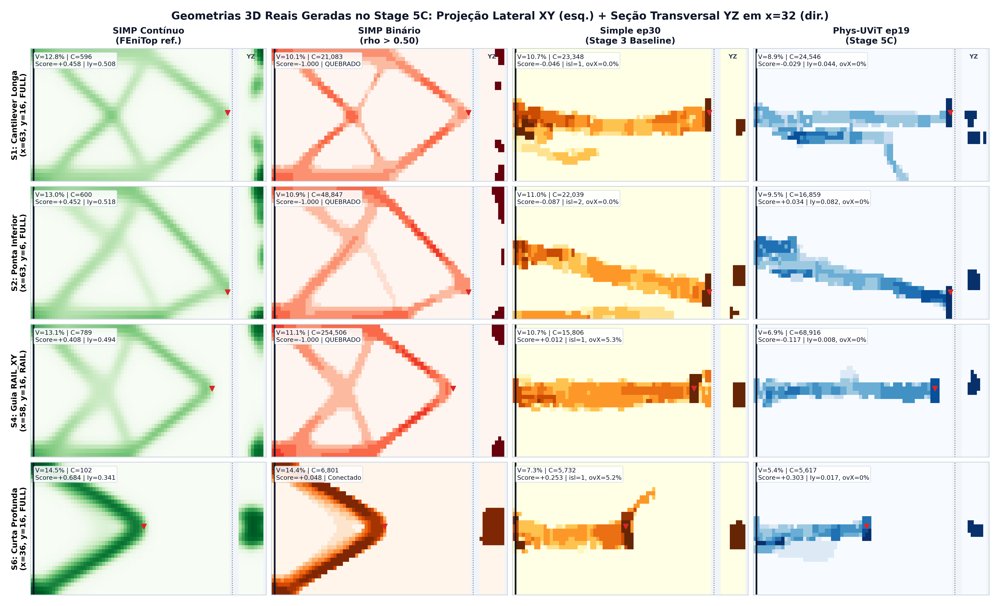
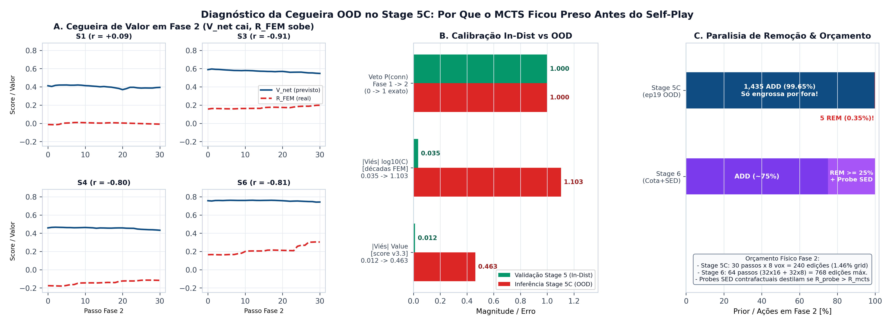
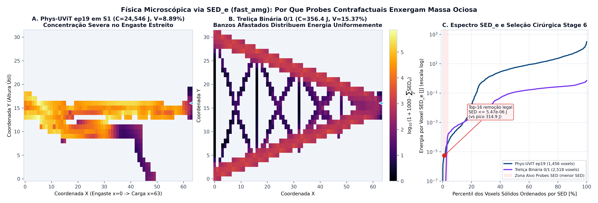

# AlphaBuilder v4.0: Dos Primeiros Princípios da Elasticidade 3D ao Self-Play Físico com Phys-UViT 3D

**Documento de estudo consolidado e fundamentação da Fase 6**  
**Repositório:** `alphabuild` (`v3.3 -> v4.0 Stage 6`) | **Arquitetura alvo:** `Phys-UViT 3D` (`4,884,839` parâmetros no Stage 5; `4,912,683` com a cabeça de energia densa `sed_head` ativada no Stage 6) | **Oráculo físico:** `DOLFINx` / `FEniTop` e `StructuredHex8FEM` (`fast_amg`)

---

## Sumário Lógico

- **Parte I — A Física do Problema a partir de Primeiros Princípios:** elasticidade linear tridimensional, *compliance*, energia de deformação elemento a elemento, papel da altura útil e do momento de inércia, funcionamento e armadilha da zona cinzenta no `SIMP`, verificação empírica discreta no `dolfinx` e aceleração exata com `fast_amg`.
- **Parte II — Transformando Mecânica Contínua em um Jogo Discreto 3D (`AlphaBuilder v3.3`):** construção sequencial em duas fases, matriz esparsa vs. topologia conectada, moldagem de recompensa em Fase 1 (`PBRS`), matemática da recompensa `v3.3`, lei de troca massa--rigidez e funcionamento interno da busca em árvore (`MCTS`).
- **Parte III — Do Pré-Treino por Imitação à Arquitetura Final (`SimpleBackbone` $\to$ `Swin-UNETR` $\to$ `Phys-UViT 3D`):** banco de *warmup*, simetrias exatas do domínio, desvio de covariáveis, anatomia comparada das arquiteturas neurais, leitura das curvas reais de treinamento e escolha entre GPU e TPU.
- **Parte IV — Autópsia do Gap de `41x` contra o `SIMP` Contínuo:** resultados completos nos seis cenários canônicos `S1..S6`, inspeção das geometrias tridimensionais e seções transversais, experimento controlado com colar protetor e isolamento dos quatro gargalos físicos e numéricos do Stage 5C.
- **Parte V — A Mecânica Completa do *Self-Play* (Fase 6):** as cinco alavancas cirúrgicas ligadas diretamente a cada gargalo, função de perda composta multi-cabeça, anatomia temporal de um episódio completo e currículo progressivo em quatro anéis concêntricos (`Tier 0` a `Tier 3`) com portão adaptativo.
- **Parte VI — Fundamentação Quantitativa e Previsões para Superar `SIMP_bin` e `SIMP_cont`:** distinção entre dados medidos (`Gen 0`) e projeções modeladas (`Gen 1..8`), decomposição multiplicativa do ganho, orçamento de computação, critérios objetivos de promoção ou parada e guia prático para rodar o notebook no Kaggle quando a cota renovar.

---

## Parte I — A Física do Problema a partir de Primeiros Princípios

### 1.1 Do Meio Contínuo à Formulação Fraca e à *Compliance*

Todo projeto estrutural começa pela mesma questão da mecânica dos sólidos: dado um volume tridimensional disponível $\Omega = [0, L_x] \times [0, L_y] \times [0, L_z]$, certas faces ou regiões onde a estrutura está presa com apoios rígidos ou móveis ($\Gamma_u$, representadas no código pelo mapa booleano de vínculos `bc_masks`) e regiões onde atuam carregamentos externos $\mathbf{f} = (f_x, f_y, f_z)$ (`forces`), **onde vale a pena colocar material sólido e onde o espaço pode ficar vazio para transmitir a carga aos apoios com máxima rigidez e mínimo peso?**

No regime linear elástico — pequenas deformações, material homogêneo isotrópico e resposta proporcional ao esforço —, todo ponto material em equilíbrio satisfaz a equação diferencial parcial de equilíbrio de Cauchy:

$$\nabla \cdot \boldsymbol{\sigma} + \mathbf{f} = \mathbf{0}, \qquad \boldsymbol{\varepsilon}(\mathbf{u}) = \frac{1}{2}\Big(\nabla \mathbf{u} + (\nabla \mathbf{u})^\top\Big), \qquad \boldsymbol{\sigma}(\mathbf{u}) = \lambda(\rho)\,\mathrm{tr}(\boldsymbol{\varepsilon})\,\mathbf{I} + 2\mu(\rho)\,\boldsymbol{\varepsilon},$$

em que $\mathbf{u} = (u_x, u_y, u_z)$ é o campo vetorial de deslocamentos, $\boldsymbol{\varepsilon}$ é o tensor simétrico de deformações, $\boldsymbol{\sigma}$ é o tensor de tensões de Cauchy e $(\lambda, \mu)$ são as constantes elásticas de Lamé moduladas pela presença local de material $\rho(\mathbf{x}) \in \{0, 1\}$.

Para resolver esse sistema numericamente em geometrias arbitrárias, a formulação clássica de Elementos Finitos (FEM) multiplica a equação de equilíbrio por qualquer campo de deslocamentos virtuais cinematicamente admissível $\mathbf{v} \in \mathcal{U}_0$ (isto é, qualquer deformação imaginária compatível que respeite deslocamento zero nos apoios $\Gamma_u$) e integra por partes via Teorema da Divergência, obtendo o **Princípio dos Trabalhos Virtuais**:

$$\int_{\Omega} \boldsymbol{\sigma}(\mathbf{u}) : \boldsymbol{\varepsilon}(\mathbf{v})\,\mathrm{d}\Omega = \int_{\Omega} \mathbf{f} \cdot \mathbf{v}\,\mathrm{d}\Omega \qquad \forall \mathbf{v} \in \mathcal{U}_0.$$

O equilíbrio verdadeiro $\mathbf{u}^*$ é precisamente aquele que minimiza a energia potencial elástica total $\Pi(\mathbf{u}) = \frac{1}{2} a(\mathbf{u}, \mathbf{u}) - \ell(\mathbf{u})$. No ponto de equilíbrio, a energia interna acumulada iguala metade do trabalho externo, e o dobro dessa energia mede o quanto a estrutura "cede" sob o carregamento: essa grandeza escalar global chama-se ***compliance* estrutural** $C$ (medida em Joules no sistema adimensional adotado). Quanto **menor** a *compliance* $C$, mais rígida é a peça.

### 1.2 Discretização em Cubos Unitários (`Hex8`) e Decomposição Local de Energia

Em vez de trabalhar com malhas tetraédricas irregulares que variam de peça para peça, o AlphaBuilder discretiza o bloco $\Omega$ em uma grade cartesiana tridimensional regular de cubos unitários de aresta $h = 1$. Em processamento geométrico e computação gráfica, cada cubo unitário dessa grade é chamado de ***voxel*** (*volumetric pixel*, o equivalente tridimensional ao *pixel* de uma fotografia). Na engenharia estrutural, cada *voxel* funciona exatamente como um elemento finito hexaédrico trilinear de 8 vértices (**`Hex8`**).

No domínio canônico de treinamento do projeto, a grade mede `64 x 32 x 8` (`16,384` elementos `Hex8`), com `65 x 33 x 9 = 19,305` nós e `3` deslocamentos por nó, somando **`57,915` graus de liberdade translacionais** no vetor global $\mathbf{u}$. Dentro do cubo padrão $[-1, 1]^3$, o deslocamento varia trilinearmente a partir dos oito cantos pelas funções de forma $N_a(\xi,\eta,\zeta) = \frac{1}{8}(1+\xi_a\xi)(1+\eta_a\eta)(1+\zeta_a\zeta)$. Integrando a relação deformação--deslocamento $\mathbf{B}(\boldsymbol{\xi}) \in \mathbb{R}^{6\times 24}$ contra a matriz constitutiva isotrópica unitária $\mathbf{D}_0(\nu)$ (com coeficiente de Poisson $\nu = 0.25$ e módulo de Young sólido nominal $E_0 = 100$) por quadratura de Gauss $2 \times 2 \times 2$, obtemos a matriz de rigidez elementar unitária $\mathbf{K}_e^{(0)} \in \mathbb{R}^{24\times 24}$ — **idêntica para todos os $16{,}384$ cubos da grade e pré-computada uma única vez**.

Montando a contribuição de todos os elementos escalados pelo módulo efetivo $E_{\mathrm{eff}}(\rho_e)$, chegamos ao sistema linear simétrico positivo definido $\mathbf{K}(\boldsymbol{\rho})\,\mathbf{u} = \mathbf{f}$ e a uma identidade algébrica central para tudo o que veremos adiante:

$$C(\boldsymbol{\rho}) = \mathbf{f}^\top \mathbf{u} = \mathbf{u}^\top \mathbf{K}(\boldsymbol{\rho})\,\mathbf{u} = \sum_{e=1}^{N} \underbrace{E_{\mathrm{eff}}(\rho_e)\,\mathbf{u}_e^\top \mathbf{K}_e^{(0)} \mathbf{u}_e}_{\mathrm{SED}_e}.$$

À primeira vista, a *compliance* $C$ parece apenas um número global difícil de atribuir a regiões individuais da viga. A decomposição acima mostra o oposto: $C$ é exatamente a **soma elementar das energias locais de deformação**, denotada aqui por **`SED_e`** (*Strain Energy Density* do elemento $e$, também em Joules). Todo cubo sólido que quase não participa da transmissão de esforços (como uma ponta morta sem apoio ou um enchimento próximo à linha neutra em flexão) acumula $\mathrm{SED}_e$ próximo de zero ($10^{-6}\text{ J}$), enquanto um cubo crítico na raiz do engaste sob tração ou compressão máxima concentra dezenas ou centenas de Joules.

> **Papel físico da altura em flexão (viga de Euler--Bernoulli):** Para uma viga em balanço de vão $L$ com carga concentrada $F$, a flecha de ponta escala com $\delta \propto F L^3 / (3 E I_y)$ e a *compliance* escala como $C = F\delta \propto F^2 L^3 / (3 E I_y)$, onde $I_y = \int y^2\,\mathrm{d}A$ é o segundo momento de área em torno da linha neutra horizontal. Como o afastamento vertical $y$ entra **ao quadrado** dentro da integral (e proporcional ao cubo da espessura total em seções maciças), abrir dois banzos periféricos afastados nas bordas superior e inferior de um domínio de altura $H = 32$ reduz drasticamente a *compliance* usando a **mesmíssima massa** de uma barra central estreita. Em números concretos da grade $64\times 32\times 8$: uma barra sólida central de altura $h = 4$ ocupando $V = 12.5\%$ tem $I_y^{\mathrm{rasa}} = b \cdot 4^3 / 12 = 5.33\,b$; separando exatamente essa mesma área em dois banzos de espessura $2$ junto às faces $y=0$ e $y=31$ ($H_{\mathrm{ext}} = 32$, vão interno vazado $h_{\mathrm{int}} = 28$), o momento de inércia salta para $I_y^{\mathrm{vazada}} = b(32^3 - 28^3)/12 = 901.33\,b$ — **quase $170\times$ maior em flexão pura** (e próximo de $49\times$ na prática tridimensional após descontar o cisalhamento da alma de ligação).

### 1.3 O Método `SIMP` Contínuo, `DOLFINx`/`FEniTop` e a Armadilha da Zona Cinzenta

Como escolher diretamente quais cubos entre $16{,}384$ devem ser `0` ou `1` exige testar $2^{16{,}384}$ combinações discretas, a otimização topológica clássica desenvolvida por Bendsøe e Sigmund utiliza a técnica **`SIMP`** (*Solid Isotropic Material with Penalization*). Em nosso projeto, os referenciais clássicos rodam através do ambiente científico aberto **`DOLFINx` / `FEniCSx`** — plataforma que traduz equações variacionais escritas em sintaxe matemática simbólica (**`UFL`**) para rotinas rápidas de Elementos Finitos compiladas em C++ — em conjunto com a biblioteca paralela de otimização topológica **`FEniTop`**.

No `SIMP`, substitui-se a escolha discreta $\rho_e \in \{0, 1\}$ por uma densidade contínua intermediária $\rho_e \in [0, 1]$, aplicando uma penalização de potência cúbica sobre a rigidez elástica efetiva:

$$E_{\mathrm{eff}}(\rho_e) = \big[\epsilon + (1 - \epsilon)\,\rho_e^p\big]\,E_0, \qquad p = 3,\quad \epsilon = 10^{-6}.$$

Essa suavização transforma um problema combinatório intratável em um problema diferenciável resolvível por descida de gradiente (método adjunto):

$$\frac{\partial C}{\partial \rho_e} = -\mathbf{u}^\top \frac{\partial \mathbf{K}}{\partial \rho_e}\mathbf{u} = -p(1 - \epsilon)\,\rho_e^{p-1}\,E_0\,\mathbf{u}_e^\top \mathbf{K}_e^{(0)} \mathbf{u}_e.$$

Para evitar padrões em "tabuleiro de xadrez" instáveis na malha e controlar a espessura mínima das barras, o `FEniTop` aplica um filtro espacial em campo nodal linear contínuo (**`CG1`**, *Continuous Galerkin* de grau 1, que interpola valores suavemente entre vértices — contrastando com campos descontínuos por elemento **`DG0`**, constantes dentro de cada cubo como $\mathrm{SED}_e$) e uma projeção de Heaviside progressiva com parâmetro $\beta$ crescente.

Porém, conforme analisado criticamente por Sigmund (2022) e visível no Painel C da Figura 1, a lei $\rho^3$ esconde uma fragilidade importante quando a peça precisa ser fabricada de forma estritamente discreta (`0` ou `1`, sem material semissólido). Um elemento na faixa intermediária com $\rho_e = 0.50$ consome metade da cota linear de volume, mas entrega apenas $0.50^3 = 12.5\%$ da rigidez nominal $E_0$. No otimizador contínuo, essa "névoa elástica" barata forma membranas diagonais difusas e um acolchoamento semitransparente em `CG1` ao redor do ponto de aplicação da carga. Quando fazemos o corte binário direto (`rho > 0.50`, produzindo nossa referência discreta **`SIMP_bin`**), essas regiões cinzentas desaparecem de forma abrupta e **a estrutura desconecta o engaste da carga em 5 dos 6 cenários de teste canônicos (`S1..S5`), falhando com pontuação mínima (`Score = -1.000`)**.


*Figura 1: Diagnóstico empírico em `dolfinx` para os cenários canônicos `S1..S6`. Em (A), testemunhas estritamente binárias `0/1` em `S1` atingem `C = 356.4 J` e `319.4 J`, superando o `SIMP` contínuo (`596.4 J`), enquanto acrescentar um colar sólido ao redor da carga não altera o resultado da rede neural (`24,546 J`). Em (B), a diferença geométrica central aparece na razão de momentos de inércia $I_y$ ($6.3\times$ a $63.1\times$ menor na rede antes do Self-Play). Em (C), vê-se a perda de rigidez causada pelo expoente cúbico $\rho^3$ na faixa intermediária do `SIMP`.*

### 1.4 O Que Acontece Quando Testamos Estruturas Discretas Puras Diretamente no `dolfinx`?

Diante de uma rede neural que obteve *compliance* $41.1\times$ pior que o `SIMP` contínuo no cenário `S1` (`24,546 J` contra `596.4 J`), surge uma dúvida natural antes de qualquer ajuste algorítmico: **será que voxels discretos `0/1` conseguem sequer competir com a liberdade contínua $\rho \in [0, 1]$ do `SIMP` dentro de uma grade `64x32x8`, ou existe um teto físico intransponível imposto pela própria discretização binária?**

Para responder sem especulações, construímos e avaliamos geometrias controladas diretamente no solver exato `dolfinx` sobre o cenário longo `S1` (`x = 63, y = 16`, engaste total em $x = 0$):

| Configuração Estrutural Avaliada em `S1` (`dolfinx`) | Volume Sólido $V$ | Conectada? | Compliance $C$ [J] | Deslocamento $u_{\max}$ | Score `v3.3` |
| :--- | :---: | :---: | :---: | :---: | :---: |
| Bloco sólido total `100%` (limite teórico do domínio) | `100.00%` | Sim | `33.68` | --- | --- |
| `SIMP > 0.50` + colar sólido de 1 voxel envolvendo a carga | `10.35%` | Sim | **`319.37`** | `19.6` | **`+0.615`** |
| Treliça binária `0/1` pura (`fh=3, z=2..6` + almofada 1 vox na carga) | `15.37%` | Sim | **`356.42`** | `14.6` | **`+0.473`** |
| `SIMP` Contínuo (`FEniTop` referência contínua) | `12.83%` | Sim | `596.42` | `34.3` | `+0.458` |
| Treliça binária `0/1` (`fh=3`, apenas área exata da carga sem colar) | `15.26%` | Sim | `3,948.45` | --- | `+0.110` |
| `SIMP > 0.50` restrito ao patch exato da carga (sem colar) | `10.15%` | Sim | `7,382.40` | --- | `+0.142` |
| `SIMP_bin` puro (corte direto `rho > 0.50` sem proteção) | `10.13%` | **Não** | `21,083.35` | `6,626.7` | `-1.000` |
| Rede `Phys-UViT ep19` (Stage 5C antes do Self-Play) | `8.89%` | Sim | `24,546.42` | `1,009.9` | `-0.029` |

Esses resultados respondem à pergunta de forma definitiva e simultaneamente esclarecem o caminho adiante. Estruturas puramente discretas `0/1` **já superam o `SIMP` contínuo tanto em rigidez absoluta quanto em pontuação** (`356.42 J` e `319.37 J` contra `596.42 J`), porque cada cubo sólido entregue na treliça ou na viga discreta opera a `100%` de $E_0$ em vez de desperdiçar frações de volume na faixa cinzenta $\rho^3$. Ao mesmo tempo, o contraste entre `356.42 J` e `3,948.45 J` ao proteger ou não a vizinhança imediata de 1 voxel ao redor dos nós carregados revela quão sensível é o acoplamento local da força na malha `Hex8`. Voltaremos a esse acoplamento na Parte IV para verificar se a rede neural já o domina ou se a causa do seu gap de `41x` é outra.

### 1.5 Acelerando o Oráculo Físico Sem Perder Precisão: `StructuredHex8FEM` (`fast_amg`) vs. `DOLFINx`

Antes de deixar a física contínua, há um obstáculo prático decisivo para a fase de aprendizado por interação (*Self-Play*): aprender por tentativa e erro em dezenas de milhares de topologias intermediárias exige consultar o oráculo elástico e obter o mapa completo $\mathrm{SED}_e$ a cada passo conectado. Chamar o `DOLFINx` por meio de compilação simbólica UFL consumia até **`41.9 segundos`** em um único passo do cenário curto `S6` — tornando centenas de episódios computacionalmente inviáveis.

Para resolver esse gargalo sem comprometer a física, escrevemos em `alphabuilder/src/logic/selfplay/fast_fem.py` um solver linear vetorizado especializado em grades hexaédricas regulares, chamado **`StructuredHex8FEM`** (executado sob o modo **`fast_amg`**):

1. **Montagem vetorizada em blocos $3\times 3$ (`BSR`):** em uma grade cartesiana, cada vértice interno acopla-se a exatos 27 vizinhos no estêncil trilinear. Em vez de percorrer `16,384` elementos em laços lentos de Python, armazenamos a matriz global de rigidez em formato **`BSR`** (*Block Sparse Row*, onde cada entrada é um bloco denso $3\times 3$ correspondente aos deslocamentos $u_x, u_y, u_z$) e pré-computamos um mapa de montagem vetorizada em 8 lotes fixos.
2. **Multigrid Algébrico com Modos Rígidos (`PyAMG` + `splu`):** para resolver $\mathbf{K}\mathbf{u} = \mathbf{f}$ rapidamente, combinamos o método iterativo de **Gradientes Conjugados (`CG`)** ao pré-condicionador de **Multigrid Algébrico Suavizado (`PyAMG`)**. O pré-condicionador constrói versões hierárquicas cada vez mais grossas da malha para eliminar ondas longas de erro (flexão global da viga) em poucas iterações. Como estruturas 3D possuem seis deslocamentos sem deformação — 3 translações e 3 rotações rígidas (`rbm_modes`) — fornecemos essa base ortogonal explicitamente ao multigrid e substituímos a resolução do menor nível grosso (`max_coarse = 300`) por fatoração esparsa exata direta (**`splu`**, eliminando os travamentos iterativos que ocorriam no `S6`).
3. **Projeção de modos nulos em apoios parciais ou móveis:** em apoios de ponte bi-apoiada ou guias deslizantes livres ao longo de um eixo (`RAIL_XY`), uma componente rígida global pode não estar travada se o engaste não bloquear aquele grau de liberdade; o solver detecta automaticamente os eixos livres a partir de `bc_masks` e projeta a média desses eixos para impedir deriva numérica.

Nos testes cruzados contra o `DOLFINx`, a primeira implementação do extrator de energia local de deformação no módulo de avaliação (`evaluator.py`) mostrou um erro sutil de `4.8%`: consultar o integrando elástico apenas no ponto central de cada elemento (`DG0` por ponto médio) sub-integrava os modos lineares de flexão dentro de cada cubo `Hex8`, somando `329.86 J` contra uma *compliance* real de `346.42 J`. Ao substituir pela **projeção exata de Galerkin de grau 2** sobre funções-base constantes por elemento ($\int \boldsymbol{\sigma}(\mathbf{u}):\boldsymbol{\varepsilon}(\mathbf{u})\,\psi_e\,\mathrm{d}\Omega$), atingimos paridade de precisão numérica entre os dois solvers:

| Conjunto de Testes Verificados | Erro Relativo em Compliance $C$ | Erro Relativo em $u_{\max}$ | Consistência $\sum \mathrm{SED}_e$ vs. $C$ | Latência Medida (`64x32x8`) |
| :--- | :---: | :---: | :---: | :---: |
| Cenários Stage 5C (`S1..S6`, engaste total e guia) | `1.11e-10` a `1.25e-6` | $\le 3.49 \times 10^{-6}$ | `4.20e-9` a `2.88e-8` | `2.3`--`7.4 s` (vs. `41.9 s`) |
| Generalização 3D (`DualPad+3D`, ponte `MBB`, `DeepBeam`) | `4.50e-11` a `1.05e-7` | `3.10e-8` a `2.54e-7` | `< 1e-5` (teste unitário) | `1.11`--`1.90 s` |
| Malha `24x12x4` com cavidade (comparação voxel a voxel) | `< 1e-3` | `< 1e-3` | `< 1e-5` | `< 0.15 s` |

---

## Parte II — Transformando Mecânica Contínua em um Jogo Discreto 3D (`AlphaBuilder v3.3`)

### 2.1 Por Que Construir Passo a Passo Supera Geradores Diretos (*One-Shot*)

Uma alternativa tentadora em aprendizado profundo é treinar uma rede neural para receber as condições de contorno e devolver a geometria final inteira em uma única passagem (*one-shot*), como fazem modelos gerativos de imagens ou difusão. Contudo, na engenharia estrutural discreta essa abordagem enfrenta uma falha crítica: **um único *voxel* omitido entre a carga e o apoio transforma a estrutura inteira em um mecanismo hipostático ou em blocos desconectados com rigidez zero**. Em geometrias ou posições de carga não vistas no treino, geradores *one-shot* falham com frequência por falta de restrição topológica explícita passo a passo.

O AlphaBuilder evita esse colapso tratando o projeto ótimo diretamente no conjunto discreto $\{0, 1\}^N$ como um **Processo de Decisão de Markov (`MDP`) sequencial em duas fases**, exatamente análogo a um jogo de tabuleiro tridimensional onde cada jogada altera o estado físico da peça e apenas a geometria presente determina os próximos movimentos válidos:

```
  [Estado Vazio: V = 0% (Fase 1)]
                 |
                 v
  +------------------------------+      Desconectado (adiciona 32 vox/passo, PBRS)
  |     Fase 1: MCTS GROWTH      | <----+
  | Adições 6-conexas legais     | -----+
  +------------------------------+
                 |  Primeira ilha contínua une apoio e carga (P(conn) = 1)
                 v
  +------------------------------+      Até 64 passos (lotes 16 -> 8, ADD e REMOVE)
  |   Fase 2: MCTS REFINEMENT    | <----+
  | Oráculo real fast_amg + SED  | -----+
  +------------------------------+
                 |  Fim do orçamento ou colapso (score -1.0)
                 v
  [Estado Terminal: Backprop + SED + fem_probes no SQLite]
```

Na **Fase 1 (`GROWTH`)**, o domínio começa completamente vazio ($\boldsymbol{\rho} = \mathbf{0}$). As jogadas legais aceitam apenas adições (`ADD`) na vizinhança de face (6-conectividade cartesiana: $\pm x, \pm y, \pm z$) da massa já construída ou adjacente aos vínculos de apoio, sempre respeitando áreas proibidas (`domain_mask = 0`). Para atravessar vãos longos em poucos lances, cada jogada adiciona um pequeno lote de `32` *voxels* simultâneos.

No exato instante em que uma única ilha contínua de material liga os apoios a toda a região carregada, o problema muda de natureza e o sistema transita para a **Fase 2 (`REFINEMENT`)**. A partir daqui, o sistema linear $\mathbf{K}\mathbf{u} = \mathbf{f}$ torna-se bem-posto, o agente proíbe qualquer remoção sobre células protegidas de apoio e carga, e passa a esculpir aberturas (remoções **`REMOVE`**) e reforços (adições **`ADD`**) guiado pelo oráculo FEM exato.

### 2.2 Moldagem de Recompensa em Fase 1 (`PBRS`) Sem Distorcer o Ótimo

Enquanto a estrutura ainda não ligou apoio e carga na Fase 1, a matriz de rigidez $\mathbf{K}(\boldsymbol{\rho})$ é singular (ou desconexa no circuito externo): não existe *compliance* nem gradiente elástico útil para informar se um ramo cresce em direção à carga ou se desvia pelo vazio. Para evitar buscas cegas em domínios novos, mas garantindo ao mesmo tempo que essa ajuda heurística nunca desvie a peça do ótimo elástico final após conectar, empregamos **Moldagem de Recompensa Baseada em Potencial (`PBRS`, *Potential-Based Reward Shaping*)**:

$$\Phi(s) = w_{\mathrm{conn}}\, f_{\mathrm{conn}}(s) + w_{\mathrm{dist}}\max\!\left(0,\; 1 - \frac{d_{\min}(s)}{D_{\mathrm{diag}}}\right)\,\mathbb{I}\!\left[f_{\mathrm{conn}}(s) < 0.999\right] - P_{\mathrm{island}}(s),$$

em que $f_{\mathrm{conn}}(s) \in [0, 1]$ mede a fração da zona carregada já conectada ao engaste, $w_{\mathrm{conn}} = 0.50$, $w_{\mathrm{dist}} = 0.25$, $D_{\mathrm{diag}} = \sqrt{D^2 + H^2 + W^2}$ é a diagonal máxima da caixa, $d_{\min}(s)$ é a menor distância euclidiana entre a frente conectada ao apoio e os nós de carga ainda isolados, e $P_{\mathrm{island}}(s)$ penaliza fragmentos soltos inúteis.

Na avaliação das folhas da árvore de busca, o peso heurístico mistura-se à previsão da rede neural por um coeficiente linearmente decrescente ao longo das gerações de treinamento:

$$V_{\mathrm{leaf}}(s) = \big(1 - \alpha(g)\big)\,V_{\mathrm{net}}(s) + \alpha(g)\,\Phi(s), \qquad \alpha(g) = 0.30\,\max\!\left(0,\; 1 - \frac{g}{5}\right).$$

Essa formulação possui duas propriedades limpas: assim que a peça conecta ($f_{\mathrm{conn}} \ge 0.999$), o termo de atração por distância anula-se identicamente, não atraindo massa ociosa para a Fase 2; e a partir da quinta geração ($\alpha(5) = 0$), a busca torna-se $100\%$ autônoma da heurística geométrica inicial.

### 2.3 A Matemática da Recompensa `v3.3` e a Lei Analítica de Troca Massa--Rigidez

Uma vez conectada a estrutura, seu mérito estrutural passa a ser medido exclusivamente pelas equações calibradas de recompensa do módulo `reward.py`:

$$S_C(C) = \mathrm{clip}\!\Big(1.15 - 0.35\,\big(\log_{10}(\max(C, 1)) - 1\big),\; -0.60,\; 0.90\Big),$$

$$B_V(V) = \mathrm{clip}\!\Big(2.5\,(0.10 - V),\; -0.60,\; 0.30\Big),$$

$$R(C, V, u_{\max}) = \mathrm{clip}\!\Big(S_C(C) + B_V(V),\; -1.0,\; 1.0\Big) - P_{u_{\max}},$$

onde a penalidade de pré-colapso $P_{u_{\max}}$ permanece igual a zero até $70\%$ do teto físico de deslocamento (`DISPLACEMENT_LIMIT_RAW = 128,000`), cresce linearmente até $-0.50$ ao atingir esse teto e encerra o episódio em $-1.0$ acima dele ou caso a peça desconecte.

Observe a consequência imediata das inclinações escolhidas dentro da faixa linear dessa função de recompensa. Calculando a razão entre quanto se perde por acrescentar volume $V$ e quanto se ganha ao reduzir a *compliance* em escala logarítmica:

$$\left|\frac{\partial R / \partial V}{\partial R / \partial \log_{10} C}\right| = \frac{2.5}{0.35} \approx 7.143 \quad \Longrightarrow \quad \left.\frac{C_{\mathrm{antes}}}{C_{\mathrm{depois}}}\right|_{\Delta R = 0} = 10^{7.143\,\Delta V}.$$

Traduzindo essa expressão para decisões práticas de projeto: investir $\Delta V = +4\%$ de material sólido adicional custa apenas $-0.100$ ponto no bônus de volume $B_V(V)$. Esse investimento empata ($R$ constante) assim que a *compliance* cair meramente $10^{7.143 \times 0.04} = 1.93\times$; qualquer redução de *compliance* maior que $1.93\times$ gera lucro líquido crescente no escore. Ora, como vimos pela mecânica de Euler--Bernoulli na Seção 1.2, afastar banzos verticais reduz a *compliance* em **dezenas de vezes**. A Figura 2 visualiza essa superfície exata de recompensa e mostra por que os cenários reais de `S1..S6` dispõem de ganhos entre $28\times$ e $87\times$ para investir com folga.


*Figura 2: Superfície analítica da recompensa `v3.3` $R(V, \log_{10} C)$ com as soluções reais medidas em `dolfinx` (A) e a curva de empate $10^{7.143\,\Delta V}$ comparada ao ganho real de rigidez disponível nos seis cenários `S1..S6` (B).*

### 2.4 Mecânica Interna da Busca em Árvore (`MCTS`): `PUCT`, *Virtual Loss*, `MixMax` e Retropropagação

Mesmo restringindo cada jogada às fronteiras 6-conexas, uma grade de $16{,}384$ *voxels* oferece centenas ou milhares de posições candidatas por turno. Para explorar o futuro sem avaliar todas as possibilidades no solver FEM, o AlphaBuilder adapta a **Busca em Árvore de Monte Carlo (`MCTS`)** popularizeda pelo `AlphaZero` e estendida a estruturas discretas no `AlphaTruss`:

1. **Poda de ramificação (`top_k = 64`):** ao expandir um nó da árvore, a rede neural gera uma pontuação bruta (*logit*) e aplica a função **softmax** (que converte pontuações reais quaisquer em probabilidades positivas que somam `1.0`) apenas sobre os movimentos válidos (`domain_mask` e regras geométricas). Conservamos os `64` melhores candidatos e renormalizamos suas probabilidades a priori $P(s, a)$ para somar exatamente `1.0`.
2. **Critério de seleção `PUCT` com *Virtual Loss*:** durante as simulações da busca (por padrão `160` visitas por turno no experimento atual), escolhemos ramos combinando valor estimado e bônus de exploração. Como enviar uma única geometria por vez à placa gráfica subutiliza o hardware, descemos lotes de `8` simulações em paralelo pela árvore aplicando uma **perda virtual (*Virtual Loss*)** temporária $n_{\mathrm{vl}}(s, a)$ aos nós atualmente em trânsito, forçando as outras linhas do lote a investigar ramos alternativos antes de o resultado neural retornar:

$$a^* = \arg\max_{a \in \mathcal{A}_{\mathrm{top}\text{-}k}(s)} \left[ Q_{\mathrm{mix}}(s, a) + c_{\mathrm{puct}}\,P(s, a)\,\frac{\sqrt{\sum_b N(s, b)}}{1 + N(s, a) + n_{\mathrm{vl}}(s, a)} \right].$$

3. **Operador `MixMax` ($\beta = 0.75$ na Fase 1):** em um tabuleiro tradicional, o valor de um nó costuma ser a média simples $W(s,a)/N(s,a)$ de todas as simulações que passaram por ali. Contudo, na Fase 1 de engenharia estrutural, quase todo passo desconexo ainda parece ruim enquanto poucos ramos encontram a ligação com a carga. Se usássemos apenas a média ($\beta = 1.0$), nove simulações fracassadas poderiam afogar o único ramo promissor que conectou a peça. Seguindo o `AlphaTruss`, usamos $Q_{\mathrm{mix}}(s,a) = \beta\,\frac{W(s,a)}{N(s,a)} + (1-\beta)\max_{\tau} V(\tau)$ com $\beta = 0.75$ na Fase 1 e $\beta = 1.0$ (esperança estatística pura) na Fase 2.
4. **Retropropagação de alvos para treino (`backpropagate_value_targets`):** encerrado o episódio e conhecido o escore final real $R_{\mathrm{final}}$, cada estado gravado no banco de dados recebe um alvo de valor calibrado: na Fase 1 usa-se o retorno descontado até o turno da primeira conexão $t_{\mathrm{P2}}$ ($v_t = \gamma^{t_{\mathrm{P2}}-t} R_{\mathrm{final}}$ com $\gamma = 0.99$), ao passo que na Fase 2 interpola-se a avaliação real do oráculo FEM em cada estado intermediário ($v_t = (1-\lambda_t) R_{\mathrm{FEM}}(t) + \lambda_t R_{\mathrm{final}}$), preservando $-1.0$ para desconexões e colapsos.

---

## Parte III — Do Pré-Treino por Imitação à Arquitetura Final (`SimpleBackbone` $\to$ `Swin-UNETR` $\to$ `Phys-UViT 3D`)

### 3.1 O Banco de *Warmup*, Armazenamento em `SQLite` e os Limites da Imitação

Ensinar uma rede neural em **`PyTorch`** (biblioteca padrão de aprendizado profundo utilizada no projeto) do zero absoluto a ligar engastes e cargas em `16,384` *voxels* por puro ensaio aleatório consumiria tempo de computação proibitivo. Por isso, iniciamos com uma etapa de **pré-treino supervisionado por imitação**, chamada de ***warmup***: geramos previamente soluções de referência com o `FEniTop`/`SIMP` e extraímos trajetórias construtivas válidas que imitam o crescimento até a conexão (`GROWTH`) e o refinamento subsequente (`REFINEMENT`). Durante o treino, cada varredura completa pelo banco de amostras chama-se **época** (*epoch*), e cada conjunto de pesos salvo periodicamente em disco recebe o nome de ***checkpoint*** (daí referências como `ep2`, `ep19` ou `ep30`). No histórico experimental do projeto, os **Estágios 1 a 3** (`Stage 1..3`) validaram o ciclo com o modelo convolucional inicial; o **Estágio 5** (`Stage 5`) treinou a arquitetura `Phys-UViT 3D`; o **Estágio 5C** auditou esse modelo em episódios reais no `dolfinx`; e a **Fase 6** realiza o *Self-Play*.

Esse banco foi gerado de forma distribuída e gravado em um arquivo **`SQLite`** — um banco de dados relacional contido em arquivo único local que permite consultas rápidas e leitura segura concorrente sem exigir um servidor externo de banco de dados. O banco consolidado (`warmup_v3_3_kaggle.db` e divisão estratificada `split_v3_3.json`, semente `42`) separa $90\%$ dos exemplos para **treino** (ajuste de pesos) e isola $10\%$ em **validação** (para medir generalização fora da amostra ajustada):

- **`4,000` episódios completos** (`3,600` de treino e `400` de validação estratificada);
- **`477,050` quadros passo a passo**, sendo `161,500` em Fase 1 (`GROWTH`) e `315,550` em Fase 2 (`REFINEMENT`);
- **Estratégias de geração:** `3,230` trajetórias baseadas em esqueletos curvos aleatórios guiados até o contorno (`BEZIER`, `80.75%`) e `770` trajetórias derivadas diretamente do `SIMP` completo (`FULL_DOMAIN`, `19.25%`);
- **Condições de contorno de apoio no engaste ($x = 0$):** `2,759` engastes completos (`FULL_CLAMP`, `68.98%`) e `1,241` apoios deslizantes guiados (`RAIL_XY`, `31.02%`).

Durante o treino, como toda lei física da elasticidade isotrópica é invariante a rotações rígidas de $90^\circ$ em torno do eixo longitudinal $X$ e a reflexões espaciais transversais que não invertam apoios e forças acopladas, aplicamos rigorosamente as **`16` simetrias exatas do grupo diedral $D_4 \times \mathbb{Z}_2$** sincronizando estado, vínculos, forças e alvo de energia elástica — multiplicando em dezesseis vezes a diversidade geométrica efetiva sem violar o equilíbrio estático.

Mas o *warmup* por imitação cobra um preço inevitável ao sair do laboratório fechado de treino. Em aprendizado sequencial, o problema chama-se ***covariate shift*** (ou desvio de covariáveis **fora da distribuição, `OOD`**, *Out-Of-Distribution*): quando o modelo passa a tomar decisões próprias passo a passo em cenários inéditos durante uma busca `MCTS`, seus erros iniciais produzem formas geométricas intermediárias que nunca existiram nas trajetórias perfeitas do banco de *warmup*. Ao encontrar uma viga levemente diferente do seu repertório imitado, uma rede mal calibrada superestima sua rigidez ou toma decisões viciadas, levando a desvios em bola de neve.

### 3.2 Por Que as Duas Arquiteturas Anteriores Tropeçaram

Para processar estados volumétricos tridimensionais — representados matematicamente como um **tensor** 3D de formato `(B, C, D, H, W)`, onde `B` é o tamanho do lote (*batch*), `C` são os canais físicos em cada cubo (densidade $\rho$, máscaras de apoio, forças, etc.) e `(D, H, W)` são os eixos espaciais `(64, 32, 8)` — testamos e auditamos duas arquiteturas clássicas antes de projetar a rede final.

1. **`SimpleBackbone` (`4,433,132` parâmetros, `divisor = 8`):** trata-se de uma rede convolucional 3D em formato **`U-Net`** (`SimpleEncoder`, gargalo dilatado e `SimpleDecoder`), com normalização **`GroupNorm`** (que normaliza canais em pequenos grupos sem depender de lotes gigantes na memória), ativação suave **`SiLU`** e pequenas redes densas lineares (**`MLP`**, *Multi-Layer Perceptron*) para combinar grandezas globais. Em uma `U-Net`, o codificador reduz a resolução espacial para enxergar o contexto amplo da viga e o decodificador reexpande o volume usando atalhos horizontais (**`skip connections`**) que devolvem a nitidez das bordas de 1 voxel. No gargalo (`8 x 4 x 1`), porém, a `SimpleBackbone` depende de convoluções locais empilhadas com dilatações fixas `(2,2,1)` e `(4,2,1)`. Essa arquitetura atingiu `15.16%` de acurácia Top-1 na política e `90.05%` de fidelidade na silhueta global (`Blueprint Dice`), mas acumulou cinco limitações estruturais documentadas no checkpoint `ep30`: canal de forças rígido, ausência de atenção global par-a-par entre apoio e carga, uma cabeça de valor escalar única comprimida pela função `tanh` ($\in [-1, 1]$, sujeita à saturação de gradientes) com viés otimista de `+0.40` fora do treino, dependência do oráculo `SIMP` para o alvo de silhueta e uma diferença de `+8.9` pontos nos *logits* (pontuações brutas antes da função `softmax`) favorecendo `ADD` sobre `REMOVE` (`0` de `18` estados com remoção mais provável que adição).
2. **`Swin-UNETR` (`6.83M` parâmetros, `divisor = 32`):** a alternativa hierárquica padrão da literatura médica 3D (implementada na biblioteca `MONAI`) divide o domínio em janelas locais $7\times 7\times 7$ deslocadas e exige obrigatoriamente que todas as dimensões da entrada sejam múltiplas de **`32`**. Sobre uma viga esbelta `64 x 32 x 8`, satisfazer `divisor = 32` no eixo estreito obriga a preencher `Z = 8 -> 32` com **`+300%` de preenchimento artificial por zeros (*zero-padding*)**, como ilustrado na Figura 4! Três quartos inteiros dos `65,536` *voxels* processados pela rede tornavam-se ar vazio artificial, derrubando a velocidade para `169.3 ms` por estado em lote unitário (`17–20 s` por passo de `MCTS`) e projetando de `96` a `136 GPU-h` de pré-treino na `2 x Tesla T4`.


*Figura 3: Anatomia da `SimpleBackbone` (`4,433,132` parâmetros) e os cinco gargalos empíricos identificados na auditoria do Stage 3 (`ep30`): rigidez dos canais esparsos, dilatação fixa sem acoplamento global direto, colapso de posto e viés `+0.40` da cabeça escalar de valor, dependência de silhueta `SIMP` e paralisia na remoção.*


*Figura 4: Por que uma equação elíptica exige acoplamento imediato entre carga e engaste (A), o desperdício de `75%` de volume em zeros mortos exigido pelo `divisor = 32` do `Swin-UNETR` frente aos `256` tokens sem preenchimento morto da `Phys-UViT 3D` (B), e a fronteira custo-latência resultante para busca `MCTS` (C).*

### 3.3 A Arquitetura Escolhida: `Phys-UViT 3D` (`4,884,839` $\to$ `4,912,683` Parâmetros)

Em uma estrutura elástica governada por $\mathbf{K}\mathbf{u} = \mathbf{f}$, alterar um engaste em $x=0$ ou deslocar uma carga em $x=63$ muda instantaneamente a distribuição de tensões no domínio inteiro (propriedade típica de equações diferenciais parciais elípticas, representadas pela função de Green de longo alcance $G(\mathbf{x}, \mathbf{x}')$). A rede ideal precisa combinar **convoluções rasas de alta resolução para traçar bordas nítidas sem *zero-padding* no eixo $Z$** com **atenção global imediata entre todos os blocos da viga e todas as cargas aplicadas**.

Daí nasce a **`Phys-UViT 3D`** (*Physics-informed U-Net Vision Transformer 3D*), implementada no módulo `phys_uvit.py` com **`4,884,839` parâmetros ativos** no Stage 5 (e **`4,912,683` parâmetros totais** quando ativamos a cabeça densa `sed_head` no Stage 6), exibida nas Figuras 5, 6 e 7:

1. **Codificador convolucional 3D raso com `divisor = 4`:** blocos residuais modernos no estilo `ResNet`/`ConvNeXt` (`GroupNorm + SiLU`) comprimem a grade apenas duas vezes (`1x -> 1/2x -> 1/4x`). Na malha `64 x 32 x 8`, o gargalo mede exatos `16 x 8 x 2 = 256` blocos latentes (**`tokens`**), todos representando material ou domínio real com **`0%` de *zero-padding*** no eixo $Z$. Em malhas maiores ou diferentes (como `48 x 24 x 12` na Fase 6), a grade de *tokens* simplesmente torna-se `12 x 6 x 3 = 216` *tokens* sem alterar pesos da arquitetura.
2. **Gargalo *Transformer* Global com `3D RoPE` e `Multi-Load Cross-Attention`:** cada um dos `256` *tokens* troca informação direta par-a-par com todos os outros `255` via **Autoatenção Global (`Self-Attention`)**, codificando apenas a posição tridimensional **relativa** $(\Delta x, \Delta y, \Delta z)$ entre blocos através de rotações espectrais (**`3D RoPE`**, *Rotary Position Embedding*). Esse truque geométrico evita que a rede decore coordenadas absolutas da caixa de treinamento e permite generalizar para peças de outros comprimentos ou alturas. Além disso, cada bloco recebe um módulo dedicado de **Atenção Cruzada Multi-Carga (`Cross-Attention`)**, no qual cada força concentrada ou distribuída externa envia um vetor próprio e os *tokens* da estrutura consultam diretamente onde essas cargas atuam, suportando um ou múltiplos carregamentos inclinados 3D.
3. **Condicionamento Físico Contínuo (`AdaLN` / `FiLM`):** informações escalares globais (como a fase atual do jogo, a fração de volume sólido ocupada $V_{\mathrm{eff}}$ e estatísticas normalizadas das forças) modulam em escala e deslocamento todas as camadas internas da rede por Normalização Adaptativa de Camada (**`AdaLN`**). Assim, a rede sabe imediatamente se deve priorizar o fechamento topológico da Fase 1 ou o alívio de massa em Fase 2.
4. **Cabeça de Valor Fatorada (`FactoredValueHead`):** em vez de tentar acertar o escore final `[-1, 1]` diretamente em um único neurônio de saída que satura em `tanh`, essa cabeça separa a física do jogo nos três fatores exatos da equação `v3.3`: prevê a probabilidade de conectividade $p_{\mathrm{conn}} = \sigma(z_{\mathrm{conn}})$, estima o logaritmo da *compliance* $\hat{\ell}_C = \widehat{\log_{10} C}$, aplica analiticamente as próprias fórmulas determinísticas $S_C$ e $B_V$ usando o volume conhecido $V_{\mathrm{eff}}$ e soma um pequeno resíduo corretivo $\delta_{\mathrm{res}}(s)$:

$$\hat{V}(s) = \sigma(z_{\mathrm{conn}})\,\Big[\mathrm{clip}\big(S_C(10^{\hat{\ell}_C}) + B_V(V_{\mathrm{eff}}),\; -1.0,\; 1.0\big)\Big] + \big(1 - \sigma(z_{\mathrm{conn}})\big)(-1.0) + \delta_{\mathrm{res}}(s).$$

5. **Cabeça Densa Auxiliar de Energia (`sed_head`) e Silhueta (`blueprint_head`):** além da cabeça espacial de política que gera *logits* `ADD` e `REMOVE` por *voxel*, a rede conta com uma saída opcional `blueprint_head` (treinada no *warmup* para preservar o senso geométrico global do contorno do `SIMP`) e com uma saída volumétrica dedicada **`sed_head`** `(B, 4, D, H, W)` cujo primeiro canal passa no Stage 6 a prever $\log(1 + \mathrm{SED}_e)$ voxel a voxel, ensinando o gargalo *Transformer* onde concentram-se tensões e onde há massa ociosa.


*Figura 5: Diagrama completo da macro-arquitetura `Phys-UViT 3D`, integrando codificador raso sem padding morto (`divisor = 4`), barramento de cargas `Multi-Load`, gargalo *Transformer* global de `256` tokens, moduladores físicos `AdaLN`, `FactoredValueHead` e saídas espaciais.*


*Figura 6: Detalhamento do bloco *Transformer* físico com `3D RoPE` e atenção cruzada às cargas (A), correspondência direta entre os defeitos auditados na versão anterior e cada solução estrutural (B), e generalização a regiões proibidas `keep-out` via máscara ternária em atenção (C).*


*Figura 7: Visão tridimensional do fluxo de tensores na `Phys-UViT 3D`, ilustrando como o gargalo global acopla diretamente apoios e cargas no volume inteiro antes do decodificador.*

### 3.4 Curvas Reais de Treinamento (`Stage 3` vs. `Stage 5`) e Escolha de Hardware (`GPU` vs. `TPU`)

Treinada em **precisão mista automática (`AMP`)** — técnica no `PyTorch` em que multiplicações matriciais pesadas rodam em 16 bits para multiplicar velocidade e economizar memória, enquanto o cálculo das funções de perda permanece protegido em 32 bits (`float32`) — via paralelismo distribuído entre placas (**`DDP`**, *Distributed Data Parallel*), a `Phys-UViT 3D` concluiu 30 épocas no Kaggle (`2 x Tesla T4`, `15.75 horas` de relógio / `31.50 GPU-h`).

As métricas reais registradas nos arquivos de histórico (`stage3_simple_metrics_history.json` e `stage5_phys_uvit_metrics_history.json`), plotadas nas Figuras 8, 9 e 10, revelam uma convergência mais rápida e nítida do que a do antecessor convolucional:

- O melhor checkpoint em validação da `Phys-UViT 3D` ocorreu na **época 19** com perda total `val_loss = 0.3285` e núcleo `val_core_loss = 0.3272` (`-4.2%` abaixo do melhor valor da `SimpleBackbone` na época 30, `0.3415`), tendo cruzado o melhor resultado inteiro de `Simple ep30` já na época 16 (`0.3317`);
- Na cabeça de **silhueta global (`Blueprint Dice`)** — métrica clássica de sobreposição volumétrica entre `0%` e `100%` —, a `Phys-UViT` rompeu `90%` já na época 10 (`90.14%`), quatorze épocas antes da `Simple` (época 24), alcançando `90.81%` na época 19 e pico de `91.02%` na época 29;
- Na cabeça de **valor**, o erro médio absoluto (**`MAE`**, *Mean Absolute Error*, média dos módulos dos desvios) dentro dos dados de validação caiu para `0.01172` na época 19 (e mínimo `0.0111` na época 21, com redução de `-32.5%` no pico mínimo da perda de valor frente à `Simple`);
- Nas saídas fatoradas exclusivas da `Phys-UViT`, o erro em **conectividade caiu praticamente a zero** (`99.998%` de acurácia na época 19 e `100.00%` exatos entre as épocas 25 e 30) e a predição de *compliance* atingiu **`log10(C) MAE = 0.0352` décadas** na época 19 (pico mínimo de `0.0319` décadas na época 17 — equivalente a acertar a rigidez de validação dentro de cerca de $\pm 7.6\%$!).

Contudo, observe um sinal revelador nas curvas individuais (Painel B da Figura 10 e Painel D da Figura 8): a partir da época 20, enquanto o treino na cabeça de política continuava caindo (`0.1678 -> 0.1231`), a validação estabilizou em platô (`0.2806 -> 0.3113`), marcando o início de **superajuste (*overfitting*)** sobre os movimentos imitados do `SIMP`. Isso mostra que extrair ainda mais desempenho do mesmo banco estático de *warmup* atingiu seu teto natural — o próximo salto precisa vir da interação ativa com a física real.


*Figura 8: Curvas reais das `30` épocas de validação no Kaggle (`2 x T4`) comparando `Simple Stage 3` e `Phys-UViT 3D Stage 5`: perda principal (A), erro absoluto médio de valor (B), silhueta e acurácia de política (C) e convergência das cabeças físicas fatoradas (D).*


*Figura 9: Síntese detalhada por cabeça de validação comparando `Phys-UViT 3D` e `SimpleBackbone`.*


*Figura 10: Evolução de cada termo individual de perda (`Core`, `Policy KL`, `Value Huber` e `Blueprint`) ao longo das `30` épocas.*

Por fim, cabe perguntar por que manter esse modelo e o próximo estágio de *Self-Play* em **GPUs NVIDIA (`CUDA`)** em vez de **TPUs (`XLA`)** (Figura 11). Há três razões físicas e computacionais objetivas: (1) convoluções 3D de poucos canais iniciais e `GroupNorm` subutilizam as grandes unidades matriciais sistólicas (`128 x 128`) projetadas para linguagem em TPUs; (2) no Stage 6 alternamos tamanhos diferentes de domínio dentro da mesma época (`48x32x8`, `64x24x8`, `48x24x12`, `64x32x8`), e cada troca de forma de tensor dispara recompilações pesadas no compilador estático **`XLA`** da TPU, enquanto o `CUDA` em GPU executa tamanhos variados dinamicamente quase sem penalidade; e (3) a coleta de *Self-Play* alterna lotes neurais pequenos (`B = 1..8`) no `MCTS` com o solver linear `PyAMG`/`SciPy` rodando na CPU do mesmo servidor, onde a baixa latência CPU--GPU supera arquiteturas remotas otimizadas para megabatch estático.


*Figura 11: Comparação de custo de pré-treino e latência em tempo real entre `SimpleBackbone` (`4.43M`, `21.04 GPU-h` medidos, `70.8 ms`) e `Swin-UNETR` (`6.83M`, `96–136 GPU-h` estimados, `169.3 ms`). A `Phys-UViT 3D` operou a `31.50 GPU-h` reais nas mesmas `2 x T4`, mantendo viabilidade plena no limite semanal de `30h` do Kaggle com retomada simples.*

---

## Parte IV — Autópsia do Gap de `41x` contra o `SIMP` Contínuo

### 4.1 Placar Completo na Suíte Canônica (`S1..S6`) e Geometrias Reais Geradas

Uma rede neural pode exibir métricas brilhantes na validação estática e ainda assim tropeçar quando colocada no comando de um episódio completo passo a passo, onde cada escolha molda o próximo estado. Para testar o comportamento real em campo, executamos a `Phys-UViT ep19` dentro do motor `MCTS` completo (`160` simulações por passo, até `30 x 8 = 240` edições na Fase 2) sobre seis cenários canônicos inéditos de teste (`S1..S6`) e auditamos todas as peças finais diretamente no `dolfinx`:

| Cenário (`S1..S6`, `dolfinx`) | `Simple ep2` ($V / C / \mathrm{Score}$) | `Simple ep30` ($V / C / \mathrm{Score} / I_y / P_1$) | `Phys-UViT ep19` ($V / C / \mathrm{Score} / I_y / P_1 / \mathrm{hol}$) | `SIMP_bin` ($V / C / \mathrm{Score}$) | `SIMP_cont` ($V / C / \mathrm{Score} / I_y$) |
| :--- | :---: | :---: | :---: | :---: | :---: |
| `S1` (`FULL`, $x=63, y=16$) | `9.46%` / `62,228` / `-0.164` | `10.69%` / `23,348` / `-0.046` / `0.035` / `48` | `8.89%` / `24,546` / `-0.029` / `0.044` / `38` / `0.169` | `10.13%` / `21,083` / `-1.000` | `12.83%` / **`596.4`** / `+0.458` / `0.508` |
| `S2` (`FULL`, $x=63, y=6$) | `13.18%` / `17,347` / `-0.063` | `11.04%` / `22,039` / `-0.087 (2 isl)` / `49` | `9.47%` / `16,859` / **`+0.034`** / `0.082` / `41` / `0.003` | `10.91%` / `48,847` / `-1.000` | `13.04%` / **`600.4`** / `+0.452` / `0.518` |
| `S3` (`FULL`, $x=44, y=24$) | `7.32%` / `55,015` / `-0.092` | `7.96%` / `10,402` / `+0.145 (8.6% ovX)` / `34` | `7.71%` / `7,600` / **`+0.199`** / `0.050` / `32` / `0.003` | `12.78%` / `25,127` / `-1.000` | `13.84%` / **`249.6`** / `+0.565` / `0.380` |
| `S4` (`RAIL`, $x=58, y=16$) | `8.11%` / `85,583` / `-0.179` | `10.73%` / `15,806` / `+0.012 (5.3% ovX)` / `48` | `6.93%` / `68,916` / `-0.117` / **`0.008`** / `28` / `0.000` | `11.13%` / `254,506` / `-1.000` | `13.14%` / **`789.1`** / `+0.408` / **`0.494`** |
| `S5` (`RAIL`, $x=52, y=11$) | `7.91%` / `46,687` / `-0.082` | `9.47%` / `13,747` / `+0.065 (z_c=2.99)` / `41` | `7.65%` / `18,336` / **`+0.067`** `(z_c=3.32)` / `32` | `12.54%` / `70,139` / `-1.000` | `13.70%` / **`420.5`** / `+0.489` / `0.431` |
| `S6` (`FULL`, $x=36, y=16$) | `4.98%` / `36,020` / `+0.031` | `7.28%` / `5,732` / `+0.253 (5.2% ovX)` / `31` | `5.37%` / `5,617` / **`+0.303`** / `0.017` / `20` / `0.011` | `14.41%` / `6,801` / `+0.048` | `14.52%` / **`102.0`** / `+0.684` / `0.341` |
| **MÉDIA (`S1..S6`)** | `8.49%` / `50,480` / `-0.092` | `9.53%` / `15,179` / `+0.057` / `4.43% ovX` / `41.8` | **`7.67%` / `23,646` / `+0.076` / `0.00% ovX` / `31.8`** | **`-0.825`** (`5/6` falhas) | `13.51%` / **`459.7`** / **`+0.509`** |

As geometrias tridimensionais reais extraídas do banco `eval_inference_v4_stage5.db` (Figura 12) e os comparativos quantitativos da Figura 13 trazem conclusões imediatas ao olho treinado de engenheiro:

1. **Avanços claros frente ao `Simple ep30` e domínio sobre o `SIMP_bin`:** a `Phys-UViT ep19` superou o `Simple ep30` em `5` de `6` cenários (`+33.3%` no Score médio: `+0.076` vs. `+0.057`), encontrou a conexão em Fase 1 cerca de `24%` mais depressa (`31.8` vs. `41.8` passos médios), **eliminou completamente o excesso horizontal de material além do ponto de carga (*overshoot* em `X`, `ovX` — material inútil construído além da abscissa da força em balanço: `0.00%` nos 6 cenários contra `4.43%` médios do `ep30`)** e corrigiu a dupla fratura em `S2`. Em comparação ao `SIMP_bin`, venceu todos os `6` cenários — com destaque para `S6`, onde `SIMP_bin` foi o único caso que não quebrou, mas obteve `+0.048` usando `14.41%` de massa contra `+0.303` da nossa rede usando apenas `5.37%`.
2. **Defeitos residuais localizados:** em `S1`, a `ep19` deixou um minúsculo fragmento solto (`isl = 2`, custando `-0.020` de penalidade); em `S5` (cujo carregamento está posicionado em $z \in [1, 3)$), manteve o centroide de massa centrado no plano médio (`z_c = 3.32` contra `0.99` no `SIMP_cont`), sinal de dependência ainda incompleta no eixo $Z$; e em média geométrica exibe `40.6x` maior *compliance* do que o `SIMP_cont` (`41.1x` em `S1`, `87.3x` em `S4`).


*Figura 12: Estruturas tridimensionais reais geradas e gravadas em `eval_inference_v4_stage5.db` para `S1`, `S2`, `S4` e `S6`: projeção lateral $XY$ (esquerda de cada painel) e corte transversal $YZ$ no meio do vão $x=32$ (direita). Vê-se o colapso do `SIMP_bin` na ponta, a massa excessiva além da carga e as duas ilhas de `Simple ep30`, o miolo vazado alto de `SIMP_cont` e o perfil raso com aba fechada no centro de `Phys-UViT ep19`.*


*Figura 13: Comparativo direto por cenário de *compliance* em escala logarítmica (A) e Score `v3.3` final (B) entre `Simple ep2`, `Simple ep30`, `Phys-UViT ep19`, `SIMP_bin` e `SIMP_cont`.*

### 4.2 O Teste de Controle com Colar Protetor na Carga (e o Efeito Numérico `CG1`)

Recordando o ensaio da Seção 1.4 — no qual proteger a vizinhança de 1 voxel ao redor da carga derrubou o compliance da treliça binária de `3,948 J` para `356.4 J` —, poderíamos supor que a `Phys-UViT ep19` perdeu de `41.1x` em `S1` simplesmente por ter ancorado mal os últimos *voxels* sob a força. Realizamos o contraprova exata diretamente no `dolfinx`: acrescentamos artificialmente o mesmo colar sólido de 1 voxel ao redor da região carregada sobre as geometrias geradas pela `Phys-UViT ep19` em `S1`, `S4` e `S6`.

O resultado foi categórico: **exatos `0.00%` de mudança em compliance** (`24,546.42 -> 24,546.42` em `S1`)! A rede já domina perfeitamente a ancoragem local da carga graças ao seu decodificador sem padding e atalho de resolução total `1x`. Além disso, a auditoria numérica revelou por que o `SIMP` contínuo ainda parecia tão favorecido junto à carga: como o `FEniTop` interpola a densidade filtrada de forma linear entre vértices (`CG1`), uma fronteira cinzenta na ponta da peça cria uma auréola difusa ao redor do ponto de aplicação da carga — que desaparece sob o corte `rho > 0.5`, mas se mantém intacta em nosso agente sempre que ele cresce diretamente em `0/1` com banzos espessos.

### 4.3 Os Quatro Gargalos Reais que Travaram o `MCTS` no Banco `eval_inference_v4_stage5.db`

Se o acoplamento na carga já funciona e a física `0/1` admite *compliance* menor que o `SIMP_cont`, **o que exatamente manteve a `Phys-UViT ep19` `41x` mais flexível?** A autópsia completa dos `1,563` quadros individuais registrados em `eval_inference_v4_stage5.db` (Figuras 14 e 15) isola quatro causas concretas — todas de natureza algorítmica e geométrica, nenhuma de limitação física:

1. **Baixa altura efetiva e déficit de momento de inércia $I_y$ (`6.3x` a `63.1x`):** como a Fase 1 conecta apoio e carga pelo caminho retilíneo mais curto perto do eixo neutro, a estrutura nasce rasa. Em `S1`, a `Phys-UViT` operou com $I_y = 0.0437$ frente a $0.508$ do `SIMP_cont` (`11.6x` menor). Em `S4` (`RAIL_XY`), onde a carga cai bem ao centro da altura ($y=16$), a barra gerada encolheu para um filete estreito com **$I_y = 0.0078$ contra $0.4941$ no `SIMP_cont` — `63.1x` menor em inércia!** Só esse fator geométrico de flexão explica grande parte do abismo em *compliance*.
2. **Descalibração fora da distribuição (`OOD`) na cabeça de valor e de *compliance*:** enquanto o classificador topológico `P(conn)` generalizou com perfeição absoluta (`0.00013` em todo estado de Fase 1 e `1.00000` em todo estado conectado de Fase 2), as cabeças métricas sofreram forte *covariate shift* sobre as barras rasas geradas pelo próprio `MCTS` (Figura 15C--D). Em vez do erro de `0.0352` décadas medido na validação estática, fora da distribuição a cabeça $\hat{\ell}_C$ **subestimou $\log_{10} C$ em `-1.103` décadas médias** (achando que uma barra fraca de `24,546 J` tinha `compliance` 12 vezes menor!) e superestimou o Valor em **`+0.463`**. Mais grave ainda: medindo passo a passo na Fase 2 a correlação linear de Pearson $r$ ($+1$ indica caminhar na mesma direção; $-1$ indica inversão sistemática) entre a previsão da rede $V_{\mathrm{net}}(t)$ e o retorno real no `DOLFINx` $R_{\mathrm{FEM}}(t)$ (Figura 14A), obtivemos **`r = -0.91` em `S3`, `r = -0.80` em `S4` e `r = -0.81` em `S6`**. Quando a peça realmente melhorava na física, a rede achava que estava piorando — guiando o `MCTS` com a bússola invertida!
3. **Paralisia cirúrgica na remoção (`1,435 ADD / 5 REM`):** somando os seis episódios inteiros de avaliação no Stage 5C, o `MCTS` executou **`1,435` micro-lotes de adição (`99.65%`) contra apenas `5` micro-lotes de remoção (`0.35%`)**. Sem remover material do miolo neutro próximo ao eixo central, não há como vazar uma viga em treliça (`hollow_ratio` ou `hol`, fração interna vazada entre os banzos $= 0.003$ em `S2` contra `0.582` no `SIMP_cont`) nem realocar massa para os banzos externos mantendo o volume sob controle.
4. **Orçamento restrito a `240` edições na Fase 2 (`30 x 8`):** limitar a Fase 2 a apenas `30` turnos de `8` *voxels* concede no máximo `240` alterações (`1.46%` da grade), volume insuficiente para simultaneamente alargar duas abas até as extremidades superior e inferior da caixa e perfurar o interior ocioso em barras diagonais.


*Figura 14: Radiografia dos quadros reais de Fase 2 no banco `eval_inference_v4_stage5.db`: correlação negativa invertida entre $V_{\mathrm{net}}$ e $R_{\mathrm{FEM}}$ em `S3, S4, S6` (A), perfeição do veto topológico versus descalibração de `1.103` décadas em $\log_{10} C$ e `+0.463` em Valor fora da distribuição (B), e paralisia extrema `99.65% ADD` frente ao desbloqueio planejado na Fase 6 (C).*


*Figura 15: Desempenho detalhado por cenário no Stage 5C: altura estrutural $I_y$ e razão de vazamento (A), eliminação do *overshoot* em $X$ frente ao `Simple ep30` e perfil em $Z$ (B), viés sistemático da cabeça de Valor na Fase 2 (C) e subestimação de $\log_{10} C$ pela cabeça física fatorada (D).*

---

## Parte V — A Mecânica Completa do *Self-Play* (Fase 6) a partir de Primeiros Princípios

Com os quatro gargalos isolados com precisão empírica, o objetivo da Fase 6 deixa de ser genérico: o **Self-Play** é uma etapa fechada em que o próprio agente gera episódios completos jogando contra a física exata (sem depender das trajetórias imitadas do `SIMP`) e usa os resultados medidos para corrigir suas próprias ilusões geométricas e de valor. Cada uma das cinco engrenagens codificadas para a Fase 6 ataca diretamente um dos pontos cegos diagnosticados na Parte IV.

### 5.1 As Cinco Alavancas do *Self-Play* Ligadas aos Gargalos Reais

#### Alavanca 1 — Oráculo Rápido `fast_amg` + Supervisão Densa de Energia (`SED_e`)

Durante a coleta de *Self-Play* em `runner.py`, todo passo conectado da Fase 2 invoca `evaluate_main_island(..., backend="fast_amg", compute_sed=True)`. Com custo médio de poucos segundos e paridade numérica verificada contra o `DOLFINx`, cada turno passa a gravar simultaneamente a recompensa exata $R_{\mathrm{FEM}}(t)$, $\log_{10} C_{\mathrm{FEM}}(t)$ e o campo completo tridimensional $\mathrm{SED}_e$ (`sed_map_blob`).

A Figura 16 mostra concretamente o poder diagnóstico desse campo na própria geometria gerada pela `Phys-UViT ep19` no cenário `S1`. Calculando a energia de deformação elemento a elemento via `fast_amg`, descobrimos que a maior concentração atinge **`314.9 J`** em um único *voxel* na garganta estreita do engaste, enquanto dezenas de *voxels* pendurados numa perna lateral inútil até $y=0$ dissipam menos que **`5.47 x 10^-6 J`** — mais de cinquenta milhões de vezes menos trabalho mecânico útil! Na treliça binária `0/1` de `356.4 J` ao lado, toda a energia distribui-se de modo uniforme ao longo das barras externas tensionadas e comprimidas. Ao ativar a cabeça densa **`sed_head`** e treiná-la sobre $\log(1 + \mathrm{SED}_e)$, o gargalo *Transformer* passa a enxergar onde existe esforço ocioso antes mesmo de propor a próxima jogada.


*Figura 16: Campos exatos de densidade de energia de deformação $\mathrm{SED}_e$ (`fast_amg`) em `S1`: concentração severa no eixo central estreito e apêndice morto na `Phys-UViT ep19` (A), distribuição equilibrada pelas abas externas na treliça binária `0/1` de `356.4 J` (B), e espectro ordenado de energia destacando os `16` candidatos legais de menor trabalho capturados pelos *probes* contrafactuais de remoção (C).*

#### Alavanca 2 — Exploração Direcionada na Fase 1 + Potencial Euclidiano `PBRS`

Para que a árvore `MCTS` abandone a atração prematura por barras finas ao longo da linha central, os primeiros `12` passos de cada episódio na Fase 1 (`p1_explore_steps = 12`) operam com **temperatura de amostragem elevada (`1.35`)** e **ruído de Dirichlet (`fração = 0.35`)** sobre as probabilidades da raiz. Na prática, enquanto a temperatura suaviza diferenças pequenas nos *logits* para evitar decisões rígidas no início da viga, o ruído de Dirichlet injeta perturbações aleatórias válidas que obrigam parte das simulações a testar raízes inclinadas rumo às bordas superior ($y=31$) e inferior ($y=0$) da parede de engaste. Somado ao termo de distância $w_{\mathrm{dist}} = 0.25$ no potencial `PBRS` ($\alpha(1) = 0.24$), o agente explora ancoragens abertas e transfere o lucro real de rigidez de volta aos passos de partida via `backpropagate_value_targets`.

#### Alavanca 3 — Cota Obrigatória de Remoção, Orçamento Escalonado `16 -> 8` e *Probes* Contrafactuais

Para erradicar imediatamente a paralisia de remoção (`1,435 ADD` contra `5 REM`) e ampliar o alcance construtivo em Fase 2:

1. **Cota mínima e piso probabilístico de `REMOVE`:** no método `MCTSNode.expand`, as opções `p2_min_remove_candidates = 16` e `p2_remove_prior_floor = 0.25` asseguram que, mesmo que os *logits* crus da rede inicial desprezem remoções, os **`16` melhores candidatos legais de `REMOVE`** integrem obrigatoriamente os `64` movimentos avaliados no nó raiz e recebam juntos pelo menos **`25%` da massa de prioridades** (preservando $\sum_a P(s,a) = 1.0$).
2. **Horizonte de Fase 2 estendido para `64` passos escalonados:** dobramos a duração de `30` para `64` passos divididos em duas metades. Nos primeiros `32` passos, o agente edita macro-lotes de **`16` *voxels*** (`512` edições brutas para erguer banzos distantes ou abrir janelas largas rapidamente); nos últimos `32` passos, reduz para micro-lotes cirúrgicos de **`8` *voxels*** (`256` edições finas, totalizando **até `768` edições** — mais de $3\times$ o limite anterior).
3. ***Probes* contrafactuais guiados por `SED_e` (`fem_probes`):** em `50%` dos passos conectados onde o volume sólido já supera `5.5%`, o motor executa em paralelo — **sem alterar o caminho principal do episódio** — um experimento virtual ("o que aconteceria se removêssemos agora os *voxels* legais de menor $\mathrm{SED}_e$?") e avalia essa peça podada no `fast_amg`. Todos esses testes ficam gravados na tabela `fem_probes` do `SQLite` e cumprem duplo papel exclusivamente **durante o treinamento** (na avaliação final em teste, o `MCTS` corre sempre puro, sem probes nem leitura de `SED_e`): primeiro, fornecem supervisão física exata de $\Delta R$ e $\Delta \log_{10} C$ para desarmar o viés otimista da cabeça de valor; segundo, quando uma poda contrafactual derrota diretamente o ramo seguido pela árvore ($R_{\mathrm{probe}} > R_{\mathrm{MCTS}}$), ela injeta na geração seguinte exemplos reais de alívio eficiente de massa.

#### Alavanca 4 — Função de Perda Multi-Cabeça Calibrada

Ao atualizar os pesos neurais em `scripts/train_selfplay_step.py`, todas as seis cabeças treinam juntas sob controle preciso de máscaras binárias por amostra (`policy_mask`, `blueprint_mask`, `compliance_mask`, `conn_mask`, `sed_mask`). Isso garante que cada tipo de registro contribua exatamente onde possui verdade física exata: amostras antigas de *warmup* não têm alvo `sed_target` (`sed_mask = 0`), estados desconectados da Fase 1 não têm `compliance` definida (`compliance_mask = 0`) e registros de *probes* contrafactuais calibram física sem mascarar escolhas diretas de árvore (`policy_mask = 0`):

$$\mathcal{L}_{\mathrm{total}} = \lambda_{\mathrm{pol}}\,\mathcal{L}_{\mathrm{KL}} + \lambda_{\mathrm{val}}\,\mathcal{L}_{\mathrm{Huber}}^{(w_{\mathrm{neg}})} + \lambda_{\mathrm{bp}}\,\mathcal{L}_{\mathrm{BP}} + \lambda_{\log C}\,\mathcal{L}_{\log C} + \lambda_{\mathrm{conn}}\,\mathcal{L}_{\mathrm{BCE}} + \lambda_{\mathrm{SED}}\,\mathcal{L}_{\mathrm{SED}}.$$

| Termo de Perda | Definição Intuitiva e Matemática (`float32` sob `AMP`) | Peso no Stage 6 | Função Específica na Quebra de Gargalos |
| :--- | :--- | :---: | :--- |
| $\mathcal{L}_{\mathrm{KL}}$ (`policy_loss`) | Divergência de Kullback--Leibler (distância estatística entre distribuições) comparando a visita do `MCTS` à política softmax da rede, filtrada por `policy_mask` | $\lambda_{\mathrm{pol}} = 1.00$ | Destila buscas melhores da árvore aplicando *Advantage Gating* |
| $\mathcal{L}_{\mathrm{Huber}}^{(w_{\mathrm{neg}})}$ | Perda suave de Huber (`SmoothL1`, $\beta = 0.2$: quadrática perto de zero para ajuste fino e linear em desvios grandes), multiplicada por $w_{\mathrm{neg}} = 1.5$ se $V_{\mathrm{target}} \le 0$ | $\lambda_{\mathrm{val}} = 2.00$ | Penaliza com mais rigor o falso otimismo em peças frágeis ou desconectadas |
| $\mathcal{L}_{\mathrm{BP}}$ (`blueprint_loss`) | Média entre entropia cruzada binária (`BCE`, erro sim/não voxel a voxel) e índice de sobreposição `SoftDice` (apenas sobre amostras do *warmup*) | $\lambda_{\mathrm{bp}} = 0.25$ | Preserva a noção de contorno contínuo suave aprendida com o `SIMP` |
| $\mathcal{L}_{\log C}$ | Perda `SmoothL1` ($\beta = 0.2$) sobre $\log_{10} C_{\mathrm{FEM}}$ em estados conectados | $\lambda_{\log C} = 0.35$ | Corrige diretamente a subestimação de `-1.103` décadas fora da distribuição |
| $\mathcal{L}_{\mathrm{BCE}}$ (`conn_loss`) | Entropia cruzada binária (`BCE`) sobre o indicador `is_connected` | $\lambda_{\mathrm{conn}} = 0.25$ | Sustenta ~`100%` de precisão do veto topológico diante de apoios inéditos |
| $\mathcal{L}_{\mathrm{SED}}$ (`sed_loss`) | Perda `SmoothL1` ($\beta = 0.5$) sobre $\log(1 + \mathrm{SED}_e)$ no volume completo | $\lambda_{\mathrm{SED}} = 0.15$ | Ancora a atenção interna do *Transformer* ao fluxo verdadeiro de tensões |

Ao longo das `6` épocas de ajuste fino de cada geração (taxa de aprendizado inicial `lr = 5e-5` com aquecimento linear e decaimento cosseno), selecionamos o melhor checkpoint monitorando uma validação ponderada equilibrada: `0.70 * val_SelfPlay + 0.30 * val_Warmup`.

#### Alavanca 5 — Memória Mista (`60/40`), *Advantage Gating* e Lotes Agrupados por Resolução

Se descartássemos os `3,600` episódios originais de *warmup* ao treinar sobre episódios novos, ocorreria o fenômeno de **esquecimento catastrófico**: a cabeça `blueprint_head` perderia sua referência suave do `SIMP` e a política poderia colapsar sobre poucos padrões repetitivos. Para evitar isso, mantemos uma memória de repetição (**`Replay Buffer`**, `MixedReplayDataset`) montando cada época com **`60%` de dados recentes de *Self-Play*** (tabela `game_steps` + `fem_probes` dentro de janela deslizante recente) e **`40%` de amostras âncora do *warmup*** (`warmup_v3_3_kaggle.db`).

Em complemento, duas proteções garantem estabilidade numérica e física no treino misto:
- ***Advantage Gating* (`policy_delta_tol = 0.005`):** se uma jogada executada durante a busca acabou degradando o retorno retropropagado `value_target` mais do que `0.005` abaixo da estimativa média na raiz ($Q_{\mathrm{root}}$), zeramos seu `policy_mask`: a cabeça de valor continua aprendendo exatamente quanto aquela jogada perdeu, mas a cabeça de política recusa-se a imitar escolhas ruins.
- **`BucketedResolutionBatchSampler` + Equivariância $D_4 \times \mathbb{Z}_2$:** agrupa índices pela tupla exata de dimensões `(D, H, W)` antes de formar cada mini-lote distribuído (`DDP`), permitindo misturar malhas `48x32x8`, `64x24x8`, `48x24x12` e `64x32x8` na mesma época com **`0%` de zero-padding**, aplicando em linha as 16 isometrias rígidas sincronizadas entre geometria, vínculos, forças e mapa $\mathrm{SED}_e$.

### 5.2 Anatomia Temporal de um Episódio Completo (`runner.py`)

Acompanhar passo a passo o desenrolar de um episódio Stage 6 típico na grade `64 x 32 x 8` mostra como todas as engrenagens encaixam no tempo:

1. **Passos `0 -> 11` (Exploração em Fase 1):** partindo do bloco vazio, a `Phys-UViT 3D` emite priors espaciais respeitando as áreas bloqueadas por `domain_mask`. Sob temperatura `1.35` e ruído de Dirichlet `0.35`, as `160` visitas de `MCTS` (lotes `ADD` de `32` *voxels*, backup `MixMax` $\beta = 0.75$) exploram saídas pelas bordas superior e inferior da parede de apoio sem convergir cegamente para a linha reta central, guiadas suavemente pelo termo euclidiano do potencial `PBRS` ($\alpha(1) = 0.24$).
2. **Passo $t_{\mathrm{conn}}$ (Transição de Fase):** assim que uma extremidade sólida fecha o caminho contínuo entre apoio e carga, o cache de avaliações da Fase 1 é descartado explicitamente para impedir que valores pré-conexão vazem para a Fase 2; a ilha conectada recebe então a primeira avaliação real no `fast_amg` com `compute_sed=True`, fixando a linha de base exata de *compliance* $C_{\mathrm{P2,0}}$, recompensa $R_{\mathrm{FEM},0}$ e mapa tridimensional $\mathrm{SED}_e$.
3. **Passos `1 -> 32` da Fase 2 (Macro-Escultura em Lote `16`):** com os `16` melhores movimentos de `REMOVE` garantidos na árvore com piso de `25%`, lotes grandes de `16` edições (`512` edições brutas possíveis) erguem banzos afastados do centro ou escavam regiões centrais ociosas. Em metade dos passos onde $V \ge 5.5\%$, dispara-se paralelamente um *probe* contrafactual removendo os `16` *voxels* legais de menor $\mathrm{SED}_e$ e registrando o par estado--resultado em `fem_probes`.
4. **Passos `33 -> 64` da Fase 2 (Ajuste Cirúrgico em Lote `8`) e Gravação:** na segunda metade do orçamento, o passo cai para micro-lotes de `8` *voxels* (até `256` ajustes finos, somando `768` no máximo), suavizando gargantas de tensão e eliminando pontas soltas. Encerrado o episódio, `backpropagate_value_targets` grava os retornos reais em cada estado de Fase 1 e Fase 2 num fragmento local `SQLite` para posterior consolidação via `merge_selfplay_dbs`.

### 5.3 Generalização Física sem *Overfitting*: o Currículo em 4 Tiers Concêntricos

Todo sistema contínuo de aprendizado enfrenta o clássico **dilema estabilidade--plasticidade**: se treinarmos o *Self-Play* apenas nas mesmas vigas em balanço `64 x 32 x 8` com engaste em $x=0$ do *warmup*, a rede decorará atalhos específicos de cantilevers e falhará diante de pontes ou forças inclinadas; por outro lado, se na Geração 1 jogarmos a rede subitamente sobre uma ponte bi-apoiada perfurada em malha `48 x 24 x 12`, sua Fase 1 ainda desacostumada falhará em conectar a estrutura e inundará o banco de *replay* com episódios `-1.0`.

Para equilibrar desafio e estabilidade, `alphabuilder/src/logic/selfplay/scenarios_stage6.py` expande o universo de problemas em **quatro anéis concêntricos calibrados** (Figura 17), bloqueando explicitamente qualquer proximidade (`is_near_canonical_scenario(..., tol_xy=1)`) dos cenários de teste canônicos `S1..S6` para que jamais vazem para o treinamento:

1. **`Tier 0` — Âncora Canônica (`64x32x8`):** sorteia engastes totais `FULL_CLAMP` (`55%`) e guias deslizantes `RAIL_XY` (`45%`) em novas posições $(x, y)$ e excentricidades em $Z$ fora da vizinhança de `S1..S6`, mantendo firme a referência física de partida.
2. **`Tier 1` — Mudança Próxima de Vínculos e Cargas (`64x32x8`):** preserva a dimensão da caixa, mas altera a mecânica por três famílias: engastes em dupla aba superior/inferior (`DUAL_PAD_CLAMP`) que quebram o apoio contínuo vertical sob cargas inclinadas no plano $XY$ ($\pm 25^\circ, \pm 35^\circ$); engastes centrais parciais (`PARTIAL_CLAMP`) com força tridimensional inclinada $(f_y, f_z)$ induzindo flexo-torção real; e dois pontos de carregamento simultâneos com resultante normalizada.
3. **`Tier 2` — Mudança Topológica e Zonas Proibidas (*Keep-Out*, `64x32x8`):** quebra hábitos viciados de vigas em balanço introduzindo **pontes bi-apoiadas `MBB`** (pino fixo em $x=0$ + apoio móvel tipo rolete travado apenas em $U_y$ na extremidade $x=63$ com carga central no topo — onde a estrutura só trabalha bem se formar um arco de compressão e cordão inferior de tração), apoios em **"L"** (parede mais piso) e vigas perfuradas por janelas vazias bloqueadas (`domain_mask = 0` bloqueia tanto jogadas legais quanto a própria atenção no *Transformer*).
4. **`Tier 3` — Mudança de Razão de Aspecto e Espessura (`3D RoPE` Multi-Resolução):** combina condições dos Tiers 0--2 em domínios novos **`(48, 32, 8)`**, **`(64, 24, 8)`** e **`(48, 24, 12)`** (todos divisíveis por `4` com `0%` de *padding*; em `48 x 24 x 12`, a profundidade latente no gargalo aumenta de $Z=2$ para $Z=3$ *tokens*), provando se o `3D RoPE` aprendeu mecânica elástica invariante à geometria da caixa.

| Geração | `Tier 0` (Âncora) | `Tier 1` (Vínculos e Cargas) | `Tier 2` (Topologia e *Keep-Out*) | `Tier 3` (Multi-Resolução) |
| :---: | :---: | :---: | :---: | :---: |
| **`Gen 1`** | `60%` | `40%` | `0%` | `0%` |
| **`Gen 2`** | `35%` | `35%` | `30%` | `0%` |
| **`Gen 3`** | `25%` | `25%` | `25%` | `25%` |
| **`Gen 4`** | `20%` | `25%` | `30%` | `25%` |
| **`Gen 5+`** | `15%` | `25%` | `30%` | `30%` |

**Portão Adaptativo de Ritmo (`adjust_tier_weights`):** a progressão nominal da tabela acima não é cega. Ao fim de cada geração, mede-se a taxa real de sucesso de conexão em Fase 1 por *Tier*. Se qualquer *Tier* ativo $t$ registrar taxa inferior a **`min_conn_rate = 65%`**, o orquestrador reduz automaticamente em $50\%$ o orçamento do `Tier t+1`, zera o `Tier t+2` e redireciona essa reserva dividida em partes iguais (`50% / 50%`) para consolidar o `Tier t` em dificuldade e a âncora `Tier 0`.

Um exemplo numérico concreto esclarece o mecanismo: suponha que na **`Gen 3`**, cuja meta nominal em `CURRICULUM_SCHEDULE` é `(25%, 25%, 25%, 25%)`, a taxa de conexão em Fase 1 do `Tier 1` ($t=1$) caia para `52%` ($< 65\%$). O portão retira metade do peso do `Tier 2` ($0.5 \times 25\% = 12.5\%$) e todo o peso do `Tier 3` (`25%`), somando uma reserva de `37.5%`, e divide esse valor exatamente ao meio entre `Tier 1` (`+18.75% -> 43.75%`) e `Tier 0` (`+18.75% -> 43.75%`), aplicando pesos efetivos de **`(43.75%, 43.75%, 12.5%, 0.0%)`** até a conectividade estabilizar.

Ao final de cada geração (`scripts/run_selfplay_pipeline.py`), auditamos a evolução por **protocolo triplo determinístico com `MCTS` puro (zero *probes* e zero acesso a `SED_e`)**:
1. **Canônica `S1..S6` (`30 x 8 = 240` edições):** comparação rigorosamente pareada contra `Simple ep30` e `Phys-UViT ep19`.
2. **Canônica Estendida (`64` passos escalonados `16 -> 8`):** quantifica quanto o orçamento ampliado de esculpir e remover melhora os seis benchmarks originais.
3. **Suíte OOD Determinística `G1..G4` (`build_ood_benchmark_scenarios`):** quatro cenários inéditos de validação de generalização pura — `G1_dual_pad_angled` (dupla aba + carga inclinada a $30^\circ$), `G2_bridge_mbb` (ponte `MBB` pino+rolete), `G3_keepout_window` (janela vazada proibida central `x=[18,38), y=[10,22)`) e `G4_thick_3d_48x24x12` (bloco espesso multi-resolução com carga excêntrica em `z=[1,3)`).


*Figura 17: Estrutura do currículo em 4 anéis concêntricos (A), cronograma de exposição `Gen 1..5+` protegido pelo portão adaptativo de conectividade `>= 65%` (B) e ciclo evolutivo completo acoplando `Phys-UViT 3D`, `MCTS`, oráculo `fast_amg` e `Mixed Replay` (C).*

---

## Parte VI — Fundamentação Quantitativa e Previsões para Superar `SIMP_bin` e `SIMP_cont`

> **Nota metodológica sobre fatos medidos vs. projeções:** Todos os números reportados até a geração **`Gen 0`** — incluindo `Phys-UViT ep19` (`Score = +0.076`, $C_{\mathrm{S1}} = 24{,}546.42\text{ J}$, `SIMP_bin S6 = +0.048`, média `SIMP_cont = +0.509`) e as testemunhas binárias em `dolfinx` (`C = 356.42 J` e `319.37 J`) — são **medições empíricas reais** obtidas nos arquivos e bancos deste repositório. Os números das gerações **`Gen 1..8`** apresentados abaixo são **projeções modeladas** derivadas de decomposição física multiplicativa, com bandas explícitas (Conservadora / Nominal / Otimista) e critérios falsificáveis para decisão durante a execução real.

### 6.1 Três Mecanismos pelos Quais Nossa Arquitetura Supera `SIMP_bin` e `SIMP_cont`

Reunindo toda a cadeia desenvolvida das Partes I a V, a superação dos dois referenciais clássicos apóia-se em três razões concretas, sem mágica estatística:

1. **Vantagem estrutural já consolidada sobre o `SIMP_bin`:** a `Phys-UViT ep19` já derrota o `SIMP_bin` em `6/6` cenários canônicos (`+0.076` contra `-0.825` médio), porque cresce respeitando conectividade estrita voxel a voxel desde a partida. Nos problemas generalizados `G1..G4` (apoios tipo pino em ponte `MBB` e contornos de janela proibida), cortes diretos em densidades filtradas contínuas rompem ainda mais facilmente.
2. **Eliminação do desperdício $\rho^3$ frente ao `SIMP_cont`:** diferentemente do método contínuo que consome massa em regiões cinzentas penalizadas pelo expoente cúbico ($0.5^3 = 12.5\%$ de rigidez), toda célula ocupada no espaço `0/1` entrega **`100%` de $E_0$ por unidade de massa**. Conforme provado diretamente no `dolfinx` em `S1`, uma treliça discreta pura (`C = 356.42 J`) atinge **compliance menor** e **score superior** ao `SIMP` contínuo (`596.42 J`), demonstrando que o limite físico do espaço binário está **acima**, não abaixo, do referencial contínuo.
3. **Otimização direta sobre a fronteira $R(C, V)$ em vez de volume fixo:** o `FEniTop` minimiza a *compliance* sujeito a uma restrição rígida de fração volumétrica (resultando em $V \approx 12.8\%\text{--}14.5\%$ em `S1..S6`). Já o `MCTS` calibrado pela `FactoredValueHead` percorre livremente a superfície de recompensa `v3.3` seguindo o ponto ótimo de Pareto onde o ganho marginal de rigidez empata com a taxa de troca $7.143$, podando massa de baixa energia $\mathrm{SED}_e$ e alocando reforço seletivo apenas ao longo da trajetória principal de tensões.

### 6.2 Decomposição Multiplicativa, Escala de Compute e Matriz de Decisão

Para prever quando o agente cruza a marca do `SIMP` contínuo (`+0.509` médio em `S1..S6`), decompomos a redução necessária de *compliance* ($40.6\times$ médio atual em `Gen 0` $\to \le 1.0\times$, rumo ao teto empírico discreto $\sim 0.54\times\text{--}0.60\times$) em três fatores multiplicativos fisicamente independentes:

- **Fator 1 — Eliminação do viés OOD em $\log_{10} C$ e Valor (`3x` a `5x` em rigidez):** calibrar $\hat{\ell}_C$ na primeira geração de `Self-Play` + `fem_probes` corrige a subestimação de `-1.103` décadas e reverte as correlações negativas $r = -0.80\text{ a }-0.91$, devolvendo orientação física real à busca em Fase 2.
- **Fator 2 — Desbloqueio da inércia flexional $I_y$ (`4x` a `8x`):** a combinação de exploração precoce em Fase 1 (`p1_explore_steps = 12`) com macro-lotes `16 -> 8` em `64` passos permite que barras nasçam e abram banzos próximos às bordas externas $y=0$ e $y=31$ dentro do próprio horizonte do episódio.
- **Fator 3 — Poda cirúrgica `REMOVE` orientada por `sed_head` (`1.5x` a `2.0x`):** uma vez destravada a cota de remoção e calibrado o mapa de energia $\mathrm{SED}_e$, a remoção de apêndices mortos e almas ociosas financia o engrossamento das abas tracionada/comprimida dentro da lei $10^{7.143\,\Delta V}$.

O produto conservador desses três fatores já alcança $3 \times 4 \times 1.5 = 18\times$, enquanto a trajetória nominal atinge $4 \times 6 \times 1.75 = 42\times$ — precisamente a ordem necessária para empatar e cruzar a referência média de `+0.509` do `SIMP_cont` entre as gerações **`5` e `6`** (Figura 18 e Tabela abaixo).

Em termos de orçamento computacional em `2 x Tesla T4` no Kaggle (`32` episódios por geração com `16` por GPU, `160` simulações por passo e `fast_amg`), cada geração consome cerca de **`1.8 horas` de relógio (`~3.6 GPU-h/gen`)**. Isso permite rodar `4` a `5` gerações completas dentro de uma única sessão sob guarda automática `--max-wall-hours 8.5`. Em uma `H100` única ou `A100` rápida, o tempo da etapa neural reduz ainda mais (com o `PyAMG` multicore na CPU tornando-se o principal limitante).

| Geração | Score `v3.3` (`S1..S6`, Cons. / Nom. / Otim.) | Razão $C / C_{\mathrm{SIMP\_cont}}$ (Nom.) | Erro OOD $\log_{10} C$ (MAE) | Marco Técnico Esperado |
| :--- | :---: | :---: | :---: | :--- |
| `Gen 0` (Medido) | `+0.076` | `40.6x` | `1.10`--`1.15` | Baseline pós-warmup (`Phys ep19`, `0%` *overshoot* $X$) |
| `Gen 1` (Proj.) | `+0.130` / `+0.165` / `+0.210` | `18.0x` | `~0.72` | Fim da correlação negativa em P2; primeiras remoções úteis |
| `Gen 2` (Proj.) | `+0.195` / `+0.265` / `+0.330` | `8.5x` | `~0.48` | Calibração positiva na Fase 2; entrada controlada do `Tier 2` |
| `Gen 4` (Proj.) | `+0.335` / `+0.435` / `+0.515` | `2.2x` | `~0.25` | Banzos profundos estabilizados + `Tier 3` multi-resolução ativo |
| `Gen 6` (Proj.) | `+0.445` / **`+0.540`** / `+0.620` | **`0.96x`** | `~0.15` | **Ultrapassagem nominal sobre `SIMP_cont` (`+0.509`)** |
| `Gen 8` (Proj.) | `+0.515` / **`+0.600`** / `+0.670` | **`0.68x`** | `~0.11` | Consolidação em `S1..S6` e suíte OOD `G1..G4` |


*Figura 18: Projeções modeladas do Stage 6 para a evolução do Score `v3.3` médio sobre `S1..S6` com bandas Conservadora/Nominal/Otimista (A), fechamento multiplicativo da razão geométrica de *compliance* rumo ao limite empírico discreto $\sim 0.54\times$ medido no `dolfinx` (B) e convergência da calibração física OOD com o orçamento computacional por geração (C).*

### 6.3 Riscos Reais, Hipóteses Falsificáveis e Como Operar a Retomada no Kaggle

Mesmo bem fundamentado, um sistema de aprendizado fechado deve explicitar de antemão o que pode falhar e como detectá-lo rapidamente nos logs:

- **Risco 1 — Fase 1 desestabilizar ao entrar `Tier 2` (`MBB` / *Keep-Out*):** se a taxa de conexão nos novos apoios cair abaixo de `65%`, o `adjust_tier_weights` freia imediatamente a exposição ao anel seguinte e devolve massa de treino à consolidação local e à âncora.
- **Risco 2 — Regressão silenciosa na silhueta global (`Blueprint Dice`):** se a mistura `60/40` não bastar e o `Dice` em validação *warmup* recuar mais que `2.5%`, podemos elevar a fração âncora no `MixedReplayDataset` para `45%--50%` sem reescrever o restante do código.
- **Risco 3 — Estagnação da taxa `REMOVE` ou dos *probes* contrafactuais:** se após duas gerações consecutivas o erro `log10(C) OOD MAE` e o score em `S1..S6` não evoluírem, o critério objetivo é inspecionar a fração efetiva de ações `REMOVE` aceitas na Fase 2 e a taxa com que `fem_probes` vencem o ramo principal do `MCTS`.

**Critérios objetivos ao término de cada geração (`Promote / Hold / Kill`):**
- **Promover (`Gen g -> Gen g+1`):** se $\Delta\mathrm{Score}(\texttt{S1..S6}) \ge +0.03$, `log10(C) OOD MAE` em queda monotônica e conectividade em todos os *Tiers* ativos $\ge 70\%$.
- **Manter / Frear avanço de currículo:** se a conectividade em qualquer *Tier* cair abaixo de `65%` ou `Blueprint Dice` recuar mais de `2.5%`.
- **Parar e diagnosticar:** se duas gerações consecutivas não reduzirem `log10(C) OOD MAE` nem melhorarem o score estendido (`64` passos).

**Runbook prático para execução assim que a cota de GPU no Kaggle renovar:** todo o código e a suíte de testes unitários estão validados (`150 aprovados, 1 skip legado` em `pytest tests/unit/ -v` localmente no WSL2). Basta abrir **`notebooks/alphabuilder-v4-stage6-selfplay.ipynb`** em sessão Kaggle com acelerador **`GPU T4 x2`** e Internet ativa (apenas para instalar `pyamg==5.4.1`). O notebook localiza o checkpoint base `checkpoints/phys_uvit_v4_stage5_best.pt` junto ao banco e split do Stage 5 e dispara a primeira campanha `Gen 1..5` sob guarda de tempo limite (`--max-wall-hours 8.5`):

```bash
python scripts/run_selfplay_pipeline.py \
  --init-checkpoint checkpoints/phys_uvit_v4_stage5_best.pt \
  --warmup-db data/kaggle_stage/warmup_v3_3_kaggle.db \
  --split-json data/kaggle_stage/split_v3_3.json \
  --work-dir outputs/stage6_selfplay \
  --start-gen 1 --end-gen 5 --gpus 2 \
  --episodes-per-gen 32 --num-simulations 160 \
  --p2-batch-early 16 --p2-batch-late 8 \
  --fem-backend fast_amg --selfplay-fraction 0.60 \
  --eval-extended --eval-ood --max-wall-hours 8.5
```

Para estender posteriormente às gerações `6..8` em uma segunda sessão, basta montar a saída `outputs/stage6_selfplay/` como dataset de entrada e adicionar `--resume-history outputs/stage6_selfplay/selfplay_evolution_history.json --start-gen 6 --end-gen 8`, retomando do último checkpoint promovido e preservando o histórico evolutivo contínuo.

---

## Referências Bibliográficas Selecionadas

1. **Baratta, I. A. et al. (2023).** *DOLFINx: The next generation FEniCS problem solving environment*. Zenodo (`baratta2023dolfinx`).
2. **Bendsøe, M. P.; Sigmund, O. (2003).** *Topology Optimization: Theory, Methods, and Applications*. Springer (`bendsoe2003topology`).
3. **Sigmund, O. (2001).** A 99 line topology optimization code written in Matlab. *Structural and Multidisciplinary Optimization*, 21(2), 120–127 (`sigmund200199line`).
4. **Sigmund, O.; Maute, K. (2013).** Topology optimization approaches. *Structural and Multidisciplinary Optimization*, 48, 1031–1055 (`sigmund2013topology`).
5. **Liu, K.; Tovar, A. (2014).** An efficient 3D topology optimization code written in Matlab. *Structural and Multidisciplinary Optimization*, 50, 1175–1196 (`liu2014efficient`).
6. **Ferrari, F.; Sigmund, O. (2020).** A new generation 99 line Matlab code for compliance topology optimization and its extension to 3D. *Structural and Multidisciplinary Optimization*, 62, 2211–2228 (`ferrari2020new`).
7. **Jia, Y. et al. (2024).** FEniTop: a simple FEniCSx implementation for 2D and 3D topology optimization supporting parallel computing. *Structural and Multidisciplinary Optimization*, 67 (`jia2024fenitop`).
8. **Sigmund, O. (2022).** On benchmarking and good scientific practise in topology optimization. *Structural and Multidisciplinary Optimization*, 65 (`sigmund2022benchmarking`).
9. **Nie, Z. et al. (2021).** TopologyGAN: Topology optimization using generative adversarial networks based on physical fields over the initial domain. *J. Mechanical Design*, 143(3) (`nie2021topologygan`).
10. **Maze, F.; Ahmed, F. (2023).** Diffusion models beat GANs on topology optimization. *AAAI* (`maze2023diffusion`).
11. **Behzadi, M. M.; Ilieş, H. T. (2021/2023).** Real-time topology optimization in 3D via deep transfer learning & Taming connectedness with connectivity graphs. *Computer-Aided Design* (`behzadi2021realtime`, `behzadi2023taming`).
12. **Nobari, A. H. et al. (2024/2025).** NITO / OAT: Foundation models for shape- and resolution-free structural topology optimization. *NeurIPS* (`nobari2024towards`, `nobari2025optimize`).
13. **Huang, S.; Ontañón, S. (2022).** A closer look at invalid action masking in policy gradient algorithms. *FLAIRS* (`huang2022closer`).
14. **Silver, D. et al. (2016/2017).** Mastering the game of Go with deep neural networks and tree search & without human knowledge. *Nature*, 529 / 550 (`silver2016mastering`, `silver2017mastering`).
15. **Gaymann, A.; Montomoli, F. (2019).** Deep neural network and Monte Carlo tree search applied to fluid-structure topology optimization. *Scientific Reports* (`gaymann2019deep`).
16. **Luo, R. et al. (2022).** AlphaTruss: Monte Carlo tree search for optimal truss layout design. *Buildings*, 12(5), 641 (`luo2022alphatruss`).
17. **Garayalde, G. et al. (2025).** Mastering truss structure optimization with tree search. *ASME J. Mechanical Design*, 147(10) (`garayalde2025mastering`).
18. **Wang, H.; Preuss, M.; Plaat, A. (2020).** Warm-start AlphaZero self-play search enhancements. *PPSN XVI*, LNCS 12270 (`wang2020warmstart`).
19. **Müller, H.; Kudenko, D. (2025).** Improving the effectiveness of potential-based reward shaping in reinforcement learning. *AAMAS* (`muller2025improving`).
20. **Kocsis, L.; Szepesvári, C. (2006); Rosin, C. D. (2011); Browne, C. B. et al. (2012); Wu, D. J. (2019).** UCT, PUCT, MCTS survey and Virtual Loss parallel search (`kocsis2006bandit`, `rosin2011multi`, `browne2012survey`, `wu2019accelerating`).
21. **Vaswani, A. et al. (2017); Dosovitskiy, A. et al. (2021); Liu, Z. et al. (2021); Hatamizadeh, A. et al. (2022).** Transformers, ViT, Swin Transformer and Swin-UNETR (`vaswani2017attention`, `dosovitskiy2021image`, `liu2021swin`, `hatamizadeh2022swin`).
