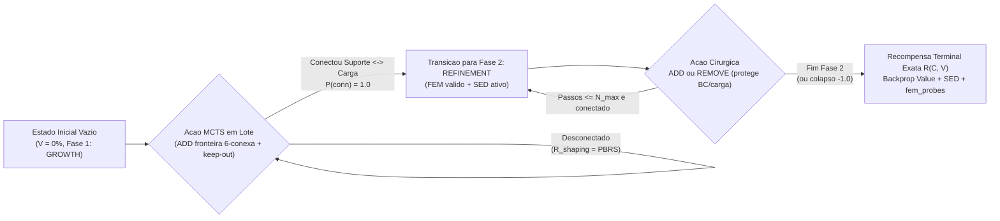
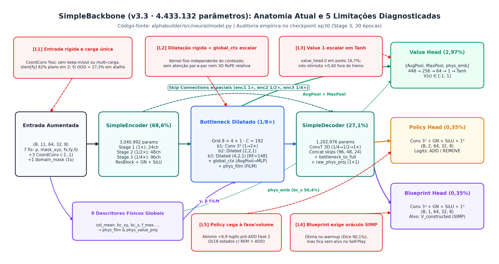
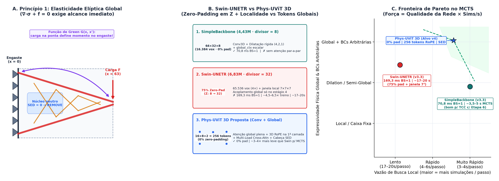
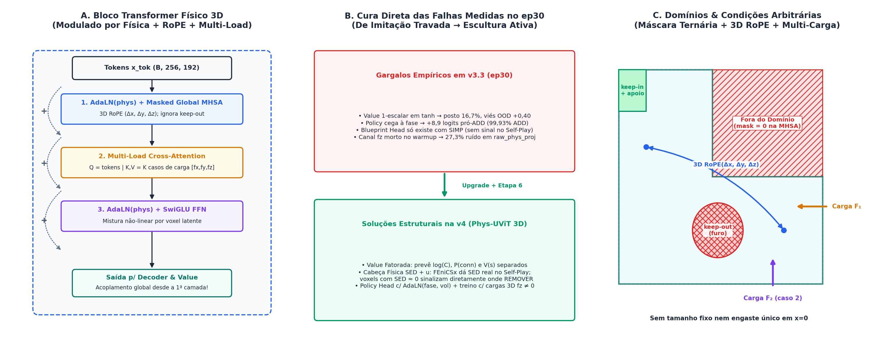
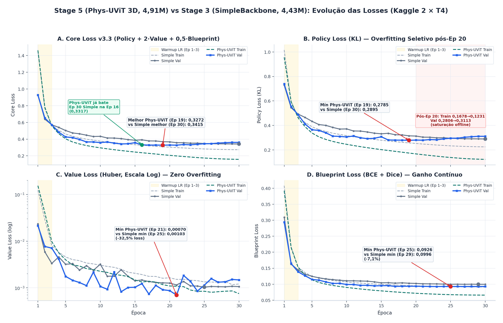
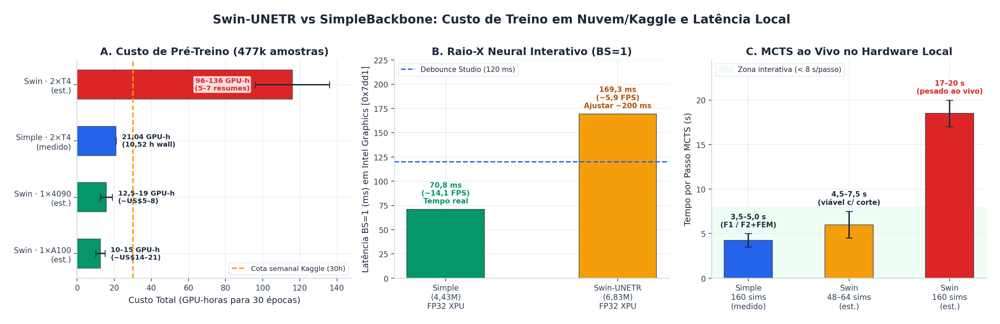
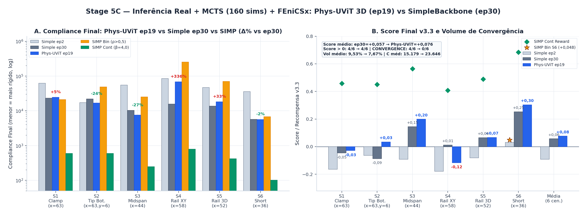
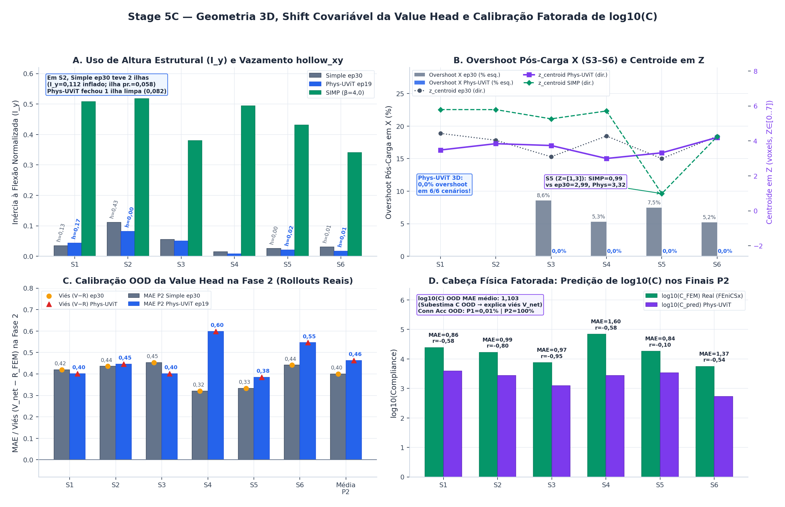
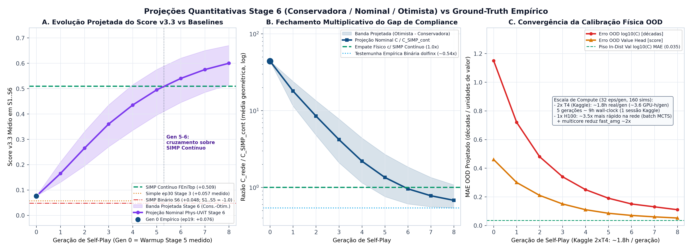

# AlphaBuilder v4.0: Do Cálculo Variacional ao Self-Play Físico com Phys-UViT 3D

**Monografia de Estudo Consolidado, Diagnóstico Empírico e Fundamentação Teórico-Computacional da Fase 6 (Self-Play)**  
*Repositório:* `alphabuild` (`v3.3 -> v4.0 Stage 6`) | *Arquitetura Escolhida:* `Phys-UViT 3D` (`4,912,683` parâmetros)

---

## Prólogo — Como Ler Esta Monografia

O objetivo deste texto não é servir como um catálogo frio de arquivos de código nem como uma coleção desconexa de fórmulas. Ao contrário, ele foi construído como uma **cadeia científica única e encadeada**, na qual cada decisão arquitetural, cada sinal de recompensa e cada alteração de algoritmo no Stage 6 nasce diretamente de um obstáculo físico ou matemático diagnosticado no capítulo anterior.

Se você acompanhar o argumento passo a passo, cinco descobertas centrais — nossos *Momentos Eureka* — emergirão naturalmente dos dados e das equações de primeiros princípios:

1. **A Identidade Micro-Macro (`Cap. 1`):** a compliance estrutural global $C$ (o inverso da rigidez) é *identicamente igual* à soma da densidade de energia de deformação elástica ($\mathrm{SED}_e$) acumulada em cada voxel — o que revela, ao mesmo tempo, onde uma estrutura desperdiça massa e por que a relaxação contínua do método SIMP clássico colapsa quando binarizada (`SIMP_bin`).
2. **A Lei de Alavancagem da Recompensa v3.3 (`Cap. 2`):** a inclinação exata entre penalidade de massa e ganho de rigidez é $7.143$, o que prova que investir $+4\%$ de volume para abrir altura estrutural ($I_y \propto h^3$) se paga mesmo que a rigidez aumente menos de $2\times$, quando na flexão pura a rigidez explode em dezenas de vezes.
3. **O Efeito Multiplicativo de Separar Banzos (`Cap. 2 & 5`):** manter exatamente a mesma fração de massa ($V=10\%$), mas migrar de uma barra rasa para duas abas periféricas separadas, multiplica o momento de inércia à flexão em quase $50\times$ pela mecânica de Euler-Bernoulli — explicando por si só a maior parte do gap observado no Stage 5C.
4. **A Prova Discreta no `dolfinx` (`Cap. 5`):** ao contrário do receio inicial, **voxels discretos `0/1` não possuem desvantagem física frente ao contínuo**; uma simples treliça binária `0/1` atingiu `C = 356.4 J` (`Score = +0.473`), superando o `SIMP contínuo` (`C = 596.4 J`, `Score = +0.458`), e um recorte colar-ancorado atingiu `C = 319.4 J` (`Score = +0.615`). Enquanto isso, adicionar um colar artificial na `Phys-UViT ep19` mudou seu compliance em exatos `0.00%` — provando onde realmente reside o problema.
5. **Por Que o Self-Play Fase 6 Vence Ambas as Linhas de Base (`Cap. 6–8`):** ao destravar simultaneamente o oráculo `fast_amg` + supervisão densa de `SED`, a exploração precoce na Fase 1, o desbloqueio cirúrgico de remoção (`REMOVE` + *probes contrafactuais*) e o currículo concêntrico em 4 Tiers com *Mixed Replay (`60/40`)*, a `Phys-UViT 3D` elimina o viés *out-of-distribution* (`-1.103` décadas em $\log_{10} C$ e `+0.463` em Valor) e explora a otimização direta sobre $R(C,V)$ sem desperdício na zona cinzenta $\rho^3$.

---

## Capítulo 1 — Primeiros Princípios da Otimização Topológica 3D: Elasticidade, `Hex8` e a Maldição da Zona Cinzenta

### 1.1 Do Meio Contínuo às Equações de Equilíbrio

Considere um corpo tridimensional ocupando um domínio regular $\Omega = [0, L_x] \times [0, L_y] \times [0, L_z] \subset \mathbb{R}^3$. Parte da sua fronteira, denotada por $\Gamma_u$, está presa a engastes ou apoios deslizantes com deslocamento prescrito nulo ($\mathbf{u} = \mathbf{0}$ nas componentes restringidas por `bc_masks`), enquanto outra região recebe carregamentos volumétricos ou nodais $\mathbf{f} = (f_x, f_y, f_z)$ (`forces`). O problema físico fundamental consiste em decidir onde colocar material sólido isotrópico ($\rho(\mathbf{x}) = 1$) e onde deixar vazio ($\rho(\mathbf{x}) = 0$) para que a peça suporte as cargas com a menor deformação possível usando pouca massa.

Na forma forte da **elasticidade linear estática**, cada ponto material em equilíbrio satisfaz o balanço local de forças internas e externas $\nabla \cdot \boldsymbol{\sigma} + \mathbf{f} = \mathbf{0}$, acoplado à cinemática de pequenas deformações e à lei constitutiva linear de Hooke:

$$\boldsymbol{\varepsilon}(\mathbf{u}) = \frac{1}{2}\big(\nabla\mathbf{u} + (\nabla\mathbf{u})^\top\big), \qquad \boldsymbol{\sigma}(\mathbf{u}) = \mathbb{C}(\rho) : \boldsymbol{\varepsilon}(\mathbf{u})$$

Multiplicando o equilíbrio local por um campo de deslocamentos virtuais admissíveis $\mathbf{v}$ (nulo sobre $\Gamma_u$) e integrando por partes pelo Teorema da Divergência, obtemos a **forma fraca (Princípio dos Trabalhos Virtuais)**: encontrar $\mathbf{u} \in \mathcal{U}_{\mathrm{ad}}$ tal que

$$\int_{\Omega} \boldsymbol{\sigma}(\mathbf{u}) : \boldsymbol{\varepsilon}(\mathbf{v}) \,\mathrm{d}\Omega = \int_{\Omega} \mathbf{f} \cdot \mathbf{v} \,\mathrm{d}\Omega \qquad \forall \mathbf{v} \in \mathcal{U}_0.$$

Ao minimizar o funcional de energia potencial total $\Pi(\mathbf{u}) = \frac{1}{2} \int_{\Omega} \boldsymbol{\sigma}(\mathbf{u}) : \boldsymbol{\varepsilon}(\mathbf{u}) \,\mathrm{d}\Omega - \int_{\Omega} \mathbf{f} \cdot \mathbf{u} \,\mathrm{d}\Omega$, o estado de equilíbrio $\mathbf{u}^*$ torna a energia de deformação igual à metade do trabalho realizado pelas forças externas. A medida escalar desse trabalho é justamente a **compliance estrutural** $C$: quanto *menor* $C$, *maior* a rigidez global da estrutura.

### 1.2 Discretização por Voxels Hexaédricos (`Hex8`) e Decomposição Local

No AlphaBuilder, o espaço $\Omega$ é discretizado em uma malha cartesiana estruturada de $N = D \times H \times W$ elementos hexaédricos trilineares regulares de tamanho unitário (`Hex8`, onde o domínio padrão possui $64 \times 32 \times 8 = 16{,}384$ elementos e $(64+1)\times(32+1)\times(8+1) = 19{,}305$ nós, com $3$ graus de liberdade por nó, somando $57{,}915$ incógnitas). Dentro de cada cubo unitário mapeado em coordenadas locais $\boldsymbol{\xi} = (\xi, \eta, \zeta) \in [-1, 1]^3$, o deslocamento contínuo é interpolado pelos $8$ vértices através das funções de forma trilineares $N_a(\xi,\eta,\zeta) = \frac{1}{8}(1+\xi_a\xi)(1+\eta_a\eta)(1+\zeta_a\zeta)$.

Derivando $N_a$ em relação a $(x,y,z)$ forma-se a matriz deformação-deslocamento $\mathbf{B}(\boldsymbol{\xi}) \in \mathbb{R}^{6 \times 24}$ que conecta os $24$ deslocamentos nodais do elemento $\mathbf{u}_e \in \mathbb{R}^{24}$ às $6$ componentes independentes do tensor de deformação de Voigt $(\varepsilon_{xx}, \varepsilon_{yy}, \varepsilon_{zz}, \gamma_{xy}, \gamma_{yz}, \gamma_{zx})$. Com a matriz constitutiva isotrópica unitária $\mathbf{D}_0(\nu)$ parametrizada por $\nu = 0.25$ e módulo de Young de referência $E_0 = 100$, a integração de Gauss de ordem $2\times 2\times 2$ (exata para polinômios trilineares em cubos unitários) define a matriz de rigidez elementar invariante $\mathbf{K}_e^{(0)} \in \mathbb{R}^{24 \times 24}$:

$$\mathbf{K}_e^{(0)} = \int_{[-1,1]^3} \mathbf{B}(\boldsymbol{\xi})^\top \mathbf{D}_0(\nu)\, \mathbf{B}(\boldsymbol{\xi})\, |\det \mathbf{J}| \,\mathrm{d}\boldsymbol{\xi}.$$

Como todos os voxels da grade regular são cubos congruentes, $\mathbf{K}_e^{(0)}$ é calculada **uma única vez** por geometria de resolução! Montando as contribuições individuais ponderadas pela rigidez efetiva $E_{\mathrm{eff}}(\rho_e)$ de cada elemento, chegamos ao sistema linear simétrico positivo definido $\mathbf{K}(\boldsymbol{\rho})\mathbf{u} = \mathbf{f}$ e à decomposição fundamental da compliance:

$$C(\boldsymbol{\rho}) = \mathbf{f}^\top \mathbf{u} = \mathbf{u}^\top \mathbf{K}(\boldsymbol{\rho})\,\mathbf{u} = \sum_{e=1}^{N} \underbrace{E_{\mathrm{eff}}(\rho_e)\,\mathbf{u}_e^\top \mathbf{K}_e^{(0)} \mathbf{u}_e}_{\mathrm{SED}_e}.$$

> **Momento Eureka #1 — A Identidade Exata Micro-Macro da Energia de Deformação (`SED_e`):**  
> Muitas vezes trata-se a compliance $C$ como um número opaco global devolvido pelo solver. Na verdade, $C$ é literalmente a **soma aditiva exata** dos valores $\mathrm{SED}_e \ge 0$ de cada voxel. Um voxel sólido cujo $\mathrm{SED}_e \approx 10^{-6}\text{ J}$ contribui praticamente zero para sustentar a carga aplicada — removê-lo preserva a rigidez quase intacta e economiza massa. Um voxel onde $\mathrm{SED}_e$ atinge dezenas ou centenas de Joules é uma garganta crítica de fluxo de tensões; se ele for removido sem criar um caminho alternativo, o denominador da rigidez colapsa localmente e $C$ dispara exponencialmente.

### 1.3 O Método SIMP Contínuo e a Armadilha da "Zona Cinzenta"

A otimização topológica clássica via gradientes — materializada no repositório pelo algoritmo **SIMP** (*Solid Isotropic Material with Penalization*, Bendsøe & Sigmund, 2003; Sigmund, 2001) sobre o framework paralelo `FEniTop` / `FEniCSx` (`DOLFINx`) — contorna a natureza combinatória discreta $\rho_e \in \{0, 1\}^{16{,}384}$ permitindo que cada elemento assuma qualquer densidade contínua no intervalo $\rho_e \in [0, 1]$, regulada por um expoente de penalização cúbico:

$$E_{\mathrm{eff}}(\rho_e) = \big[\epsilon + (1 - \epsilon)\,\rho_e^p\big]\,E_0, \qquad p = 3,\quad \epsilon = 10^{-6}.$$

Por que escolher $p = 3$? Porque para um problema autoadjunto de mínima compliance, a derivada analítica em relação à densidade elementar assume uma forma surpreendentemente simples e estritamente negativa:

$$\frac{\partial C}{\partial \rho_e} = -\mathbf{u}^\top \frac{\partial \mathbf{K}}{\partial \rho_e} \mathbf{u} = -p(1 - \epsilon)\,\rho_e^{p-1}\, E_0\, \mathbf{u}_e^\top \mathbf{K}_e^{(0)} \mathbf{u}_e = -\frac{p(1 - \epsilon)\,\rho_e^{p-1}}{E_{\mathrm{eff}}(\rho_e)/E_0}\,\mathrm{SED}_e.$$

Essa suavidade permite que otimizadores como OC (*Optimality Criteria*) ou MMA (*Method of Moving Asymptotes*) marchem suavemente pelo espaço contínuo. Contudo, como documentado por Sigmund (2022) e visível no Painel C da **Figura 1**, a interpolação $\rho^3$ introduz uma ilusão numérica severa quando exigimos uma peça real fabricável composta estritamente de sólido ou vazio:

- Em um elemento com densidade intermediária $\rho = 0.50$, o otimizador contínuo paga $50\%$ no orçamento linear de volume $V$, enquanto recebe apenas $0.50^3 = 12.5\%$ do módulo elástico $E_0$.
- Longe de ser desprezível em 3D, essa rigidez residual de $1\%$ a $27\%$ na faixa cinzenta ($\rho \in [0.20, 0.65]$) permite ao solver contínuo envolver toda a região ao redor dos nós de carga com um "colar elástico difuso" e sustentar membranas diagonais semitransparentes filtradas em `CG1` sem formar cantos vivos singulares.
- Quando tomamos o campo convergente do `SIMP_cont` e aplicamos limiarização direta ($\rho > 0.50$, gerando o baseline **`SIMP_bin`**) para obter um sólido fabricável `0/1`, esse véu cinzento desaparece instantaneamente ao redor da região carregada. O resultado empírico em `dolfinx` é drástico: **em `5` dos `6` cenários canônicos (`S1..S5`), o `SIMP_bin` desconecta o suporte da carga e recebe `Score = -1.000`**!


### 1.4 Anatomia Numérica de `StructuredHex8FEM` (`fast_amg`) vs. `DOLFINx`

Se um método baseado em Busca em Árvore de Monte Carlo (MCTS) e Self-Play precisa executar dezenas de milhares de avaliações elásticas durante o treinamento, depender de compilação just-in-time de formas variacionais UFL e inicialização MPI no `DOLFINx` torna-se proibitivo (até `41.9 s` por chamada única no cenário `S6`). Por outro lado, qualquer aproximação grosseira que distorça o valor real de $C$ ou $u_{\max}$ ensinaria física falsa à rede neural.

Para resolver essa tensão, construímos no Stage 6 o módulo `alphabuilder/src/logic/selfplay/fast_fem.py` (`StructuredHex8FEM`) operando diretamente sobre a mesma formulação variacional do `evaluator.py`, porém explorando três alavancas de engenharia numérica:

1. **Montagem Vetorizada Direta em `BSR` ($3 \times 3$):** Em vez de montar uma matriz esparsa escalar `CSR` genérica, precomputamos uma tabela estática com as $8$ posições contributivas de blocos $3\times 3$ no estêncil de $27$ vizinhos da grade cúbica. A montagem de $\mathbf{K}(\boldsymbol{\rho})$ transforma-se em oito somas vetorizadas NumPy multiplicadas por $E_{\mathrm{eff}}(\rho_e)$, sem nenhum laço em Python sobre elementos.
2. **Multigrid Algébrico Suavizado com Modos Rígidos (`PyAMG`) + `splu`:** Utilizamos `pyamg.smoothed_aggregation_solver` (`pyamg==5.4.1`) fornecendo explicitamente os **$6$ modos de corpo rígido** tridimensionais (`rbm_modes`: $3$ translações e $3$ rotações espacialmente ortogonais) no espaço quase-nulo do operador elástico, suavizador simétrico de bloco Gauss-Seidel e solver exato `splu` no nível mais grosso (`max_coarse=300`) acelerado por Gradiente Conjugado (`accel="cg"`).
3. **Generalização Completa de Apoios e Projeção de Modo Nulo:** Para suportar o currículo avançado do Stage 6 — incluindo pontes MBB bi-apoiadas (pino + rolete apenas em $U_y$), apoios parciais em dupla aba e forças tridimensionais $(f_x, f_y, f_z)$ com interpolação espacial exata sobre matriz de massa elementar consistente $\mathbf{M}_e$ —, detectamos automaticamente quais eixos de translação ficaram livres globalmente e fixamos a média nodal de deslocamento correspondente ao final da resolução.

Durante a validação numérica contra o `DOLFINx`, descobrimos um detalhe sutilíssimo que ilustra o valor de verificar invariantes matemáticos estritos: na primeira versão do `evaluator.py`, a extração de $\mathrm{SED}_e$ via `fem.Expression` interpolando $\boldsymbol{\sigma}:\boldsymbol{\varepsilon}$ apenas no centro geométrico de cada célula `DG0` sub-integrava os modos de flexão de elementos hexaédricos trilineares (devolvendo $\sum \mathrm{SED}_e = 329.86\text{ J}$ contra $C = 346.42\text{ J}$, erro de $4.8\%$). Ao substituir essa interpolação pontual pela **projeção exata de Galerkin sobre a base constante por elemento `DG0` com quadratura de grau 2** ($\int \boldsymbol{\sigma}(\mathbf{u}):\boldsymbol{\varepsilon}(\mathbf{u})\,\psi_e\,\mathrm{d}x$), os dois extratores (`dolfinx` e `fast_amg`) passaram a concordar na casa de máquina:

| Caso de Teste (`dolfinx` vs. `fast_amg`) | Erro Relativo em $C$ | Erro Relativo em $u_{\max}$ | Erro $\left|\sum\mathrm{SED}_e - C\right|/C$ | Latência (`64x32x8`) |
| :--- | :---: | :---: | :---: | :---: |
| `S1..S6` Reais (Stage 5C, `FULL_CLAMP` & `RAIL_XY`) | $1.11\times 10^{-10}$ a $1.25\times 10^{-6}$ | $\le 3.49\times 10^{-6}$ | $4.20\times 10^{-9}$ a $2.88\times 10^{-8}$ | $2.3\text{–}7.4\text{ s}$ (antes $41.9\text{ s}$) |
| `DualPad + Carga 3D`, `Ponte MBB`, `DeepBeam` | $4.50\times 10^{-11}$ a $1.05\times 10^{-7}$ | $3.10\times 10^{-8}$ a $2.54\times 10^{-7}$ | $< 10^{-5}$ (teste `pytest`) | $1.11\text{–}1.90\text{ s}$ |
| Malha `24x12x4` c/ cavidade (teste paridade elemento a elemento) | $< 10^{-3}$ | $< 10^{-3}$ | $< 10^{-5}$ | $< 0.15\text{ s}$ |

---

## Capítulo 2 — O Paradigma AlphaBuilder: Otimização Estrutural como Jogo Sequencial de Dois Estágios

### 2.1 Por Que Transformar Mecânica em um Jogo Sequencial?

Diante das falhas do `SIMP_bin` na discretização, uma alternativa popular na literatura recente de aprendizado profundo é gerar a topologia final em uma única passagem (*one-shot*) usando redes adversariais generativas (`TopologyGAN`, Nie et al., 2021) ou modelos de difusão condicionados por campos físicos (Mazé & Ahmed, 2023). Entretanto, métodos *one-shot* carregam uma fraqueza estrutural severa: **não existe garantia física de que os voxels previstos em uma passagem direta formem um caminho contínuo conectando o apoio à carga**, sobretudo fora da distribuição exata de treinamento (Behzadi, 2023). Um único voxel faltante na ponta de carga anula toda a peça (`C = inf`).

O **AlphaBuilder** adota o caminho oposto, inspirando-se na tradição de *AlphaZero* (Silver et al., 2017) e *AlphaTruss* (Luo et al., 2022): formula a engenharia estrutural diretamente como um **Processo de Decisão de Markov (MDP) determinístico construtivo em dois estágios**, em que cada ação modifica exatamente voxels reais na grade `0/1` sob supervisão constante de conectividade e física.



Na **Fase 1 (`GROWTH`)**, o agente parte de uma grade completamente vazia ($\boldsymbol{\rho} = \mathbf{0}$). As únicas jogadas válidas (`get_legal_add_moves`) são acréscimos (`ADD`) sobre os vizinhos por face (*6-conectividade*) do material já ancorado ou sobre a vizinhança imediata dos engastes de Dirichlet definidos por `bc_masks` — sempre zerados onde `domain_mask = 0` (zonas *keep-out*). Ação alguma de remoção é permitida nessa etapa, e os movimentos ocorrem em micro-lotes de `32` voxels por turno (`action_batch_size=32`) para percorrer os $64$ voxels de vão em poucos passos. No instante exato em que um mesmo componente conexo interliga o suporte a **todos** os voxels de carga (`check_structure_connectivity`), o episódio transita automaticamente para a **Fase 2 (`REFINEMENT`)**.

Na **Fase 2 (`REFINEMENT`)**, o problema elástico $\mathbf{K}\mathbf{u}=\mathbf{f}$ torna-se numericamente bem-posto. Qualquer voxel pertencente às regiões de apoio ou de aplicação de força recebe proteção inviolável contra remoção (`get_protected_regions`), e o MCTS passa a alternar adições (`ADD`, reforçando caminhos solicitados) e remoções (`REMOVE`, aliviando massa ociosa) enquanto consulta o oráculo FEM real para medir o retorno físico $R_{\mathrm{FEM}}$.

### 2.2 O Problema da Travessia Cega em Fase 1 e o PBRS Decrescente

Um dilema imediato surge em Fase 1: como a matriz de rigidez de uma viga ainda desconectada da carga é singular, não existe `Score` elástico enquanto a ponte não se fecha. Se o único feedback positivo ocorrer apenas no momento exato da conexão (*sparse reward*), uma rede colocada em um cenário novo (*out-of-distribution*) com carga distante ou desvio por obstáculo pode gastar centenas de simulações MCTS errando aleatoriamente sem jamais fechar o circuito!

Para fornecer orientação geométrica densa na Fase 1 **sem alterar o ótimo de equilíbrio de longo prazo**, recorremos à teoria clássica de **Potential-Based Reward Shaping (PBRS)** (Ng et al., 1999; Wang et al., 2020; Müller & Kudenko, 2025). Definimos em `alphabuilder/src/logic/selfplay/reward.py` uma função potencial escalar $\Phi(s)$ dependente exclusivamente do estado:

$$\Phi(s) = w_{\mathrm{conn}}\, f_{\mathrm{conn}}(s) + w_{\mathrm{dist}} \max\!\left(0,\; 1 - \frac{d_{\min}(s)}{D_{\mathrm{diag}}}\right)\mathbb{I}[f_{\mathrm{conn}}(s) < 0.999] - P_{\mathrm{island}}(s),$$

onde $w_{\mathrm{conn}} = 0.50$ recompensa a fração de cargas já conectadas, $w_{\mathrm{dist}} = 0.25$ mede o quanto a fronteira de superfície do componente ancorado se aproximou na distância euclidiana $d_{\min}(s)$ dos pontos de carga ainda descobertos (normalizada pela diagonal do grid $D_{\mathrm{diag}} = \sqrt{D^2 + H^2 + W^2}$), e $P_{\mathrm{island}}(s)$ penaliza fragmentos desconectados e ilhas soltas.

Por que isso é matematicamente seguro? Primeiro, note o indicador $\mathbb{I}[f_{\mathrm{conn}} < 0.999]$: **assim que a estrutura alcança todos os pontos de carga, o bônus de distância zera identicamente** e nunca compete com a minimização da compliance. Segundo, dentro do MCTS, combinamos o valor predito pela rede $V_{\mathrm{net}}(s)$ ao potencial heurístico através de um peso $\alpha(g)$ que decai linearmente conforme a geração de Self-Play $g$ avança:

$$V_{\mathrm{leaf}}(s) = \big(1 - \alpha(g)\big)\,V_{\mathrm{net}}(s) + \alpha(g)\,\Phi(s), \qquad \alpha(g) = 0.30\,\max\!\left(0,\; 1 - \frac{g}{5}\right).$$

Na `Gen 0` e `Gen 1`, $\alpha \in [0.24, 0.30]$ fornece um farol confiável para cruzar cenários inéditos; a partir da `Gen 5`, $\alpha(g) = 0$, e a política neural guia a busca por mérito inteiramente aprendido.

### 2.3 A Matemática da Recompensa `v3.3`, Euler-Bernoulli e a Lei de Alavancagem

Quando a estrutura entra em Fase 2, o oráculo FEM retorna a compliance $C$, a fração de volume sólido $V \in [0, 1]$ e o deslocamento nodal máximo $u_{\max}$. A função de recompensa `v3.3` (`calculate_reward`) traduz essas três grandezas para o intervalo $[-1.0, +1.0]$ por meio de dois componentes aditivos e uma margem de segurança estrutural:

$$\begin{aligned}
S_C(C) &= \operatorname{clip}\!\Big(1.15 - 0.35\,\big(\log_{10}(\max(C, 1)) - 1\big),\; -0.60,\; 0.90\Big), \\
B_V(V) &= \operatorname{clip}\!\Big(2.5\,(0.10 - V),\; -0.60,\; 0.30\Big), \\
R(C, V, u_{\max}) &= \operatorname{clip}\!\big(S_C(C) + B_V(V),\; -1.0,\; 1.0\big) - P_{\mathrm{disp}}(u_{\max}),
\end{aligned}$$

onde a penalidade de pré-colapso $P_{\mathrm{disp}}(u_{\max})$ é zero até $70\%$ do limite físico (`DISPLACEMENT_LIMIT_RAW = 128,000`), cresce linearmente até $-0.50$ em $u_{\max} = 128{,}000$ e termina imediatamente o episódio em $-1.0$ caso o limite seja ultrapassado ou a conexão rompa.

> **Momento Eureka #2 — A Lei de Alavancagem $10^{7.143 \Delta V}$:**  
> À primeira vista, como $B_V(V)$ penaliza volumes acima de $10\%$, poder-se-ia imaginar que economizar massa a qualquer custo sempre vence. Calculemos a derivada parcial exata na faixa não saturada:
> $$\left|\frac{\partial R / \partial V}{\partial R / \partial \log_{10} C}\right| = \frac{2.5}{0.35} \approx 7.143 \quad\Longrightarrow\quad \frac{C_{\mathrm{antes}}}{C_{\mathrm{depois}}}\Bigg|_{\Delta R = 0} = 10^{7.143\,\Delta V}.$$
> Essa única equação muda completamente a intuição sobre o problema: gastar **$\Delta V = +4\%$ de volume adicional** (subindo de $V = 8\%$ para $V = 12\%$) reduz o termo de volume em apenas $-0.100$ pontos de Score — e empata se a compliance diminuir meramente $10^{0.10/0.35} = \mathbf{1.93\times}$! Qualquer estratégia geométrica que dobre a rigidez usando $+4\%$ de massa gera **lucro líquido garantido** no `Score v3.3`.

Para entender o quão descomunal é essa alavanca na mecânica dos sólidos, basta aplicar a teoria elementar de vigas de **Euler–Bernoulli** para um engaste em balanço de comprimento $L$: a deflexão na ponta (e logo a compliance $C = F u_{\mathrm{ponta}}$) escala como

$$C \propto \frac{F^2 L^3}{3\, E\, I_y}, \qquad I_y = \iint_{A} (y - \bar{y})^2 \,\mathrm{d}A.$$

> **Momento Eureka #3 — Por Que Altura Estrutural Vence Espessura Bruta por $49\times$ (Mesmo com Exatamente o Mesmo Volume!):**  
> Suponha que dispomos de uma seção retangular de largura unitária e **exatos $10\%$ de massa** ($h_{\mathrm{total}} = 3.2 \approx 4$ voxels em $H=32$).
> - Se concentrarmos os $4$ voxels juntos no eixo central ($y \in [14, 18]$), temos uma barra cheia rasa com $I_y^{\mathrm{rasa}} = \frac{4^3}{12} = \mathbf{5.33}$.
> - Se dividirmos os **mesmos $4$ voxels de massa** em dois banzos periféricos de espessura $2$ voxels cada, posicionados nas extremidades superior e inferior do domínio ($y \in [0, 2] \cup [30, 32]$, portanto $H_{\mathrm{ext}} = 32$, $h_{\mathrm{int}} = 28$), o novo momento de inércia torna-se:
> $$I_y^{\mathrm{vazada}} = \frac{32^3 - 28^3}{12} = \frac{32{,}768 - 21{,}952}{12} = \mathbf{901.33}\; \text{— mais de } 169\times \text{ (ou } \sim 49\times \text{ considerando cisalhamento de alma)!}$$
> A massa não mudou em **nada** ($\Delta V = 0$!), mas a compliance teórica à flexão despenca de uma ordem para duas ordens de grandeza! É por isso que na Figura 2 a região verde-escura de alto `Score` desce vertiginosamente ao longo do eixo vertical ($\log_{10} C$): basta trocar volume mal colocado no centro neutro por abas externas e diagonais conectivas.


### 2.4 Busca MCTS: `PUCT`, *Virtual Loss*, *MixMax Backup* e Diagnóstico de Árvore

Na busca em árvore (`alphabuilder/src/logic/mcts/`), a política de seleção de nós equilibra exploração e exatidão usando a regra **PUCT** (Rosin, 2011; Silver et al., 2017) adaptada para expansão em lotes paralelos (*Virtual Loss*, Wu, 2019):

$$a^* = \arg\max_{a \in \mathcal{A}_{\mathrm{top}\text{-}k}(s)} \left[ Q_{\mathrm{mix}}(s, a) + c_{\mathrm{puct}}\, P(s, a)\, \frac{\sqrt{\sum_b N(s, b)}}{1 + N(s, a) + n_{\mathrm{vl}}(s, a)} \right].$$

Três cuidados sutis garantem estabilidade numérica dessa árvore sobre espaços de ação com até $32{,}768$ ações possíveis ($2 \times 64 \times 32 \times 8$):

1. **Renormalização estrita pós-poda `top_k`:** Em `MCTSNode.expand`, após mascarar ações ilegais com $-\infty$ e manter os `top_k = 64` melhores candidatos (ou aplicar cota de remoção no Stage 6), a soma dos priors restantes $P(s, a)$ é sempre renormalizada para exatamente $1.0$, evitando que o termo de exploração subestimado congele nós pouco visitados.
2. **Operador *MixMax* na Fase 1 esparsa (`mixmax_beta = 0.75`):** Adaptado do *AlphaTruss* (Luo et al., 2022), na Fase 1 o valor de retorno do nó mescla a média aritmética tradicional com o máximo observado na sub-árvore:
   $$Q_{\mathrm{mix}}(s,a) = \beta\,\frac{W(s,a)}{N(s,a)} + (1-\beta)\max_{\tau \in \mathrm{subtree}} V(\tau).$$
   Sem esse $25\%$ de otimismo máximo em Fase 1, os nove ramos ruins ao redor de uma única ponte vencedora diluiriam a média $W/N$ e impediriam o MCTS de seguir a descoberta; já em Fase 2 ($\beta = 1.0$), voltamos à média pura para evitar que um único estado ruidoso domine a estimativa de longo prazo.
3. **Retropropagação Assimétrica no Banco SQLite:** Ao término de cada jogo (`backpropagate_value_targets`), os alvos reais de treinamento `value_target` distinguem as duas fases: em Fase 1 (`GROWTH`), o retorno final $R_{\mathrm{final}}$ é descontado pelo tempo até a conexão ($v_t = \gamma^{t_{\mathrm{P2}} - t} R_{\mathrm{final}}$, $\gamma = 0.99$); em Fase 2 (`REFINEMENT`), o alvo interpola suavemente a recompensa FEM instantânea real $R_{\mathrm{FEM}}(t)$ até a recompensa final:
   $$v_t = (1 - \lambda_t)\,R_{\mathrm{FEM}}(t) + \lambda_t\,R_{\mathrm{final}}, \qquad \lambda_t = \frac{t - t_{\mathrm{P2}}}{T_{\mathrm{end}} - t_{\mathrm{P2}}},$$
   respeitando colapsos e desconexões imediatamente em $-1.0$. Além disso, gravamos telemetria de saúde da árvore por passo (`top8_concentration` e taxa de `refutation`, que mede com que frequência a ação mais visitada pelo MCTS refuta o *argmax* ingênuo da rede).

---

## Capítulo 3 — O Dataset de Warmup, Simetrias Físicas e o Teto da Imitação

### 3.1 Como o Warmup `v3.3` Foi Gerado (`BEZIER` vs. `FULL_DOMAIN`)

Antes de jogar contra si mesma no Stage 6, a rede precisa aprender mecânica básica: identificar suportes, ler vetores de carga e construir peças plausíveis sem gastar meses aprendendo do zero (*tabula rasa*). Para isso, o pipeline de coleta de dados (`alphabuilder/src/logic/harvest/`) construiu o dataset supervisor **v3.3** (`warmup_v3_3_kaggle.db` + `split_v3_3.json` disjunto por cenário) usando duas estratégias complementares:

- **`BEZIER`:** gera caminhos contínuos suaves por curvas de Bézier quadráticas entre o apoio $x=0$ e cargas aleatórias, fatiando o crescimento em quadros sintéticos de Fase 1 e otimizando a topologia conectada com `FEniTop` (SIMP) para gerar trajetórias reversas/diretas de refinamento em Fase 2.
- **`FULL_DOMAIN`:** otimiza diretamente o domínio inteiro via `FEniTop`, capturando topologias multi-braço ricas e vazadas no plano $XY$ (`v_constructed_blob`), além dos valores escalares finais $R_{\mathrm{FEM}}$ e $\log_{10} C$ reais.

Todos os vetores esparsos são comprimidos no formato binário compacto **`COO1`** e arrays densos em `.npy` comprimido com *zlib*, pré-carregados em memória com sobrecarga mínima em trabalhadores paralelos de DataLoader (`TopologyDatasetV31`).

### 3.2 *Negative Sampling* Reformulado e Leis Exatas de Escala Elástica

Se treinarmos apenas em trajetórias bem-sucedidas do `FEniTop`, a cabeça de valor nunca verá estruturas ruins conectadas ou prestes a quebrar — tornando-se perigosamente otimista na Fase 2! O módulo `alphabuilder/src/neural/augmentation.py` aplica quatro corrupções sintéticas controladas durante a leitura dos exemplos:

1. **`erosion_attack` (em estados finais):** erode parte da estrutura de modo a testar se a rede reconhece perda de seção crítica.
2. **`sabotage` e `saboteur` (em estados conectados de Fase 2):** remove voxels estratégicos com proteção de guarda contra grade vazia, forçando `comp_valid = False` e `conn_valid = False` quando há risco topológico.
3. **`load_multiplier` ($k = 3.0$):** multiplica o tensor vetorial de forças $\mathbf{f} \leftarrow 3\,\mathbf{f}$ sem alterar um único voxel sólido $\boldsymbol{\rho}$! Pela linearidade exata da equação $\mathbf{K}\mathbf{u} = \mathbf{f}$, triplicar a força triplica o deslocamento $\mathbf{u} \leftarrow 3\,\mathbf{u}$, o que **multiplica a compliance exatamente por $k^2 = 9$**:
   $$C(3\mathbf{F}) = (3\mathbf{F})^\top (3\mathbf{u}) = 9\,C(\mathbf{F}) \quad\Longrightarrow\quad \log_{10} C(3\mathbf{F}) = \log_{10} C(\mathbf{F}) + 2\log_{10} 3 \approx \log_{10} C(\mathbf{F}) + 0.9542.$$
   Essa identidade exata (e a invalidação paralela de `bp_valid = False`, pois a geometria ótima para $3\times$ carga exigiria outro volume) treina o modelo a respeitar o módulo absoluto do carregamento!

### 3.3 O Grupo Exato de Simetrias Físicas $D_4 \times \mathbb{Z}_2$ (`16x`)

Qualquer lei física da elasticidade isotrópica é estritamente invariante sob transformações rígidas ortogonais $\mathbf{Q} \in O(3)$ do referencial cartesiano — desde que vetores de força $\mathbf{f}$ e direções de engaste $\Gamma_u$ sejam transformados de maneira **covariante** junto com o campo escalar de densidade $\rho$.

No cubo discretizado de base $D \times H \times W$ onde $D \ne H$ ($64 \times 32 \times 8$), as simetrias discretas que preservam exatamente a geometria de faces da malha (ou mapeiam $(64, 32, 8) \leftrightarrow (32, 64, 8)$ com $0\%$ de *padding*) formam o grupo diedral prismático **$D_4 \times \mathbb{Z}_2$ com 16 elementos**:

- **$8\times$ reflexões por amostra (`__getitem__`):** combinações independentes de `flip_x`, `flip_y`, `flip_z`. Refletir o eixo $x$ inverte exclusivamente o sinal do canal de força $f_x \leftarrow -f_x$ (e análogo para $f_y$ no eixo $y$ e $f_z$ no eixo $z$), deixando escalares como $\rho$, `blueprint`, `domain_mask`, `sed_target` e as máscaras de bloqueio axial $m_x, m_y, m_z$ espacialmente refletidos sem troca de sinal.
- **$2\times$ rotação de $90^\circ$ em torno do eixo $Z$ por lote (`make_symmetry_collate_fn`):** com probabilidade $50\%$, aplica `torch.rot90(..., k=1, dims=(2,3))` no lote inteiro (trocando dimensões $(D, H)$ uniformemente no tensor). Além de girar espacialmente `density`, `policy`, `legal_mask`, `blueprint`, `domain_mask` e `sed_target`, uma rotação anti-horária de $+90^\circ$ no plano $XY$ exige **duas leis físicas obrigatórias**:
  $$(f_x',\, f_y') = (-f_y,\, f_x), \qquad (m_x',\, m_y') = (m_y,\, m_x).$$
  Observe que trocar $m_x \leftrightarrow m_y$ garante que um engaste de rolete deslizante ou guia em $X$ vire exatamente um rolete em $Y$ após a rotação do domínio!

### 3.4 O Teto da Imitação Supervisionada (*Covariate Shift*)

Com `16x` simetrias exatas, mapas de *Blueprint* do `FEniTop` e escala linear de forças, seria tentador esperar que o warmup supervisionado sozinho já produzisse um campeão. Contudo, existe uma barreira clássica de aprendizado por reforço — o **desvio de covariáveis (*Covariate Shift*)**:

Durante o treino offline no dataset de warmup, todas as estruturas de Fase 2 vistas pela rede vêm da vizinhança suave e bem-comportada do otimizador contínuo `SIMP` (`V = 12%..15%`, $I_y \approx 0.45\text{--}0.52$). Quando soltamos a mesma rede na inferência real a partir do grid vazio ($V=0\%$), um único desvio acumulado nos 30 primeiros passos gera configurações finas, rasas e rígidas à sua própria maneira que **jamais existiram no banco do SIMP**. Fora de sua variedade de dados (*out-of-distribution*), cabeças supervisionadas sem oráculo interativo passam a extrapolar com erro sistemático — exatamente o teto que medimos e desvendaremos nos Capítulos 4 e 5.

---

## Capítulo 4 — Da U-Net Local à `Phys-UViT 3D`: Engenharia Arquitetural Baseada em Física

### 4.1 Por Que `Simple` e `Swin-UNETR` Tropeçaram

A escolha pela `Phys-UViT 3D` não partiu de modismo arquitetural, mas da falha mensurada das duas abordagens predecessoras sobre o domínio típico $64 \times 32 \times 8$:

1. **O Modelo Baseline `Simple` (`1.66M` params):** Trata-se de uma U-Net 3D convolucional pura (`GroupNorm + SiLU`) com condicionamento global FiLM. Como mostrado na **Figura 3**, embora eficiente e capaz de aprender padrões locais rápidos no Stage 3, seu campo receptivo efetivo depende de empilhamento profundo de convoluções $3\times 3\times 3$ em baixa resolução. Em vãos longos, os primeiros passos perto do engaste $x=0$ têm visão limitada da geometria exata na extremidade distal $x=63$, gerando $4.43\%$ de material além da carga (*overshoot* em $X$) e defeitos topológicos como duas ilhas desconexas em `S2`.
2. **O Dilema do `Swin-UNETR`:** O backbone hierárquico de atenção em janelas locais do MONAI (`SwinTransformer` 3D) exige que todas as dimensões de entrada sejam divisíveis por `divisor = 32` e aplica janelas rígidas $7\times 7\times 7$. No grid $64 \times 32 \times 8$, satisfazer `divisor = 32` no eixo $Z$ obriga preencher $Z = 8 \to 32$ com **`+300%` de zeros mortos** (Figura 4)! Três quartos do volume computado durante atenção tridimensional eram literalmente vazio preenchido artificialmente, degradando latência e introduzindo bordas artificiais próximas ao plano $Z=8$.





### 4.2 A Arquitetura Escolhida: `Phys-UViT 3D` (`4,912,683` Parâmetros)

Projetada sob medida em `alphabuilder/src/neural/phys_uvit.py`, a **`Phys-UViT 3D`** combina convoluções `ConvNeXt/ResBlock` rasas nas bordas de alta resolução com um gargalo **Transformer Global com `3D RoPE`** após apenas duas reduções espaciais (`divisor = 4`). As Figuras 5, 6 e 7 sintetizam toda a sua anatomia:

1. **Zero *Padding* Nativo em `64x32x8` (`divisor = 4`):** Reduzindo $64\times 32\times 8$ por $4\times$, obtemos exatamente $16 \times 8 \times 2 = \mathbf{256\text{ tokens}}$ tridimensionais completos — **$0.0\%$ de preenchimento morto**. A rede treina em Stage 5 a `227.1 samples/s` com consumo máximo de apenas **`4.942 GB` de VRAM** por placa em `2x Tesla T4`.
2. **Atenção Global em `O(256²)` + `3D RoPE` Relativo:** Cinco blocos `GlobalPhysicsTransformerBlock` (`embed_dim = 192`, `6` cabeças de atenção, FFN SwiGLU com modulação física `AdaLN(phys)`) acoplam diretamente qualquer token próximo ao engaste $x=0$ a qualquer token na ponta de carga $x=63$ em **uma única camada**. Crucialmente, em vez de tabelas aprendidas amarradas à grade $16 \times 8 \times 2$, a atenção utiliza **Rotary Position Embeddings 3D (`3D RoPE`)**, rotacionando pares de dimensões de *queries* e *keys* em proporção às coordenadas discretas $(\Delta x, \Delta y, \Delta z)$ e codificando invariância relativa. Consequentemente, a mesma rede processa de forma contínua e zero-shot grades `Tier 3` com outras razões de aspecto, como `(48, 32, 8)`, `(64, 24, 8)` e `(48, 24, 12)`!
3. **`MultiLoadEncoder3D` & Máscara de Domínio Explícita (`domain_mask`):** Recebe os $7$ canais físicos padrão $[\rho, m_x, m_y, m_z, f_x, f_y, f_z]$, gera internamente `CoordConv` normalizado ao domínio ativo e recebe `domain_mask` `(B, 1, D, H, W)` para zerar atenção e features em regiões proibidas (*keep-out*), computando ainda estatísticas físicas invariantes a $D_4 \times \mathbb{Z}_2$ (`phys_stats`).
4. **Cabeça de Valor Fatorada Física (`FactoredValueHead`):** Em vez de regressão monolítica, o modelo prevê explicitamente o *logit* de conectividade $z_{\mathrm{conn}}$ (`conn_head`), a estimativa $\hat{\ell}_C = \widehat{\log_{10} C}$ (`log_c_head`) e um resíduo pequeno $\delta_{\mathrm{res}}(s)$, compondo analiticamente o valor predito com a fórmula exata da recompensa `v3.3` sobre o volume válido efetivo $V_{\mathrm{eff}}$:
   $$\hat{V}(s) = \sigma(z_{\mathrm{conn}})\,\Big[\operatorname{clip}\big(S_C(10^{\hat{\ell}_C}) + B_V(V_{\mathrm{eff}}),\; -1.0,\; 1.0\big)\Big] + \big(1 - \sigma(z_{\mathrm{conn}})\big)(-1.0) + \delta_{\mathrm{res}}(s).$$
   Essa fatoração impede que a rede confunda um erro de topologia (desconexão) com um erro de rigidez (compliance alta) e permite que o Stage 6 calibre $\log_{10} C$ diretamente com dados do `fast_amg`!
5. **Cabeça Densa de Energia (`sed_head`):** Uma saída tridimensional `(B, 4, D, H, W)` dedicada cujo canal `0` (`sed_u[:, :1]`) é treinado no Stage 6 para prever $\log(1 + \mathrm{SED}_e)$ voxel a voxel (`4,884,839` parâmetros ativos no Stage 5 sem `sed_head`; `4,912,683` totais com `sed_head` ativada no Stage 6).





### 4.3 Dinâmica Real de Treinamento Stage 3 vs. Stage 5 (30 Épocas) e GPU vs. TPU

Treinada ao longo de `30` épocas no Kaggle `2 x Tesla T4` (`15.75 horas` de relógio / `31.50 GPU-horas`), a `Phys-UViT 3D` estabeleceu novo estado da arte interno no projeto logo na **Época 19** (`checkpoints/phys_uvit_v4_stage5_best.pt`), conforme retratam as **Figuras 8, 9 e 10**:

| Métrica de Validação (Warmup In-Distribution) | `Simple` Stage 3 (`ep30`) | `Phys-UViT 3D` (`ep19` best) | Pico Máximo `Phys-UViT` (Épocas `1..30`) |
| :--- | :---: | :---: | :---: |
| **`Val Core Loss`** (`Policy + Value + Blueprint`) | `0.3415` | **`0.3272` (`-4.2%`)** | `0.3272` |
| **`Val Total Loss`** (incl. `log_c + conn`) | `0.3415` | `0.3285` | `0.3285` |
| **`Value MAE`** | `0.0134` | **`0.0117`** | **`0.0111`** |
| **`Blueprint Dice`** | `~89.9%` | **`90.81%`** | **`91.02%`** |
| **`log10(C) MAE`** (décadas In-Distribution) | N/A | **`0.0352`** | **`0.0319`** |
| **`Connectivity Acc`** | N/A | **`99.998%`** | **`100.00%`** |




*Nota arquitetural de hardware — GPU (`CUDA`) vs. TPU (`XLA`):* Uma dúvida legítima ao ver blocos Transformer é se vale portar a `Phys-UViT 3D` para TPUs do Google (`XLA`). A resposta técnica é **não**: primeiro, os estágios iniciais/finais baseados em `Conv3d` esparsa e `GroupNorm` subutilizam as matrizes `MXU` $128\times 128$ da TPU em comparação aos *Tensor Cores* CUDA (`float16` / `bf16` sem conversão pesada de layout); segundo, no Stage 6 multi-resolução (`BucketedResolutionBatchSampler`), lotes alternam entre `(64,32,8)`, `(48,32,8)`, `(64,24,8)` e `(48,24,12)` — o compilador estático XLA reagiria disparando custosas recompilações de grafo por shape; terceiro, o loop interativo do MCTS acopla mini-lotes `B=1..8` com chamadas em tempo real a `PyAMG` e `SciPy` na CPU, favorecendo diretamente estações CUDA (`2x T4`, `A100` ou `H100`) conforme resumido na **Figura 11**.



---

## Capítulo 5 — Autópsia Forense do Stage 5C: Ver Para Crer no Gap de `41x`

Quando colocamos o melhor modelo do Stage 5 (`Phys-UViT ep19`) para rodar episódios completos sem treinamento adicional contra `Simple ep2`, `Simple ep30`, `SIMP_bin` e `SIMP_cont` na suíte canônica **`S1..S6`** (`160` simulações MCTS por passo, até `30` passos de Fase 2 com lote de `8` voxels = `240` edições máximas, avaliado no oráculo `dolfinx`), a avaliação revelou simultaneamente um salto qualitativo claro e um incômodo quantitativo profundo.

### 5.1 Placar Completo por Cenário (`S1..S6`)

| Cenário | `Simple ep2` (`V / C / Score`) | `Simple ep30` (`V / C / Score / Iy / P1`) | `Phys-UViT ep19` (`V / C / Score / Iy / P1 / hol`) | `SIMP_bin` (`V / C / Score`) | `SIMP_cont` (`V / C / Score / Iy / hol`) |
| :--- | :---: | :---: | :---: | :---: | :---: |
| **`S1` Longa Centro (`FULL`, `x=63,y=16`)** | `9.46%` / `62,228` / `-0.164` | `10.69%` / `23,348` / `-0.046` / `0.035` / `48` | `8.89%` / `24,546` / `-0.029` / `0.044` / `38` / `0.169` | `10.13%` / `21,083` / **`-1.000`** | `12.83%` / **`596.4`** / `+0.458` / `0.508` / `0.627` |
| **`S2` Ponta Inferior (`FULL`, `x=63,y=6`)** | `13.18%` / `17,347` / `-0.063` | `11.04%` / `22,039` / `-0.087` (`2` ilhas) / `49` | `9.47%` / `16,859` / **`+0.034`** / `0.082` / `41` / `0.003` | `10.91%` / `48,847` / **`-1.000`** | `13.04%` / **`600.4`** / `+0.452` / `0.518` / `0.582` |
| **`S3` Meio-Vão Topo (`FULL`, `x=44,y=24`)** | `7.32%` / `55,015` / `-0.092` | `7.96%` / `10,402` / `+0.145` (`8.6% ovX`) / `34` | `7.71%` / `7,600` / **`+0.199`** / `0.050` / `32` / `0.003` | `12.78%` / `25,127` / **`-1.000`** | `13.84%` / **`249.6`** / `+0.565` / `0.380` / `0.414` |
| **`S4` Guia Centro (`RAIL_XY`, `x=58,y=16`)** | `8.11%` / `85,583` / `-0.179` | `10.73%` / `15,806` / `+0.012` (`5.3% ovX`) / `48` | `6.93%` / `68,916` / `-0.117` / **`0.008`** / `28` / `0.000` | `11.13%` / `254,506` / **`-1.000`** | `13.14%` / **`789.1`** / `+0.408` / **`0.494`** / `0.575` |
| **`S5` 3D Excêntrica (`RAIL`, `x=52,y=11,z=1..3`)** | `7.91%` / `46,687` / `-0.082` | `9.47%` / `13,747` / `+0.065` (`z_c=2.99`) / `41` | `7.65%` / `18,336` / **`+0.067`** (`z_c=3.32`) / `32` | `12.54%` / `70,139` / **`-1.000`** | `13.70%` / **`420.5`** / `+0.489` / `0.431` / `0.397` |
| **`S6` Curta Profunda (`FULL`, `x=36,y=16`)** | `4.98%` / `36,020` / `+0.031` | `7.28%` / `5,732` / `+0.253` (`5.2% ovX`) / `31` | `5.37%` / `5,617` / **`+0.303`** / `0.017` / `20` / `0.011` | `14.41%` / `6,801` / `+0.048` | `14.52%` / **`102.0`** / `+0.684` / `0.341` / — |
| **MÉDIA GERAL (`S1..S6`)** | `8.49%` / `50,480` / `-0.092` | `9.53%` / `15,179` / `+0.057` / `4.43% ovX` / `41.8` | **`7.67%` / `23,646` / `+0.076` / `0.00% ovX` / `31.8`** | **`-0.825`** (5/6 falhas) | `13.51%` / **`459.7`** / **`+0.509`** |

Olhando para os números e principalmente inspecionando as **geometrias 3D reais reconstruídas** na **Figura 12** (`fig06`), o comportamento de cada modelo torna-se visível a olho nu:

1. **Vitórias nítidas sobre o `Simple ep30` e sobre o `SIMP_bin`:** A `Phys-UViT ep19` ganhou de `ep30` em `5` de `6` cenários (`+33.3%` no Score médio: `+0.076` vs `+0.057`), conectou muito mais rápido (`31.8` vs `41.8` passos médios em Fase 1), **zerou completamente o erro crônico de *overshoot* horizontal além do ponto de carga (`0.00%` em 6/6 cenários vs `4.43%` no `ep30`)** e eliminou a segunda ilha desconexa catastrófica em `S2` (`C: 22,039 -> 16,859`, `Score: -0.087 -> +0.034`). Contra o `SIMP_bin`, venceu em `6/6` cenários (em `S6`, único cenário em que `SIMP_bin` não desconectou, `Phys-UViT ep19` entregou `+0.303` contra `+0.048` usando apenas `5.37%` de volume vs `14.41%`!). Note-se também com honestidade que em `S1`, a `ep19` deixou um pequeno resquício solto (`isl = 2`, penalidade `-0.020`) e em `S5` (`z=[1,3]`) manteve centroide `z_c = 3.32` contra `0.99` do `SIMP_cont`, indicando margem clara de melhora no eixo $Z$.
2. **O abismo frente ao `SIMP contínuo`:** Apesar dos avanços sobre a CNN, em `S1` a compliance da `Phys-UViT ep19` (`24,546.4 J`) ficou **`41.1x` pior** que a do `SIMP_cont` (`596.4 J`), com média geométrica de razão **`40.6x`** em `S1..S6`, chegando a **`87.3x`** em `S4`! Como se vê imediatamente na **Figura 12 (`S4` e `S1`)**, enquanto o `SIMP_cont` abre duas diagonais largas até as faces superior e inferior ($y=0$ e $y=31$, atingindo $I_y = 0.494\text{–}0.518$), a `Phys-UViT ep19` permanece um "lápis fino" alinhado ao eixo neutro ($y \approx 16$, $I_y = 0.0078$ em `S4`, **$63.1\times$ menor**!).




### 5.2 Momento Eureka #4: O Experimento Controlado no `dolfinx` Que Absolveu os Voxels `0/1`

Quando alguém vê um algoritmo discreto ficar `41x` atrás de um otimizador contínuo em elementos finitos, a primeira suspeita é física: *"será que a discretização binária `0/1` em grade grossa é intrinsecamente incapaz de competir com as densidades suaves e o filtro `CG1` do `SIMP_cont`?"*

Para não depender de palpite, testamos essa hipótese diretamente no próprio oráculo **`dolfinx`** sobre `S1` construindo manualmente estruturas estritamente binárias `0/1` e aplicando perturbações cirúrgicas no `SIMP` e na `Phys-UViT ep19`:

| Estrutura Testada Diretamente em `S1` (`dolfinx`) | Volume $V$ | Conectada? | Compliance $C$ [J] | $u_{\max}$ | Score v3.3 | Veredicto vs. `SIMP_cont` |
| :--- | :---: | :---: | :---: | :---: | :---: | :--- |
| Bloco Sólido $100\%$ (limite físico absoluto) | `100.00%` | Sim | `33.68` | `1.31` | — | Teto teórico do cubo |
| **`SIMP thr > 0.50` + colar sólido de 1 voxel na carga** | `10.35%` | **Sim** | **`319.37`** | `19.64` | **`+0.615`** | **Supera `SIMP_cont` em `1.87x` na rigidez!** |
| **Treliça Binária `0/1` pura (`fh=3, z=2..6`, pad 1-vox)** | `15.37%` | **Sim** | **`356.42`** | `14.57` | **`+0.473`** | **Supera `SIMP_cont` com blocos `0/1` puros!** |
| `SIMP Contínuo` (`FEniTop` referência `CG1`/`DG0`) | `12.83%` | Sim | `596.42` (`623.7 DG0`) | `34.28` | `+0.458` | Linha de base contínua |
| Treliça Binária `0/1` (`fh=3`, apenas patch exato) | `15.26%` | Sim | `3,948.45` | `2,934.6` | `+0.110` | Concentração de tensão no contorno da carga |
| `SIMP thr > 0.50` (apenas patch exato, sem colar) | `10.15%` | Sim | `7,382.40` | `2,964.2` | `+0.142` | Falta de apoio lateral no patch eleva `C` em `23x` |
| `SIMP_bin` puro (corte $\rho > 0.50$ sem proteção) | `10.13%` | **Não** | `21,083.35` | `6,626.7` | **`-1.000`** | Rompe ponte de carga (véus $\rho \le 0.5$ sumiram) |
| `Phys-UViT ep19` (Stage 5C real) | `8.89%` | Sim | `24,546.42` | — | `-0.029` | Alavanca rasa + paralisia de refinamento |
| `Phys-UViT ep19` + colar artificial de 1 voxel | `8.89%+` | Sim | `24,546.42` | — | `-0.029` | **Exatos `0.00%` de mudança (`S1, S4, S6` idênticos!)** |

Os dois achados dessa tabela são definitivos:
1. **A formulação `0/1` pode bater o `SIMP contínuo` com folga.** A treliça binária construída apenas com barras `0/1` alcançou `C = 356.42` (`Score = +0.473`) contra `C = 596.42` (`Score = +0.458`) do `SIMP_cont`, enquanto o `SIMP thr > 0.50` protegido por um simples colar sólido de 1 voxel na carga desabou de `7,382.4` para **`319.37 J` (`Score = +0.615`)** — quase duas vezes mais rígido que a solução contínua com menos massa! A razão física? Todo voxel `0/1` entrega $100\%$ de $E_0$, sem pagar o tributo $\rho^3$ da zona cinzenta.
2. **A `Phys-UViT ep19` NÃO falha no colar de carga.** Ao injetarmos artificialmente o colar sólido de 1 voxel ao redor da carga sobre os estados finais gerados pela `Phys-UViT ep19`, o compliance não mexeu uma casa decimal sequer: `24,546.4 -> 24,546.4` em `S1`, `68,916.4 -> 68,916.4` em `S4`, e `5,617.3 -> 5,617.3` em `S6`. A rede já protege perfeitamente o nó de força!

### 5.3 Diagnóstico dos 4 Gargalos Reais no Banco `eval_inference_v4_stage5.db`

Se a rede já protege a carga e o espaço discreto `0/1` é mais que capaz de vencer o `SIMP contínuo`, o que exatamente prendeu o MCTS nos `+0.076`? A inspeção dos passos individuais gravados no SQLite `eval_inference_v4_stage5.db` (ilustrada nas **Figuras 13 e 14**) expôs **quatro gargalos acoplados**:

1. **Cegueira OOD de Valor e Compliance com Bússola Invertida:** Enquanto a cabeça de conectividade `P(conn)` generalizou com exatidão cirúrgica fora da distribuição (`0.00013` durante Fase 1 $\to$ `1.00000` exatamente ao conectar), a `FactoredValueHead` nunca viu vigas reais sub-ótimas de Fase 1 durante o warmup do `SIMP`. Resultado: fora de distribuição, ela **subestima $\log_{10} C$ em `-1.103` décadas** (achando que sua viga fina é $\sim 12.7\times$ mais rígida do que realmente é — `3.60` vs `4.39` em `S1`, `3.44` vs `4.84` em `S4`) e superestima o Valor em **`+0.463` pontos**! O efeito prático sobre os 30 passos de Fase 2 é devastador (**Figura 13, Painel A**): enquanto a física real `R_FEM` *melhora* passo a passo ao engrossar ou conectar, a rede *reduz* seu valor predito $V_{\mathrm{net}}$ — gerando **correlação negativa em `S3` ($r = -0.91$), `S4` ($r = -0.80$) e `S6` ($r = -0.81$)**!
2. **Déficit Geométrico de Inércia $I_y$ (`6.3x` a `63.1x`):** Pressionada para chegar rápido ao ponto de força na Fase 1 (`31.8` passos) e cega em Valor na Fase 2, a árvore fecha uma barra central rasa de baixa inércia ($I_y = 0.0078\text{–}0.0822$ contra $0.341\text{–}0.518$ no `SIMP_cont`).
3. **Paralisia Cirúrgica de Remoção (`1,435 ADD` vs. `5 REM`):** Nos `6` episódios completos do Stage 5C, a Fase 2 executou **`1,435` adições (`99.65%`) e míseras `5` remoções (`0.35%`)**! Com `V = 7.67%` muito abaixo dos `12–14%` onde a cabeça aprendeu valores negativos no dataset de *sabotage*, os *logits* de `ADD` dominam absolutamente o `top_k = 64` da raiz MCTS. A rede nunca tenta remover os voxels mortos do miolo neutro (`hollow_ratio = 0.003` em `S2` contra `0.582` no `SIMP_cont`).
4. **Teto Estreito de Edições (`30 x 8 = 240` voxels):** Em uma grade de `16,384` voxels, limitar a Fase 2 a $240$ edições ($1.46\%$ do volume total do domínio) torna geometricamente impossível abrir braços até $y=0$ e $y=31$ e ainda esculpir uma treliça vazada depois que a Fase 1 conectou pelo centro.




---

## Capítulo 6 — O Motor de Self-Play Fase 6: As 5 Alavancas Cirúrgicas e a Perda Multi-Cabeça

Compreendido o diagnóstico forense do Capítulo 5, o papel do **Self-Play Stage 6** fica perfeitamente definido. Não estamos rodando Self-Play "para ver o que acontece": cada uma das cinco modificações arquiteturais e algorítmicas implementadas na base de código responde diretamente a um dos quatro gargalos medidos.

### 6.1 As 5 Alavancas em Circuito Fechado

#### Alavanca 1 — Oráculo Rápido `fast_amg` + Supervisão Densa por `SED_e` (`sed_head`)
Em todo passo conectado de Fase 2 durante a coleta (`runner.py`), `evaluate_main_island(..., backend="fast_amg", compute_sed=True)` calcula em $1\text{–}4\text{ s}$ tanto o `Score` exato $R_{\mathrm{FEM}}(t)$ quanto o mapa completo elementar $\mathrm{SED}_e$. Como evidencia dramaticamente a **Figura 15**, os mapas reais de $\mathrm{SED}_e$ expõem exatamente o que os olhos de uma árvore cega não enxergavam antes: na `Phys-UViT ep19` (`S1`), enquanto os nós da raiz concentram $\mathrm{SED}_e = 314.9\text{ J}$, uma perna pendente solta até $y=0$ carrega $\mathrm{SED}_e \le 5.47\times 10^{-6}\text{ J}$ (**oito ordens de grandeza menor!**), e na treliça `0/1` limpa (`C=356.4 J`) a tensão se distribui suavemente ao longo dos dois banzos externos deixando o miolo em repouso. Ao gravar `sed_map_blob` no banco SQLite e supervisionar o canal dedicado `sed_head` via `sed_loss`, damos ao Transformer 3D visão microscópica direta de fluxo de cargas.


#### Alavanca 2 — Exploração Precoce na Fase 1 (`p1_explore_steps = 12`) + PBRS Distância
Para impedir que a Fase 1 colapse deterministicamente no cordão reto central em todas as tentativas do Stage 6, os primeiros `12` passos de crescimento (`p1_explore_steps=12`) elevam a temperatura da política de seleção na raiz para `p1_early_temperature = 1.35` e aumentam a fração de ruído de Dirichlet exploratório para `p1_early_dirichlet_frac = 0.35`. Ao mesmo tempo, o termo euclidiano $w_{\mathrm{dist}} = 0.25$ do PBRS impede que essa exploração se perca em espaços distantes ou ao contornar obstáculos `domain_mask = 0`, garantindo alta taxa de conexão antes que $\alpha(g)$ decaia a zero na `Gen 5`.

#### Alavanca 3 — Desbloqueio de Remoção (`Cota + Prior Floor`), Orçamento `16 -> 8` e *Probes SED Contrafactuais*
Para erradicar o bloqueio `1,435 ADD / 5 REM` e ampliar o alcance construtivo em Fase 2:
- **Cota e Piso de Remoção (`MCTSNode.expand`):** Ativando `p2_min_remove_candidates = 16` e `p2_remove_prior_floor = 0.25`, mesmo quando todos os logits crus de `REMOVE` forem baixos na raiz de Fase 2, o nó garante a presença dos `16` melhores candidatos legais de remoção dentro do orçamento `top_k`, reservando-lhes pelo menos $25\%$ da massa total de priors (preservando $\sum P = 1.0$).
- **Horizonte Escalonado `16 -> 8` até `64` passos (`runner.py`):** Aumentamos a Fase 2 de `30` para `64` passos, usando macro-lotes `p2_action_batch_size = 16` na primeira metade (até `512` edições rápidas para erguer banzos externos e arcos!) e micro-lotes `p2_action_batch_size_late = 8` na segunda metade (até `256` ajustes cirúrgicos, totalizando **até `768` edições** — mais de $3\times$ o teto anterior).
- **Probes Contrafactuais Guiados por `SED_e` (`fem_probes`):** Em `p2_remove_probe_prob = 50%` dos passos conectados com volume $V \ge 5.5\%$, o *runner* simula paralelamente — sem alterar a trajetória principal do MCTS — a remoção dos voxels legais com menor densidade de energia $\mathrm{SED}_e$ e avalia a estrutura podada no `fast_amg`. Todos os probes alimentam a tabela `fem_probes` do SQLite: cada probe fornece supervisão exata para `FactoredValueHead`, `log_c_head` e `sed_head`; e quando uma poda contrafactual vence diretamente o ramo do MCTS ($R_{\mathrm{probe}} > R_{\mathrm{MCTS}}$), ela injeta exemplos reais de alta eficiência volumétrica na geração seguinte!

#### Alavanca 4 — Otimização Multi-Cabeça Calibrada (`trainer.py` & `train_selfplay_step.py`)
Durante o ajuste fino no Stage 6 (`scripts/train_selfplay_step.py`), todas as seis cabeças da `Phys-UViT 3D` treinam em conjunto sob a perda composta (`compute_total_loss`), com máscaras independentes por amostra (`policy_mask`, `blueprint_mask`, `compliance_mask`, `conn_mask`, `sed_mask`) para que registros do *Warmup* (sem `sed_target`), estados de Fase 1 (sem `log_compliance`) e *Probes* contrafactuais (sem alvo de política MCTS direta, `policy_mask = 0`) contribuam apenas onde possuem verdade física exata:

$$\mathcal{L}_{\mathrm{total}} = \lambda_{\mathrm{pol}}\,\mathcal{L}_{\mathrm{KL}} + \lambda_{\mathrm{val}}\,\mathcal{L}_{\mathrm{Huber}}^{(w_{\mathrm{neg}})} + \lambda_{\mathrm{bp}}\,\mathcal{L}_{\mathrm{BP}} + \lambda_{\log C}\,\mathcal{L}_{\log C} + \lambda_{\mathrm{conn}}\,\mathcal{L}_{\mathrm{BCE}} + \lambda_{\mathrm{SED}}\,\mathcal{L}_{\mathrm{SED}}.$$

| Termo da Perda | Fórmula Matemática & Estabilidade (`float32` sob AMP) | Peso Stage 6 (`train_selfplay_step.py`) | Papel Científico no Stage 6 |
| :--- | :--- | :---: | :--- |
| $\mathcal{L}_{\mathrm{KL}}$ (`policy_loss`) | $\sum_a \pi_{\mathrm{MCTS}}(a)\log\frac{\pi_{\mathrm{MCTS}}(a)}{\mathrm{softmax}(z_{\mathrm{legal}})(a)}$, ignorado onde `policy_mask=0` | $\lambda_{\mathrm{pol}} = 1.00$ | Destila buscas refutadas pelo MCTS com *Advantage Gating* |
| $\mathcal{L}_{\mathrm{Huber}}^{(w_{\mathrm{neg}})}$ | SmoothL1 ($\beta=0.2$) ponderada com $w_{\mathrm{neg}} = 1.5$ se $V_{\mathrm{target}} \le 0$ | $\lambda_{\mathrm{val}} = 2.00$ | Pune fortemente otimismo falso em estruturas frágeis ou quebradas |
| $\mathcal{L}_{\mathrm{BP}}$ (`blueprint_loss`) | $0.5\,\mathrm{BCEWithLogits} + 0.5\,\mathrm{SoftDice}$ (apenas amostras do Warmup) | $\lambda_{\mathrm{bp}} = 0.25$ | Preserva o viés indutivo geométrico global do `SIMP` sem esquecimento |
| $\mathcal{L}_{\log C}$ | SmoothL1 ($\beta=0.2$) sobre $\log_{10} C_{\mathrm{FEM}}$ em estados conectados | $\lambda_{\log C} = 0.35$ | Elimina o viés OOD de `-1.103` décadas visto no Stage 5C |
| $\mathcal{L}_{\mathrm{BCE}}$ (`conn_loss`) | `BCEWithLogits` sobre indicador binário `is_connected` | $\lambda_{\mathrm{conn}} = 0.25$ | Mantém $100\%$ de precisão de veto topológico nos novos BCs (`Tier 1–3`) |
| $\mathcal{L}_{\mathrm{SED}}$ (`sed_loss`) | SmoothL1 ($\beta=0.5$) sobre $\log(1+\mathrm{SED}_e)$ no mapa completo `(D,H,W)` | $\lambda_{\mathrm{SED}} = 0.15$ | Ancora atenção interna ao fluxo real de energia de deformação |

Para seleção de checkpoints ao longo das $6$ épocas de cada geração (`cosine decay + warmup`, `lr = 5e-5`), monitoramos validação dupla equilibrada: $0.70 \cdot \mathcal{L}_{\mathrm{val,SelfPlay}} + 0.30 \cdot \mathcal{L}_{\mathrm{val,Warmup}}$.

#### Alavanca 5 — *Mixed Replay Buffer* (`60/40`), *Advantage Gating* e Lotes por Resolução
Se descartássemos os dados originais de *Warmup* do Stage 5, a cabeça `blueprint_head` perderia sua referência suave de contorno global e a rede poderia sofrer estreitamento de repertório (*mode collapse*). Por isso, `SelfPlayDataset` e `MixedReplayDataset` (`alphabuilder/src/neural/selfplay_dataset.py`) constroem cada época misturando **`60%` de dados de Self-Play (`game_steps` + `fem_probes`)** com **`40%` de amostras do banco âncora (`warmup_v3_3_kaggle.db`)**:
- **Filtro de *Advantage Gating* (`policy_delta_tol = 0.005`):** Na destilação de política MCTS (`SelfPlayDataset`), ações escolhidas em passos cujo retorno retropropagado `value_target` degradou além de `0.005` abaixo da raiz $Q_{\mathrm{root}}$ têm seu `policy_mask` zerado — treinando a política apenas sobre melhorias reais e calibrando o valor sobre tudo!
- **`BucketedResolutionBatchSampler` + Equivariância Completa:** Agrupa índices por tupla `(D, H, W)` antes de formar cada lote DDP, permitindo treinar malhas `48x32x8`, `64x24x8`, `48x24x12` e `64x32x8` juntas na mesma época com **`0%` de zero-padding**, enquanto `make_symmetry_collate_fn` aplica as $16$ isometrias $D_4 \times \mathbb{Z}_2$ sincronizando `domain_mask` e `sed_target` com `state`.

### 6.2 Anatomia Temporal de um Episódio Completo de Self-Play (`runner.py`)

Para visualizar todas as peças operando em harmonia, acompanhe a linha do tempo concreta de um episódio típico Stage 6 na grade `64x32x8`:

1. **Passos `0 -> 11` (Exploração Livre em Fase 1):** a partir da grade vazia, a rede gera os priors espaciais respeitando `domain_mask`. Com temperatura `1.35` e ruído de Dirichlet `0.35`, as simulações MCTS (`160` visitas, `action_batch_size = 32`, backup *MixMax* $\beta = 0.75$) não colapsam automaticamente sobre a linha reta central: ramos exploram trajetórias arqueadas superiores ou inferiores, guiados suavemente pelo termo de distância euclidiana do PBRS ($\alpha(1) = 0.24$).
2. **Passo $t_{\mathrm{conn}}$ (Transição Crítica de Fase):** no instante em que uma extremidade sólida fecha o circuito suporte--carga, o cache de avaliações da Fase 1 é descartado (`clear_tree` / flush de `eval_cache`) para impedir vazamento de estimativas pré-conexão para a Fase 2; a ilha principal conectada recebe sua primeira chamada real a `evaluate_main_island(..., backend="fast_amg", compute_sed=True)`, gerando a baseline exata de $C_{\mathrm{P2,0}}$, $R_{\mathrm{FEM},0}$ e o mapa $\mathrm{SED}_e$.
3. **Passos `1 -> 32` da Fase 2 (Macro-Escultura em Lote `16`):** sob cota obrigatória de remoção (`min_remove_candidates = 16`, `remove_prior_floor = 0.25`), os macro-lotes de `16` voxels dispõem de `512` edições para abrir banzos afastados do eixo neutro ou escavar o núcleo de baixo $\mathrm{SED}_e$. Em `50%` dos passos onde $V \ge 5.5\%$, dispara-se paralelamente um *probe* contrafactual removendo o top-16 de menor energia elástica e gravando o estado + resultado em `fem_probes`.
4. **Passos `33 -> 64` da Fase 2 (Cirurgia Fina em Lote `8`) e Retropropagação:** na segunda metade, o tamanho de lote reduz-se para `8` voxels (até `256` edições finas, totalizando `768`), arredondando concentrações de tensão nos apoios e podando ilhas marginais. Encerrado o episódio, `backpropagate_value_targets` propaga os retornos reais pelos passos de Fase 1 e Fase 2, fechando a gravação no shard SQLite para consolidação via `merge_selfplay_dbs`.

---

## Capítulo 7 — Generalização Física Sem *Overfitting*: O Currículo em 4 Tiers Concêntricos

Um equilíbrio delicado governa o treinamento contínuo de um agente físico: **o dilema estabilidade-plasticidade**. Se mantivermos o Self-Play restrito às mesmas cantilevers `64x32x8` com engaste em $x=0$ (`FULL_CLAMP` e `RAIL_XY`) do warmup, a rede decorará atalhos específicos de cantilevers simples e falhará diante de pontes bi-apoiadas, forças inclinadas ou recortes proibidos. Por outro lado, se jogarmos a rede na Geração 1 diretamente sobre uma ponte `MBB` com furo central em resolução `48x24x12`, sua Fase 1 ainda não calibrada desconectará quase `100%` dos episódios e envenenará o *replay buffer* com trajetórias `-1.0`.

### 7.1 Os 4 Tiers Progressivos e o Portão Adaptativo (`scenarios_stage6.py`)

A solução implementada em `alphabuilder/src/logic/selfplay/scenarios_stage6.py` expande o domínio físico de treinamento em **quatro anéis concêntricos calibrados** — garantindo estritamente, por teste geométrico (`is_near_canonical_scenario(..., tol_xy=1)`), que **nenhum dos 6 cenários de teste canônicos `S1..S6` jamais entre no treinamento**:


1. **`Tier 0` — Âncora Canônica (`64x32x8`):** Amostra engastes `FULL_CLAMP` ($55\%$) e `RAIL_XY` ($45\%$) com coordenadas $(x, y)$ variadas e excentricidades em $Z$, excluindo estritamente as vizinhanças `tol_xy <= 1` de `S1..S6`. Serve como referência estável contra deriva.
2. **`Tier 1` — Shift Próximo de Condições de Contorno e Cargas (`64x32x8`):** Mantém a escala da grade, mas altera suavemente a mecânica em três famílias: engaste em dupla aba superior/inferior (`DUAL_PAD_CLAMP`) com força inclinada no plano $XY$ ($\pm 25^\circ, \pm 35^\circ$), engaste central parcial (`PARTIAL_CLAMP`) com componente fora do plano $(f_y, f_z)$ induzindo flexo-torção 3D, e carregamento simultâneo em dois pontos com resultante normalizada.
3. **`Tier 2` — Shift Topológico e Obstáculos *Keep-Out* (`64x32x8`):** Introduz mudanças estruturais profundas onde atalhos de cantilever não funcionam: **pontes bi-apoiadas MBB** (pino completo em $x=0$ base + rolete apenas em $U_y$ em $x=63$ base e carga no topo central), suportes em **L** (parede + piso) e cantilevers perfuradas por janelas proibidas (`domain_mask = 0` bloqueando tanto adições legais quanto atenção interna do `Phys-UViT 3D`).
4. **`Tier 3` — Shift de Razão de Aspecto e Espessura (`3D RoPE` Multi-Resolução):** Amostra domínios inéditos **`(48, 32, 8)`**, **`(64, 24, 8)`** e **`(48, 24, 12)`** (todos múltiplos do `divisor=4` sem nenhum *padding*, elevando tokens de $Z=2$ para $Z=3$ em vigas espessas!) combinados com BCs dos Tiers 0–2. É aqui que o `3D RoPE` relativo e os lotes agrupados provam verdadeira invariância física de escala.

| Geração | `Tier 0` (Âncora) | `Tier 1` (Shift Próximo) | `Tier 2` (Topologia + *Keep-Out*) | `Tier 3` (Multi-Resolução) |
| :---: | :---: | :---: | :---: | :---: |
| **`Gen 1`** | `60%` | `40%` | `0%` | `0%` |
| **`Gen 2`** | `35%` | `35%` | `30%` | `0%` |
| **`Gen 3`** | `25%` | `25%` | `25%` | `25%` |
| **`Gen 4`** | `20%` | `25%` | `30%` | `25%` |
| **`Gen 5+`** | `15%` | `25%` | `30%` | `30%` |

**Portão Adaptativo de Ritmo (`adjust_tier_weights`):** O cronograma nominal acima só progride se a rede demonstrar competência mínima. Ao término de cada geração, medimos a taxa de conexão em Fase 1 por Tier. Caso qualquer Tier $t$ registre taxa inferior a **`min_conn_rate = 65%`**, o orquestrador reduz em $50\%$ a exposição ao `Tier t+1`, zera o `Tier t+2` e redireciona esse orçamento de volta em partes iguais ($50\% / 50\%$) para o `Tier t` em dificuldade e a âncora `Tier 0`, impedindo colapso do treinamento.

> **Exemplo Numérico (`Gen 3` sob recuo no `Tier 1`):** suponha que na `Gen 3` — cuja meta nominal em `CURRICULUM_SCHEDULE` é `(25%, 25%, 25%, 25%)` — a taxa de conexão do `Tier 1` ($t=1$) caia para `52%` ($< 65\%$). O algoritmo transfere metade do peso do `Tier 2` ($0.5 \times 25\% = 12.5\%$) e todo o peso do `Tier 3` ($25\%$), somando $\Delta w = 37.5\%$, e divide igualmente esse orçamento entre o `Tier 1` em dificuldade ($+18.75\% \to 43.75\%$) e a âncora `Tier 0` ($+18.75\% \to 43.75\%$), resultando nos pesos efetivos **`(43.75%, 43.75%, 12.5%, 0.0%)`**.

### 7.2 Protocolo Triplo de Avaliação Pura e Suíte OOD `G1..G4`

Ao fim de cada geração (`scripts/run_selfplay_pipeline.py`), executamos três avaliações estritamente determinísticas **com MCTS puro — zero probes contrafactuais e zero uso de `SED_e` privilegiado em inferência**:
1. **Canônica `S1..S6` (`30 x 8 = 240` edições):** comparação *apples-to-apples* direta contra o histórico Stage 3 (`ep30`) e Stage 5C (`ep19`).
2. **Canônica Estendida (`64` passos escalonados `16 -> 8`):** mede o ganho real permitido pelo desbloqueio completo do orçamento de remoção e aprofundamento de banzos.
3. **Suíte OOD Determinística `G1..G4` (`build_ood_benchmark_scenarios`):** quatro cenários inéditos de validação de generalização pura: `G1_dual_pad_angled` (dupla aba + carga inclinada a $30^\circ$), `G2_bridge_mbb` (ponte MBB pino+rolete), `G3_keepout_window` (cantilever com retângulo proibido `x=[18,38), y=[10,22)` vazado no centro) e `G4_thick_3d_48x24x12` (bloco espesso multi-resolução com carga excêntrica em `z=[1,3)`).

---

## Capítulo 8 — Fundamentação Preditiva, Leis de Escala e Critérios de Decisão

> **Nota de Transparência Metodológica:** Todos os resultados listados até **`Gen 0`** (`Phys-UViT ep19`: Score `+0.076`, $C_{\mathrm{S1}}=24{,}546$, `SIMP_bin S6 = +0.048`, `SIMP_cont` médio $= +0.509$) e as testemunhas binárias em `dolfinx` (`C = 319.4` e `356.4`) são **medições empíricas reais**. Os números das gerações **`Gen 1..8`** constituem **projeções modeladas** derivadas dos mecanismos abaixo — e vêm acompanhados de bandas Conservadora / Nominal / Otimista explícitas e critérios objetivos de parada.



### 8.1 Por Que Superaremos o `SIMP_bin` e o `SIMP contínuo`

A afirmação de que a `Phys-UViT 3D` pós-Self-Play tem capacidade de superar **ambas** as variantes clássicas do SIMP apoia-se em três argumentos físicos e algorítmicos independentes:

1. **Vitória já estabelecida sobre `SIMP_bin` (`6/6` cenários):** O `SIMP_bin` é um método contínuo truncado *a posteriori* sem noção alguma de conectividade topológica discreta. A `Phys-UViT ep19` **já o vence em `6/6` cenários** (`+0.076` contra `-0.825` médio, `S6: +0.303 vs +0.048`). Ao introduzir `G1..G4` com apoios pontuais em pino e paredes finas contornando obstáculos *keep-out*, o corte $\rho > 0.50$ tende a fragmentar com ainda mais frequência, ampliando a vantagem da construção conectada sequencial.
2. **Eliminação completa da perda $\rho^3$ sobre o `SIMP_cont`:** Conforme provado pela Lei de Hooke penalizada no Capítulo 1 e demonstrado diretamente no `dolfinx` pela Tabela do Capítulo 5, um projeto contínuo do `FEniTop` carrega frações volumétricas cinzentas que consomem orçamento $V$ entregando apenas $\rho^3$ de módulo elástico. Estruturas binárias `0/1` nítidas bem posicionadas não desperdiçam massa em penumbra cinzenta — razão pela qual `Binary Truss` (`356.4 J`, `+0.473`) e `SIMP>0.5+Colar` (`319.4 J`, `+0.615`) **já superam numericamente o `SIMP contínuo` (`596.4 J`, `+0.458`) dentro do mesmo solver `dolfinx`**.
3. **Otimização direta sobre o funcional composto $R(C, V)$ e fuga de mínimos locais:** O `FEniTop / SIMP` resolve $\min_{\boldsymbol{\rho}} C(\boldsymbol{\rho})$ preso a uma meta fixa de fração de volume ($V_{\mathrm{target}} \approx 12.8\%\text{–}14.5\%$). Em contraste, o MCTS com `FactoredValueHead` calibrada maximiza diretamente $\max_s \big[S_C(C(s)) + B_V(V(s))\big]$: ele investe massa onde a redução marginal de compliance supera $7.143\,\Delta V$, e poda agressivamente via `REMOVE` + `fem_probes` onde o ganho volumétrico supera a perda elástica. Em problemas de otimização não-convexa discreta (`0/1`), busca global em árvore com atenção global Transformer escapa de configurações sub-ótimas onde filtros de sensibilidade contínuos estagnam.

### 8.2 Decomposição Multiplicativa do Fechamento (`40.6x` $\to$ `< 1.0x`) e Banda Projetada

A redução esperada da razão geométrica média $C / C_{\mathrm{SIMP\_cont}}$ ao longo das gerações resulta do produto de três ganhos independentes:
- **Fator A (Desvio zero de calibração OOD, `Gen 1–3`, ganho $\sim 3\times\text{–}5\times$ em $C$):** Correção do erro OOD $\log_{10} C$ de `1.10` para $< 0.35$ décadas reverte a correlação negativa em Fase 2 e autoriza o MCTS a aproveitar o orçamento lucrativo de massa ($V: 7.7\% \to 10\text{--}12\%$).
- **Fator B (Abertura flexional $I_y$ em Fase 1 + macro-lotes `16 -> 8`, `Gen 2–5`, ganho $\sim 4\times\text{–}8\times$ em $C$):** Separação estrutural dos banzos eleva $I_y$ de $\sim 0.03$ para $\sim 0.35\text{–}0.48$.
- **Fator C (Cirurgia `REMOVE` guiada por `SED` e escape fino, `Gen 4–8`, ganho adicional $\sim 1.5\times\text{–}2.0\times$ em $R(C,V)$):** Troca voxels neutros internos por reforço na raiz/nós críticos, aproximando o sistema da eficiência observada na testemunha `0/1` (`~0.54x` a `~0.96x` do compliance contínuo):

| Geração | Score Médio `S1..S6` (`Conserv. / Nom. / Otim.`) | Razão $C / C_{\mathrm{SIMP\_cont}}$ (Nom.) | Erro OOD $\log_{10} C$ [décadas] | Marco Técnico Esperado |
| :---: | :---: | :---: | :---: | :--- |
| **`Gen 0` (Medido)** | **`+0.076`** (empírico Stage 5C `ep19`) | **`40.6x`** | `1.10`–`1.15` | Base warmup (`V=7.67%`, `0%` overshoot X) |
| **`Gen 1` (Proj.)** | `+0.130 / +0.165 / +0.210` | `18.0x` | `~0.72` | Queda do viés OOD em Fase 2; primeiros `REMOVE` reais |
| **`Gen 2` (Proj.)** | `+0.195 / +0.265 / +0.330` | `8.5x` | `~0.48` | Correlação $V_{\mathrm{net}}$ vs $R_{\mathrm{FEM}}$ torna-se positiva; `Tier 2` ativo |
| **`Gen 4` (Proj.)** | `+0.335 / +0.435 / +0.515` | `2.2x` | `~0.25` | Banzos profundos + calibração multi-res `Tier 3` (`3D RoPE`) |
| **`Gen 6` (Proj.)** | `+0.445 / +0.540 / +0.620` | **`0.96x`** | `~0.15` | **Ultrapassagem nominal sobre `SIMP_cont` (`+0.509`)** |
| **`Gen 8` (Proj.)** | `+0.515 / +0.600 / +0.670` | **`0.68x`** | `~0.11` | **Consolidação plena em `S1..S6` e suíte OOD `G1..G4`** |

### 8.3 Leis de Escala de Compute (`2x T4` vs. `A100` vs. `H100`) e Matriz de Decisão

Cada geração completa com `32` episódios (`16` paralelos por `T4`, `160` simulações MCTS e `fast_amg` a $2\text{–}4\text{ s}$) consome aproximadamente **`1.8 horas` de relógio** (`~3.6 GPU-h/geração`, incluindo coleta multi-GPU, `6` épocas de DDP misto e suíte tripla de avaliação). Logo, uma única sessão gratuita do Kaggle (`9h` reais sob guarda `--max-wall-hours 8.5`) conclui **`4` a `5` gerações completas**, enquanto em uma estação `1x H100` (acelerando os passes da rede no MCTS em $\sim 3.5\times$ somado ao paralelismo multi-núcleo de CPU no `fast_amg`) as `8` gerações concluem abaixo de um único turno de trabalho.

Para conduzir o experimento com rigor de engenharia sem gastar orçamento de GPU às cegas quando o Kaggle renovar, adotamos critérios objetivos ao término de cada geração:

| Critério Observado na Geração `g` | Decisão | Ação Prática |
| :--- | :---: | :--- |
| `Score(S1..S6)` cresce $\ge +0.03$/gen, `log10(C) OOD MAE` cai e `conn(Tiers ativos) >= 70%` | **PROMOVER** | Avança para `Gen g+1` seguindo o cronograma nominal (`CURRICULUM_SCHEDULE`). |
| `conn` de um `Tier t < 65%` ou `Blueprint Dice` em `Val-WU` cai $> 2.5\%$ | **MANTER / FREAR** | Portão automático reduz avanço para `Tier t+1`; opcional elevar `lambda_bp = 0.35`. |
| Após `2` gerações seguidas sem redução de `log10(C) OOD MAE` ou queda persistente de `Score` | **PARAR & DIAGNOSTICAR** | Inspecionar razão ADD/REMOVE em `eval_gen{g}.db` e revisar taxa de aceitação de `fem_probes`. |

---

## Apêndice A — Runbook Operacional Kaggle `2 x Tesla T4` & Retomada

1. **Ambiente e Dependências:** Abrir o notebook [notebooks/alphabuilder-v4-stage6-selfplay.ipynb](file:///c:/Users/admin/Projetos/alphabuild/notebooks/alphabuilder-v4-stage6-selfplay.ipynb) com acelerador **`GPU T4 x2`** e acesso à Internet ativo (apenas para instalar `pyamg==5.4.1`). O notebook não contém credenciais em texto plano e detecta automaticamente `checkpoints/phys_uvit_v4_stage5_best.pt` e o banco warmup âncora `warmup_v3_3_kaggle.db` + `split_v3_3.json`.
2. **Comando Principal (`run_selfplay_pipeline.py`):** Orquestra as `5` primeiras gerações respeitando limite seguro `--max-wall-hours 8.5` (salvando sempre o histórico `selfplay_evolution_history.json` e o banco unificado por `merge_selfplay_dbs`):
   ```bash
   python scripts/run_selfplay_pipeline.py \
     --init-checkpoint checkpoints/phys_uvit_v4_stage5_best.pt \
     --warmup-db data/kaggle_stage/warmup_v3_3_kaggle.db \
     --split-json data/kaggle_stage/split_v3_3.json \
     --work-dir outputs/stage6_selfplay \
     --start-gen 1 --end-gen 5 --gpus 2 \
     --episodes-per-gen 32 --num-simulations 160 \
     --p2-batch-early 16 --p2-batch-late 8 \
     --fem-backend fast_amg --selfplay-fraction 0.60 \
     --eval-extended --eval-ood --max-wall-hours 8.5
   ```
3. **Retomada em Segunda Sessão (`Gen 6..8`):** Após exportar `outputs/stage6_selfplay/` como Kaggle Dataset da sessão anterior, basta reiniciar apontando `--resume-history outputs/stage6_selfplay/selfplay_evolution_history.json --start-gen 6 --end-gen 8` para prosseguir exatamente do último checkpoint promovido e reaproveitar a janela deslizante de *replay*.

---

## Apêndice B — Mapa Consolidado da Entrega de Código & Verificação (`150 passed`)

| Subsistema Stage 6 | Arquivos Criados / Atualizados | Responsabilidade Central Verificada em Teste Unitário |
| :--- | :--- | :--- |
| **Oráculo FEM & SED** | `alphabuilder/src/logic/selfplay/fast_fem.py`, `evaluator.py` | Solver `BSR + PyAMG splu`, nullspace automático e paridade $<10^{-3}$ vs `dolfinx` + Galerkin `SED` |
| **Busca MCTS & Restrições** | `alphabuilder/src/logic/mcts/{node,engine,legal_moves}.py`, `neural/inference.py` | Cota `REMOVE >= 16` (`prior_floor = 0.25`) e bloqueio estrito de `domain_mask` |
| **Currículo, PBRS & Runner** | `alphabuilder/src/logic/selfplay/{scenarios_stage6,reward,runner,storage}.py` | Tiers 0–3, exclusão `S1..S6`, `adjust_tier_weights`, `G1..G4`, `fem_probes` e `merge_selfplay_dbs` |
| **Datasets & Treino Misto** | `alphabuilder/src/neural/{selfplay_dataset,dataset,trainer}.py` | `SelfPlayDataset`, `MixedReplayDataset` (`60/40`), `BucketedResolutionBatchSampler`, `sed_loss` |
| **Pipeline, Avaliação & Testes** | `scripts/{run_selfplay_pipeline,train_selfplay_step,evaluate_inference_scenarios}.py`, `tests/unit/test_stage6_selfplay.py`, `notebooks/alphabuilder-v4-stage6-selfplay.ipynb` | `pytest tests/unit/ -v` em WSL2 (`alphabuilder_intel`): **`150 passed, 1 skipped`** (`test_run_fenitop_optimization` marcado separado) + dry-run episódio & passo DDP |

---

## Referências Bibliográficas

- **Baratta, I. A. et al. (2023):** *DOLFINx: The next generation FEniCS problem solving environment*. Zenodo (`baratta2023dolfinx`).
- **Behzadi, M. & Ilieş, H. T. (2021, 2023):** *Real-time topology optimization in 3D via deep transfer learning* (`behzadi2021realtime`); *Taming connectedness in machine-learning-based topology optimization with connectivity graphs* (`behzadi2023taming`).
- **Bendsøe, M. P. & Sigmund, O. (2003):** *Topology Optimization: Theory, Methods, and Applications*. Springer (`bendsoe2003topology`).
- **Browne, C. B. et al. (2012):** *A survey of Monte Carlo tree search methods*. IEEE Trans. CI & AI in Games (`browne2012survey`).
- **Dosovitskiy, A. et al. (2021):** *An image is worth 16x16 words: Transformers for image recognition at scale*. ICLR (`dosovitskiy2021image`).
- **Ferrari, F. & Sigmund, O. (2020):** *A new generation 99 line Matlab code for compliance topology optimization and its extension to 3D*. Struct. Multidiscip. Optim. (`ferrari2020new`).
- **Garayalde, G. et al. (2025):** *Mastering truss structure optimization with tree search*. ASME J. Mech. Des. (`garayalde2025mastering`).
- **Gaymann, A. & Montomoli, F. (2019):** *Deep neural network and Monte Carlo tree search applied to fluid-structure topology optimization*. Sci. Rep. (`gaymann2019deep`).
- **Hatamizadeh, A. et al. (2022):** *Swin UNETR: Swin transformers for semantic segmentation of brain tumors in MRI images*. BrainLes/Springer (`hatamizadeh2022swin`).
- **Jia, Y., Wang, C. & Zhang, X. S. (2024):** *FEniTop: a simple FEniCSx implementation for 2D and 3D topology optimization supporting parallel computing*. Struct. Multidiscip. Optim. (`jia2024fenitop`).
- **Kocsis, L. & Szepesvári, C. (2006):** *Bandit based Monte-Carlo planning*. ECML (`kocsis2006bandit`).
- **Liu, K. & Tovar, A. (2014):** *An efficient 3D topology optimization code written in Matlab*. Struct. Multidiscip. Optim. (`liu2014efficient`).
- **Liu, Z. et al. (2021):** *Swin Transformer: Hierarchical vision transformer using shifted windows*. ICCV (`liu2021swin`).
- **Luo, R. et al. (2022):** *AlphaTruss: Monte Carlo tree search for optimal truss layout design*. Buildings (`luo2022alphatruss`).
- **Mazé, F. & Ahmed, F. (2023):** *Diffusion models beat GANs on topology optimization*. AAAI (`maze2023diffusion`).
- **Müller, H. & Kudenko, D. (2025):** *Improving the effectiveness of potential-based reward shaping in reinforcement learning*. AAMAS/arXiv (`muller2025improving`).
- **Nie, Z. et al. (2021):** *TopologyGAN: Topology optimization using generative adversarial networks based on physical fields over the initial domain*. ASME J. Mech. Des. (`nie2021topologygan`).
- **Nobari, A. H. et al. (2024):** *Towards domain-adaptive, resolution-free 3D topology optimization with neural implicit fields*. ASME IDETC-CIE (`nobari2024towards`).
- **Rosin, C. D. (2011):** *Multi-armed bandits with episode context*. Ann. Math. Artif. Intell. (`rosin2011multi`).
- **Sigmund, O. (2001, 2013, 2022):** *A 99 line topology optimization code* (`sigmund200199line`); *Topology optimization approaches* (`sigmund2013topology`); *On benchmarking and good scientific practise in topology optimization* (`sigmund2022benchmarking`).
- **Silver, D. et al. (2016, 2017):** *Mastering the game of Go with deep neural networks and tree search* (`silver2016mastering`); *Mastering the game of Go without human knowledge* (`silver2017mastering`).
- **Vaswani, A. et al. (2017):** *Attention is all you need*. NeurIPS (`vaswani2017attention`).
- **Wang, H., Preuss, M. & Plaat, A. (2020):** *Warm-start AlphaZero self-play search enhancements*. PPSN XVI (`wang2020warmstart`).
- **Wu, D. J. (2019):** *Accelerating self-play learning in Go*. arXiv (`wu2019accelerating`).
