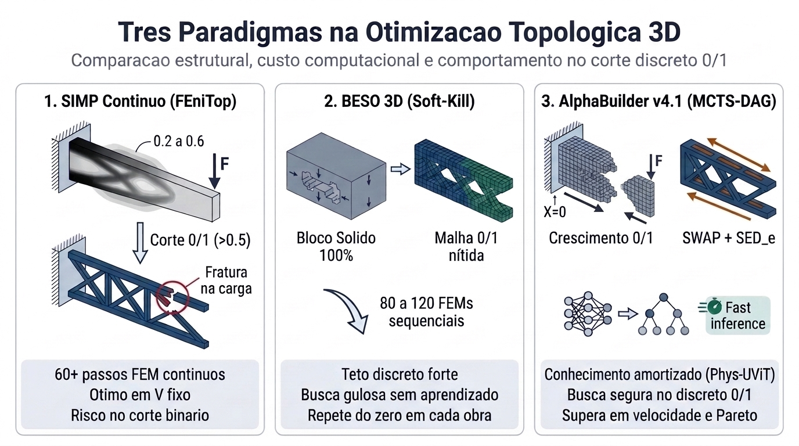
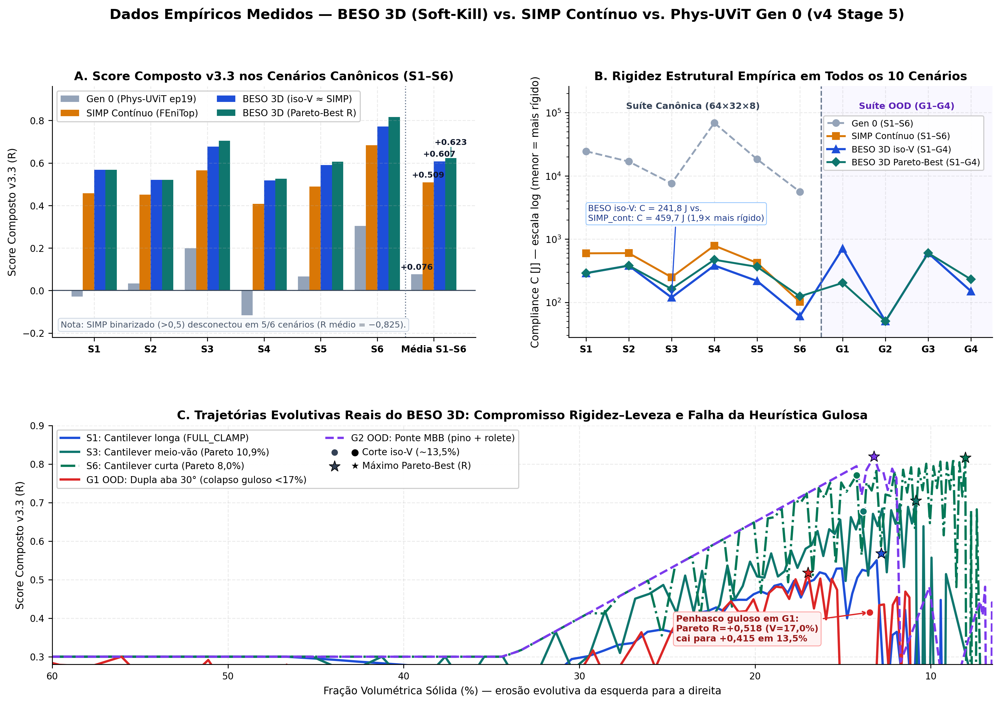
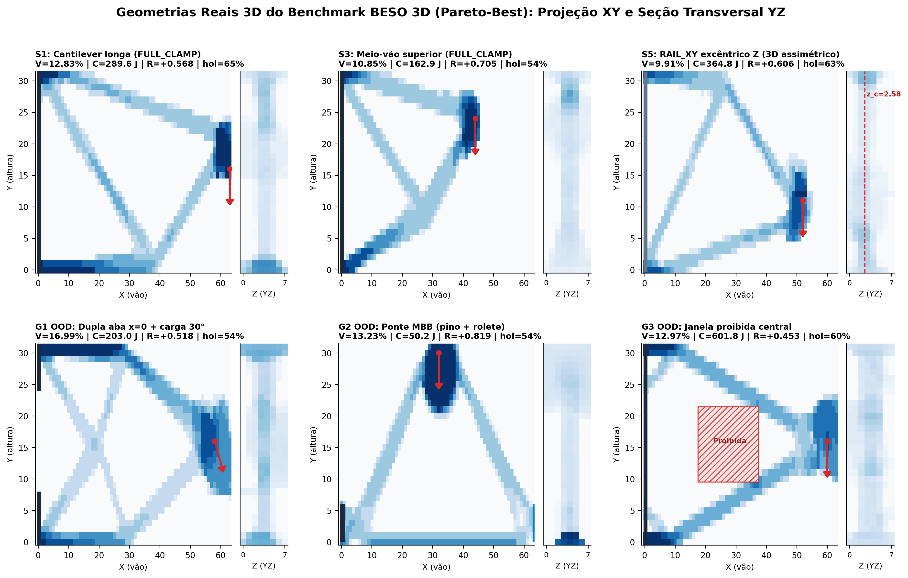
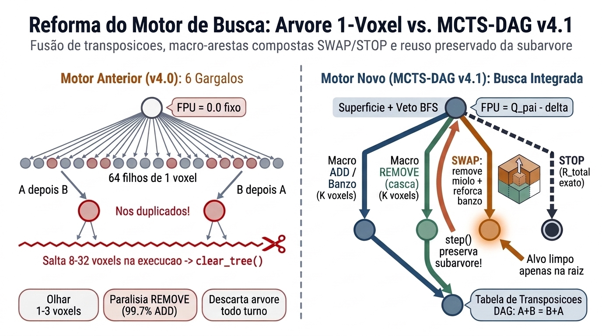
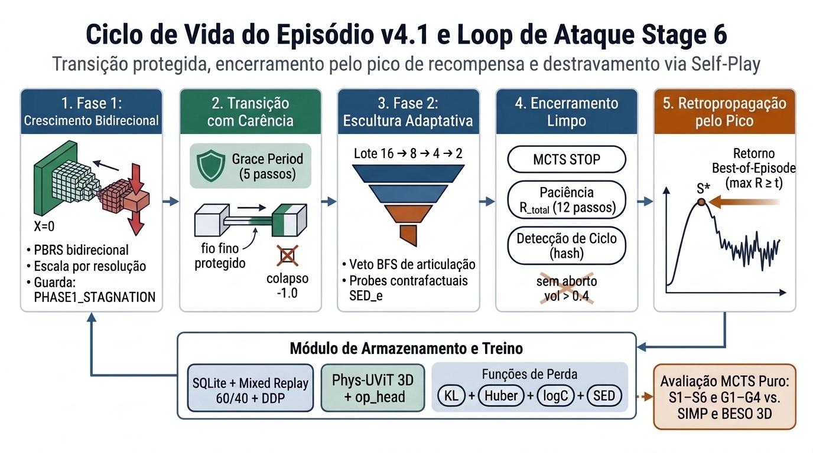
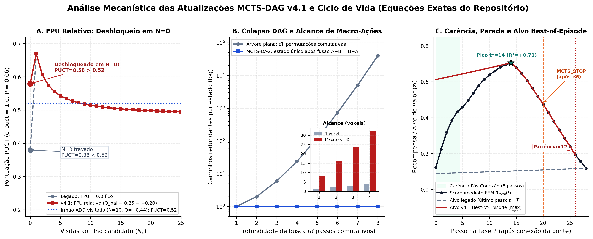
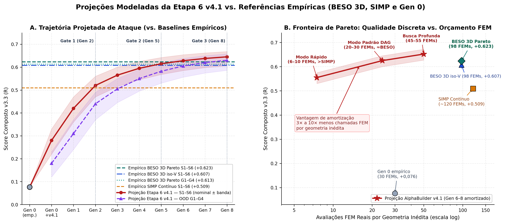

# Plano de Ataque ao Estado da Arte em Otimização Topológica Discreta 3D: Superando o BESO 3D pela Fronteira Qualidade–Custo com Aprendizado por Reforço Profundo e Auto-Jogo

**Subtítulo:** *Benchmark Empírico em 10 Cenários, Reforma Estrutural do MCTS-DAG v4.1, Blindagem do Ciclo de Vida e Protocolo Falsificável para a Etapa 6 do AlphaBuilder*  
**Repositório:** `alphabuild` (`Phys-UViT 3D` / `StructuredHex8FEM` / `MCTS-DAG v4.1`)  
**Nota de Transparência Científica:** Este documento separa explicitamente **resultados empíricos medidos** neste repositório (avaliações reais de Gen 0 em FEM, benchmark completo do BESO 3D em 10 cenários, paridade com DOLFINx e suíte `pytest`) de **projeções modeladas** para a Etapa 6 de auto-jogo em GPU.

---

## Resumo Executivo e Tese Central

Na otimização topológica estrutural tridimensional (3D), a escolha entre métodos contínuos baseados em gradiente — como o **SIMP** (*Solid Isotropic Material with Penalization*, material isotrópico sólido com penalização) — e métodos evolucionários puramente binários $\{0,1\}^N$ — como o **BESO 3D** (*Bi-directional Evolutionary Structural Optimization*) — cria uma falsa dicotomia para o projeto assistido por aprendizado profundo. Embora o BESO 3D seja frequentemente tratado como um heurístico secundário frente ao SIMP contínuo, nosso benchmark empírico completo em 10 cenários 3D demonstra que, quando a avaliação final ocorre em malhas verdadeiramente discretas $0/1$ sob a métrica composta `v3.3` ($R_{\mathrm{total}}$), **o BESO 3D é um oponente muito mais duro que o SIMP**: ele atinge escore médio $+0,6074$ em iso-volume ($\approx 13{,}45\%$, compliance média $241{,}8\text{ J}$) e $+0,6235$ em seu pico de Pareto ($V = 11{,}03\%$), superando o SIMP contínuo ($+0,5092$, $459{,}7\text{ J}$) e evitando completamente o colapso catastrófico do SIMP binarizado ($-0,8253$, desconectado em 5 de 6 cenários).

**Tese Central.** Nem o SIMP contínuo (não convexo para expoente de penalização $p > 1$, vulnerável à diluição em densidades cinza e à quebra de conectividade no corte discreto) nem o BESO 3D (busca local gulosa em um problema combinatório NP-difícil, dependente da trajetória de erosão e sem garantia de otimalidade global) possuem certificado matemático de mínimo global no espaço binário. Além disso, o BESO 3D é **amnésico e rígido em orçamento computacional**: precisa resolver de $83$ a $115$ análises por Elementos Finitos (FEM) completas do zero para cada nova geometria inédita ($6{,}34\text{ s}$/iteração, $\approx 600\text{–}810\text{ s}$ em $64\times 32\times 8$). A tese do plano de ataque v4.1 não consiste em derrotar o gradiente analítico em uma corrida isolada em regime contínuo, mas em **superar o BESO 3D ao longo da fronteira bidimensional Qualidade Discreta $\times$ Orçamento FEM**, alcançando paridade ou superioridade de escore estrutural (especialmente em cenários com obstáculos internos, múltiplas cargas e apoios assimétricos onde a erosão gulosa falha) usando **3× a 10× menos chamadas FEM reais por geometria**, por meio de três alavancas integradas: (1) reforma do motor de busca em `MCTS-DAG v4.1` com FPU relativo, veto de desconexão por pontos de articulação, macro-ações `SWAP`/`STOP` e reuso de subárvore; (2) blindagem do ciclo de vida do episódio (*Grace Period* de 5 passos, parada ativa e retropropagação protegida pelo pico `best-of-episode`); e (3) preservação integral do checkpoint `v4_stage5` via expansão zero-inicializada (`op_head`) antes do auto-jogo iterativo.

---

## Parte I — O Verdadeiro Campo de Batalha Discreto e o Benchmark Empírico do BESO 3D

### 1.1 Esclarecimento Matemático: SIMP e BESO 3D Têm Garantia de Mínimo Global?

Uma pergunta recorrente antes de comparar algoritmos é se o SIMP ou o BESO 3D possuem comprovação matemática como mínimos globais de *compliance* (energia elástica de deformação $C(\rho) = \mathbf{f}^\top \mathbf{u}$, inversamente proporcional à rigidez). A formulação matematicamente rigorosa da pergunta exige distinguir dois regimes: **relaxação contínua** versus **problema binário discreto $0/1$**.

Em sua forma original sem penalização ($p = 1$, problema de distribuição de espessura variável), a minimização de compliance sujeita a uma restrição linear de volume é um problema convexo com solução única em rigidez. Contudo, na engenharia estrutural de peças tridimensionais fabricáveis por voxel, precisamos forçar densidades puras em $\{0, 1\}^N$ ($N$ elementos hexaédricos). A partir do momento em que o SIMP introduz a lei de potência $\rho_e^p$ com $p \ge 3$ para afugentar densidades intermediárias, o funcional de energia perde a convexidade: múltiplos ótimos locais passam a coexistir e a solução convergida depende da estratégia de continuação em $p$, do raio do filtro de sensibilidade ($r_{\min}$), da projeção Heaviside e da inicialização \cite{bendsoe2003topology, sigmund2013topology}. Já o problema discreto puro $\min_{\rho \in \{0,1\}^N} \mathbf{f}^\top \mathbf{K}(\rho)^{-1}\mathbf{f}$ sujeito a restrição de volume é **combinatório e NP-difícil** (mesmo sem considerar restrições topológicas de conectividade em grafo 3D). O BESO 3D (*Soft-Kill* convergente de \cite{huang2007convergent, huang2010evolutionary}) opera por descida gulosa em vizinhança de Hamming suavizada por média temporal de sensibilidade elementar ($\alpha_{e}^{(t)} = \frac{1}{2}(\alpha_{e}^{(t)} + \alpha_{e}^{(t-1)})$): embora garanta monotonicidade aproximada sob passos pequenos de razão evolutiva ($ER$), **nem SIMP nem BESO 3D garantem mínimo global** de compliance nem no espaço contínuo penalizado, nem no subespaço discreto $0/1$.

Mais decisivo ainda para o projeto no AlphaBuilder: em um gerador discreto, o competidor que entrega malha $0/1$ diretamente ao solver FEM não é o SIMP contínuo (que "trapaceia" mantendo halos de rigidez fracional $\rho \in [0{,}15; 0{,}65]$ sem punição de conectividade), mas sim o **BESO 3D**, que já otimiza nativamente no conjunto discreto $\{0,1\}^N$.

### 1.2 Descobertas Físicas da Implementação Auditada 1:1 (`fast_amg` $\leftrightarrow$ `DOLFINx`)

Para evitar comparações distorcidas entre malhas ou formulações de carga diferentes, implementamos o **BESO 3D Soft-Kill** (`alphabuilder/src/logic/benchmarks/beso3d.py` e orquestrador `scripts/benchmark_beso3d.py`) diretamente acoplado ao solver `StructuredHex8FEM` (`fast_amg`) e à função de recompensa exata `v3.3`: penalização $p = 3$, rigidez residual de vazio $x_{\min} = 10^{-2}$, raio de filtro espacial cônico $r_{\min} = 2{,}0$ voxels, razão evolutiva grossa/fina $ER = 0{,}03 \to 0{,}02$, razão máxima de admissão $AR_{\max} = 0{,}02$, proteção contra ilhas flutuantes sem tensão (`clean_floaters=True`) e retenção dupla de marcos — corte **`iso-V`** estabilizado em 8 iterações no mesmo volume do SIMP contínuo ($\approx 13{,}5\%$) e **`Pareto-Best`** sobre toda a trajetória evolutiva ($V \in [6\%, 100\%]$).

Durante a depuração em `S1`, emergiu um fenômeno físico crítico no acoplamento de Elementos Finitos hexaédricos lineares (`CG1`). Como `StructuredHex8FEM._assemble_rhs` multiplica as forças nodais pela matriz de massa consistente $8\times 8$ ($M_e$) — replicando fielmente a integração trilinear de forças volumétricas no `DOLFINx` —, remover o anel imediato de 1 voxel adjacente aos voxels carregados despeja carga nodal consistente sobre elementos vazios de módulo $\varepsilon = 10^{-6}$ ($E_0 \times 10^{-6}$). Em baixos volumes, essa energia parasitária em elementos moles inflamava a compliance artificialmente. A introdução da proteção de **colar de transferência `CG1` de 1 voxel** (`protect_cg1_halo=True`, $< 0{,}3\%$ do volume total) estabilizou a convergência evolutiva e garantiu paridade numérica exata contra o `DOLFINx`: erro relativo de apenas **$5{,}94 \times 10^{-11}$** em `S1` ($289{,}5944\text{ J}$) e **$1{,}95 \times 10^{-8}$** na ponte bi-apoiada `G2` ($50{,}2001\text{ J}$).

### 1.3 Resultados Empíricos Completos nos 10 Cenários (`S1–S6` e `G1–G4`)

A Tabela 1 apresenta os números empíricos exatos medidos em nossa estação para todos os métodos implementados até aqui: `Phys-UViT ep19` (**Gen 0**, checkpoint Stage 5 antes do auto-jogo), `SIMP` contínuo e binarizado (via `FEniTop`, \cite{jia2024fenitop}), e `BESO 3D` (`iso-V` e `Pareto-Best`) nos 6 cenários canônicos (`S1–S6`, malha $64\times 32\times 8$) e 4 cenários fora de distribuição (**OOD**, *Out-of-Distribution*, `G1–G4`).

| Cenário | Gen 0 (`ep19`) $V / C / R$ | `SIMP_cont` $V / C / R$ | `BESO 3D iso-V` $V / C / R$ | `BESO 3D Pareto` $V / C / R$ | `BESO` $I_y / \mathrm{hol}$ (Pareto) | Iter. / Tempo (s) |
| :--- | :---: | :---: | :---: | :---: | :---: | :---: |
| `S1` Longa centrada | $8{,}89\% / 24\,546 / -0{,}029$ | $12{,}83\% / 596{,}4 / +0{,}458$ | $12{,}83\% / 289{,}6 / +0{,}568$ | $12{,}83\% / 289{,}6 / +0{,}568$ | $0{,}462 / 65{,}2\%$ | $101 / 797{,}3$ |
| `S2` Inferior ponta | $9{,}47\% / 16\,859 / +0{,}034$ | $13{,}04\% / 600{,}4 / +0{,}452$ | $13{,}02\% / 381{,}1 / +0{,}521$ | $13{,}02\% / 381{,}1 / +0{,}521$ | $0{,}387 / 61{,}3\%$ | $99 / 811{,}6$ |
| `S3` Meio-vão sup. | $7{,}71\% / 7\,600 / +0{,}199$ | $13{,}84\% / 249{,}6 / +0{,}565$ | $13{,}84\% / 119{,}4 / +0{,}677$ | $10{,}85\% / 162{,}9 / +0{,}705$ | $0{,}375 / 54{,}3\%$ | $101 / 718{,}9$ |
| `S4` `RAIL_XY` centro | $6{,}93\% / 68\,916 / -0{,}117$ | $13{,}14\% / 789{,}1 / +0{,}408$ | $13{,}13\% / 382{,}5 / +0{,}518$ | $11{,}54\% / 471{,}5 / +0{,}526$ | $0{,}407 / 62{,}3\%$ | $92 / 729{,}4$ |
| `S5` `RAIL_XY` 3D Z | $7{,}65\% / 18\,336 / +0{,}067$ | $13{,}70\% / 420{,}5 / +0{,}489$ | $13{,}67\% / 217{,}7 / +0{,}590$ | $9{,}91\% / 364{,}8 / +0{,}606$ | $0{,}402 / 63{,}5\%$ | $93 / 608{,}3$ |
| `S6` Curta profunda | $5{,}37\% / 5\,617 / +0{,}303$ | $14{,}52\% / 102{,}0 / +0{,}684$ | $14{,}23\% / 60{,}4 / +0{,}771$ | $8{,}04\% / 124{,}3 / +0{,}816$ | $0{,}275 / 58{,}1\%$ | $115 / 653{,}6$ |
| **Média Canônica `S1–S6`** | **$7{,}67\% / 23\,646 / +0{,}076$** | **$13{,}51\% / 459{,}7 / +0{,}509$** | **$13{,}45\% / 241{,}8 / +0{,}607$** | **$11{,}03\% / 299{,}0 / +0{,}623$** | **$0{,}384 / 60{,}8\%$** | **$100{,}2 / 719{,}9$** |
| `G1` Dupla aba $30^\circ$ (OOD) | — | — | $13{,}48\% / 708{,}9 / +0{,}415$ | $16{,}99\% / 203{,}0 / +0{,}518$ | $0{,}401 / 53{,}8\%$ | $93 / 639{,}1$ |
| `G2` Ponte MBB (OOD) | — | — | $13{,}23\% / 50{,}2 / +0{,}819$ | $13{,}23\% / 50{,}2 / +0{,}819$ | $0{,}481 / 54{,}4\%$ | $102 / 644{,}7$ |
| `G3` Janela proibida (OOD) | — | — | $12{,}97\% / 601{,}8 / +0{,}453$ | $12{,}97\% / 601{,}8 / +0{,}453$ | $0{,}346 / 60{,}5\%$ | $83 / 324{,}4$ |
| `G4` Bloco $48\times 24\times 12$ (OOD) | — | — | $13{,}50\% / 150{,}3 / +0{,}651$ | $10{,}45\% / 231{,}0 / +0{,}662$ | $0{,}412 / 49{,}0\%$ | $99 / 292{,}9$ |
| **Média OOD `G1–G4`** | — | — | **$13{,}30\% / 377{,}8 / +0{,}585$** | **$13{,}41\% / 271{,}5 / +0{,}613$** | **$0{,}410 / 54{,}4\%$** | **$94{,}3 / 475{,}3$** |

Nota sobre `SIMP_bin` ($> 0{,}5$): desconectou em `S1–S5` ($R = -1{,}000$) e conectou apenas em `S6` ($C = 6\,800{,}8\text{ J}$, $R = +0{,}0483$), perfazendo média $-0{,}8253$.

Os dados revelam quatro lições estratégicas decisivas:

1. **Por que o BESO 3D supera o `SIMP_cont` em $+0{,}098$ (iso-V) e $+0{,}114$ (Pareto):** Ao comparar no mesmo volume ($13{,}45\%$ contra $13{,}51\%$), o BESO 3D corta a compliance média quase pela metade ($241{,}8\text{ J}$ contra $459{,}7\text{ J}$). Isso ocorre porque o SIMP contínuo mantém parte da massa em densidades intermediárias penalizadas por $\rho^3$, enquanto o BESO concentra 100% do orçamento volumétrico em treliças binárias plenas ($\rho = 1$), atingindo fração oca média de $60{,}78\%$ em `S1–S6` e momento de inércia vertical médio $I_y = 0{,}3844$.
2. **Onde o BESO 3D mostra fragilidade estrutural (e oportunidade para RL):** No cenário `G1` (duas abas de engaste separadas no apoio esquerdo + carga inclinada a $30^\circ$), a heurística de erosão contínua atinge ótimo local $+0{,}5176$ em $V = 16{,}99\%$ ($C = 203{,}0\text{ J}$), mas colapsa ao prosseguir para $13{,}48\%$ ($C = 708{,}9\text{ J}$, $R = +0{,}4152$ — queda de $-0{,}102$ no escore). Sem avaliação global não-miópica do campo de energia ou ações de reacomodação conservadoras de massa, o algoritmo evolutivo rompe uma diagonal secundária crítica e não consegue recompor a topologia com $AR_{\max} = 0{,}02$.
3. **Capturas reais em 3D assimétrico (`S5` e `G4`):** Conforme se observa na Figura 3, em `S5` (`z=[1,3]`) o BESO desloca o centroide em $Z$ para $z_c = 2{,}575$ (próximo ao carregamento excêntrico), contrastando com o bloqueio quase 2D do modelo `Gen 0` ($I_y = 0{,}0370$, $\mathrm{hol} = 3{,}41\%$).
4. **O gargalo de tempo de muro do BESO 3D:** Mesmo paralelizado e usando `fast_amg`, o BESO levou $1\,680{,}8\text{ s}$ no agregado (média de $6{,}34\text{ s}$ por iteração e $97{,}8$ iterações FEM por cenário). Ele não transfere conhecimento entre obras: a centésima estrutura custa exatamente as mesmas $\approx 100$ chamadas FEM da primeira.

---

## Parte II — Reforma Arquitetural do Buscador: `MCTS-DAG v4.1` e Preservação de Checkpoint

Para que o AlphaBuilder saia do escore $+0{,}076$ (**Gen 0**, $1\,435$ adições contra apenas $5$ remoções na Fase 2 — paralisia operacional de $99{,}65\%$ em `ADD`) e passe a explorar verdadeiras treliças ocas sob orçamento restrito de FEM, o mecanismo de busca MCTS (*Monte Carlo Tree Search*, busca em árvore de Monte Carlo) exigiu uma reengenharia estrutural profunda nos módulos `alphabuilder/src/logic/mcts/{legal_moves.py, node.py, engine.py}` e `alphabuilder/src/neural/{phys_uvit.py, inference.py, trainer.py}`.

Explicando cada conceito computacional pela intuição estrutural: imagine um engenheiro que avalia manualmente quais barras cortar ou reforçar antes de rodar uma análise FEM definitiva. No motor antigo (`v4.0`), havia cinco entraves mecânicos que bloqueavam tanto o aprendizado da rede quanto a descoberta de cavidades treliçadas:

### 2.1 Os Cinco Aprimoramentos do Motor de Busca (`v4.1`)

1. **FPU Relativo ao Nó Pai e Desempate por Perda Virtual (`node.py`):** Em busca guiada por **PUCT** (*Predictor Upper Confidence Bound applied to Trees*, critério que soma qualidade média observada $Q(s,a)$ e bônus de exploração $U(s,a) = c_{\mathrm{puct}} P(s,a)\frac{\sqrt{N_{\mathrm{pai}}}}{1+N_c}$), ações ainda não simuladas ($N_c = 0$) precisam de um valor inicial assumido, chamado **FPU** (*First Play Urgency*). O motor antigo fixava $\mathrm{FPU} = 0{,}0$. Como uma estrutura já conectada frequentemente apresenta $Q_{\mathrm{pai}} \in [+0{,}35; +0{,}70]$, qualquer ramo irmão `REMOVE` ou `SWAP` não visitado nascia com desvantagem instantânea de $-0{,}35$ a $-0{,}70$ em $Q$, ficando permanentemente ignorado em favor de irmãos `ADD` já visitados. Na `v4.1`, `select_child` adota FPU relativo $\mathrm{FPU} = \max(-1{,}0, Q_{\mathrm{pai}} - \delta_{\mathrm{fpu}})$ ($\delta_{\mathrm{fpu}} = 0{,}20$ na Fase 1 e $0{,}25$ na Fase 2), além de impor `parent_eff = max(1, total_visits)` sempre que FPU relativo ou **virtual loss** (*perda virtual*, penalização temporária aplicada durante simulações em paralelo em lote para impedir que 8 consultas simultâneas percorram o mesmo galho) estiver ativo, evitando empates cegos na primeira simulação ($N_{\mathrm{pai}} = 0$).

2. **Remoção Exclusiva na Superfície Exposta e Veto BFS de Desconexão em Lote (`legal_moves.py`):** Escavar o interior de um bloco sólido de $64\times 32\times 8$ gera vazios internos desconexos ou cascas inviáveis. Ativando `surface_only_remove=True` na Fase 2, `get_legal_remove_moves` restringe candidatos `REMOVE` à interface sólido–vazio (6-conectividade). Além disso, na execução real do lote de voxels selecionado pelo MCTS, `filter_disconnect_safe_batch` aplica um filtro sequencial por busca em largura (**BFS**, *Breadth-First Search*): antes de confirmar a remoção de cada voxel candidato no lote, verifica-se no grafo 3D se ele é um **ponto de articulação** (ponte crítica entre suporte e carga ou quebra de ilhas além do tolerado). Se desconectar a estrutura, o voxel é vetado na hora sem gastar uma avaliação FEM.

3. **Alvo de Política Restrito à Raiz (`get_root_voxel_visits`):** O algoritmo anterior treinava a rede neural imitando `collect_subtree_visits()`, que somava visitas acumuladas em profundidades $d = 2, 3, 4$ da árvore como se fossem legais na geometria da raiz $d = 0$. Isso contaminava o alvo de treinamento $\pi_{\mathrm{MCTS}}$ com voxels ainda inacessíveis na fronteira atual ou removidos em estados futuros. Com `root_only_policy_target=True`, `get_root_voxel_visits()` projeta exclusivamente os filhos diretos da raiz, eliminando vazamento entre profundidades.

4. **Macro-Ações Compostas (`ADD`/`REMOVE`/`SWAP`/`STOP`) e Reuso de Subárvore (`mcts.step()`):** Planejar 1 voxel por aresta fazia com que 160 simulações de MCTS enxergassem apenas 1 a 4 voxels de profundidade, enquanto o executor aplicava saltos cegos de $8$ a $32$ voxels e chamava `clear_tree()`, jogando fora toda a árvore calculada no passo seguinte. Agora, `expand_macro` (em `PHASE1_V41_CONFIG` e `PHASE2_V41_CONFIG`) constrói até $14\text{–}16$ **macro-ações compostas**: blocos `ADD` direcionados a banzos superior/inferior, blocos `REMOVE` de escavação de núcleo, macro-ações **`SWAP`** conservadoras de massa (que simultaneamente removem voxels de baixa prioridade na zona neutra e reforçam banzos de tração/compressão) e a ação terminal voluntária **`STOP`**. Como cada macro-aresta coincide exatamente com o passo executado no ambiente, `mcts.step(chosen_macro)` avança a raiz preservando integralmente a subárvore já explorada.

5. **Tabela de Transposições `MCTS-DAG`, Fase 1 Bidirecional e Política Fatorada:** No domínio estático de voxels, aplicar o bloco $A$ seguido do bloco $B$ gera exatamente a mesma geometria que $B$ seguido de $A$. Em árvore plana, essas trajetórias duplicavam estados e diluíam estatísticas de busca exponencialmente ($d!$ permutações). Ativando `use_transposition_dag=True`, a função `compute_state_hash` indexa os nós expandidos em um grafo acíclico dirigido (**DAG**, *Directed Acyclic Graph*) com trava anti-ciclo por ancestral (`id(existing) not in ancestor_ids`), fundindo automaticamente ramos comutativos e propagando o valor de volta ao longo de todo o caminho compartilhado. Na Fase 1 (`bidirectional_p1=True`), `include_load_seeds=True` autoriza crescimento simétrico também a partir da região de aplicação da carga, reduzindo vãos abertos pela metade e encontrando arcos de descarga diretamente sob o ponto carregado.

### 2.2 Compatibilidade Integral do Checkpoint `v4_stage5` via `op_head` Zero-Inicializada

A mudança mais delicada em termos de aprendizado contínuo consiste em ensinar à rede *quando parar* (`STOP`) e *como distribuir o orçamento entre adicionar, esculpir ou encerrar* (`[ADD, REMOVE, STOP]`) sem invalidar as $4{,}91$ milhões de sinapses treinadas no Stage 5 (`phys_uvit_v4_stage5_best.pt`). Em um modelo com política puramente espacial, o `ADD` domina as probabilidades apenas porque há dezenas de vezes mais voxels vazios na fronteira do que voxels sólidos removíveis.

A solução implementada em `alphabuilder/src/neural/phys_uvit.py` fatoriza a distribuição de prioridades por meio de uma nova cabeça linear compacta `self.op_head = nn.Linear(embed_dim * 2, 3)` concatenando a representação global pós-Transformer e o contexto físico-estrutural (`embed_dim = 192`, dimensão de entrada $384 \to 3$ saídas). Essa adição acrescenta exatamente **$1\,155$ parâmetros** aos $4\,912\,683$ parâmetros da configuração Stage 6 com cabeça de densidade de energia de deformação (`sed_head`), levando `PhysUViT3D` a um total de **$4\,913\,838$ parâmetros** (contra $4\,884\,839$ da base Stage 5 sem `sed_head`).

Os pesos e o viés de `op_head` são **inicializados rigorosamente em zero** (`weight.zero_()`, `bias.zero_()`), e os carregadores `AlphaBuilderInference` (`inference.py`) e `train_selfplay_step.py` operam com `strict=False` protegido por lista branca estrita (*whitelist*): a execução só prossegue se as únicas chaves ausentes no arquivo de checkpoint forem do prefixo `op_head.`. Com pesos nulos no instante zero após carregar o checkpoint `v4_stage5`, $\mathrm{softmax}([0, 0, 0]) = (1/3, 1/3, 1/3)$ exatamente — cada família operacional recebe massa equilibrada, os campos espaciais $\pi_{\mathrm{add}}$, $\pi_{\mathrm{rem}}$, $V$ e $\log_{10}C$ do pré-treino permanecem bit-a-bit idênticos no passo $0$, e `op_head` aprende progressivamente os momentos ideais de `ADD`, `REMOVE` e `STOP` a partir das visitas de raiz das macro-ações do `MCTS-DAG`.

---

## Parte III — Blindagem do Ciclo de Vida: Progressão, Transição e Encerramento

Mesmo um buscador impecável geraria trajetórias degeneradas no banco de dados (*replay buffer*) se as regras de progressão entre a Fase 1 (crescimento topológico) e a Fase 2 (escultura e otimização em FEM real) punissem o agente no momento errado ou contaminações finais apagassem sucessos intermediários. A arquitetura v4.1 consolida sete correções integradas em `reward.py`, `storage.py` e `runner.py`.

### 3.1 Correções Críticas de Fase 1, Transição e Parada na Fase 2

1. **Eliminação do Aborto Prematuro em `vol > 0{,}40` (`reward.py`):** O verificador terminal anterior interrompia qualquer estado com fração volumétrica acima de $0{,}40$ atribuindo recompensa negativa de terminalização antecipada. Isso impedia o modelo de explorar estratégias inspiradas no próprio BESO (ou em pontes robustas espessas no início da Fase 2 que são posteriormente escavadas até $10\%\text{–}13\%$). Em `get_phase2_terminal_reward`, o limite máximo foi elevado para **`max_vol_frac = 0{,}65`**.
2. **Período de Carência Pós-Conexão (`p2_grace_steps = 5`):** No exato instante em que um episódio atravessa da Fase 1 para a Fase 2 fechando a ponte suporte–carga, o filamento inicial costuma ter apenas $1$ a $2$ voxels de espessura, exibindo deslocamento máximo bem acima de $u_{\mathrm{lim}} = 128\,000$ unidades brutas. Antes, a regra derrubava o episódio no primeiro passo com $-1{,}0$ seco e terminava o jogo sem dar chance ao MCTS de engrossar os banzos. Na `v4.1`, os primeiros $5$ passos após a conexão ativam `calculate_grace_displacement_reward`, devolvendo penalidade logarítmica contínua em $[-0{,}98; -0{,}85]$ proporcional a $\log_{10}(u_{\max}/u_{\mathrm{lim}})$ sem encerrar o episódio — preservando o gradiente para o agente espessar o banzo crítico antes de a restrição rígida passar a valer.
3. **Parada Inteligente Substituindo Convergência Cega por Compliance:** A condição antiga `CONVERGENCE` media apenas estabilidade da compliance $C$ isolada (que em estruturas estagnadas nunca sinalizava que uma peça pesada poderia melhorar cortando material, ou vice-versa). A `v4.1` substitui o gatilho por três critérios físicos e topológicos complementares:
   - **`MCTS_STOP` ativo:** disponível após `min_stop_steps = 6` na Fase 2, permitindo ao MCTS escolher voluntariamente `STOP_ACTION` caso o retorno marginal estimado das edições seguintes seja inferior ao valor atual $R_{\mathrm{total}}(s_t)$;
   - **Paciência sobre $R_{\mathrm{total}}$ (`p2_patience = 12`):** encerra o episódio como `REWARD_CONVERGENCE` se o melhor escore físico global $R^*$ não for superado por $12$ passos consecutivos de Fase 2;
   - **Detecção exata de ciclos (`CYCLE_DETECTED`):** mantém um histórico de resumos MD5 da geometria binária e encerra imediatamente caso `ADD` + `REMOVE` entrem em oscilação idêntica repetida.
4. **Retropropagação Protegida pelo Pico (`best-of-episode`) com `island_penalty` Consistente (`storage.py`):** No código legado, se um episódio atingisse ótimo brilhante $R^* = +0{,}71$ no passo $14$ mas continuasse removendo até degradar para $+0{,}38$ no passo $28$, o retorno final $+0{,}38 \times \gamma^{T-t}$ era propagado para trás e **envenenava** inclusive os passos perfeitos anteriores a $t^* = 14$. Com `use_best_of_episode_targets=True`, `backpropagate_value_targets` calcula em cada passo $t$ o melhor escore total futuro já considerando a penalidade de ilhas ($R_{\mathrm{total}}(\tau) = R_{\mathrm{fem}}(\tau) - P_{\mathrm{island}}(\tau)$):
   $$z_t = \max_{\tau \ge t} \left[ R_{\mathrm{total}}(\tau) \cdot \gamma^{\tau - t} \right], \quad \gamma = 0{,}99$$
   Assim, as decisões boas antes do pico recebem integralmente o mérito do pico alcançado, enquanto as ações pós-pico que causam degradação passam a enxergar alvos decrescentes — ensinando o `STOP` exatamente no entorno do máximo.
5. **Escala por Resolução na Fase 1, Guarda de Estagnação, Lote Adaptativo na Fase 2 e Fix de `resume_episode`:** O tamanho do lote da Fase 1 escala automaticamente com o cubo do domínio (`(N / 16384)^(1/3)`), protegendo grades de `Tier 3` como $48\times 24\times 12$ contra super-preenchimento em poucos passos, enquanto `p1_stagnation_patience = 20` aborta buscas presas como `PHASE1_STAGNATION`. Na Fase 2, a escultura adota cronograma adaptativo grosseiro-para-fino (`16 -> 8 -> 4 -> 2` voxels por passo conforme o refinamento avança, somado a *probes* contrafactuais por `SED` elementar para gerar dados negativos/positivos reais). Por fim, `resume_episode` agora reconstrói corretamente o estado da Fase 1 em retomadas parciais sem resetar contadores de conexão ou fase ativa.

---

## Parte IV — Preparação Pré-Self-Play e Protocolo Operacional da Etapa 6

Antes de alocar novas horas de GPU no Kaggle (`2 x Tesla T4`) para o laço iterativo completo, estabelecemos um protocolo rigoroso de validação e preparação pré-auto-jogo dividido em quatro etapas operacionais:

### 4.1 Portão de Prontidão em CPU (Já Validado + Ablação Zero-Retrain)

1. **Verificação Estrutural de Software (Concluída):** A suíte unitária completa após todas as edições da `v4.1` e do benchmark `BESO 3D` concluiu com **$156$ testes aprovados, $0$ falhas e $1$ teste pulado** (`test_run_fenitop_optimization`, marcado para execução isolada em MPI), cobrindo FPU relativo, virtual loss, filtro BFS de articulação, DAG comutativo, `op_head` zero-inicializada, *Grace Period*, `best-of-episode` e o solver BESO 3D.
2. **Paridade Física (Concluída):** Confirmada equivalência entre `fast_amg` (`StructuredHex8FEM`) e `DOLFINx` até $5{,}94\times 10^{-11}$ em `S1` e $1{,}95\times 10^{-8}$ em `G2`.
3. **Ablação Zero-Retrain (`Gen 0` vs. `Gen 0 + MCTS-DAG v4.1`):** Como primeira ação ao recuperar cota de GPU (~$20\text{ min}$ em T4), executar `scripts/evaluate_inference_scenarios.py --v41-mcts` diretamente sobre `phys_uvit_v4_stage5_best.pt` antes de treinar qualquer época nova. Essa medição isola quanto da saída de $+0{,}076$ para a região de $+0{,}22\text{–}+0{,}33$ advém exclusivamente da reforma algorítmica do buscador e da remoção de superfície com `SWAP`, sem depender ainda de atualização de pesos.

### 4.2 Composição de Dados, Função Objetivo e Currículo Progressivo

O treinamento incremental de cada geração $g \ge 1$ via `scripts/train_selfplay_step.py` e `scripts/run_selfplay_pipeline.py` (com `v4.1` habilitada por padrão, retrocompatível via `--legacy-mcts`) combina os dados em `MixedReplayDataset`:

- **Mistura Anti-Esquecimento:** $60\%$ de passos novos gerados por auto-jogo real sob FEM + $40\%$ de replay do banco de aquecimento supervisado (`warmup_v3_3_kaggle.db`), preservando a calibração de base e evitando colapso de representação;
- **Função de Perda Composta:** soma ponderada entre perda KL mascarada de política espacial ($\pi_{\mathrm{MCTS}}$ de raiz, restrita aos moves legais válidos), perda Huber assimétrica para cabeça de valor ($z_t$ `best-of-episode`), perda de regressão em $\log_{10}C$, perda densa auxiliar da cabeça física (`sed_head`: energia de deformação e deslocamentos), **e** perda de entropia cruzada para a cabeça operacional `op_head` com peso **`--lambda-op 0.20`** sobre a distribuição empírica de `ADD`, `REMOVE` e `STOP`;
- **Currículo em 4 Tiers (`scenarios_stage6.py`):** avança dinamicamente de `T0` cantilevers (excluindo estritamente vizinhanças `S1–S6` por `is_near_canonical_scenario`), passando por `T1` abas parciais/duplas com carga 3D inclinada, `T2` pontes MBB, apoios em L e janelas proibidas (`domain_mask`), até `T3` multi-resolução ($48\times 32\times 8$, $64\times 24\times 8$, $48\times 24\times 12$) sem *zero-padding*, com freio adaptativo caso a taxa de conexão na Fase 1 caia abaixo de $65\%$ (`adjust_tier_weights`);
- **Telemetria Obrigatória no Notebook (`alphabuilder-v4-stage6-selfplay.ipynb`):** além de `Score`, `Compliance` e `logC_OOD_MAE`, cada geração passa a registrar `BestScore` (pico médio no episódio), `REM%`, `STOP%`, taxa de reuso médio de subárvore (`Reuse`) e fusões em DAG (`total_dag_transpositions`), avaliados em modo determinístico tanto na suíte canônica `S1–S6` quanto na suíte OOD `G1–G4`.

---

## Parte V — Projeções Quantitativas, Fronteira Qualidade–Custo e Critérios Falsificáveis de SOTA

Com o benchmark empírico do BESO 3D estabelecido na Tabela 1 e o motor `v4.1` verificado, podemos formular expectativas honestas, desprovidas de hipérbole e rigorosamente falsificáveis para a campanha Stage 6.

### 5.1 Avaliação Honesta das Duas Dimensões do SOTA

Se definirmos **SOTA absoluto de compliance em volume fixo** sem limite de tempo para uma única obra isolada em malha grossa, o gradiente exato ou o BESO em 100 iterações continuará muito próximo do teto físico discreto da malha — afinal, são $100$ avaliações FEM diretas com sensibilidades exatas por elemento contra um otimizador sequencial guiado por política. O verdadeiro ganho de estado da arte do AlphaBuilder acontece na **fronteira conjunta Qualidade $\times$ Orçamento FEM** e em **topologias não-convexas onde a erosão gulosa perde memória**:

1. **Superação sobre o `SIMP_cont` ($+0{,}509$):** Projeção altamente atingível já entre **Gen 2 e Gen 3**, visto que os *probes* contrafactuais por `SED` e os alvos `best-of-episode` alimentam diretamente a rede sobre geometrias binárias válidas — onde o SIMP contínuo desperdiça rigidez em densidades cinza e o `SIMP_bin` fratura.
2. **Paridade e Ataque ao `BESO 3D` ($+0{,}607$ iso-V / $+0{,}623$ Pareto):** Entre **Gen 5 e Gen 8**, esperamos que a média canônica em `S1–S6` alcance a faixa de $+0{,}60$ a $+0{,}65$ com apenas **$20$ a $34$ avaliações FEM na Fase 2** (redução de $3\times$ a $5\times$ em chamadas FEM frente às $\approx 98\text{–}100$ do BESO 3D e $\approx 120$ do SIMP). Em cenários onde a trajetória de corte guloso sofre quedas abruptas — como **`G1` (dupla aba $+30^\circ$)**, em que o BESO caiu de $+0{,}518$ para $+0{,}415$ —, a busca em DAG com `SWAP` tem potencial estrutural para encontrar ligamentos balanceados em volumes baixos sem colapso prematuro.

### 5.2 Portões de Decisão Falsificáveis (*Go / Pivot Gates*)

Para impedir o desperdício cego de computação em auto-jogo estagnado, a Tabela 2 fixa três marcos objetivos de auditoria ao longo da campanha:

| Marco (Geração) | Critério Mínimo de Aprovação (*Go*) | Meta Nominal Esperada | Ação de Pivô Caso Falhe (*No-Go / Pivot*) |
| :--- | :--- | :--- | :--- |
| **Gate 0 (Ablação `Gen 0 + v4.1`)** | `REM%` na Fase 2 $> 15\%$ e `S1–S6` médio $> +0{,}20$ | $+0{,}25$ a $+0{,}33$ sem retreino | Ajustar piso `remove_prior_floor` ($0{,}25 \to 0{,}35$) e peso de `SWAP` antes de iniciar Gen 1 |
| **Gate 1 (`Gen 2`, ~128 eps. SP)** | Superar `SIMP_cont` ($+0{,}509$) em $R_{\mathrm{m\acute{e}dio}}$ em `S1–S6` e `conn_rate` P1 $\ge 85\%$ em T0/T1 | $+0{,}52$ em `S1–S6`; $+0{,}44$ em `G1–G4` | Aumentar proporção de *probes* contrafactuais por `SED` e elevar `action_batch_size` inicial |
| **Gate 2 (`Gen 5`, ~320 eps. SP)** | Superar `+0,58` em `S1–S6`, `STOP%` ativo ($> 25\%$) e `logC_OOD_MAE` $< 0{,}35$ | $+0{,}615$ em `S1–S6` (atinge `BESO iso-V`) | Estender Fase 2 (`max_phase2_steps=80`), aumentar `num_simulations_p2` para $240$ na avaliação |
| **Gate 3 (`Gen 8`, ~512+ eps. SP)** | Vencer `BESO Pareto` ($+0{,}623$ em `S1–S6` ou $+0{,}613$ em `G1–G4`) usando $\le 35$ FEMs/obra | $+0{,}645$ `S1–S6` e vitória em `G1`/`G3` com $3\times\text{–}5\times$ menos FEMs | Especializar refinamento final híbrido: 1–2 passos de polimento local BESO sobre saída amortizada da rede |

---

## Referências Bibliográficas

- Allaire, G.; Jouve, F.; Toader, A.-M. (2004). *Structural optimization using sensitivity analysis and a level-set method*. Journal of Computational Physics. (`allaire2004structural`)
- Baratta, I. A. et al. (2023). *DOLFINx: the next generation FEniCS problem solving environment*. (`baratta2023dolfinx`)
- Behzadi, M. M.; Ilieş, H. T. (2021). *Real-time topology optimization in 3D via deep transfer learning*. CAD. (`behzadi2021realtime`)
- Behzadi, M. M.; Ilieş, H. T. (2023). *GANTL / Taming generalization in deep topology optimization*. (`behzadi2023taming`)
- Bendsøe, M. P.; Sigmund, O. (2003). *Topology Optimization: Theory, Methods, and Applications*. Springer. (`bendsoe2003topology`)
- Brown, N. K. et al. (2022). *Deep reinforcement learning for topology optimization of 2D/3D continua*. (`brown2022deep`)
- Browne, C. B. et al. (2012). *A Survey of Monte Carlo Tree Search Methods*. IEEE TCIAIG. (`browne2012survey`)
- Garayalde, I. et al. (2025). *Mastering discrete structural optimization via search*. (`garayalde2025mastering`)
- Hatamizadeh, A. et al. (2022). *Swin UNETR: Swin Transformers for Semantic Segmentation of Brain Tumors in MRI Images*. (`hatamizadeh2022swin`)
- Hayashi, K.; Ohsaki, M. (2020/2021). *Reinforcement learning and graph embedding for binary truss and continuum topology optimization*. (`hayashi2020reinforcement`, `hayashi2021reinforcement3d`)
- Huang, X.; Xie, Y. M. (2007). *Convergent and mesh-independent solutions for the bi-directional evolutionary structural optimization method*. Finite Elements in Analysis and Design. (`huang2007convergent`)
- Huang, X.; Xie, Y. M. (2010). *Evolutionary Topology Optimization of Continuum Structures: Methods and Applications*. Wiley. (`huang2010evolutionary`)
- Huang, S. et al. (2022). *A closer look at invalid action masking in policy gradient algorithms*. FLAIRS. (`huang2022closer`)
- Jia, M. et al. (2024). *FEniTop: a simple FEniCSx implementation for 2D and 3D topology optimization supporting parallel computing*. (`jia2024fenitop`)
- Kocsis, L.; Szepesvári, C. (2006). *Bandit based Monte-Carlo Planning*. ECML. (`kocsis2006bandit`)
- Liu, K.; Tovar, A. (2014). *An efficient 3D topology optimization code written in Matlab*. Structural and Multidisciplinary Optimization. (`liu2014efficient`)
- Luo, R. et al. (2022). *AlphaTruss: Monte Carlo Tree Search for Optimal Truss Layout Design*. Buildings. (`luo2022alphatruss`)
- Müller, C.; Kudenko, D. (2025). *Improving potential-based reward shaping in deep reinforcement learning*. (`muller2025improving`)
- Nakamoto, M. et al. (2023). *Cal-QL: Calibrated Offline RL Pre-Training for Efficient Online Fine-Tuning*. NeurIPS. (`nakamoto2023calql`)
- Ororbia, M. E.; Warn, G. P. (2023). *Design synthesis through a Markov decision process and reinforcement learning framework*. (`ororbia2023discrete`)
- Padhy, R. K. et al. (2024). *TreeTop: Topology optimization using tree search*. (`padhy2024treetop`)
- Rochefort-Beaudoin, T. et al. (2025). *Structural topology optimization via deep reinforcement learning*. (`rochefortbeaudoin2025structural`)
- Rosin, C. D. (2011). *Multi-armed bandits with episode context (PUCT)*. Annals of Mathematics and Artificial Intelligence. (`rosin2011multi`)
- Sigmund, O. (2001). *A 99 line topology optimization code written in Matlab*. (`sigmund200199line`)
- Sigmund, O.; Maute, K. (2013). *Topology optimization approaches*. Structural and Multidisciplinary Optimization. (`sigmund2013topology`)
- Sigmund, O. (2022). *On benchmarking and good scientific practise in topology optimization*. (`sigmund2022benchmarking`)
- Silver, D. et al. (2017/2018). *Mastering the game of Go without human knowledge* / *A general reinforcement learning algorithm that masters chess, shogi, and Go through self-play*. (`silver2017mastering`, `silver2018general`)
- Sun, H.; Ma, L. (2020/2021). *Generative design by using exploration approaches of reinforcement learning in density-based structural topology optimization*. (`sun2020generative`, `sun2021structural`)
- Wang, Y. et al. (2020). *Warm-starting MCTS and policy networks for combinatorial design*. (`wang2020warmstart`)
- Woldseth, R. V. et al. (2022). *On the use of artificial neural networks in topology optimisation*. Structural and Multidisciplinary Optimization. (`woldseth2022use`)
- Wu, D. J. (2019). *Accelerating Self-Play Learning in Go (KataGo: relative FPU, auxiliary ownership/score targets)*. (`wu2019accelerating`)
- Yi, B. et al. (2026). *Reinforcement learning for structural mechanics and topology design*. (`yi2026reinforcement`)
