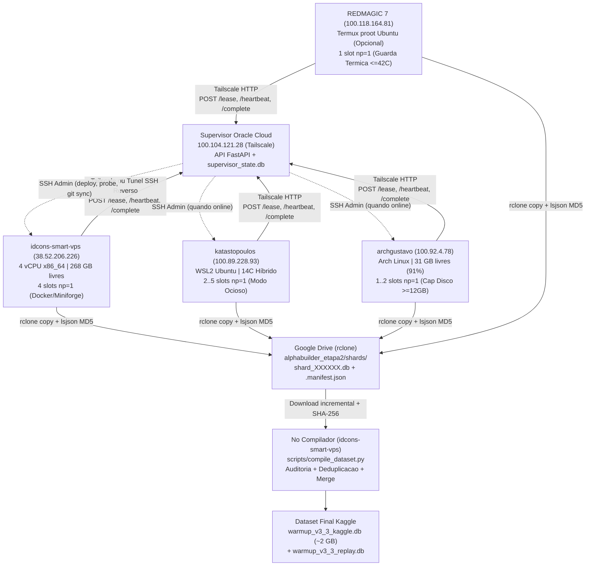

# Arquitetura de Data Harvest Distribuído e Resiliente — Etapa 2 (TCC)

**Projeto:** AlphaBuilder (`c:/Users/admin/Projetos/alphabuild`)  
**Documento:** Projeto arquitetural da Etapa 2 — Geração Distribuída de Dados (FEniCSx/FEniTop), Sincronização com Google Drive e Compilação para Treinamento no Kaggle.  
**Base de Código Auditada:** Branch `main` (commit `4377d01`), módulos [`run_data_harvest.py`](file:///c:/Users/admin/Projetos/alphabuild/run_data_harvest.py), [`storage.py`](file:///c:/Users/admin/Projetos/alphabuild/alphabuilder/src/logic/storage.py), [`config.py`](file:///c:/Users/admin/Projetos/alphabuild/alphabuilder/src/logic/harvest/config.py), [`optimization.py`](file:///c:/Users/admin/Projetos/alphabuild/alphabuilder/src/logic/harvest/optimization.py), [`processing.py`](file:///c:/Users/admin/Projetos/alphabuild/alphabuilder/src/logic/harvest/processing.py), [`generators.py`](file:///c:/Users/admin/Projetos/alphabuild/alphabuilder/src/logic/harvest/generators.py), [`convert_db_for_kaggle.py`](file:///c:/Users/admin/Projetos/alphabuild/scripts/convert_db_for_kaggle.py), [`dataset.py`](file:///c:/Users/admin/Projetos/alphabuild/alphabuilder/src/neural/dataset.py), [`environment.yml`](file:///c:/Users/admin/Projetos/alphabuild/environment.yml), [`environment_arch_intel.yml`](file:///c:/Users/admin/Projetos/alphabuild/environment_arch_intel.yml) e [`etapa1_veredito_politica_recompensa.md`](file:///c:/Users/admin/Projetos/alphabuild/docs/tcc/etapa1_veredito_politica_recompensa.md).

---

## 0. Sumário Executivo da Arquitetura

Em conformidade com o veredito da **Etapa 1 (1D)**, a geração distribuída de dados **não deve iniciar** antes da execução das correções físicas e de esquema (Bloco A) e da aprovação de um **lote piloto local/controlado (`100` episódios: `20` de auditoria estrutural + `80` de calibração empírica da recompensa `v3.3`)**.

Superado o *gate* do piloto, a arquitetura da Etapa 2 adota um modelo **Supervisor Pull-Based com Shards Imutáveis (WORM)**:
1. **Orquestração Central na Oracle Cloud (`gustavo-oracle-server-vnic`):** Opera 24/7 como Supervisor via Tailscale (`100.104.121.28`), emitindo *leases* determinísticos por faixas de `seed` (blocos de **`10` episódios por shard**) e monitorando *heartbeats*, RAM, disco livre e ociosidade.
2. **Execução Paralela em Nível de Episódio/Shard (Não MPI Largo):** Na malha padrão `64×32×8` (`16.384` elementos hexaédricos, `57.915` DOFs vetoriais nodais CG1), rodar múltiplos slots independentes com `mpirun -np 1` (ou `-np 2` após micro-benchmark local) e `OMP_NUM_THREADS=1` escala quase linearmente, evita gargalos de comunicação coletiva (`S_comm.gather` em [`topopt.py`](file:///c:/Users/admin/Projetos/alphabuild/alphabuilder/src/logic/fenitop/topopt.py#L157-L168)), reduz o risco de OOM e isola falhas por shard.
3. **Ambiente Enxuto Dedicado (`environment_harvest.yml`):** `run_data_harvest.py` e toda a árvore `alphabuilder/src/logic/harvest` + `fenitop` + `storage` **não utilizam** `pytorch`, `monai`, `pyvista`, `matplotlib`, `fastapi`, `uvicorn`, `plotly` ou `streamlit`. Separar um ambiente específico de harvest reduz o footprint por nó de ~6–10 GB para ~1,5–2,5 GB (crucial em nós com disco apertado).
4. **Persistência e Sincronização Imutável:** Cada worker grava em SQLite local isolado (`shard_XXXXXX.part.db`) com commit atômico por episódio, consolida WAL (`PRAGMA wal_checkpoint(TRUNCATE)`), gera manifesto JSON com `SHA-256` e `MD5`, envia o `.db` para o Google Drive via `rclone` com verificação de checksum e sobe o `.manifest.json` por último como *commit marker*. **Nunca** se edita um banco SQLite único diretamente no Google Drive.
5. **Compilação em Dois Produtos:** Um script `scripts/compile_dataset.py` baixa os shards verificados, valida integridade física/estatística e gera: (a) `warmup_v3_3_kaggle.db` enxuto (sem `displacement_blob`, compatível nativamente com [`TopologyDatasetV31`](file:///c:/Users/admin/Projetos/alphabuild/alphabuilder/src/neural/dataset.py#L40-L58) via `\x93NUMPY` + `zlib`) e (b) `warmup_v3_3_replay.db` (subconjunto estratificado com `displacement_blob` para inspeção no frontend React/FastAPI).

---

## 1. Impacto do Veredito da Etapa 1 no Harvest

### 1.1 Gate Obrigatório Pré-Etapa 2 (Correções do Bloco A)

Antes de distribuir qualquer tarefa em escala, o código do repositório precisa incorporar integralmente as correções identificadas no veredito `1D`:

| Arquivo | Defeito Atual Observado | Correção Obrigatória Antes da Produção |
| :--- | :--- | :--- |
| [`generators.py`](file:///c:/Users/admin/Projetos/alphabuild/alphabuilder/src/logic/harvest/generators.py#L57-L60) | `random.triangular(low, mode, high)` com ordem invertida; curvas e barra inicial ancoradas em `nx - 1` / `nx - 3` (gerando ilhas desconexas quando `load_x < nx - 1`); divergência `2..4` curvas vs. `1..3` na spec. | Corrigir ordem `(low, high, mode)` (ou `np.random.triangular`); ancorar extremidades em `load_config['x']`; padronizar faixa de curvas e passar `rng` derivado da `seed`. |
| [`optimization.py`](file:///c:/Users/admin/Projetos/alphabuild/alphabuilder/src/logic/harvest/optimization.py#L74-L152) e [`fem.py`](file:///c:/Users/admin/Projetos/alphabuild/alphabuilder/src/logic/fenitop/fem.py#L80-L113) | Passa `"disp_bc"` sempre fixo em `X=0`, ignorando `RAIL_XY` (`30%` dos episódios simulados erradamente como `FULL_CLAMP`); `record_step` trunca `CG1` com `[:-1, :-1, :-1]`. | Passar `"bcs"` explícito respeitando `bc_type` (`FULL_CLAMP` trava `0, 1, 2`; `RAIL_XY` trava `0, 1`); amostrar densidade celular pelos 8 vértices (ou campo `DG0`) e `max` dos 8 vértices para `displacement_map` sem truncar a fronteira `x=nx`. |
| [`run_data_harvest.py`](file:///c:/Users/admin/Projetos/alphabuild/run_data_harvest.py#L106-L276) e [`processing.py`](file:///c:/Users/admin/Projetos/alphabuild/alphabuilder/src/logic/harvest/processing.py#L13-L188) | Grava `forces` em `nx - 1`; grava `fitness_score` via `compute_normalized_value` (`v3.1 tanh`); omite `step=0`; colide `step=50` entre Fase 1 e Fase 2 (`UNIQUE(episode_id, step)`); omite `simp_history[-1]`; usa `t -> t+1` com *max-scaling* independente ignorando `REFINEMENT_WINDOW_SIZE=5` em [`config.py`](file:///c:/Users/admin/Projetos/alphabuild/alphabuilder/src/logic/harvest/config.py#L29-L38); grava `debug_simp_log_ep{i}.csv` no diretório atual (`L171`); deixa episódios órfãos se SIMP falhar (`L163`). | Alinhar `forces` em `load_config['x']`; usar escala unificada `v3.3` em `fitness_score`; gravar Fase 1 (`0..50`) na fronteira geodésica e Fase 2 (`51..T`) com janela `k=5`, limiar $\tau_{\text{noise}}$ e normalização conjunta; incluir `simp_history[-1]` (`is_final_step=1`); desativar CSV de debug por padrão; gravar episódio + registros em transação atômica única; gerar `episode_id` determinístico via `uuid5(seed)`. |
| [`storage.py`](file:///c:/Users/admin/Projetos/alphabuild/alphabuilder/src/logic/storage.py#L70-L101) e [`convert_db_for_kaggle.py`](file:///c:/Users/admin/Projetos/alphabuild/scripts/convert_db_for_kaggle.py#L18-L76) | `storage.py` serializa com `pickle.HIGHEST_PROTOCOL` (quebra entre NumPy 2.x local e NumPy 1.x/2.x do Kaggle); `convert_db_for_kaggle.py` usa header `struct` proprietário que [`dataset.py`](file:///c:/Users/admin/Projetos/alphabuild/alphabuilder/src/neural/dataset.py#L40-L58) **não lê** (`warmup_data_kaggle.db` atual tem `0` bytes) e descarta metadados. | Gravar arrays densos nativamente em `zlib(np.save(..., allow_pickle=False))` (cabeçalho `\x93NUMPY` já suportado por `dataset.py:51`) e arrays esparsos em formato neutro de versão (ex.: `np.savez_compressed` ou dict puro de `bytes`/`int` com `protocol=4` ou header `struct` lido por `dataset.py` e `fastapi_utils.py`). |

### 1.2 Novo Esquema de Dados (`Schema v3.3` para Shards e Banco Compilado)

O veredito `1D` demonstrou que **re-simular o FEniTop toda vez que a ponderação escalar da recompensa ou a formulação de target de política muda é inviável e desnecessário**, desde que os campos físicos brutos sejam persistidos no harvest. Além disso, a arquitetura distribuída requer metadados de proveniência por episódio.

#### Tabela `episodes` (1 linha por episódio)

| Coluna | Tipo SQLite | Obrigatória (Shard / Kaggle) | Propósito e Origem |
| :--- | :--- | :---: | :--- |
| `episode_id` | `TEXT PRIMARY KEY` | Sim / Sim | Determinístico: `uuid5(NAMESPACE_ALPHABUILD, f"v3.3:{nx}x{ny}x{nz}:{seed}")`. Impede duplicação entre workers. |
| `seed` | `INTEGER NOT NULL UNIQUE` | Sim / Sim | Seed exata usada no gerador e em todos os ranks MPI. |
| `shard_id` | `TEXT NOT NULL` | Sim / Sim | Identificador do lote (ex.: `shard_000042`). |
| `worker_id` | `TEXT NOT NULL` | Sim / Opcional | Nome do nó executor (ex.: `idcons-smart-vps`, `katastopoulos`). |
| `code_version` | `TEXT NOT NULL` | Sim / Sim | Hash curto do commit Git + tag do schema (`4377d01+v3.3`). |
| `bc_masks_blob` | `BLOB NOT NULL` | Sim / Sim | Tensor `(3, D, H, W)` `float32` em `\x93NUMPY` + `zlib`. |
| `forces_blob` | `BLOB NOT NULL` | Sim / Sim | Tensor `(3, D, H, W)` `float32` em `\x93NUMPY` + `zlib`, aplicado em `x = load_config['x']`. |
| `v_constructed_blob` | `BLOB` | Sim / Opcional | Máscara binária `uint8` `(D, H, W)` da geometria final construída (`V_constructed`, ~`0,5–2 KB`), permitindo recalcular targets de Fase 1 (ex.: variar $\beta_{\text{geo}}$) sem re-rodar o harvest. |
| `load_config` | `TEXT NOT NULL` | Sim / Sim | JSON com `x`, `y`, `z_start`, `z_end`, `bc_type`, `load_multiplier_base`. |
| `bc_type` | `TEXT NOT NULL` | Sim / Sim | `'FULL_CLAMP'` ou `'RAIL_XY'`. |
| `strategy` | `TEXT NOT NULL` | Sim / Sim | `'BEZIER'` ou `'FULL_DOMAIN'`. |
| `resolution` | `TEXT NOT NULL` | Sim / Sim | JSON `[64, 32, 8]`. |
| `final_compliance` | `REAL` | Sim / Sim | Compliance física real da última iteração do SIMP. |
| `final_volume` | `REAL` | Sim / Sim | Fração de volume física (`vol_frac`) da última iteração do SIMP. |
| `final_max_displacement` | `REAL` | Sim / Sim | Deslocamento máximo $U_{\max}$ da última iteração do SIMP. |
| `final_is_connected` | `INTEGER NOT NULL` | Sim / Sim | `1` se conectado pelo critério estrito de `reward.py`, `0` caso contrário. |
| `simp_iters` | `INTEGER NOT NULL` | Sim / Opcional | Total de iterações SIMP executadas. |
| `duration_sec` | `REAL` | Sim / Opcional | Tempo de execução do episódio no worker (para telemetria e ROI real). |
| `created_at` | `TIMESTAMP` | Sim / Sim | Carimbo UTC de criação. |

#### Tabela `records` (1 linha por passo `step`)

| Coluna | Tipo SQLite | Obrigatória (Shard / Kaggle) | Propósito e Impacto de Tamanho |
| :--- | :--- | :---: | :--- |
| `id` | `INTEGER PRIMARY KEY AUTOINCREMENT` | Sim / Sim | Chave substituta. |
| `episode_id` | `TEXT NOT NULL` | Sim / Sim | FK para `episodes(episode_id)` (`UNIQUE(episode_id, step)`). |
| `step` | `INTEGER NOT NULL` | Sim / Sim | Fase 1: `0..50`; Fase 2: `51..T` (zero colisões). |
| `phase` | `TEXT NOT NULL` | Sim / Sim | `'GROWTH'` ou `'REFINEMENT'`. |
| `density_blob` | `BLOB NOT NULL` | Sim / Sim | Estado de entrada `(D, H, W)` em `\x93NUMPY` + `zlib` (`uint8` ou `float32`). |
| `rho_cont_blob` | `BLOB` | Sim / Opcional | Densidade física contínua $\rho_t$ da Fase 2 (`float16` ou `float32`, `\x93NUMPY`+`zlib`). Permite recalcular `generate_refinement_targets` para qualquer janela $k$ e $\tau_{\text{noise}}$ sem re-rodar FEM! |
| `policy_add_blob` | `BLOB` | Sim / Sim | COO esparso (`int32` indices, `float32` values) dentro da fronteira legal $\mathcal{A}_{\text{add}}(s)$. |
| `policy_remove_blob` | `BLOB` | Sim / Sim | COO esparso dentro de $\mathcal{A}_{\text{rem}}(s)$ (sempre vazio na Fase 1). |
| `fitness_score` | `REAL NOT NULL` | Sim / Sim | Alvo de valor unificado `v3.3` (Fase 1 descontado $\gamma^{T_{\text{P1}}-t} R_{\text{final}}$; Fase 2 mistura $\lambda_t$ com `calculate_reward` incluindo colapso). |
| `compliance` | `REAL` | Sim / Sim | `NULL` na Fase 1; `current_frame['compliance']` bruto na Fase 2 (8 bytes!). |
| `vol_frac` | `REAL` | Sim / Sim | Fração de volume exata (`current_frame['vol_frac']` na Fase 2; média binária na Fase 1). |
| `max_displacement` | `REAL` | Sim / Sim | `NULL` na Fase 1; `float(np.max(disp_3d))` na Fase 2 (8 bytes — permite recalibrar $P_{\text{disp}}(U_{\max})$ sem armazenar o campo 3D inteiro!). |
| `beta` | `INTEGER` | Sim / Sim | Parâmetro Heaviside $\beta$ da iteração SIMP (`1..128`). |
| `is_final_step` | `INTEGER DEFAULT 0` | Sim / Sim | `1` apenas no último frame real convergido (`simp_history[-1]`). |
| `is_connected` | `INTEGER DEFAULT 0` | Sim / Sim | Conectividade estrita avaliada no estado `density_blob`. |
| `displacement_blob` | `BLOB` | **Apenas final/chave** / **Omitido no Kaggle** | **Ponto crítico de armazenamento (ver 1.3):** no shard, salvar apenas no frame final (`is_final_step=1`) ou 1 a cada 10 frames em `float16`; omitir integralmente no `.db` de treino do Kaggle (`TopologyDatasetV31` nunca o lê). |
| `reward_components_json` | `TEXT` | Sim / Opcional | Detalhamento escalar `S_comp`, `B_vol`, `P_disp`, `fem_score`, `mixing_factor` para auditoria e frontend. |

> [!IMPORTANT]
> **Compatibilidade com o Treino (`TopologyDatasetV31`) e Frontend (`training_data.py`):**
> Manter as tabelas `episodes` e `records` (e os nomes de colunas legíveis por [`dataset.py`](file:///c:/Users/admin/Projetos/alphabuild/alphabuilder/src/neural/dataset.py#L121-L136) e [`training_data.py`](file:///c:/Users/admin/Projetos/alphabuild/alphabuilder/web/backend/routers/training_data.py#L189-L196)) evita quebrar o backend web e os testes existentes, apenas enriquecendo com `ADD COLUMN` / novo DDL compatível. Já o script legado [`recalculate_warmup_db.py`](file:///c:/Users/admin/Projetos/alphabuild/scripts/recalculate_warmup_db.py) deve ser aposentado e substituído por recalibração direta sobre `compliance`, `vol_frac` e `max_displacement` no próprio schema `episodes`/`records`.

### 1.3 Estimativa Empírica de Tamanho por Episódio e Orçamento para o Kaggle

Ancoramos os cálculos diretamente em três observações medidas no repositório:
1. **Histórico real executado no notebook [`alphabuilder-v3-1-kaggle-training.ipynb`](file:///c:/Users/admin/Projetos/alphabuild/notebooks/alphabuilder-v3-1-kaggle-training.ipynb):** o banco `warmup_data_kaggle.db` tinha **`780,7 MB`** para **`122.358` registros** (`~6,69 KB/registro` médios, sem `displacement_blob`). Na mistura padrão do [`run_data_harvest.py`](file:///c:/Users/admin/Projetos/alphabuild/run_data_harvest.py#L108-L127) (`80%` `BEZIER` com ~50 slices Fase 1 + ~80–95 frames Fase 2; `20%` `FULL_DOMAIN` com 0 slices Fase 1 + ~95–115 frames Fase 2), a média observada é de **`~125–140` registros/episódio** (isto é, `122.358` registros correspondem a `~900–980` episódios, ou **`~0,82–0,90 MB/episódio`**).
2. **Medição em [`data/selfplay_games.db`](file:///c:/Users/admin/Projetos/alphabuild/data/selfplay_games.db):** `density_blob` binário comprimido da Fase 1 ocupa em média **`532` bytes** e o da Fase 2 limiarizada ocupa **`957` bytes** (`bc_masks_blob` = `363 B`, `forces_blob` = `357 B` por episódio).
3. **Medição direta com `zlib` sobre grade `(64, 32, 8)` (`16.384` voxels = `65.536` bytes brutos em `float32`):**
   - Campo denso binário (`8%` sólidos): **`~1,8 KB`** comprimido.
   - Campo denso contínuo (`rho_cont`): **`~5–10,4 KB`** comprimido em `float32` (`~3–6 KB` em `float16`).
   - Campo contínuo `displacement_blob` (`float32`): **`~45–55,5 KB`** comprimido por frame!
   - Policy esparsa COO (`150` a `400` não-zeros): **`~1,0–2,3 KB`** por canal.

Logo, salvar `displacement_blob` (`float32`) em todos os ~90 frames de Fase 2 inflaria **cada episódio em `+4,5–5,0 MB`** (multiplicando o dataset por **6×** sem nenhum ganho para o treino neural!). A tabela abaixo consolida o dimensionamento resultante:

| Perfil de Persistência | Tamanho por Registro | Tamanho por Episódio (~135 steps) | `100` eps (Piloto) | `2.000` eps (Base TCC) | `4.000` eps (Expandido) | `5.000` eps (Máximo) |
| :--- | :---: | :---: | :---: | :---: | :---: | :---: |
| **A. Kaggle Enxuto (`warmup_v3_3_kaggle.db`)**<br>*(sem `displacement_blob`, sem `rho_cont_blob`, com `compliance`/`vol_frac`/`max_displacement`)* | `~6,5–7,5 KB` | **`~0,90–1,05 MB`** | `~100 MB` | **`~1,8–2,1 GB`** | `~3,6–4,2 GB` | `~4,5–5,2 GB` |
| **B. Shard Bruto Arquival (`shard_XXXXXX.db`)**<br>*(inclui `rho_cont_blob` `float16` + `v_constructed_blob` + `displacement_blob` `float16` só no passo final e a cada 10 steps)* | `~10–13 KB` médio | **`~1,35–1,75 MB`** | `~155 MB` | **`~2,7–3,5 GB`** | `~5,4–7,0 GB` | `~6,8–8,8 GB` |
| **C. Full Legacy (NÃO RECOMENDADO)**<br>*(com `displacement_blob` `float32` em todos os 90 steps de Fase 2)* | `~38–45 KB` médio | `~5,2–6,0 MB` | `~560 MB` | `~10,4–12,0 GB` | `~20,8–24,0 GB` *(estoura Drive 15 GB)* | `~26–30 GB` *(estoura Kaggle 20 GB)* |

#### Escolha Recomendada de Meta Total de Episódios para o Kaggle

- **Meta Base Recomendada (TCC): `2.000` episódios (`~270.000` amostras, ~2× o dataset v3.1 anterior):**
  - **Disco no Kaggle:** `~1,8–2,1 GB` (muito abaixo do limite padrão de `20 GB` de Datasets do Kaggle e dos `19,5–20 GB` do `/kaggle/working`).
  - **Disco no Google Drive:** `~2,7–3,5 GB` para os shards arquivais + `~2,0 GB` se subir o compilado para o Drive (`~5–5,5 GB` no total), cabendo com folga mesmo em conta gratuita de **`15 GB`** do Google Drive!
  - **RAM e Tempo de Treino no Kaggle (`T4 x2` / `~30 GB RAM`):** No notebook `v3.1` (`122.358` amostras), `preload_to_ram=True` decodificando tensores densos consumiu **`26,8 GB` (`86%`)** de RAM e exigiu `num_workers=0` (`~163 samples/s`, **`~11,3 min/época`**, `~5,6 h` para 30 épocas). Para escalar para `2.000–5.000` episódios sem OOM no Kaggle, é **obrigatório** aplicar a correção do veredito `1D` no [`dataset.py`](file:///c:/Users/admin/Projetos/alphabuild/alphabuilder/src/neural/dataset.py#L157-L184): manter em RAM apenas os blobs comprimidos ou arrays `uint8` + índices esparsos (~`1,0–1,8 GB` de RAM para `2.000` episódios!) e decodificar *on-the-fly* com `num_workers=4`. Com `2.000` episódios (~243 mil amostras de treino), `30–40` épocas de `Swin-UNETR` em T4 x2 permanecem dentro do limite de sessão de GPU do Kaggle.
- **Meta Expandida Opcional: `4.000` episódios (`~540.000` amostras):** Recomendável apenas se o usuário confirmar cota livre >= `12 GB` no Google Drive e desejar treinar `Swin-UNETR` com maior diversidade após validar que `2.000` episódios não saturaram a capacidade do modelo.

---

## 2. Ambiente FEniCSx/DOLFINx Viável por Nó e Análise de Custo-Benefício (ROI)

### 2.1 Princípio de Isolamento: Ambiente Enxuto de Harvest (`environment_harvest.yml`)

A inspeção direta das importações de [`run_data_harvest.py`](file:///c:/Users/admin/Projetos/alphabuild/run_data_harvest.py#L15-L56) e de toda a subárvore `alphabuilder/src/logic/{harvest,fenitop,storage}` comprova que o worker de harvest **não importa** `torch`, `monai`, `pyvista` (importado de forma *lazy* apenas em `Plotter.__init__` em [`utility.py`](file:///c:/Users/admin/Projetos/alphabuild/alphabuilder/src/logic/fenitop/utility.py#L218), nunca instanciado no harvest), `matplotlib`, `fastapi`, `uvicorn`, `plotly` ou `streamlit` (e `numba` em [`node.py`](file:///c:/Users/admin/Projetos/alphabuild/alphabuilder/src/logic/mcts/node.py#L345-L390) possui fallback puro em NumPy).

Usar [`environment.yml`](file:///c:/Users/admin/Projetos/alphabuild/environment.yml) ou [`environment_arch_intel.yml`](file:///c:/Users/admin/Projetos/alphabuild/environment_arch_intel.yml) nos nós de harvest desperdiçaria `4–8 GB` de disco e criaria conflitos de `mpich` vs `IPEX`/`torch` em hosts com pouca margem de armazenamento. Logo, o projeto deve definir um **`environment_harvest.yml`** minimalista (`~1,5–2,2 GB` instalado após `conda clean --all`):

```yaml
name: alphabuilder_harvest
channels:
  - conda-forge
  - nodefaults
dependencies:
  - python=3.10
  - fenics-dolfinx>=0.8,<0.10
  - mpich
  - mpi4py
  - petsc
  - numpy
  - scipy
  - tqdm
```

Alternativamente, nos hosts Linux com suporte a container (`idcons-smart-vps`, `archgustavo`, `gustavo-oracle-server-vnic`, `katastopoulos` via WSL2), a imagem oficial multi-arquitetura **`ghcr.io/fenics/dolfinx/dolfinx:v0.9.0`** (suporta nativamente `linux/amd64` e `linux/arm64`) garante **exatamente a mesma versão de DOLFINx, PETSc, UFL, FFCx e MPICH** entre `x86_64` e `aarch64`, eliminando variações de versão do solver entre máquinas! *(Nota: adicionar apenas `scipy` e `tqdm` via pip/layer se não estiverem na tag base escolhida, em uma imagem derivada leve `alphabuilder-harvest:v3.3`.)*

### 2.2 Estratégia MPI vs. Paralelismo de Episódios e Prevenção de OOM

Para a grade padrão `64×32×8`:
- Número de células hexaédricas: $64 \times 32 \times 8 = 16.384$.
- Número de nós `CG1`: $(64+1) \times (32+1) \times (8+1) = 19.305$ vértices $\implies$ **`57.915` DOFs** no problema elástico vetorial 3D.
- Em [`optimization.py`](file:///c:/Users/admin/Projetos/alphabuild/alphabuilder/src/logic/harvest/optimization.py#L35-L41) + [`topopt.py`](file:///c:/Users/admin/Projetos/alphabuild/alphabuilder/src/logic/fenitop/topopt.py#L157-L168), o rank 0 cria **duas** malhas (`mesh` distribuída + `mesh_serial`), constrói o `Communicator` com `cKDTree` e executa `S_comm.gather` coletivo a cada iteração SIMP, enquanto o otimizador OC/MMA faz `comm.allreduce` a cada passo interno (`optimize.py:46,56`).
- **Implicação de desempenho:** Com apenas `16.384` células, dividir 1 episódio em 4 ou 8 ranks MPI sofre alto custo de barreira síncrona e *gather* no rank 0, além de duplicar estruturas PETSc/Python em memória. Em contrapartida, rodar **$W$ workers independentes com `mpirun -np 1`** (ou execução direta `python run_data_harvest.py`, onde `MPI.COMM_WORLD.size == 1`) elimina comunicação MPI entre processos e escala o throughput agregado de episódios/hora de forma quase linear!
- **Variáveis de ambiente obrigatórias em todo worker (anti-oversubscription):**
  ```bash
  export OMP_NUM_THREADS=1
  export OPENBLAS_NUM_THREADS=1
  export MKL_NUM_THREADS=1
  export NUMEXPR_NUM_THREADS=1
  export PETSC_OPTIONS="-malloc_trim"
  ```
- **Orçamento Conservador de Memória (Anti-OOM):**
  - Cada slot com `np = 1` (Python + DOLFINx + PETSc `CG+GAMG` + SciPy + buffers do histórico SIMP de 120 frames) exige orçamento conservador de pico de **`1,3–1,5 GiB`** de RAM (`~0,4–0,8 GiB` em regime permanente, com picos na fatoração/agregação GAMG e pós-processamento).
  - Cada rank MPI extra (`np > 1`) adiciona **`~0,6–0,8 GiB`**.
  - Fórmula de teto de concorrência por nó:
    $$W_{\max} = \min\!\left(\left\lfloor \frac{M_{\text{total}} - M_{\text{reserva\_SO}}}{M_{\text{slot}}(np)} \right\rfloor,\; \left\lfloor \frac{C_{\text{físicos/alocados}}}{np} \right\rfloor\right)$$

### 2.3 Análise Viável por Nó da Infraestrutura Atual

#### Nó 1 — `idcons-smart-vps` (`38.52.206.226`, público)
- **Hardware/SO:** VPS VMware, Ubuntu 24.04.3 LTS `x86_64`, 4 vCPU Intel Xeon E7-4830 (2,13 GHz), **15 GiB RAM**, **315 GB NVMe (`268 GB` livres — 16% usado)**.
- **Ambiente FEniCSx Viável:** **Docker `ghcr.io/fenics/dolfinx/dolfinx:<tag>`** (ou **Miniforge `environment_harvest.yml`**). Docker é preferível para padronização de ABI com a Oracle Cloud.
- **Dimensionamento Seguro (`np` / Slots / RAM / Disco):**
  - Reserva SO = `2,5 GiB` $\implies$ `12,5 GiB` livres.
  - Configuração recomendada: **`4` slots paralelos com `np = 1`** (`4 × 1,5 GiB = 6,0 GiB` de pico máximo; ~`9 GiB` de folga!). Rodar micro-benchmark de 3 episódios na calibração comparando `4 × (np=1)` vs `2 × (np=2)` (como o Xeon E7-4830 é uma CPU antiga de baixo clock single-core, `4 × np=1` tende a maximizar throughput sem latência de IPC MPI).
  - Disco: `268 GB` livres — pode manter cache local de shards por mais tempo e atuar como **nó compilador final (`compile_dataset.py`)** sem risco de lotação.
- **Rede:** Único nó fora da Tailscale. **Ação recomendada:** instalá-lo na Tailscale; caso não seja possível, usar **túnel SSH reverso (`autossh`)** da VPS para a Oracle Cloud (ou `ProxyJump`/chave dedicada), nunca expondo o Supervisor na internet aberta.
- **ROI:** **MUITO ALTO (Tier 1 — Cavalo de Carga 24/7).** Estável, sem uso interativo, muita RAM e 268 GB livres.

#### Nó 2 — `katastopoulos` (`100.89.228.93`, Tailscale)
- **Hardware/SO:** ASUS Vivobook S 14, Windows 11 Home 10.0.26300 `x86_64`, Intel Core Ultra 5 225H (14 núcleos híbridos P+E+LPE), **15,4 GiB RAM**, C: `90 GB` livres + D: `59 GB` livres.
- **Ambiente FEniCSx Viável:** **WSL2 (Ubuntu 24.04)** rodando **Miniforge (`environment_harvest.yml`)** ou **Docker Engine nativo dentro do WSL2** (não há FEniCSx nativo para Windows).
  - *Armadilha crítica de I/O no WSL2:* O diretório de trabalho e os shards `.part.db` **devem residir no filesystem `ext4` nativo dentro do WSL2** (ex.: `~/alphabuild_work`, que reside em `ext4.vhdx`), **nunca** em `/mnt/c/` ou `/mnt/d/` via protocolo 9P, que degrada I/O SQLite e causa falhas de *locking*. Se desejar poupar C:, mover a imagem VHDX da distro WSL2 (`wsl --manage` / `wsl --import`) para `D:\WSL\`.
- **Dimensionamento Seguro (`np` / Slots / RAM / Disco):**
  - **Risco crítico de RAM (15,4 GiB no Windows 11):** Windows 11 + navegador/IDE consomem facilmente `5–7 GiB`. Sem `.wslconfig`, o WSL2 pode tentar pegar ~7,7 GiB e levar o host a *thrashing* de pagefile.
  - **Configuração obrigatória em `%UserProfile%\.wslconfig`:**
    - Modo diário/misto: `memory=6GB`, `processors=6`, `swap=4GB` $\implies$ **`2` slots (`np = 1`)** (`~3,0 GiB` usados no WSL2).
    - Modo ocioso/noturno (ou dedicado): `memory=9GB`, `processors=10` $\implies$ **`4` a `5` slots (`np = 1`)** (`~6,0–7,5 GiB` usados).
  - **Arquitetura híbrida P/E/LP-E:** Nunca rodar `mpirun -np 8` ou `-np 14` num único episódio no Core Ultra 5 225H, pois os E-cores/LP-E cores atrasam os P-cores em toda barreira coletiva do PETSc CG+GAMG. Slots independentes com `np = 1` eliminam esse gargalo!
- **ROI:** **MUITO ALTO (Tier 1/2 — Maior Velocidade Single-Core).** Mesmo com `3–4` slots em modo ocioso, o Core Ultra 5 225H entrega o maior throughput por hora entre as máquinas disponíveis, porém em regime intermitente (notebook pessoal).

#### Nó 3 — `archgustavo` (`100.92.4.78`, Tailscale)
- **Hardware/SO:** Acer Aspire 5, Arch Linux `x86_64`, Intel Core i5-1135G7 (4 cores / 8 threads), **11 GiB RAM**, **226 GB NVMe (`195 GB` usados, 91% — apenas `~31 GB` livres)**.
- **Ambiente FEniCSx Viável:** **Miniforge (`environment_harvest.yml`)** ou **Docker/Podman rootless (`ghcr.io/fenics/dolfinx/dolfinx:<tag>`)**.
  - **Regra explícita: NÃO instalar `python-fenics-dolfinx` via AUR!** Compilar PETSc/SLEPc/DOLFINx pelo AUR consome horas de CPU e gigabytes temporários em `/tmp`/`~/.cache` (arriscando estourar os 31 GB livres), além de quebrar facilmente com atualizações *rolling release* do Arch (`pacman -Syu` atualizando Python/HDF5/MPI).
  - **Preferência:** Miniforge com `environment_harvest.yml` (~`1,8–2,2 GB` após `mamba clean --all -y`) se já houver `/opt/miniforge` instalado conforme [`README.md`](file:///c:/Users/admin/Projetos/alphabuild/README.md#L27-L31), evitando o overhead de imagens Docker (~2–3 GB adicionais caso o usuário não use Docker ainda).
- **Dimensionamento Seguro (`np` / Slots / RAM / Disco):**
  - **Risco crítico duplo (RAM 11 GiB + Disco 91% cheio):**
    - Em 11 GiB de RAM com desktop Arch ativo (~`2,5–3,5 GiB`), restam `~7,5 GiB`. Limite estrito: **`2` slots com `np = 1`** (ou **`1` slot** quando o usuário estiver com navegador/IDE abertos), teto de consumo `<= 3,0 GiB` para workers.
    - **Guarda rígida de disco (`min_free_disk_gb = 12,0`):** Se o espaço livre em `/` ou `/home` cair abaixo de `12 GB`, o daemon local **bloqueia novos leases** imediatamente para evitar travar o Arch Linux / journald. Shards são removidos localmente logo após `ACK_VERIFIED` do Supervisor.
- **ROI:** **MÉDIO-ALTO (Tier 2).** Boa CPU Tiger Lake, mas restrito por 11 GiB de RAM, disco em 91% e uso intermitente como notebook.

#### Nó 4 — `gustavo-oracle-server-vnic` (`100.104.121.28`, Tailscale)
- **Hardware/SO:** VPS Oracle Cloud / Ampere `aarch64`, Ubuntu 24.04.4 LTS, **2 vCPU Neoverse-N1**, **11 GiB RAM**, **193 GB SSD (`153 GB` usados, 79% — `~40 GB` livres)**.
- **Papel Primário:** **Supervisor Central + Painel/API de Controle + Staging Temporário** (24/7 online na Tailscale). O Supervisor em Python + FastAPI/stdlib + SQLite consome `< 150 MB` de RAM e `< 2%` de CPU.
- **Ambiente FEniCSx (Worker Secundário Opcional):** `conda-forge` fornece pacotes nativos `linux-aarch64` para `fenics-dolfinx`, e a imagem `ghcr.io/fenics/dolfinx/dolfinx:<tag>` possui manifesto nativo `linux/arm64` (há também PPA Ubuntu `ppa:fenics-packages/fenics`).
- **Dimensionamento Seguro caso atue como Worker:**
  - Como tem apenas **2 vCPUs** e está com **79% de disco usado**, rodar `2` workers com CPU a 100% pode causar *starvation* de SSH, Tailscale, do próprio Supervisor ou de outros serviços já hospedados nesses 153 GB usados!
  - Se o usuário autorizar uso residual de cómputo: máximo **`1` slot (`np = 1`)** com `nice -n 19` e `ionice -c 3` (CPU quota `<= 70%` via systemd `CPUQuota=70%` se necessário) e `min_free_disk_gb = 15,0`.
- **ROI:** **CRÍTICO como Supervisor (insubstituível na topologia)**; **BAIXO como Worker de cómputo** (apenas 2 vCPUs, ~5–8% do throughput do cluster — manter desligado como worker ou restrito a `1` slot `nice -n 19` se a VPS estiver ociosa).

#### Nó 5 — `REDMAGIC 7` (`100.118.164.81`, Tailscale)
- **Hardware/SO:** Android 13 + Termux, `aarch64` Snapdragon 8 Gen 1 (8 núcleos Kryo: 1× Cortex-X2 + 3× A710 + 4× A510), **10,7 GB RAM**, **104 GB (`87 GB` usados, 84% — apenas `~17 GB` livres)**.
- **Análise Realista de Viabilidade Técnica e Riscos:**
  1. **Setup:** Sem Docker nem `conda-forge` suportado no Termux Bionic nativo. Exige `proot-distro install ubuntu` (Ubuntu 24.04 `aarch64`) + `add-apt-repository ppa:fenics-packages/fenics` + `apt install fenicsx python3-scipy python3-tqdm` (~`3,5–5,0 GB` de espaço, reduzindo o espaço livre do smartphone para apenas `~12–13 GB`).
  2. **Armadilhas de `proot-distro` + MPI/PETSc:**
     - `proot` intercepta syscalls via `ptrace` (overhead típico de ~10–30% em operações intensivas de I/O/alocação).
     - O kernel Android restringe System V IPC (`shmget`/`semget`) e `/dev/shm` POSIX real: `mpirun -np > 1` frequentemente falha na inicialização do MPICH/OpenMPI/PETSc por falta de memória compartilhada entre processos, exigindo fallback via loopback TCP (`FI_PROVIDER=tcp` no MPICH ou `--mca btl ^sm,vader` no OpenMPI) — ou evitar completamente comunicação multi-rank usando **`python3 run_data_harvest.py` com `-np 1`**!
  3. **Restrições Físicas do Smartphone (Android 13):**
     - **Phantom Process Killer / LMK:** O Android 12/13 encerra processos filhos pesados no Termux (limite padrão de 32 processos *phantom* + *OOM killer* agressivo em foreground/background). Requer `termux-wake-lock` e desativação via ADB (`settings put global settings_enable_monitor_phantom_procs false`).
     - **Throttling Térmico e Saúde da Bateria:** Cálculos contínuos FP64 (CG+GAMG + FEniTop) aquecem fortemente o Snapdragon 8 Gen 1. Mesmo com a ventoinha ativa do RedMagic 7, uso contínuo na tomada degrada a bateria (a menos que utilize modo *Charge Separation / Bypass Charging* nativo do RedMagic).
- **Veredito Realista de ROI para o `REDMAGIC 7`:** **ROI BAIXO / MARGINAL (Tier 3 — Opcional / Experimental).** Estima-se que 1 slot `-np 1` sob `proot` e limite térmico entregue apenas uma fração modesta do throughput de `katastopoulos`/`idcons-smart-vps`, exigindo manutenção alta e consumindo ~4 GB dos 17 GB livres do telefone.
  - **Se o usuário desejar incluí-lo** (ex.: validação ou demonstração de heterogeneidade ARM móvel no TCC): limitar a **`1` slot (`np = 1`)**, rodar **apenas** quando `plugged != UNPLUGGED`, `battery >= 30%`, `temp <= 42.0°C` (via `termux-battery-status` antes de cada episódio e no heartbeat) e `disk_free >= 6,0 GB`. Caso contrário, **excluir da fase produtiva** sem prejuízo significativo ao prazo da Etapa 2.

### 2.4 Matriz Consolidada de ROI e Parâmetros por Nó

| Nó | IP / Rede | Arquitetura / SO | RAM / Disco Livre | Stack FEniCSx Recomendado | Slots × MPI (`np`) | Pico RAM Workers | Piso Disco Livre | Papel e ROI |
| :--- | :--- | :--- | :---: | :--- | :---: | :---: | :---: | :--- |
| **`gustavo-oracle-server-vnic`** | `100.104.121.28` (Tailscale) | `aarch64` 2 vCPU / Ubuntu 24.04 | 11 GiB / `~40 GB` (79%) | Docker multi-arch *ou* Miniforge `aarch64` *(se worker)* | **`0`** *(ou `1 × np=1` `nice 19`)* | `<= 1,5 GiB` | `>= 15 GB` | **Supervisor 24/7 (Crítico)** / Worker fallback (Baixo) |
| **`idcons-smart-vps`** | `38.52.206.226` (Público -> Tailscale/SSH) | `x86_64` 4 vCPU / Ubuntu 24.04 | 15 GiB / `~268 GB` (16%) | **Docker `dolfinx` tag fixada** *(ou Miniforge)* | **`4 × np=1`** *(testar vs `2×np=2`)* | `~5,5–6,0 GiB` | `>= 20 GB` | **Worker 24/7 + Compilador Final (ROI Muito Alto)** |
| **`katastopoulos`** | `100.89.228.93` (Tailscale) | `x86_64` 14C Híbrido / Win11 WSL2 | 15,4 GiB / `90+59 GB` | **WSL2 Ubuntu + Miniforge** *(ou Docker no WSL2)* em `ext4` | **`2` (ativo) / `4–5` (ocioso) × `np=1`** | `<= 6–9 GiB` (`.wslconfig`) | `>= 15 GB` | **Acelerador Principal Diurno/Noturno (ROI Muito Alto)** |
| **`archgustavo`** | `100.92.4.78` (Tailscale) | `x86_64` 4C/8T / Arch Linux | 11 GiB / `~31 GB` (91%) | **Miniforge `environment_harvest.yml`** *(nunca AUR)* | **`1` (ativo) / `2` (ocioso) × `np=1`** | `<= 3,0 GiB` | `>= 12 GB` | **Worker Secundário Intermitente (ROI Médio-Alto)** |
| **`REDMAGIC 7`** | `100.118.164.81` (Tailscale) | `aarch64` SD 8 Gen 1 / Android 13 | 10,7 GB / `~17 GB` (84%) | `proot-distro` Ubuntu 24.04 + PPA `fenicsx` | **`0–1 × np=1`** *(somente `temp<=42°C`)* | `<= 1,5 GiB` | `>= 6 GB` | **Tier 3 Experimental / Opcional (ROI Baixo)** |

---

## 3. Topologia Supervisor $\to$ Workers (Oracle Cloud como Supervisor)

### 3.1 Diagrama de Arquitetura e Fluxo de Rede



**Por que Pull-Based sobre Tailscale supera Push-Only via SSH?**
Notebooks (`katastopoulos`, `archgustavo`) e celular (`REDMAGIC 7`) entram em suspensão, mudam de Wi-Fi e ficam atrás de CGNAT. No modelo *Pull*, o daemon local do worker (`systemd` user/system service ou `tmux`/Task Scheduler no WSL2) inicia automaticamente ao ligar ou acordar e solicita trabalho ao IP estático Tailscale do Supervisor (`http://100.104.121.28:8420`, vinculado **apenas** à interface `tailscale0` e `127.0.0.1`, nunca em `0.0.0.0`).
Para `idcons-smart-vps` (`38.52.206.226`, caso permaneça fora da Tailscale), estabelece-se um túnel SSH reverso persistente (`autossh -M 0 -N -L 8420:127.0.0.1:8420 <user>@100.104.121.28` ou chave restrita apontando da VPS para `100.104.121.28` / da Oracle via `-R 8420:127.0.0.1:8420`). Ainda assim, **adicionar `idcons-smart-vps` à Tailscale** é a solução mais simples e segura.

### 3.2 Alocação Determinística de Seeds e Prevenção de Colisões

1. **Particionamento Estático do Espaço de Seeds em Shards:**
   - **Faixa Piloto / Calibração:** `seeds 0 .. 99` (`10` shards de `10` episódios: `shard_pilot_0000` a `shard_pilot_0009`).
   - **Faixa Produção Etapa 2:** `seeds 100_000 .. 100_000 + N - 1`, particionada em shards fixos de **`B = 10` episódios** (`shard_000000`: `[100000..100009]`, `shard_000001`: `[100010..100019]`, ...).
   - *Justificativa de `B = 10`:* Um bloco de 10 episódios pesa apenas `~13–18 MB` (upload rápido mesmo em Wi-Fi residencial) e conclui em janela curta (~15–60 min dependendo do nó), minimizando trabalho perdido se o usuário fechar o notebook ou se o lease expirar.
2. **Determinismo Intra-Episódio:**
   - Substituir `uuid.uuid4()` ([`run_data_harvest.py:106`](file:///c:/Users/admin/Projetos/alphabuild/run_data_harvest.py#L106)) por `episode_id = str(uuid.uuid5(NAMESPACE_ALPHABUILD, f"v3.3:{nx}x{ny}x{nz}:{seed}"))`.
   - Mesmo se um shard tiver seu lease expirado e for re-executado em outra máquina, **as mesmas seeds geram exatamente os mesmos `episode_id` e geometrias**, permitindo deduplicação trivial no compilador.
   - Além disso, o Supervisor mantém uma máquina de estados única para cada `shard_id` no SQLite `supervisor_state.db` (`PRAGMA journal_mode=WAL; BEGIN IMMEDIATE` nas transições de lease), garantindo que **dois workers ativos nunca recebam a mesma faixa ao mesmo tempo**.

### 3.3 Descoberta de Disponibilidade, Telemetria e Controle de Ociosidade

A cada chamada `POST /api/v1/lease` (e `POST /api/v1/heartbeat` a cada `60 s`), o agente local coleta e reporta telemetria objetiva da máquina:
- `cpu_load_1m`, `cpu_count`, `cpu_busy_pct` (medida em janela de 2 s);
- `ram_free_mb` (MemAvailable real no Linux `/proc/meminfo`, não apenas `free`);
- `disk_free_gb` na partição de trabalho (`/var/tmp` / `~/alphabuild_work`);
- `code_git_commit` e `dolfinx_version`;
- Campos específicos por perfil:
  - **Notebooks (`katastopoulos`, `archgustavo`):** `user_idle_sec` (Linux: `loginctl`/`xprintidle`; Windows via PowerShell `GetLastInputInfo` consultado pelo WSL2 ou arquivo de sinalização), `ac_online` (fonte conectada na tomada), `pause_flag` (`~/.alphabuild_pause` para o usuário pausar em 1 segundo quando precisar de 100% da máquina).
  - **Smartphone (`REDMAGIC 7`):** saída JSON de `termux-battery-status` (`percentage`, `plugged`, `temperature`).

**Regras de Admissão (Gate no Worker + Gate no Supervisor):**
1. **Versão de Código:** Se `worker.code_git_commit != supervisor.expected_commit`, o Supervisor retorna `409 CODE_MISMATCH` e o worker aborta o loop (ou dispara `git pull --ff-only` se autorizado), evitando misturar shards de física divergente.
2. **Piso de Disco e RAM:** O worker recusa pedir ou iniciar um novo shard se `disk_free_gb < node_min_disk_gb` (`20` idcons, `15` oracle/katastopoulos, `12` archgustavo, `6` redmagic) ou `ram_free_mb < 2200` por slot extra.
3. **Política de Ociosidade em Notebooks (`katastopoulos` e `archgustavo`):**
   - **Modo Ocioso (`user_idle_sec >= 300` ou madrugada/sem uso ativo, na tomada):** libera teto máximo seguro de slots (`4–5` no `katastopoulos`, `2` no `archgustavo`).
   - **Modo Uso Interativo (`user_idle_sec < 300` ou em bateria):** se estiver na tomada e o usuário não tiver ativado `~/.alphabuild_pause`, reduz o teto para `1` slot com `nice -n 19 ionice -c 3` (sem matar o episódio em curso); se estiver **em bateria**, pausa novos leases (`max_slots = 0`) após concluir o episódio atual.
4. **Sondagem Passiva/Ativa via SSH:** Além dos *heartbeats* enviados pelos workers, o Supervisor mantém script `supervisor_probe.py` que pode consultar via SSH `idcons-smart-vps` (e os demais nós online) para auditoria de logs, checagem de versão e restart remoto.

### 3.4 Contrato de Execução Idempotente, Lease/Fencing e Limpeza Segura

1. **Ciclo de Vida de um Shard (`PENDING -> LEASED -> RUNNING -> UPLOADED -> VERIFIED`):**
   - `POST /api/v1/lease`: Supervisor verifica disponibilidade de `shard_id` em `PENDING` (ou `LEASED` expirado há mais de `lease_ttl = 1800 s`, com `attempt_count < 5`), grava `assigned_worker`, gera um **`lease_token` (UUID único)** e define `lease_expires_at = now + 1800s`.
   - `POST /api/v1/heartbeat`: Enviado a cada `60 s` durante a execução; renova `lease_expires_at = now + 900s` (ou `1800s`) enquanto o worker estiver vivo. Se o Supervisor detectar que aquele `lease_token` foi revogado (ex.: lease expirou durante longa desconexão), retorna `ABORT_LEASE_LOST` para que o worker interrompa trabalho zumbi.
2. **Checkpoint Intra-Shard e Atomicidade por Episódio:**
   - O worker cria `work/<shard_id>.part.db`.
   - Para cada `seed` em `[seed_start .. seed_start + seed_count - 1]`:
     - Antes de simular, consulta `SELECT seed FROM episodes` no `part.db` local: se a `seed` já existir com `final_is_connected IS NOT NULL` e todos os seus `records` íntegros, **pula** (retomada instantânea após queda de energia/WSL/reboot!).
     - Executa `run_data_harvest.py --episodes 1 --seed-offset <seed>` escrevendo primeiro em memória/staging ou em **única transação SQLite (`BEGIN IMMEDIATE ... COMMIT`)** após o término bem-sucedido do FEniTop. Se o SIMP lançar exceção ou `simp_history` vier vazio, **não deixa registro órfão** em `episodes` e registra falha estruturada em `failed_seeds` no manifesto (ou re-tenta 1 vez).
   - Ao concluir os `B` episódios:
     - Executa `PRAGMA wal_checkpoint(TRUNCATE); PRAGMA journal_mode=DELETE; PRAGMA integrity_check;`.
     - Renomeia atomicamente `shard_XXXXXX.part.db -> shard_XXXXXX.db` e grava `shard_XXXXXX.manifest.json`.
3. **Upload Verificado e Política de Limpeza Local Pós-Upload:**
   - Worker envia `shard_XXXXXX.db` para o Drive e verifica remotamente `Size` + `MD5`.
   - Worker envia `shard_XXXXXX.manifest.json` para o Drive.
   - Worker envia `POST /api/v1/complete` com `{shard_id, lease_token, manifest}`.
   - O Supervisor valida o `lease_token` (ou registra o resultado caso seja tardio mas único), verifica opcionalmente a presença no manifesto remoto e responde **`ACK_VERIFIED`**.
   - **Limpeza local:**
     - `archgustavo` e `REDMAGIC 7` (disco crítico): **apagam imediatamente** `shard_XXXXXX.db` (mantendo apenas cópia minúscula de `shard_XXXXXX.manifest.json`, `< 10 KB`, no histórico local) **somente após receber `ACK_VERIFIED`**.
     - `katastopoulos` e `gustavo-oracle-server-vnic`: mantêm retenção de buffer circular das últimas `5` shards (ou apagam imediatamente se `disk_free_gb < min_disk + 5 GB`).
     - `idcons-smart-vps` (`268 GB` livres): pode reter os `.db` localmente até a conclusão da compilação final (agindo como segundo backup físico além do Google Drive!).

---

## 4. Sincronização Resiliente com Google Drive e Compilação Final

### 4.1 Padrão de Shards Imutáveis (WORM)

**Regra absoluta:** **Nunca** sincronizar ou atualizar um arquivo `.db` monolítico compartilhado dentro de uma pasta montada do Google Drive. Bancos SQLite em modo `WAL` dependem de memória compartilhada (`-shm`) e escrita coordenada em `-wal`; qualquer sincronizador assíncrono em nuvem (Google Drive Desktop, `rclone bisync` ou `rclone mount`) sem bloqueio distribuído causa corrupção silenciosa da B-tree ou conflitos `file (1).db`.

Em vez disso, o armazenamento no Google Drive segue a estrutura **Write-Once, Read-Many (WORM)**:

```text
gdrive:alphabuilder_etapa2/
├── config/
│   └── harvest_spec_v3_3.json        # Spec congelada: resolução, reward v3.3, max_iter, git commit
├── pilot/
│   ├── shard_pilot_0000.db
│   ├── shard_pilot_0000.manifest.json
│   └── pilot_audit_report.md
├── shards/
│   ├── shard_000000.db               # SQLite autocontido (journal_mode=DELETE, 10 episódios)
│   ├── shard_000000.manifest.json    # Commit marker + hashes SHA-256/MD5 + metadados
│   ├── shard_000001.db
│   ├── shard_000001.manifest.json
│   └── ...
├── compiled/
│   ├── warmup_v3_3_kaggle.db         # Banco consolidado enxuto para upload no Kaggle
│   ├── warmup_v3_3_replay.db         # Subconjunto de 50-100 episódios c/ displacement_blob
│   ├── split_v3_3.json               # Split determinístico train/val por episode_id (90/10)
│   └── compilation_report.md         # Relatório automático de cobertura e validação
└── quarantine/                       # Shards reprovados na validação (nunca apagados silenciosamente)
```

#### Especificação do Arquivo `shard_XXXXXX.manifest.json`

```json
{
  "schema_version": "v3.3",
  "shard_id": "shard_000042",
  "revision": 1,
  "code_git_commit": "4377d01",
  "dolfinx_version": "0.9.0",
  "numpy_version": "2.1.3",
  "worker_id": "idcons-smart-vps",
  "worker_arch": "x86_64",
  "resolution": [64, 32, 8],
  "seed_start": 100420,
  "seed_count": 10,
  "seeds_completed": [100420, 100421, 100422, 100423, 100424, 100425, 100426, 100427, 100428, 100429],
  "seeds_failed": [],
  "record_count": 1348,
  "db_filename": "shard_000042.db",
  "db_size_bytes": 15428608,
  "db_sha256": "e3b0c44298fc1c149afbf4c8996fb92427ae41e4649b934ca495991b7852b855",
  "db_md5": "d41d8cd98f00b204e9800998ecf8427e",
  "created_at_utc": "2026-11-23T04:15:32Z",
  "duration_total_sec": 742.6,
  "episodes_summary": [
    {
      "seed": 100420,
      "episode_id": "...",
      "strategy": "BEZIER",
      "bc_type": "RAIL_XY",
      "final_compliance": 1842.31,
      "final_volume": 0.101,
      "final_max_displacement": 3241.5,
      "is_connected": 1,
      "n_phase1": 51,
      "n_phase2": 84,
      "fitness_min": 0.214,
      "fitness_max": 0.688
    }
  ]
}
```

### 4.2 Sincronização Incremental e Verificação de Checksum (`rclone`)

Adota-se **`rclone`** como camada única de transporte para o Google Drive (em detrimento de clientes desktop pesados ou da CLI antiga `gdrive`, que tem menor portabilidade headless/ARM), pelos seguintes motivos práticos:
- Disponível nativamente em `x86_64` e `aarch64` (Ubuntu, Arch, WSL2 e inclusive Termux via `pkg install rclone`).
- Um único arquivo `rclone.conf` autenticado em uma máquina com navegador pode ser distribuído via SSH seguro (`chmod 600`) para VPS headless (`idcons-smart-vps`, `gustavo-oracle-server-vnic`).
- Suporta verificação nativa de `MD5` do Google Drive (`md5Checksum`) em `rclone copy --checksum` e `rclone lsjson --hash`.

**Protocolo de Upload Atômico em 3 Passos por Shard:**
1. **Upload do Payload (`.db`) sem sobrescrita:**
   ```bash
   rclone copyto work/shard_000042.db \
     gdrive:alphabuilder_etapa2/shards/shard_000042.db \
     --ignore-existing --checksum --retries 5 --low-level-retries 10 --timeout 60s
   ```
   *(Se o arquivo já existir remotamente por reenvio após queda de rede, o worker compara os hashes no passo 2; se divergir do esperado, move o incompleto ou sobe como revisão `r2`.)*
2. **Verificação Remota Real de Tamanho e MD5:**
   ```bash
   rclone lsjson --hash gdrive:alphabuilder_etapa2/shards/shard_000042.db
   ```
   O agente valida programaticamente que `Size == db_size_bytes` e `Hashes.md5 == db_md5`.
3. **Publicação do Commit Marker (`.manifest.json`):**
   Somente após o passo 2 passar, sobe `shard_000042.manifest.json` para `gdrive:alphabuilder_etapa2/shards/`. Qualquer `.db` sem `.manifest.json` correspondente é tratado pelo compilador como upload parcial ou interrompido.

### 4.3 Pipeline de Compilação e Validação Final (`scripts/compile_dataset.py`)

O compilador roda preferencialmente em **`idcons-smart-vps`** (`268 GB` livres e link de datacenter rápido) ou localmente no `katastopoulos`. Executa em 5 estágios determinísticos:

1. **Download Incremental & Verificação de Integridade:**
   - Baixa todos os `*.manifest.json` de `gdrive:alphabuilder_etapa2/shards/` via `rclone copy --include "*.manifest.json"`.
   - Para cada manifesto validado (`schema_version == "v3.3"` e `code_git_commit` compatível), baixa apenas os `shard_*.db` ainda ausentes no diretório de cache local.
   - Verifica `SHA-256` local contra `manifest.db_sha256` e executa `PRAGMA integrity_check` + `PRAGMA foreign_key_check` em cada shard. Shards corrompidos são movidos para `quarantine/` e marcados para reprocessamento no Supervisor.
2. **Deduplicação Determinística:**
   - Mantém mapa `seen_seeds` / `seen_episode_ids`. Caso uma faixa tenha sido gerada mais de uma vez (por expiração de lease), seleciona deterministicamente a maior revisão válida (ou primeira íntegra com `seeds_failed == []`) e ignora duplicatas.
3. **Auditoria Física e Estatística Automática (Gates do Veredito Etapa 1):**
   - **Integridade de sequência:** `0` colisões de `(episode_id, step)`; todos os episódios `BEZIER` iniciam em `step=0` (`GROWTH`) até `step=50` e seguem em `REFINEMENT` de `step=51..T` com exatamente um registro `is_final_step=1`.
   - **Alinhamento espacial carga $\leftrightarrow$ forças:** Verifica em todos os episódios que os índices não nulos de `forces` no eixo `X` coincidem com `load_config['x']` (nunca deslocados em `nx - 1`).
   - **Separação física `FULL_CLAMP` vs. `RAIL_XY`:** Compara média/mediana de `final_compliance` entre ambos os `bc_type` (alerta se distribuições forem indistinguíveis).
   - **Taxa de conectividade e colapso:** Reporta % de episódios com `final_is_connected == 1` (critério mínimo sugerido: `>= 95%`), % com `final_max_displacement > U_lim` e detecção de `NaN`/`Inf`.
   - **Distribuição de `fitness_score` (`value_target`):** Calcula histograma, média, desvio padrão e quartis (`Q10, Q25, Q50, Q75, Q90`) por fase, garantindo que os alvos preencham o intervalo útil planejado e **não estejam colapsados em `[0.53, 0.71]`** como na `v3.2` auditada em `1D`.
   - **Política 100% contida nas máscaras legais:** Amostra registros de `GROWTH` e `REFINEMENT` e verifica que `sum(policy_add)` fora da fronteira legal e `sum(policy_remove)` em regiões protegidas são exatamente `0.0`.
4. **Merge Otimizado e Serialização Kaggle-Ready:**
   - Cria `warmup_v3_3_kaggle.db` com schema limpo `episodes` + `records`, **omitindo `displacement_blob`** (e opcionalmente `rho_cont_blob`, controlado por `--keep-rho-cont`, para enxugar ainda mais o download no Kaggle), preservando `compliance`, `vol_frac`, `max_displacement`, `beta` e `reward_components_json`.
   - Utiliza `PRAGMA synchronous = OFF; PRAGMA journal_mode = OFF; PRAGMA temp_store = MEMORY; PRAGMA cache_size = -262144;` durante o streaming em lotes de `5.000` registros, seguido da criação de índices (`idx_records_episode`, `idx_records_phase`), `ANALYZE`, `VACUUM` e retorno para `PRAGMA journal_mode = DELETE;` (arquivo único compacto otimizado para leitura `read-only` em `/kaggle/input`).
   - Verifica explicitamente que 100% dos BLOBs densos começam com o magic header `\x93NUMPY` após `zlib.decompress` e executa teste *smoke* com `TopologyDatasetV31` (sem `preload_to_ram` denso) medindo tempo de `__getitem__` e consumo de RAM.
5. **Geração de Artefatos Auxiliares (`split_v3_3.json`, `warmup_v3_3_replay.db`, `compilation_report.md`):**
   - Gera split determinístico **estratificado por `episode_id`** (`90%` treino / `10%` validação, balanceando `BEZIER`/`FULL_DOMAIN` e `FULL_CLAMP`/`RAIL_XY`) gravado em `split_v3_3.json`, eliminando definitivamente o *data leakage* por `random_split` de frames apontado no veredito `1D`.
   - Gera `warmup_v3_3_replay.db` com ~`60` episódios completos (incluindo `displacement_blob`) para o backend FastAPI e frontend React.
   - Emite `compilation_report.md` com cobertura de seeds, distribuição por worker/arquitetura (`x86_64` vs `aarch64`), taxas de falha e estatísticas completas para inclusão direta no texto do TCC.

---

## 5. Pré-Requisitos Concretos para Confirmar com o Usuário

Para destravar a implementação dos scripts da Etapa 2 e o início do piloto, precisamos confirmar objetivamente os 6 pontos abaixo:

1. **Acesso SSH e Credenciais da Infraestrutura:**
   - Usuário SSH, porta e disponibilidade de chaves Ed25519 para: `gustavo-oracle-server-vnic` (`100.104.121.28`), `idcons-smart-vps` (`38.52.206.226`), `archgustavo` (`100.92.4.78`) e `katastopoulos` (`100.89.228.93` — confirmar se o SSH acessa o Windows host ou diretamente o WSL2 Ubuntu).
2. **Integração de Rede do `idcons-smart-vps` e Uso da Oracle Cloud:**
   - Podemos instalar e autenticar a **Tailscale no `idcons-smart-vps`** (solução recomendada), ou devemos configurar túnel SSH reverso para alcançar a Oracle Cloud?
   - A VPS `gustavo-oracle-server-vnic` tem alguma restrição de porta local na Tailscale (`100.104.121.28:8420`) ou outros serviços críticos nos `153 GB` usados que desaconselhem rodar 1 worker FEniCSx `nice -n 19` nela?
3. **Google Drive e `rclone`:**
   - Qual é a **cota total disponível** no Google Drive de destino (`15 GB` gratuitos ou plano Google One / institucional)?
   - Você já possui `rclone` configurado em alguma máquina ou prefere gerar o `rclone.conf` (via `rclone authorize "drive"`) para replicarmos nos nós headless?
4. **Orçamento de Episódios da Campanha:**
   - Confirma a execução em ondas: **Piloto (`100` episódios: `20` auditoria + `80` calibração `v3.3`)** seguido da **Produção Base (`2.000` episódios — `~1,8–2,1 GB` Kaggle / `~2,7–3,5 GB` shards)**, ou deseja mirar diretamente em **`4.000` episódios** (caso tenha cota Drive folgada)?
5. **Políticas dos Notebooks (`katastopoulos` e `archgustavo`) e do `REDMAGIC 7`:**
   - No **`katastopoulos`**: aceita configurar `.wslconfig` (`memory=6GB..9GB`) e rodar workers no WSL2 em filesystem `ext4` nativo quando ocioso/na tomada?
   - No **`archgustavo`**: considerando os **`91%` de disco ocupado (`31 GB` livres)**, prefere instalar Miniforge enxuto (`~2 GB`) ou já possui Docker/Miniforge instalado no `/opt/miniforge`?
   - No **`REDMAGIC 7`**: deseja incluí-lo como **Tier 3 experimental** (instalando `proot-distro` Ubuntu + PPA `fenicsx` + guarda térmica `<= 42°C` + bypass de bateria + ajuste ADB para *phantom processes*), ou prefere poupar o aparelho e focar os esforços nos 4 servidores/PCs?
6. **Validação Numérica Cruzada (`x86_64` vs. `aarch64`) no Piloto:**
   - Concorda em rodar a mesma semente de teste (`seed=42`) em `idcons-smart-vps` (`x86_64`) e `gustavo-oracle-server-vnic` (`aarch64`) usando a mesma tag `dolfinx` durante o piloto de `100` episódios para comprovar equivalência de `compliance`, `vol_frac` e `max_displacement` antes de liberar o cluster heterogêneo?
