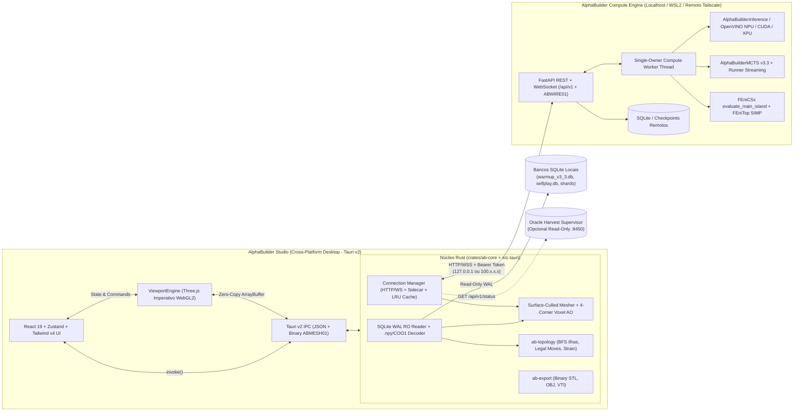

# AlphaBuilder Studio v4.0 — Especificação Completa de Arquitetura, UX e Contrato de API

> **Status:** Especificação Normativa Única (Fonte da Verdade para Implementação do Zero)  
> **Alinhamento do Projeto:** AlphaBuilder `v3.3` (pós-Bloco A `ee04deb` e Bloco B `2fa1179`)  
> **Público-Alvo deste Documento:** Agente implementador (Frontend + Núcleo Rust + Backend de Inferência/Cálculo)  
> **Regra de Interpretação:** Toda palavra `DEVE`, `NÃO DEVE`, tipo, offset binário, caminho HTTP, nome de comando IPC e constante numérica neste documento é **normativa**. Quando houver dúvida, siga literalmente o contrato abaixo — **não invente campos, não altere constantes físicas e não substitua bibliotecas sem justificativa explícita**.

---

## Índice

1. [Contexto Atual do Projeto e Diagnóstico do App Legado](#1-contexto-atual-do-projeto-e-diagnóstico-do-app-legado)
2. [Decisão Arquitetural (ADR-001): Por que Tauri v2 (Rust) + Three.js Vanilla + Engine Python Desacoplada](#2-decisão-arquitetural-adr-001-por-que-tauri-v2-rust--threejs-vanilla--engine-python-desacoplada)
3. [Topologia do Repositório e Dependências Pinadas](#3-topologia-do-repositório-e-dependências-pinadas)
4. [Design System ("Computational Ethereal v4") e Experiência de Primeiro Mundo](#4-design-system-computational-ethereal-v4-e-experiência-de-primeiro-mundo)
5. [Fonte Única de Verdade Matemática, Espacial e Física (v3.3)](#5-fonte-única-de-verdade-matemática-espacial-e-física-v33)
6. [Núcleo Rust (`crates/ab-core` + `apps/studio/src-tauri`) e Protocolo Binário `ABMESH01`](#6-núcleo-rust-cratesab-core--appsstudiosrc-tauri-e-protocolo-binário-abmesh01)
7. [Motor Gráfico 3D (`ViewportEngine` em Three.js Imperativo)](#7-motor-gráfico-3d-viewportengine-em-threejs-imperativo)
8. [Contrato Completo de API — Compute & Inference Server (`alphabuilder-engine` v1)](#8-contrato-completo-de-api--compute--inference-server-alphabuilder-engine-v1)
9. [Contrato Completo de IPC Tauri v2 (Rust ↔ Frontend TypeScript)](#9-contrato-completo-de-ipc-tauri-v2-rust--frontend-typescript)
10. [Segurança, Concorrência, Resiliência e Orçamento de Performance](#10-segurança-concorrência-resiliência-e-orçamento-de-performance)
11. [Proibições Expressas (Guardrails Anti-Erro)](#11-proibições-expressas-guardrails-anti-erro)
12. [Plano de Implementação Faseado (M0–M5), Vetores de Teste e Critérios de Aceitação](#12-plano-de-implementação-faseado-m0m5-vetores-de-teste-e-critérios-de-aceitação)
13. [Política de Convivência, Referência e Descomissionamento do Frontend + Backend Legado](#13-política-de-convivência-referência-e-descomissionamento-do-frontend--backend-legado)
14. [CI/CD e Publicação de Releases Multi-SO no GitHub (Windows, Linux, macOS + Engine)](#14-cicd-e-publicação-de-releases-multi-so-no-github-windows-linux-macos--engine)

---

## 1. Contexto Atual do Projeto e Diagnóstico do App Legado

### 1.1 Estado Atual Real do Repositório (Snapshot Nov/2026)

A sessão paralela de pesquisa e engenharia concluiu os blocos estruturais do TCC (`main` @ `2fa1179`) e está executando a campanha distribuída da Etapa 2:

| Frente | Estado Verificado | Impacto Direto no Novo App |
| :--- | :--- | :--- |
| **Bloco A — Data Harvest & Física (`ee04deb`)** | Concluído e validado em Piloto (`100/100` episódios conectados, `0` erros de auditoria, paridade `< 0,0001%` entre `x86_64` e `aarch64`). | Bancos `v3.3` gravam arrays densos como `zlib(\x93NUMPY)` e políticas esparsas como `zlib(COO1)` (**sem `pickle`**), além de `v_constructed_blob`, `rho_cont_blob`, `compliance`, `vol_frac`, `max_displacement`, `beta`, `seed`, `shard_id`, `worker_id`. |
| **Bloco B — Rede Neural, MCTS & FEM (`2fa1179`)** | Concluído (`154+` testes passando). Nova arquitetura `AlphaBuilderV31` v3.3 com `GroupNorm(affine=True)`, `CoordConv + domain_mask`, `phys_film` (9 descritores físicos invariantes), `SimpleBackbone` 4-estágios dilatado (`RF >= 64`), `Swin-UNETR` com `enc0` skip em resolução cheia, **3ª cabeça auxiliar `Blueprint Head` `(B, 1, D, H, W)`** (Wu 2019 / KataGo), simetrias rígidas $D_4 \times \mathbb{Z}_2 = 16\times$, perda KL mascarada + SmoothL1 + BCE/Dice, MCTS com `MixMax` (`beta=0.75`), PBRS com decaimento linear, renormalização pós-Top-K e `evaluator.py` alinhado 1:1 com FEniTop. | O novo app **precisa** visualizar a **Blueprint Head** (em inferência ao vivo e como ground-truth `v_constructed_blob` no replay), suportar `SimpleBackbone` + `Swin-UNETR` + OpenVINO NPU/GPU/CUDA/XPU/CPU, exibir estatísticas reais de MCTS/refutação/PV-branches e usar a fórmula de recompensa `v3.3` exata. |
| **Etapa 2 — Colheita Distribuída (`prod`)** | Em andamento no Supervisor Oracle (`100.104.121.28:8450`): `1.140 / 4.000` episódios verificados (`28,5%`, `114/400` shards, `0` falhas). | O app pode oferecer monitoramento **opcional somente-leitura** do cluster de harvest consumindo `GET /api/v1/status` do Supervisor. |
| **Próximas Etapas (3 → 8)** | Treino `SimpleBackbone` → **Inspeção visual real (Etapa 4)** → Treino `Swin-UNETR` (Etapa 5) → Self-Play evolutivo e curvas de benchmark vs. SIMP (Etapa 6) → Figuras de alta qualidade para o TCC LaTeX (Etapa 8). | O app será a **ferramenta principal de validação visual, co-design interativo, comparação A/B e geração de figuras 4K/STL para a defesa do TCC**. |

### 1.2 Por que o App Legado (`alphabuilder/web`) Deve Ser Descartado

Auditoria forense do código legado revelou 9 defeitos estruturais incuráveis por remendo:
1. **Incompatível com o Schema `v3.3`:** `fastapi_utils.py` usa apenas `pickle.loads` — quebra imediatamente ao abrir qualquer banco `v3.3` (`\x93NUMPY` / `COO1`).
2. **Fórmula de Recompensa Desatualizada:** `RewardBreakdown.tsx` tem constantes `v3.2` hardcoded (`0.80 / 0.16 / 2.0`), divergindo da calibração `v3.3` (`1.15 / 0.35 / 2.5` + margem suave de deslocamento `P_disp` acima de 70% de `128000.0`).
3. **4 de 6 Páginas São Fakes:** `Dashboard`, `Workspace`, `NeuralNet` e `Settings` operam sobre mocks estáticos; botões de edição 3D não fazem nada e não existe inferência ao vivo.
4. **Gargalo Severo de Rede & Memória:** `training_data.py` serializa tensores densos 3D como arrays JSON de floats (~2,5 MB/frame em texto); o cliente aloca `new THREE.Color()` em loop e envia até 20.000 cubos brutos (`240k` triângulos com faces internas ocultas) via `@react-three/fiber`.
5. **Perda Silenciosa de Métricas:** `replay.worker.ts` zera `nodes_expanded`, `max_depth`, `cache_hits`, `top8_concentration` e `refutation` no parser binário, e `selfplay.py` nunca envia `displacement_map` (`disp_header = 0`).
6. **Bug de Colunas Opcionais:** Bancos legados (como `data/selfplay_games.db` de Dez/2025) não possuem `fem_reward` nem `displacement_map_blob`, quebrando queries rígidas.
7. **Sem Visualização da Blueprint Head:** Nenhuma camada 3D ou endpoint expõe `blueprint_probs` nem `v_constructed_blob`.
8. **Colormap Inadequado:** Usa gradiente HSL arco-íris (perceptualmente distorcido e ilegível para daltônicos/impressão científica).
9. **UX Fragmentada:** Layout com offsets fixos em pixels (`left-[340px]`), sobreposição de painéis em telas menores e zero comparação lado a lado.

---

## 2. Decisão Arquitetural (ADR-001): Por que Tauri v2 (Rust) + Three.js Vanilla + Engine Python Desacoplada

### 2.1 Matriz Comparativa de Arquiteturas

| Critério | Opção A: Rust Puro (`egui` + `wgpu`) | Opção B: Web Puro (`React` + `FastAPI`) | **Opção C (ESCOLHIDA): Híbrido `Tauri v2` (Rust Core) + `Three.js` Vanilla + `React 19` UI + `alphabuilder-engine` (Python Local/Remoto)** |
| :--- | :--- | :--- | :--- |
| **Performance & Segurança (Rust)** | Máxima (100% nativo). | Baixa (Python GIL + HTTP JSON + JS GC). | **Excelente:** Todo I/O SQLite WAL, descompressão `zlib`, decodificação `.npy`/`COO1`, **Surface-Culled Greedy Meshing + Voxel AO**, BFS 6-conectado, cálculo de strain `||∇u||`, exportação STL/OBJ/VTI e proxy HTTP/WS rodam em **Rust compilado nativo com zero `unsafe`**. |
| **Interface de Primeiro Mundo** | Fraca (`egui` produz estética de debug tool; animações fluidas, tipografia refinada, glassmorphism e gráficos vetoriais são muito custosos). | Excelente. | **Excelente:** WebView nativo do SO (WebView2/WebKitGTK/WKWebView), bundle ~12 MB (sem Electron), CSS Tailwind v4, fontes locais bundled, 120 FPS WebGL2 imperativo fora do ciclo React. |
| **Cross-Platform (Win/Linux/macOS)** | Sim (com atritos de drivers Vulkan/DX12/Metal). | Depende de browser + Python local. | **Excelente:** Instaladores nativos `.msi`/`.exe`, `.AppImage`/`.deb`, `.dmg` via Tauri v2; abre `.db` locais em `< 300 ms` **mesmo sem Python instalado**. |
| **Inferência Local OU Remota** | Exige mesmo backend Python separado (FEniCSx não roda em Rust nem em Windows nativo). | Apenas se o servidor servir tudo. | **Nativo por design:** Perfis de conexão alternáveis em 1 clique (`Local Sidecar`, `WSL2 Localhost`, `Remoto via Tailscale/LAN/HTTPS`). |
| **Confiabilidade para Implementação por Outro Agente (Crítico!)** | **Risco Altíssimo:** APIs de `wgpu` quebram entre versões; WGSL + picking + sorting transparente + borrow checker em UI geram falhas em cascata. | Baixo risco, mas entrega app medíocre. | **Risco Mínimo:** Rust faz apenas algoritmos puros, SQLite, codecs binários e IPC (100% testáveis com `cargo test`); Three.js vanilla + React/TS é o ecossistema mais estável e previsível; Python reaproveita 100% da física `v3.3` já testada. |

### 2.2 Veredito Arquitetural

Adota-se a **Opção C**, dividida em **dois artefatos independentes com fronteira estritamente tipada**:

1. **`AlphaBuilder Studio` (App Desktop Cross-Platform em Rust + Tauri v2 + TypeScript/Three.js):**
   - Abre e inspeciona qualquer banco SQLite local (`v3.3`, `v2`, `selfplay`) diretamente pelo núcleo Rust, **sem precisar de Python nem rede**.
   - Computa malhas 3D com *face-culling* + *Voxel Ambient Occlusion*, análise de ilhas/conectividade, ações legais, gradiente de deformação e exportações STL/OBJ/VTI em **Rust (< 0,3 ms/frame)**.
   - Conecta-se a **zero, um ou vários** servidores `alphabuilder-engine` (local ou remoto) para inferência neural em tempo real, MCTS interativo ao vivo, validação FEM (FEniCSx), benchmark SIMP (FEniTop) e leitura de bancos hospedados na máquina remota.
2. **`AlphaBuilder Compute Engine` (`alphabuilder/server`, serviço Python FastAPI + WebSocket + `ABWIRE01`):**
   - Camada fina, segura e versionada (`/api/v1`) sobre `alphabuilder.src.*` (PyTorch CUDA/XPU/MPS/CPU, MONAI Swin-UNETR, OpenVINO NPU/GPU, MCTS v3.3, FEniCSx `evaluate_main_island`, FEniTop SIMP).
   - Garante **paridade numérica exata (0% de drift)** com o código de treino do TCC.
   - Roda localmente (gerenciado automaticamente pelo app ou via `python -m alphabuilder.server` / WSL2) ou em máquina remota (Tailscale `100.x.x.x:8765`, LAN, servidor GPU ou túnel HTTPS) com autenticação opcional via `Bearer Token`.

### 2.3 Diagrama de Arquitetura Ponta-a-Ponta



---

## 3. Topologia do Repositório e Dependências Pinadas

O novo código DEVE ser adicionado **sem alterar nem quebrar** `alphabuilder/src/**`, `tests/**`, `scripts/**` ou `run_*.py`. O legado `alphabuilder/web/` permanece intacto até aprovação final do v4 (não editar nem importar dele).

### 3.1 Árvore Exata de Diretórios

```text
alphabuild/
├── Cargo.toml                          # Rust workspace root (members: crates/ab-core, apps/studio/src-tauri)
├── crates/
│   └── ab-core/                        # Biblioteca Rust pura (sem Tauri; 100% testável via `cargo test`)
│       ├── Cargo.toml
│       └── src/
│           ├── lib.rs
│           ├── error.rs                # CoreError enum com códigos estáveis
│           ├── coords.rs               # Mapeamento (D,H,W) <-> flat_idx <-> world XYZ
│           ├── reward.rs               # Fórmulas exatas v3.3 + vetores de teste
│           ├── codecs/
│           │   ├── mod.rs
│           │   ├── npy.rs              # Parser seguro .npy v1/v2/v3 (u8, f16, f32, f64)
│           │   ├── coo1.rs             # Parser/encoder COO1
│           │   └── wire.rs             # Parser/encoder ABWIRE01 & encoder ABMESH01
│           ├── sqlite_reader.rs        # Leitor WAL RO com PRAGMA table_info (v3.3, v2, selfplay, v1)
│           ├── topology.rs             # BFS 6-conectado, ilhas, legal moves, protected regions, strain
│           ├── mesher.rs               # Surface-culled mesher + 4-corner Voxel AO
│           └── exporter.rs             # Exportadores Binary STL, OBJ, VTK .vti
├── apps/
│   └── studio/                         # Tauri v2 Desktop Application
│       ├── package.json
│       ├── tsconfig.json               # strict: true, noUncheckedIndexedAccess: true
│       ├── vite.config.ts
│       ├── index.html
│       ├── src-tauri/
│       │   ├── Cargo.toml
│       │   ├── tauri.conf.json
│       │   ├── capabilities/default.json
│       │   └── src/
│       │       ├── main.rs
│       │       ├── lib.rs              # Builder Tauri + estado global AppState
│       │       ├── state.rs            # Profiles, LRU cache, Active Remote Client, Sidecar handle
│       │       ├── commands/
│       │       │   ├── mod.rs
│       │       │   ├── datasets.rs     # Comandos SQLite locais + fallback remoto
│       │       │   ├── studio.rs       # Inferência, MCTS live, FEM, SIMP, validação local
│       │       │   ├── compute.rs      # Perfis de conexão, healthcheck, sidecar, checkpoints, harvest
│       │       │   └── export.rs       # STL, OBJ, VTI, PNG save dialog
│       │       └── ws_bridge.rs        # Ponte tokio-tungstenite -> Tauri events + cache ABMESH01
│       └── src/
│           ├── main.tsx
│           ├── App.tsx
│           ├── styles/
│           │   ├── tokens.css          # CSS variables Dark Studio & Light TCC
│           │   └── globals.css
│           ├── fonts/                  # Space Grotesk, Inter, JetBrains Mono (.woff2 locais)
│           ├── types/
│           │   └── contracts.ts        # TODAS interfaces TS espelhando API v1 e IPC Tauri
│           ├── lib/
│           │   ├── ipc.ts              # Wrappers tipados sobre invoke() e listen()
│           │   ├── abmesh.ts           # Zero-copy parser de ArrayBuffer ABMESH01
│           │   ├── turboColormap.ts    # LUT 256 cores Turbo (Mikhailov)
│           │   └── formatters.ts       # Formatação científica (compliance, m, ms, %)
│           ├── store/
│           │   ├── useAppStore.ts      # Modo ativo, tema, sidebar/drawers, shortcuts
│           │   ├── useComputeStore.ts  # Perfis, saúde, capacidades, modelo ativo, harvest
│           │   ├── useInspectorStore.ts# Episódio/jogo ativo, step, playback, lentes, cortes
│           │   ├── useStudioStore.ts   # Grid editável, BCs, cargas, Raio-X, sessão WS ao vivo
│           │   └── useCompareStore.ts  # Slots A/B, câmera sincronizada, diff métrico
│           ├── engine3d/
│           │   ├── ViewportEngine.ts   # Controlador Three.js imperativo (1 canvas)
│           │   ├── VoxelMeshLayer.ts   # Custom ShaderMaterial (AO + Bevel + Turbo + Deform + Clip)
│           │   ├── BlueprintLayer.ts   # Shader Fresnel holográfico para Blueprint / V_constructed
│           │   ├── OverlayLayer.ts     # InstancedMesh Policy / MCTS / Refutação / Diff
│           │   ├── BoundaryLayer.ts    # Suportes mecânicos (Clamp/Rail) + Setas de Carga arrastáveis
│           │   ├── VoxelPicker.ts      # Raycasting exato por voxel_id e plano de pintura
│           │   └── CameraRig.ts        # OrbitControls + presets isométricos + sync A/B
│           └── components/
│               ├── TopBar.tsx          # Pill bar unificada (Library | Modes | Compute | Export)
│               ├── LibraryDrawer.tsx   # Drawer deslizante: DBs locais/remotos, Games, Drag&Drop
│               ├── ComputePopover.tsx  # Seletor Local/Remoto, Checkpoints, Hardware, Harvest status
│               ├── CommandPalette.tsx  # Ctrl+K universal
│               ├── ViewportCanvas.tsx  # Mount limpo do ViewportEngine + HUD overlays
│               ├── LensToolbar.tsx     # Lentes (1..7) + Blueprint (B) + Slicer (X/Y/Z) + TCC Mode (P)
│               ├── TimelineDock.tsx    # Filmstrip temporal com fases, sparkline dupla e refutações
│               ├── InspectorPanel.tsx  # Painel direito colapsável (Métricas, Reward v3.3, MCTS/PV)
│               ├── StudioPanel.tsx     # Ferramentas de escultura, carga, BCs, Raio-X e Live MCTS
│               ├── CompareView.tsx     # Split-screen A/B sincronizado + tabela delta
│               ├── RewardBreakdown.tsx # Cadeia exata v3.3 (S_comp, B_vol, P_disp, P_ilhas, PBRS)
│               ├── VoxelTooltip.tsx    # Micro-tooltip 3D no hover de voxel
│               └── ExportModal.tsx     # Exportação 4K PNG (TCC), STL, OBJ, VTI
└── alphabuilder/
    └── server/                         # Compute & Inference Server (Python)
        ├── __init__.py
        ├── __main__.py                 # CLI: python -m alphabuilder.server --host ... --port 8765
        ├── requirements.txt
        ├── config.py                   # ServerConfig (dirs autorizados, token, device, supervisor_url)
        ├── schemas.py                  # Pydantic v2 strict models (espelho exato da Seção 8)
        ├── wire.py                     # Encoder/Decoder ABWIRE01
        ├── worker.py                   # Single-Owner Compute Worker Thread + ModelManager + SessionManager
        ├── app.py                      # FastAPI app + CORS + Auth middleware + Error handlers
        └── routers/
            ├── system.py               # /health, /capabilities, /cluster/harvest
            ├── models.py               # /models, /models/load, /models/unload, /models/active
            ├── inference.py            # /infer, /fem/evaluate, /simp/start
            ├── sessions.py             # /sessions CRUD + /command + WS /ws/sessions/{id}
            └── datasets.py             # /datasets, /selfplay, /migrate-v33
```

### 3.2 Dependências Pinadas

#### `crates/ab-core/Cargo.toml`
```toml
[package]
name = "ab-core"
version = "0.1.0"
edition = "2021"

[dependencies]
rusqlite = { version = "0.32", features = ["bundled"] }
flate2 = "1.0"
half = "2.4"
serde = { version = "1.0", features = ["derive"] }
serde_json = "1.0"
thiserror = "2.0"
bytemuck = { version = "1.18", features = ["derive"] }
lru = "0.12"
```

#### `apps/studio/src-tauri/Cargo.toml`
```toml
[package]
name = "alphabuilder-studio"
version = "4.0.0"
edition = "2021"

[dependencies]
ab-core = { path = "../../../crates/ab-core" }
tauri = { version = "2.1", features = [] }
tauri-plugin-dialog = "2.0"
tauri-plugin-fs = "2.0"
serde = { version = "1.0", features = ["derive"] }
serde_json = "1.0"
tokio = { version = "1.41", features = ["full"] }
reqwest = { version = "0.12", default-features = false, features = ["json", "rustls-tls"] }
tokio-tungstenite = { version = "0.24", features = ["rustls-tls-webpki-roots"] }
futures-util = "0.3"
tracing = "0.1"
tracing-subscriber = "0.3"
uuid = { version = "1.11", features = ["v4"] }

[build-dependencies]
tauri-build = { version = "2.0", features = [] }
```

#### `apps/studio/package.json` (dependências principais)
```json
{
  "dependencies": {
    "@tauri-apps/api": "^2.1.0",
    "@tauri-apps/plugin-dialog": "^2.0.0",
    "lucide-react": "^0.468.0",
    "react": "^19.0.0",
    "react-dom": "^19.0.0",
    "three": "^0.172.0",
    "zustand": "^5.0.0"
  },
  "devDependencies": {
    "@tailwindcss/vite": "^4.0.0",
    "@types/react": "^19.0.0",
    "@types/react-dom": "^19.0.0",
    "@types/three": "^0.172.0",
    "@vitejs/plugin-react": "^4.3.0",
    "tailwindcss": "^4.0.0",
    "typescript": "^5.7.0",
    "vite": "^6.0.0",
    "vitest": "^3.0.0"
  }
}
```
> **Nota explícita:** `@react-three/fiber`, `@react-three/drei` e `framer-motion` **NÃO SÃO INCLUÍDOS** intencionalmente. Animações de UI usam CSS Transitions/Keyframes nativos (mais leves e determinísticos), e o 3D usa `three` vanilla diretamente em `ViewportEngine`.

#### `alphabuilder/server/requirements.txt`
```text
fastapi>=0.115.0,<1.0.0
uvicorn[standard]>=0.32.0,<1.0.0
pydantic>=2.9.0,<3.0.0
websockets>=13.0,<15.0
httpx>=0.27.0,<1.0.0
```
*(Nota: `numpy`, `scipy`, `torch`, `monai`, `openvino` e `fenics-dolfinx` vêm do ambiente Python/Conda/WSL existente do usuário e são importados de forma lazy/protegida para que o servidor suba mesmo sem GPU, MONAI ou FEniCSx, reportando suas capacidades reais em `/api/v1/capabilities`.)*

---

## 4. Design System ("Computational Ethereal v4") e Experiência de Primeiro Mundo

### 4.1 Filosofia: "Viewport-First, Zero-Clutter, 3-Click Mastery"

O usuário abre o app e vê imediatamente o **Canvas 3D em tela cheia (`100vw × 100vh`)**, sem páginas administrativas vazias nem sidebars permanentes desperdiçando 260px. Toda a navegação acontece por uma barra flutuante minimalista no topo e painéis contextuais que se retraem suavemente.

#### Geometria de Layout Livre de Colisões (Z-Index & Ancoragem)
NUNCA use offsets fixos como `left-[340px]`. Use uma grade de sobreposição flexível com `pointer-events: none` no container e `pointer-events: auto` apenas nos cards:

| Camada | `z-index` | Posição & Dimensões | Comportamento |
| :--- | :---: | :--- | :--- |
| **Viewport 3D** | `0` | `inset: 0` (`100% × 100%`) | Sempre visível; em modo `Comparador` divide-se em 2 canvases `50% / 50%` com divisor arrastável. |
| **Top Pill Bar** | `20` | `top: 12px`, `left: 16px`, `right: 16px`, `height: 44px` | 3 zonas flex (`justify-between`): `[Logo + Biblioteca (L)]` — `[Inspetor | Estúdio | Comparador]` — `[Compute Pill | Ctrl+K | Export | Tema]`. |
| **Left Context Dock** | `15` | `top: 68px`, `left: 16px`, `width: 268px` (colapsável para `44px`) | No `Estúdio`: ferramentas de escultura/BC/carga. No `Inspetor`: filtros de lente + cortes X/Y/Z (colapsado por padrão para máxima área 3D!). |
| **Right Telemetry Dock** | `15` | `top: 68px`, `right: 16px`, `bottom: 104px`, `width: 320px` (colapsável para botão pill) | Tabs compactas: `Física & Reward`, `MCTS & PV`, `Blueprint`. Rolável internamente. |
| **Bottom Timeline + Lens Dock** | `15` | `bottom: 14px`, centralizado (`max-width: 920px`, `width: calc(100% - 360px)`) | Acima: barra de lentes compacta (`1..7`, `B`, `X/Y/Z`). Abaixo: Filmstrip temporal com fases e sparkline. |
| **Slide-Over Library Drawer** | `30` | `top: 64px`, `left: 16px`, `bottom: 16px`, `width: 380px` | Abre ao clicar `Biblioteca` ou teclar `L`; fecha ao clicar fora ou selecionar um episódio/jogo. |
| **Popovers / Modals / Command Palette** | `40`–`50` | Centralizado ou ancorado ao botão | Compute Popover (`40`), Export Modal (`45`), Command Palette `Ctrl+K` (`50`). |

### 4.2 Tokens Visuais (Dark Studio Padrão & Light "Figura TCC")

```css
:root[data-theme="dark"] {
  --bg-void:        #050608;   /* Canvas 3D & fundo absoluto */
  --bg-surface:     #0E1015;   /* Superfície de painéis (usar com 86% alpha + blur 16px) */
  --bg-elevated:    #161922;   /* Cards internos, inputs, tooltips */
  --border-subtle:  rgba(255, 255, 255, 0.08);
  --border-active:  rgba(0, 240, 255, 0.42);
  --text-primary:   #EEF2F8;
  --text-secondary: #8F9BB0;
  --text-muted:     #545E72;

  /* Semântica Estrutural e Neural */
  --accent-cyan:    #00F0FF;   /* Ações primárias, Value positivo, FULL_CLAMP */
  --accent-emerald: #00E599;   /* Policy ADD, Fase 1 GROWTH, conectado */
  --accent-magenta: #FF2466;   /* Policy REMOVE, Value negativo, colapso */
  --accent-orange:  #FF7A1A;   /* Vetores de Carga externa (Fx, Fy, Fz) */
  --accent-violet:  #8B5CF6;   /* Blueprint Head, RAIL_XY, Fase 2 REFINEMENT */
  --accent-gold:    #F5B700;   /* Marcadores de Refutação MCTS */
}

:root[data-theme="tcc-light"] {
  --bg-void:        #FFFFFF;   /* Fundo branco puro pronto para LaTeX */
  --bg-surface:     #F6F8FB;
  --bg-elevated:    #FFFFFF;
  --border-subtle:  rgba(15, 23, 42, 0.12);
  --border-active:  #0284C7;
  --text-primary:   #0F172A;
  --text-secondary: #475569;
  --text-muted:     #94A3B8;
  --accent-cyan:    #0284C7;
  --accent-emerald: #059669;
  --accent-magenta: #E11D48;
  --accent-orange:  #EA580C;
  --accent-violet:  #7C3AED;
  --accent-gold:    #D97706;
}
```
- **Tipografia (100% offline em `src/fonts/`):** Display `Space Grotesk` (títulos, KPIs), UI `Inter` (labels, controles), Dados `JetBrains Mono` com `font-variant-numeric: tabular-nums` em **todos os números dinâmicos** (impede jitter horizontal durante playback!).

### 4.3 Os 3 Modos e as 5 Ideias Originais de Interface

#### Modo 1 — `Inspetor` (Replay Ultra-Rápido de Harvest v3.3 e Self-Play MCTS)
- **Abertura instantânea:** Arraste qualquer `.db` para a janela ou escolha no `LibraryDrawer` (lista automática de bancos locais + bancos remotos se houver servidor conectado).
- **Lentes de Visualização (teclas `1`–`7` + `B`):**
  1. `1` **Estrutura (`structure`)**: Malha *surface-culled* com **Voxel AO** (parece cerâmica/titânio arquitetônico, não cubos crus!), suportes mecânicos distintos (`FULL_CLAMP` = blocos ciano ancorados; `RAIL_XY` = trilhos violeta com setas de deslizamento em $Z$) e vetores de carga laranja. Em bancos Harvest com `rho_cont_blob`, oferece toggle *Binário ($\rho > 0{,}5$) / Contínuo ($\rho \in [0,1]$)*.
  2. `2` **Policy (`policy`)**: Fronteira legal destacada por voxels translúcidos pulsando suavemente em Esmeralda (`ADD`) e Magenta (`REMOVE`), com opacidade mapeada à probabilidade normalizada (`masked_softmax`).
  3. `3` **MCTS (`mcts`)**: Mapa 3D de visitas $N(s,a)$ agregadas da árvore, onde o tamanho/brilho codifica $\log(1 + N)$ e a borda destaca o micro-batch executado.
  4. `4` **Refutação MCTS (`refutation`) — Ideia Original #4:** Mostra simultaneamente o *Top-K* bruto da Policy Head (anéis/wireframe translúcidos) contra as ações realmente escolhidas pelo MCTS após busca em árvore (voxels sólidos numerados `#1..#8` seguindo os ramos da Principal Variation). Quando `refutation == true`, um badge dourado explica: *"MCTS corrigiu a Policy: #1 Policy `(x,y,z)` → #1 MCTS `(x',y',z')` (`N=48`, `Q=+0.61`)"*.
  5. `5` **Diff de Decisão (`decision`)**: Mostra em 1 olhar o delta exato $t \to t+1$ (Esmeralda = voxels adicionados, Magenta = voxels removidos, Cinza = mantidos).
  6. `6` **Deslocamento (`deformation`, tecla `D`)**: Colormap científico **Turbo** sobre $|u(x,y,z)|$ com normalização robusta no percentil `p99`, legenda de colorbar numérica em tempo real (`0` → `p99` em unidades raw e metros reais `u / scale_factor`) e slider **Exagero de Deformação (`0×` a `20×`)** que deforma fisicamente os vértices da malha na GPU!
  7. `7` **Deformação / Tensão (`strain`, tecla `S`)**: Colormap **Turbo** sobre $\|\nabla |u|\|$ calculado em Rust por diferenças finitas centrais 3D.
  - **`B` — Camada Blueprint / Ground-Truth Ghost (Combinável com qualquer lente!):**
    - Em episódios **Harvest `v3.3`**: projeta `v_constructed_blob` (a estrutura final construída alvo da Blueprint Head) como um **fantasma holográfico Fresnel translúcido** ao redor do estado parcial — permitindo ver na hora se a fronteira da Fase 1 cresce exatamente rumo ao alvo!
    - Em partidas **Self-Play / Estúdio ao vivo**: projeta `blueprint_probs > threshold` (slider ajustável `0.1..0.9`, padrão `0.5`) da 3ª cabeça da rede neural!
- **Ideia Original #2 — "Mesa de Cirurgia 3D" (Planos de Corte + Modo Figura TCC):**
  - Sliders compactos de corte `X`, `Y`, `Z` (`0..D`, `0..H`, `0..W`) que fatiarão a malha e os overlays via *clipping planes* na GPU para inspecionar cavidades internas e espessura de paredes.
  - Botão **Modo Figura TCC (`P`)**: alterna para fundo branco puro (`tcc-light`) ou estúdio escuro limpo, oculta todos os HUDs exceto a barra de escala/colorbar, trava câmera em vista isométrica canônica (`[+1, +0.75, +1.1]`) ou ortográfica lateral (`XY` para viga em balanço!), e oferece botão de captura **PNG 4K (`3840×2160`)** ou **STL/OBJ/VTI**.
- **Ideia Original #3 — "Filmstrip Temporal Inteligente":**
  - Trilha visual segmentada em cores reais de fase (**Esmeralda** = Fase 1 `GROWTH`, **Violeta** = Fase 2 `REFINEMENT`).
  - Sparkline vetorial SVG integrada no fundo do scrubber mostrando `Value/Reward` (ciano) e `Volume %` (âmbar).
  - Marcadores verticais dourados nos passos onde `mcts_stats.refutation == true` (navegáveis pelas teclas `[` e `]`), e marcador vermelho se houve colapso FEM.
  - Hover sobre o scrubber mostra mini-preview numérico do passo (`Passo 74 · REFINEMENT · R=+0.582 · C=312.4 · V=11.2%`).
- **Inspetor de Voxel no Hover 3D:** Passar o mouse sobre qualquer voxel (sólido ou overlay) exibe um micro-tooltip ancorado no canto inferior direito do canvas: `Voxel (38, 14, 4) · ρ=1.00 · P_add=0.00 · P_rem=0.08 · N=19 · Q=+0.44 · |u|=41.2`.

#### Modo 2 — `Estúdio` (CAD Generativo Interativo & Inferência Live)
- **Ideia Original #1 — "Raio-X Neural" Instantâneo:**
  - Comece de um template em 1 clique (*Viga em Balanço Clássica*, *Ponte Biapoiada*, *Domínio Vazio*, *Clonar Estado Atual do Inspetor*).
  - **Manipulação Direta 3D:**
    - Clique e arraste a **alça laranja 3D da carga** ao longo dos planos da grade (snap automático em coordenadas inteiras `(lx, ly, lz)` dentro do domínio), ou gire a direção/magnitude `(Fx, Fy, Fz)` no painel lateral.
    - Alterne o tipo de suporte em 1 clique (`FULL_CLAMP`, `RAIL_XY`, `ROLLER_Y`, `CUSTOM` com pincel de DOFs `Ux/Uy/Uz`).
    - Pincele/apague voxels sólidos com raio ajustável (`1×1×1`, `3×3×3`) e validação instantânea em Rust (`is_connected`, `n_islands`, `loose_voxels`, `vol_frac`).
  - Com o toggle **`Raio-X Live`** ligado (padrão ON quando há modelo carregado), **toda edição dispara `POST /api/v1/infer` com debounce de `120 ms`**, atualizando em tempo real:
    - O **fantasma holográfico da Blueprint Head** (`blueprint_probs`),
    - O **heatmap da Policy Head** na fronteira legal,
    - O **medidor de Value Head** (`[-1, +1]`) e latência (`ex.: 18 ms · CUDA` ou `42 ms · OpenVINO NPU`).
- **Ideia Original #5 — "Co-Design Interativo Humano-IA (Live MCTS Streaming)":**
  - Clique em **`Otimizar com IA`** para abrir uma sessão WebSocket (`POST /api/v1/sessions` → `WS /api/v1/ws/sessions/{id}`).
  - Veja a estrutura crescer (Fase 1) e refinar com FEniCSx (Fase 2) ao vivo passo a passo, com barra de progresso intra-passo (`MCTS 96/160 sims · 38% cache · 1.4s`).
  - **Intervenção Humana no Meio do Jogo:** Clique **`Pausar`**, adicione uma nervura ou mova a carga com o pincel 3D, ajuste `num_simulations` / `c_puct` / `action_batch_size` / `use_guided_value`, e clique **`Continuar`** — o app envia `command: "edit_state"` pelo WebSocket, o servidor sincroniza o estado, reseta a árvore MCTS de forma segura e continua otimizando a partir da sua intervenção!
  - **Botões de Física Real (quando `capabilities.has_fenics == true`):**
    - **`Avaliar FEM Agora`**: roda `evaluate_main_island` no estado atual e pinta o campo de deslocamento + compliance real + reward v3.3.
    - **`Gerar Referência SIMP (FEniTop)`**: roda `run_fenitop_optimization` com a exata mesma carga/BC e abre automaticamente o resultado no modo `Comparador` lado a lado com a IA!
  - **Salvar como Partida:** Toda sessão concluída pode ser salva no banco `selfplay_games.db` do servidor (opcionalmente `persist_to_db: true`).

#### Modo 3 — `Comparador` (Arena A/B Sincronizada)
- Dois viewports 3D lado a lado (`Slot A` e `Slot B`) com **câmera sincronizada** (toggle *Sync Câmera*, padrão ON) e **timeline sincronizada** (por índice de passo ou por fração normalizada `0%..100%` da trajetória!).
- Cada slot pode carregar qualquer combinação:
  - Episódio de Harvest (`FEniTop SIMP`),
  - Partida Self-Play (`SimpleBackbone` vs `Swin-UNETR`, ou `Warmup` vs `SP-Gen 5`),
  - Resultado atual do `Estúdio`.
- **Barra de lentes compartilhada** (`1`..`7`) logo acima do painel delta: o modo escolhido é aplicado simultaneamente aos dois viewports; lentes FEM ficam ocultas se algum slot carregado não tiver `displacement`.
- **Painel Delta A vs. B** no rodapé: exibe lado a lado e a diferença percentual ($\Delta\%$) para `Compliance Final`, `Volume %`, `Max Displacement`, `Reward v3.3`, `Passos Fase 1 / Fase 2`, `Taxa de Refutação MCTS`, além do **IoU Volumétrico 3D** ($\frac{|A \cap B|}{|A \cup B|}$) calculado em Rust!
- Exportação conjunta **PNG A/B Side-by-Side 4K** pronta para figuras comparativas do TCC!

### 4.4 Mapa Canônico de Atalhos de Teclado

| Tecla | Ação | Contexto |
| :--- | :--- | :--- |
| `Ctrl+K` / `Cmd+K` | Abrir Command Palette universal | Global |
| `L` | Abrir/fechar Library Drawer | Global |
| `1`..`7` | Lentes: `1` Estrutura, `2` Policy, `3` MCTS, `4` Refutação, `5` Diff, `6`/`D` Deslocamento, `7`/`S` Deformação | Inspetor / Estúdio / Comparador |
| `B` | Alternar camada Ghost da Blueprint Head / `v_constructed` | Global 3D |
| `Space` | Play / Pause (replay ou sessão live) | Inspetor / Estúdio |
| `←` / `→` | Voltar / Avançar 1 passo (`Shift` = 10 passos) | Inspetor / Comparador |
| `[` / `]` | Pular para Refutação MCTS anterior / próxima | Inspetor (Self-Play) |
| `R` | Resetar câmera para vista isométrica padrão | Global 3D |
| `V` | Ciclar vistas ortográficas (`Iso` → `XY Frente` → `XZ Topo` → `YZ Lado`) | Global 3D |
| `P` | Alternar **Modo Figura TCC** (limpo, pronto para captura) | Global 3D |
| `E` | Abrir Modal de Exportação (PNG 4K / STL / OBJ / VTI) | Global |
| `Esc` | Fechar modal/drawer ativo ou cancelar ferramenta de pintura | Global |

---

## 5. Fonte Única de Verdade Matemática, Espacial e Física (v3.3)

> **CRÍTICO:** Tanto o núcleo Rust (`ab-core`) quanto o Frontend Three.js e o Backend Python DEVEM obedecer rigorosamente a estas definições. Qualquer divergência gera inversão de eixos, deslocamento de meio-voxel ou drift de recompensa.

### 5.1 Convenção de Eixos, Índices e Coordenadas 3D

- **Resolução do Domínio:** `(D, H, W)` = `(nx, ny, nz)` (padrão `64 × 32 × 8`, mas **NUNCA hardcoded** — qualquer resolução com `1 <= D,H,W <= 256` e `D*H*W <= 262_144` deve funcionar).
  - `x ∈ [0, D-1]`: eixo longitudinal da viga (vão). `x = 0` é a parede de engaste/suporte; carga tipicamente em `x ∈ (D/2, D-1]`.
  - `y ∈ [0, H-1]`: eixo vertical (altura). `Fy < 0` aponta para baixo (`-Y`).
  - `z ∈ [0, W-1]`: eixo transversal (profundidade/espessura). `RAIL_XY` libera deslocamento em $Z$.
- **Índice Linear (C-order / Row-Major):**
  $$\text{flat\_idx}(x, y, z) = x \cdot (H \cdot W) + y \cdot W + z$$
  Inverso:
  $$x = \lfloor \text{idx} / (H \cdot W) \rfloor, \quad y = \lfloor (\text{idx} \bmod (H \cdot W)) / W \rfloor, \quad z = \text{idx} \bmod W$$
- **Coordenadas Mundo Three.js (Right-Handed, +Y para cima):**
  - Domínio ocupando `X ∈ [-D/2, +D/2]`, `Y ∈ [0, H]`, `Z ∈ [-W/2, +W/2]`.
  - Centro do voxel `(x, y, z)`:
    $$\vec{p}_{\text{center}}(x, y, z) = \left(x - \frac{D}{2} + 0.5,\; y + 0.5,\; z - \frac{W}{2} + 0.5\right)$$
  - AABB do voxel `(x, y, z)`: `[x - D/2, x - D/2 + 1] × [y, y + 1] × [z - W/2, z - W/2 + 1]`.
  - **Vetor de Sanidade (`D=64, H=32, W=8`):**
    - Voxel `(0, 0, 0)` → `flat_idx = 0`, centro = `(-31.5, 0.5, -3.5)`.
    - Voxel `(63, 16, 4)` → `flat_idx = 63*256 + 16*8 + 4 = 16260`, centro = `(31.5, 16.5, 0.5)`.

### 5.2 Layout dos 7 Canais do Tensor de Entrada `(7, D, H, W)` (`float32`, C-order)

| Canal | Nome | Domínio / Significado |
| :---: | :--- | :--- |
| `0` | `density` ($\rho$) | Densidade material em `[0.0, 1.0]` (`> 0.5` = sólido). |
| `1` | `mask_x` | `1.0` onde deslocamento $u_x = 0$ (suporte), `0.0` caso contrário. |
| `2` | `mask_y` | `1.0` onde deslocamento $u_y = 0$. |
| `3` | `mask_z` | `1.0` onde deslocamento $u_z = 0$ (`0.0` em `RAIL_XY`). |
| `4` | `fx` | Componente $X$ da força normalizada (`0.0` fora da região de carga). |
| `5` | `fy` | Componente $Y$ da força normalizada (ex.: `-1.0` no patch `3×3×1` em `lx`). |
| `6` | `fz` | Componente $Z$ da força normalizada. |

**Região Canônica de Carga (`get_load_region_bounds`):**
Dado `load_config = { x, y, z_start, z_end }`:
- `lx = clamp(int(x), 0, D - 1)`
- `lz_center = (z_start + z_end) / 2.0`
- `y_min = max(0, int(y - 1.0))`, `y_max = min(H, int(y + 1.0) + 1)`
- `z_min = max(0, int(lz_center - 1.0))`, `z_max = min(W, int(lz_center + 1.0) + 1)`
- Patch discreto de carga: `[lx, y_min..y_max, z_min..z_max]` (tipicamente `1 × 3 × 3 = 9` voxels).

### 5.3 Constantes e Fórmulas Exatas da Recompensa `v3.3`

Idênticas a `alphabuilder/src/logic/selfplay/reward.py` (calibradas no Piloto v3.3). **DEVE** ser implementada em `crates/ab-core/src/reward.rs` com testes unitários batendo exatamente com os vetores abaixo (`|diff| < 1e-6`):

```text
COMPLIANCE_BASE         = 1.15
COMPLIANCE_SLOPE        = 0.35
COMPLIANCE_MIN          = -0.60
COMPLIANCE_MAX          = 0.90
VOLUME_REFERENCE        = 0.10
VOLUME_SENSITIVITY      = 2.50
VOLUME_BONUS_MAX        = 0.30
VOLUME_PENALTY_MAX      = 0.60
DISPLACEMENT_LIMIT_RAW  = 128000.0
REAL_SCALE_FACTOR       = 500000.0
PENALTY_PER_ISLAND      = 0.02
PENALTY_PER_LOOSE_FRAC  = 0.10
ISLAND_PENALTY_MAX      = 0.30
```

- **Compliance Score:**
  $$S_{\text{comp}}(C) = \begin{cases} 0.90 & C \le 0 \\ \text{clip}\big(1.15 - 0.35 \cdot (\log_{10}(\max(C, 1.0)) - 1.0),\; -0.60,\; 0.90\big) & C > 0 \end{cases}$$
- **Volume Bonus:**
  $$B_{\text{vol}}(V) = \text{clip}\big((0.10 - V) \cdot 2.50,\; -0.60,\; 0.30\big)$$
- **Pure Physics Score:**
  $$S_{\text{FEM}}(C, V) = \text{clip}\big(S_{\text{comp}}(C) + B_{\text{vol}}(V),\; -1.0,\; 1.0\big)$$
- **Displacement Warning Penalty ($r_U = U_{\max} / 128000.0$):**
  $$P_{\text{disp}}(U_{\max}) = \begin{cases} 0.0 & r_U \le 0.70 \\ 0.50 \cdot \text{clip}\big((r_U - 0.70) / 0.30,\; 0.0,\; 1.0\big) & r_U > 0.70 \end{cases}$$
- **Game Reward ($R_{\text{FEM}}$):**
  $$R(C, V, \text{valid}, U_{\max}) = \begin{cases} -1.0 & \neg \text{valid} \lor U_{\max} > 128000.0 \\ \text{clip}(S_{\text{FEM}} - P_{\text{disp}},\; -0.95,\; 1.0) & P_{\text{disp}} > 0 \\ S_{\text{FEM}} & \text{caso contrário} \end{cases}$$
- **Island Penalty:**
  $$P_{\text{ilhas}}(n_{\text{isl}}, n_{\text{loose}}, n_{\text{tot}}) = \begin{cases} 0.0 & n_{\text{isl}} \le 1 \lor n_{\text{tot}} = 0 \\ \min\left(0.30,\; 0.02(n_{\text{isl}} - 1) + 0.10 \frac{n_{\text{loose}}}{n_{\text{tot}}}\right) & \text{caso contrário} \end{cases}$$

#### Vetores de Teste Obrigatórios (`crates/ab-core/src/reward.rs`)

| `C` | `V` | `valid` | `U_max` | `S_comp` | `B_vol` | `S_fem` | `P_disp` | `R` |
| :---: | :---: | :---: | :---: | :---: | :---: | :---: | :---: | :---: |
| `100.0` | `0.10` | `true` | `50.0` | `+0.800000` | `+0.000000` | `+0.800000` | `0.000000` | `+0.800000` |
| `1000.0` | `0.10` | `true` | `500.0` | `+0.450000` | `+0.000000` | `+0.450000` | `0.000000` | `+0.450000` |
| `1000.0` | `0.15` | `true` | `500.0` | `+0.450000` | `-0.125000` | `+0.325000` | `0.000000` | `+0.325000` |
| `1000.0` | `0.08` | `true` | `100000.0` | `+0.450000` | `+0.050000` | `+0.500000` | `0.135417` | `+0.364583` |
| `1000.0` | `0.10` | `true` | `130000.0` | `+0.450000` | `+0.000000` | `+0.450000` | `0.500000` | `-1.000000` |
| `1000.0` | `0.10` | `false` | `50.0` | `+0.450000` | `+0.000000` | `+0.450000` | `0.000000` | `-1.000000` |
| `1000000.0` | `0.10` | `true` | `100.0` | `-0.600000` | `+0.000000` | `-0.600000` | `0.000000` | `-0.600000` |
| `10.0` | `0.05` | `true` | `10.0` | `+0.900000` | `+0.125000` | `+1.000000` | `0.000000` | `+1.000000` |

### 5.4 Normalização de Policy (Logits vs. Probabilidades)

Em bancos `Harvest v3.3`, `policy_add_blob` / `policy_remove_blob` já são probabilidades ($\ge 0$, soma $\approx 1$ sobre a fronteira legal). Em bancos `Self-Play` (e na saída bruta da rede `AlphaBuilderV31`), os valores armazenados podem ser **logits brutos** (negativos, ex. `-11.0`).
- **Regra de Detecção Automática (em Rust `ab-core`):**
  - Se qualquer valor não-nulo em `policy_add` ou `policy_remove` for `< -1e-4` OU o máximo global for `> 1.001`: tratar como **logits brutos** → aplicar `masked_softmax(policy_add, policy_remove, valid_add, valid_remove, temperature=1.0)` sobre as ações legais computadas em `ab-topology`.
  - Caso contrário: usar diretamente como probabilidades `[0, 1]`.
- Para visualização no heatmap, filtrar entradas esparsas com `prob >= max(1e-4, 0.01 * max_prob)` e normalizar a intensidade visual por `sqrt(prob / max_prob)` para que o gradiente de confiança fique claramente legível sem explodir a opacidade.

### 5.5 Colormap Científico Turbo (Aproximação Polinomial Exata de Mikhailov)

Usar a mesma função no GLSL (`VoxelMeshLayer.ts`) e no legendador TypeScript (`turboColormap.ts`) para `x = clamp(t, 0.0, 1.0)`:

```glsl
vec3 turboColormap(float x) {
    const vec4 kRedVec4   = vec4( 0.13572138,  4.61539260, -42.66032258, 132.13108234);
    const vec4 kGreenVec4 = vec4( 0.09140261,  2.19418839,   4.84296658, -14.18503333);
    const vec4 kBlueVec4  = vec4( 0.10667330, 12.64194608, -60.58204836, 110.36276771);
    const vec2 kRedVec2   = vec2(-152.94239396,  59.28637943);
    const vec2 kGreenVec2 = vec2(   4.27729857,   2.82956604);
    const vec2 kBlueVec2  = vec2( -89.90310912,  27.34824973);
    x = clamp(x, 0.0, 1.0);
    vec4 v4 = vec4(1.0, x, x * x, x * x * x);
    vec2 v2 = v4.zw * v4.z;
    return clamp(vec3(
        dot(v4, kRedVec4)   + dot(v2, kRedVec2),
        dot(v4, kGreenVec4) + dot(v2, kGreenVec2),
        dot(v4, kBlueVec4)  + dot(v2, kBlueVec2)
    ), 0.0, 1.0);
}
```

---

## 6. Núcleo Rust (`crates/ab-core` + `apps/studio/src-tauri`) e Protocolo Binário `ABMESH01`

### 6.1 Leitor SQLite WAL Read-Only (`sqlite_reader.rs`)

1. **Abertura Segura:** SEMPRE abrir com `OpenFlags::SQLITE_OPEN_READ_ONLY | OpenFlags::SQLITE_OPEN_NO_MUTEX` e executar `PRAGMA busy_timeout = 5000;` — permite inspecionar um `.db` ao vivo enquanto um worker de harvest ou self-play escreve em modo WAL, com risco zero de corrupção.
2. **Detecção de Schema Dinâmica (`detect_db_kind`):**
   - Consultar `SELECT name FROM sqlite_master WHERE type='table'`.
   - Contém `games` e `game_steps` → `DbKind::SelfPlay`.
   - Contém `episodes` e `records` (com `COUNT(*) > 0` em `episodes`) → `DbKind::HarvestV33` (se `episodes` tem coluna `v_constructed_blob`) ou `DbKind::HarvestV2`.
   - Contém `training_data` → `DbKind::LegacyV1`.
3. **Introspecção de Colunas Opcionais (`PRAGMA table_info(...)`):**
   - Construir a cláusula `SELECT` substituindo qualquer coluna ausente por `NULL` (ex.: em `data/selfplay_games.db` legado faltam `fem_reward`, `displacement_map_blob`, `initial_cantilever_problem_real_scale_factor` e `stiffness_E`). **Nunca** falhar com `no such column`!

### 6.2 Decodificadores Binários Seguros (`codecs/npy.rs` e `codecs/coo1.rs`)

Todos os blobs SQLite são primeiro descomprimidos com `flate2::read::ZlibDecoder`. Inspecionar os primeiros bytes de `raw`:
- **`raw.starts_with(b"\x93NUMPY")` → Parser `.npy` Rust puro:**
  - `major = raw[6]`, `minor = raw[7]`.
  - Se `major == 1`: `header_len = u16::from_le_bytes(raw[8..10])`, `header_start = 10`.
  - Se `major >= 2`: `header_len = u32::from_le_bytes(raw[8..12])`, `header_start = 12`.
  - Parsear o dicionário ASCII do header (`'descr'`, `'fortran_order'`, `'shape'`). Rejeitar `fortran_order: True` com erro claro se ocorrer.
  - Dtypes suportados (convertidos para `Vec<f32>`): `|u1` / `|b1` (`u8` → `f32`), `<f2` (`half::f16::from_le_bytes` → `f32`), `<f4` (`f32::from_le_bytes`), `<f8` (`f64::from_le_bytes` as `f32`), `<i4` (`i32::from_le_bytes` as `f32`).
  - Validar que `raw.len() >= data_offset + product(shape) * itemsize`.
- **`raw.starts_with(b"COO1")` → Parser `COO1` Rust puro:**
  - `n = u32::from_le_bytes(raw[4..8]) as usize`.
  - Validar `raw.len() >= 8 + n * 8`.
  - `indices[k] = i32::from_le_bytes(raw[8 + 4*k .. 12 + 4*k])` (validar `0 <= idx < D*H*W`).
  - `values[k] = f32::from_le_bytes(raw[8 + 4*n + 4*k .. 12 + 4*n + 4*k])`.
- **`raw.first() == Some(&0x80)` → Blob Pickle Legado Detectado:**
  - Retornar `CoreError::LegacyPickleBlob { db_path }` (código `"LEGACY_PICKLE_BLOB"`).
  - O handler Tauri intercepta este erro: se houver servidor Python conectado com acesso ao arquivo (ou modo migração), pode delegar a leitura ao endpoint `/api/v1/datasets/...` ou oferecer no banner da UI o botão **"Migrar banco legado para formato v3.3 (`.npy`/`COO1`)"**.

### 6.3 Algoritmo Exato do Surface-Culled Voxel Mesher com 4-Corner Ambient Occlusion (`mesher.rs`)

> **Por que este algoritmo é essencial:** Em vez de instanciar cubos isolados com todas as 6 faces desenhadas (240k triângulos e aparência "Minecraft plano"), geramos apenas as faces na fronteira sólido↔vazio com **Ambient Occlusion de 4 cantos por vértice**, reduzindo triângulos em ~85% e produzindo profundidade tátil de CAD profissional em `< 0,2 ms`.

**Entrada:** `density: &[f32]` `(D,H,W)`, `threshold: f32` (padrão `0.5`), `disp_norm: Option<&[f32]>`, `strain_norm: Option<&[f32]>`.

**Função `is_solid(x, y, z)`:** retorna `false` se fora de `[0..D, 0..H, 0..W]`, senão `density[flat_idx(x, y, z)] > threshold`.

**Tabela Exata das 6 Faces (CCW visto de fora, Right-Handed):**
Para cada voxel sólido `(x, y, z)`, com `x0 = x as f32 - D as f32 / 2.0`, `y0 = y as f32`, `z0 = z as f32 - W as f32 / 2.0`, testar cada face `f ∈ 0..6`. Só emitir a face se `!is_solid(x + nx, y + ny, z + nz)`:

| Face | Normal `(nx,ny,nz)` | 4 Cantos `(dx,dy,dz)` em Ordem CCW (`v0, v1, v2, v3`) | Eixo Tangente `u` | Eixo Bitangente `v` |
| :---: | :---: | :--- | :---: | :---: |
| `+X` | `(+1, 0, 0)` | `(1,0,1), (1,0,0), (1,1,0), (1,1,1)` | `(0, 0, -1)` | `(0, +1, 0)` |
| `-X` | `(-1, 0, 0)` | `(0,0,0), (0,0,1), (0,1,1), (0,1,0)` | `(0, 0, +1)` | `(0, +1, 0)` |
| `+Y` | `(0, +1, 0)` | `(0,1,1), (1,1,1), (1,1,0), (0,1,0)` | `(+1, 0, 0)` | `(0, 0, -1)` |
| `-Y` | `(0, -1, 0)` | `(0,0,0), (1,0,0), (1,0,1), (0,0,1)` | `(+1, 0, 0)` | `(0, 0, +1)` |
| `+Z` | `(0, 0, +1)` | `(0,0,1), (1,0,1), (1,1,1), (0,1,1)` | `(+1, 0, 0)` | `(0, +1, 0)` |
| `-Z` | `(0, 0, -1)` | `(1,0,0), (0,0,0), (0,1,0), (1,1,0)` | `(-1, 0, 0)` | `(0, +1, 0)` |

**Cálculo Exato de 4-Corner Voxel AO por Vértice `c ∈ 0..4`:**
- Sinais locais dos 4 cantos no plano `(u, v)`: `s0 = (-1,-1)`, `s1 = (+1,-1)`, `s2 = (+1,+1)`, `s3 = (-1,+1)`.
- No plano adjacente `(ax, ay, az) = (x + nx, y + ny, z + nz)`:
  - `side1 = is_solid(a + su * u) as u8`
  - `side2 = is_solid(a + sv * v) as u8`
  - `corner = is_solid(a + su * u + sv * v) as u8`
  - `occ = if side1 == 1 && side2 == 1 { 3 } else { side1 + side2 + corner }`
  - Curva de AO: `AO_LUT = [1.00_f32, 0.78, 0.56, 0.35]`, logo `ao[c] = AO_LUT[occ as usize]`.
- **Triangulação Anti-Anisotropia (evita artefatos diagonais de sombreamento):**
  - Se `ao[0] + ao[2] > ao[1] + ao[3]`: emitir triângulos `(base+0, base+1, base+2)` e `(base+0, base+2, base+3)`.
  - Caso contrário (flip da diagonal): emitir `(base+1, base+2, base+3)` e `(base+1, base+3, base+0)`.

**Atributos Empacotados por Vértice:**
- `positions`: `[x0 + dx, y0 + dy, z0 + dz]`
- `normals`: `[nx, ny, nz]`
- `ao_and_scalars`: `[ao[c], density_val, disp_norm_val, strain_norm_val]`
- `voxel_ids`: `flat_idx(x, y, z) as u32`

### 6.4 Topologia 3D & Análise Física Leve (`topology.rs`)

Deve espelhar exatamente `legal_moves.py` e `reward.py`:
1. **`analyze_islands(density, bc_masks, forces, load_config, threshold=0.5)`**:
   - BFS 6-conectado (`±X, ±Y, ±Z`) sobre `density > threshold`.
   - `support_mask = mask_x > 0.5 || mask_y > 0.5 || mask_z > 0.5` (fallback plano `x == 0` se vazio).
   - Fase 1 (antes de conectar carga): `loose_voxels` conta apenas voxels **não ancorados** ao suporte (regra `v3.3`).
   - `is_connected == true` se e somente se **todos** os voxels do patch de carga estão sólidos e pertencem ao **mesmo** componente conectado ao suporte.
2. **`compute_legal_moves(density, bc_masks, forces, threshold=0.5)`**:
   - `valid_add`: 6-vizinhos de sólidos fora de sólidos $\cup$ 6-vizinhos de suportes fora de sólidos.
   - `valid_remove`: sólidos $\setminus$ `protected_regions`, onde `protected = (mask_x + mask_y + mask_z > 0) || (|fx| + |fy| + |fz| > 1e-6)`.
3. **`compute_strain_and_p99(density, disp_map, D, H, W)`**:
   - Para cada voxel sólido `(x,y,z)`: diferenças finitas centrais `(d(x+1)-d(x-1))/2` (0 fora dos limites), `strain = sqrt(gx^2 + gy^2 + gz^2)`.
   - Calcular percentil `p99` (índice `floor(0.99 * (N - 1))` sobre valores ordenados dos voxels sólidos; mínimo `1e-6`).
   - Normalizar `disp_norm = clamp(|disp| / disp_p99, 0, 1)` e `strain_norm = clamp(strain / strain_p99, 0, 1)`.
4. **`compute_iou_3d(density_a, density_b, threshold=0.5) -> f32`**:
   - Para o modo `Comparador`: `intersection / max(1, union)`.

### 6.5 Exportadores Nativos (`exporter.rs`)

- **Binary STL (`export_stl`)**: Header 80 bytes (`"AlphaBuilder Studio v4.0 Binary STL"`), `u32` count de triângulos, 50 bytes por triângulo (`normal f32×3`, `v0 f32×3`, `v1 f32×3`, `v2 f32×3`, `attr u16=0`). Usa diretamente a malha surface-culled (malha fechada *watertight* pronta para fatiador 3D!).
- **Wavefront OBJ (`export_obj`)**: Vértices `v`, normais `vn`, faces `f i//i j//j k//k`.
- **VTK ImageData XML (`.vti`, `export_vti`)**: Exporta campos escalares `density`, `displacement`, `strain`, `blueprint` para abertura direta no ParaView.

### 6.6 Especificação Byte-a-Byte do Pacote IPC Binário `ABMESH01`

Retornado por comandos Tauri via `tauri::ipc::Response::new(bytes)` (**zero JSON para geometria**). Todos os valores são **Little-Endian (`<`)** e todas as seções têm **alinhamento estrito de 4 bytes**.

#### Header `ABMESH01` (96 bytes fixos)

| Offset | Tipo | Campo | Descrição |
| :---: | :---: | :--- | :--- |
| `0..8` | `[u8; 8]` | `magic` | ASCII exato `b"ABMESH01"` |
| `8..12` | `u32` | `flags` | `0x01`=displacement, `0x02`=blueprint, `0x04`=policy, `0x08`=mcts, `0x10`=diff, `0x20`=rho_cont |
| `12..16` | `u32` | `step_index` | Índice do passo |
| `16..20` | `u32` | `dim_x` | `D` |
| `20..24` | `u32` | `dim_y` | `H` |
| `24..28` | `u32` | `dim_z` | `W` |
| `28..32` | `u32` | `vertex_count` | `V` (malha da estrutura) |
| `32..36` | `u32` | `index_count` | `I` (`3 * triângulos`) |
| `36..40` | `u32` | `policy_add_count` | `N_pa` |
| `40..44` | `u32` | `policy_rem_count` | `N_pr` |
| `44..48` | `u32` | `mcts_add_count` | `N_ma` |
| `48..52` | `u32` | `mcts_rem_count` | `N_mr` |
| `52..56` | `u32` | `blueprint_vertex_count` | `Vb` |
| `56..60` | `u32` | `blueprint_index_count` | `Ib` |
| `60..64` | `u32` | `diff_added_count` | `N_da` |
| `64..68` | `u32` | `diff_removed_count` | `N_dr` |
| `68..72` | `f32` | `disp_p99` | Percentil 99 de `|u|` em sólidos |
| `72..76` | `f32` | `strain_p99` | Percentil 99 de `||∇u||` em sólidos |
| `76..80` | `u32` | `meta_json_len` | `M` (bytes UTF-8 válidos do JSON final) |
| `80..84` | `u32` | `meta_json_padded_len` | `Mp = (M + 3) & !3` |
| `84..88` | `u32` | `reserved_0` | `0` |
| `88..92` | `u32` | `reserved_1` | `0` |
| `92..96` | `u32` | `total_byte_len` | Tamanho total do buffer (validação obrigatória no TS!) |

#### Corpo `ABMESH01` (Seções Contíguas a partir do offset `96`)

1. `positions`: `V * 12` bytes (`f32[3*V]`)
2. `normals`: `V * 12` bytes (`f32[3*V]`)
3. `ao_and_scalars`: `V * 16` bytes (`f32[4*V]` = `[ao, density, disp_norm, strain_norm]`)
4. `voxel_ids`: `V * 4` bytes (`u32[V]`)
5. `indices`: `I * 4` bytes (`u32[I]`)
6. `blueprint_positions`: `Vb * 12` bytes (`f32[3*Vb]`)
7. `blueprint_normals`: `Vb * 12` bytes (`f32[3*Vb]`)
8. `blueprint_indices`: `Ib * 4` bytes (`u32[Ib]`)
9. `policy_add`: `N_pa * 8` bytes (pares `flat_idx: u32, prob: f32`)
10. `policy_rem`: `N_pr * 8` bytes (pares `flat_idx: u32, prob: f32`)
11. `mcts_add`: `N_ma * 12` bytes (triplas `flat_idx: u32, visits: f32, q_val: f32`)
12. `mcts_rem`: `N_mr * 12` bytes (triplas `flat_idx: u32, visits: f32, q_val: f32`)
13. `diff_added`: `N_da * 4` bytes (`u32[N_da]`)
14. `diff_removed`: `N_dr * 4` bytes (`u32[N_dr]`)
15. `meta_json`: `Mp` bytes (primeiros `M` bytes decodificados com `TextDecoder('utf-8')` → JSON `StepFrameMetadata`).

#### Referência Normativa de Retorno (Rust) e Parsing Zero-Copy (TypeScript)

```rust
// apps/studio/src-tauri/src/commands/datasets.rs
#[tauri::command]
pub async fn get_frame_mesh(
    state: tauri::State<'_, AppState>,
    source: DataSourceRef,
    entry_id: String,
    step: u32,
    options: MeshOptions,
) -> Result<tauri::ipc::Response, String> {
    let bytes: Vec<u8> = build_or_get_cached_abmesh(&state, source, entry_id, step, options)
        .await
        .map_err(|e| serde_json::to_string(&e.to_envelope()).unwrap_or_else(|_| e.to_string()))?;
    Ok(tauri::ipc::Response::new(bytes))
}
```

```ts
// apps/studio/src/lib/abmesh.ts — Zero-copy view sobre o ArrayBuffer retornado por invoke<ArrayBuffer>(...)
export function parseAbMesh01(buf: ArrayBuffer): ParsedAbMesh {
  if (buf.byteLength < 96) throw new Error('ABMESH01: buffer menor que header (96 bytes)');
  const dv = new DataView(buf);
  const magic = new TextDecoder('ascii').decode(new Uint8Array(buf, 0, 8));
  if (magic !== 'ABMESH01') throw new Error(`ABMESH01: magic inválido (${magic})`);

  const totalByteLen = dv.getUint32(92, true);
  if (totalByteLen !== buf.byteLength) {
    throw new Error(`ABMESH01: tamanho divergente (${buf.byteLength} != ${totalByteLen})`);
  }

  const flags = dv.getUint32(8, true);
  const stepIndex = dv.getUint32(12, true);
  const dims: [number, number, number] = [dv.getUint32(16, true), dv.getUint32(20, true), dv.getUint32(24, true)];
  const V = dv.getUint32(28, true), I = dv.getUint32(32, true);
  const nPa = dv.getUint32(36, true), nPr = dv.getUint32(40, true);
  const nMa = dv.getUint32(44, true), nMr = dv.getUint32(48, true);
  const Vb = dv.getUint32(52, true), Ib = dv.getUint32(56, true);
  const nDa = dv.getUint32(60, true), nDr = dv.getUint32(64, true);
  const dispP99 = dv.getFloat32(68, true), strainP99 = dv.getFloat32(72, true);
  const metaLen = dv.getUint32(76, true), metaPaddedLen = dv.getUint32(80, true);

  let off = 96;
  const takeF32 = (n: number) => { const a = new Float32Array(buf, off, n); off += n * 4; return a; };
  const takeU32 = (n: number) => { const a = new Uint32Array(buf, off, n); off += n * 4; return a; };

  const positions = takeF32(V * 3);
  const normals = takeF32(V * 3);
  const aoAndScalars = takeF32(V * 4);
  const voxelIds = takeU32(V);
  const indices = takeU32(I);
  const blueprintPositions = takeF32(Vb * 3);
  const blueprintNormals = takeF32(Vb * 3);
  const blueprintIndices = takeU32(Ib);
  const policyAddRaw = new DataView(buf, off, nPa * 8); off += nPa * 8;
  const policyRemRaw = new DataView(buf, off, nPr * 8); off += nPr * 8;
  const mctsAddRaw = new DataView(buf, off, nMa * 12); off += nMa * 12;
  const mctsRemRaw = new DataView(buf, off, nMr * 12); off += nMr * 12;
  const diffAdded = takeU32(nDa);
  const diffRemoved = takeU32(nDr);
  const metaJson = new TextDecoder('utf-8').decode(new Uint8Array(buf, off, metaLen));
  off += metaPaddedLen;
  if (off !== totalByteLen) throw new Error(`ABMESH01: cursor final ${off} != ${totalByteLen}`);

  return {
    flags, stepIndex, dims, dispP99, strainP99,
    positions, normals, aoAndScalars, voxelIds, indices,
    blueprintPositions, blueprintNormals, blueprintIndices,
    policyAddRaw, policyAddCount: nPa,
    policyRemRaw, policyRemCount: nPr,
    mctsAddRaw, mctsAddCount: nMa,
    mctsRemRaw, mctsRemCount: nMr,
    diffAdded, diffRemoved,
    metadata: JSON.parse(metaJson),
  };
}
```

---

## 7. Motor Gráfico 3D (`ViewportEngine` em Three.js Imperativo)

### 7.1 Arquitetura Imperativa (Zero Reconciliação React)

`ViewportCanvas.tsx` cria exatamente uma instância de `ViewportEngine(canvasElement)` dentro de um `useEffect` e chama `engine.dispose()` na desmontagem. Todas as atualizações de passo, lente, plano de corte ou deformação chamam métodos síncronos diretos (`engine.applyFrame(parsedAbMesh)`, `engine.setLens(lens)`, `engine.setClipPlanes(cx, cy, cz)`, `engine.setDeformScale(scale)`), **sem passar geometria por `useState`**.

### 7.2 Camadas e Shaders

1. **`VoxelMeshLayer.ts` (Custom `ShaderMaterial` com Clipping Planes):**
   - Atributos: `position (vec3)`, `normal (vec3)`, `aVoxelAttr (vec4: x=ao, y=density, z=dispNorm, w=strainNorm)`.
   - Uniforms: `uColorMode (0=structure, 1=continuous_rho, 2=displacement, 3=strain)`, `uDeformScale (float)`, `uLoadDir (vec3, normalizado, padrão (0,-1,0))`, `uLightDir1`, `uLightDir2`, `uBaseColor`, `uClipMax (vec3)`, `uClipMin (vec3)`.
   - Vertex shader:
     - Desloca `pos = position + uLoadDir * (aVoxelAttr.z * uDeformScale * 6.0)` quando `uColorMode == 2 && uDeformScale > 0.0`.
     - Passa `vWorldPos`, `vNormal`, `vAttr` ao fragment shader.
   - Fragment shader:
     - Descarta se `vWorldPos` fora de `[uClipMin, uClipMax]` (cortes X/Y/Z instantâneos!).
     - Iluminação *hemisphere + 2 directional rim lights* multiplicada por `vAttr.x` (4-corner Voxel AO!) + sutil escurecimento nas bordas da célula usando `fract(vWorldPos)` (*micro-bevel* arquitetônico!).
     - Se `uColorMode == 2`: cor = `turboColormap(vAttr.z) * (0.45 + 0.55 * shading)`.
     - Se `uColorMode == 3`: cor = `turboColormap(vAttr.w) * (0.45 + 0.55 * shading)`.
   - **Ganho crítico:** Trocar entre Estrutura / Deslocamento / Deformação / Exagero / Plano de Corte custa **0 ms de CPU e 0 bytes de upload na GPU**!
2. **`BlueprintLayer.ts` (Shader Holográfico Fresnel):**
   - Recebe `blueprint_positions`, `blueprint_normals`, `blueprint_indices` do `ABMESH01`.
   - Fragment shader calcula `fresnel = pow(1.0 - abs(dot(normalize(vNormal), normalize(vViewDir))), 2.2)`.
   - Mistura `#7C3AED` (interior sutil `alpha 0.08`) com `#00F0FF` (borda Fresnel `alpha 0.65`), `transparent: true`, `depthWrite: false`, `side: THREE.DoubleSide`.
3. **`OverlayLayer.ts` (InstancedMesh Dinâmico sem Teto Fixo):**
   - Aloca `InstancedMesh` redimensionável sob demanda (`capacity = max(4096, nextPow2(count))`) — **nunca** limita a `20000`.
   - Renderiza `policy_add` (Esmeralda), `policy_rem` (Magenta), `mcts_add/rem` (wireframe + preenchimento proporcional a `log1p(visits)`), `refutation` (anéis Policy + blocos numerados PV) e `diff` (verde/vermelho).
4. **`BoundaryLayer.ts` (Suportes Mecânicos & Cargas Arrastáveis):**
   - Renderiza apenas os voxels de contorno uma única vez por episódio (`bc_masks` e `forces` estáticos):
     - `FULL_CLAMP`: placa de engaste ciano translúcida (`#00F0FF`) com hachura/borda.
     - `RAIL_XY`: trilho violeta (`#8B5CF6`) com guias cilíndricas ao longo de $Z$.
   - Vetores de carga laranja (`#FF7A1A`): haste cilíndrica + cone + highlight no patch `3×3`. No modo `Estúdio`, expõe handle interativo raycastável que faz snap para inteiros `(lx, ly, lz)` durante drag!
5. **`VoxelPicker.ts`:**
   - Raycast sobre `VoxelMeshLayer` (recupera `voxel_id` direto do atributo `voxel_ids` no vértice do triângulo atingido — $O(1)$ sem percorrer o grid!) e fallback para o plano de edição 3D no modo `Estúdio`.
6. **Captura 4K TCC (`captureScreenshot(width, height, transparentBg)`):**
   - Redimensiona temporariamente `WebGLRenderer` para `3840×2160` (ou resolução escolhida), renderiza 1 frame com `preserveDrawingBuffer` / `toDataURL('image/png')`, restaura tamanho original e envia os bytes PNG ao comando Tauri de salvamento.
7. **Sincronização A/B (`CameraRig.ts`):**
   - No modo `Comparador`, `rigA.onChange` espelha `camera.position` e `controls.target` em `rigB` (com guarda contra recursão), garantindo comparação pixel-por-pixel.

---

## 8. Contrato Completo de API — Compute & Inference Server (`alphabuilder-engine` v1)

O servidor roda em `alphabuilder/server` via:
```bash
python -m alphabuilder.server --host 127.0.0.1 --port 8765 --checkpoints-dir checkpoints --data-dir data --api-token "" --harvest-supervisor-url ""
```
Para acesso remoto (Tailscale/LAN), basta iniciar com `--host 0.0.0.0 --port 8765 --api-token <SEGREDO_FORTE>` (ou vincular ao IP Tailscale `100.x.x.x`).

### 8.1 Regras Transversais da API v1

- **Base Path:** `/api/v1`
- **Autenticação:**
  - Se `--api-token` estiver vazio e `--host` for `127.0.0.1` / `::1`: acesso local sem token permitido.
  - Se `--host` NÃO for loopback e `--api-token` estiver vazio: o servidor **DEVE recusar iniciar** a menos que `--allow-insecure-remote` seja passado explicitamente!
  - Quando configurado, TODA requisição (exceto `GET /api/v1/health`) DEVE enviar `Authorization: Bearer <token>`. Em WebSocket, aceitar `Authorization: Bearer <token>` no upgrade header OU query param `?token=<token>` (preferindo header via cliente Rust `tokio-tungstenite`).
- **Envelope Padrão de Erro (obrigatório em todos os `4xx`/`5xx`):**
```json
{
  "error": {
    "code": "MODEL_NOT_LOADED",
    "message": "Nenhum checkpoint carregado no servidor de inferência.",
    "details": { "endpoint": "/api/v1/infer" },
    "request_id": "req_9f2a1c4b"
  }
}
```
- **Códigos de Erro Semânticos Canônicos:**
  `UNAUTHORIZED` (`401`), `INVALID_INPUT` (`400`), `RESOLUTION_LIMIT_EXCEEDED` (`400`), `PATH_OUTSIDE_SANDBOX` (`403`), `NOT_FOUND` (`404`), `MODEL_NOT_LOADED` (`409`), `ENGINE_BUSY` (`409`), `CAPABILITY_UNAVAILABLE` (`501`, ex.: FEM sem FEniCSx ou Swin sem MONAI), `LEGACY_PICKLE_BLOB` (`422`), `INTERNAL_ERROR` (`500`).

### 8.2 Formato Binário de Rede `ABWIRE01` (`application/octet-stream` & WebSocket Binary Frames)

Usado sempre que `Accept: application/octet-stream` ou `?format=binary` (padrão do cliente Rust) para transferir tensores sem overhead JSON. Todos os inteiros/floats são **Little-Endian (`<`)**, alinhados a **4 bytes**.

#### Header `ABWIRE01` (32 bytes fixos)

| Offset | Tipo | Campo | Descrição |
| :---: | :---: | :--- | :--- |
| `0..8` | `[u8; 8]` | `magic` | ASCII exato `b"ABWIRE01"` |
| `8..12` | `u32` | `payload_type` | `1=INFER_RESULT`, `2=FEM_RESULT`, `3=STEP_FRAME`, `4=STEP_BATCH` |
| `12..16` | `u32` | `flags` | bit 0 (`0x01`): `tensor_block` comprimido com `zlib` (nível 3–6) |
| `16..20` | `u32` | `header_json_len` | `J` (bytes UTF-8 válidos do JSON de metadados) |
| `20..24` | `u32` | `header_json_padded_len` | `Jp = (J + 3) & !3` |
| `24..28` | `u32` | `num_tensors` | `K` (quantidade de `TensorEntry` no bloco de tensores) |
| `28..32` | `u32` | `tensor_block_len` | `T` (tamanho em bytes do bloco de tensores no fio) |

#### Estrutura Após os 32 Bytes
1. `header_json`: `Jp` bytes (primeiros `J` bytes são UTF-8 JSON; resto `0x00`).
2. `tensor_block`: `T` bytes (se `flags & 0x01`, descomprimir com `zlib` primeiro). Contém `K` entradas sequenciais `TensorEntry`:

| Offset Relativo | Tipo | Campo | Valores |
| :---: | :---: | :--- | :--- |
| `0..2` | `u16` | `tag` | `1=DENSITY`, `2=RHO_CONT`, `3=BC_MASKS`, `4=FORCES`, `5=POLICY_ADD`, `6=POLICY_REMOVE`, `7=MCTS_VISIT_ADD`, `8=MCTS_VISIT_REMOVE`, `9=MCTS_Q_ADD`, `10=MCTS_Q_REMOVE`, `11=BLUEPRINT_PROBS`, `12=DISPLACEMENT_MAG`, `13=DISPLACEMENT_VEC` |
| `2..3` | `u8` | `encoding` | `0=DENSE_LE`, `1=COO1_RAW` (`u32(n) + i32[n] + f32[n]`, sem zlib interno) |
| `3..4` | `u8` | `dtype` | `0=u8`, `1=f16`, `2=f32`, `3=i32` |
| `4..5` | `u8` | `ndim` | `1..4` |
| `5..8` | `[u8; 3]` | `reserved` | `[0, 0, 0]` |
| `8..16` | `[u16; 4]` | `shape` | Dimensões (não usadas = `0`, ex. `[64, 32, 8, 0]`) |
| `16..20` | `u32` | `data_len` | Bytes reais do payload; cursor avança `20 + ((data_len + 3) & !3)` |

*(Para `payload_type == 4 (STEP_BATCH)`: `header_json` contém `{"count": N, "frame_byte_lengths": [L_0, ..., L_{N-1}]}` e `tensor_block` concatena `N` pacotes `ABWIRE01` completos do tipo `3=STEP_FRAME`.)*

### 8.3 Catálogo Completo de Endpoints REST (`/api/v1`)

#### A. Sistema, Capacidades e Cluster

1. **`GET /api/v1/health`** *(público, sem token, timeout alvo `< 50 ms`)*
```json
{
  "ok": true,
  "service": "alphabuilder-engine",
  "api_version": "1.0.0",
  "protocol": "ABWIRE01",
  "code_version": "v3.3",
  "uptime_sec": 142.8,
  "auth_required": false,
  "timestamp_utc": "2026-11-22T21:15:00Z"
}
```

2. **`GET /api/v1/capabilities`**
```json
{
  "hostname": "katastopoulos-wsl",
  "os": "linux",
  "arch": "x86_64",
  "devices": [
    { "id": "cuda", "available": false, "name": null },
    { "id": "xpu", "available": false, "name": null },
    { "id": "npu", "available": true, "name": "Intel AI Boost (OpenVINO)" },
    { "id": "cpu", "available": true, "name": "Intel Core Ultra 5 225H (14 cores)" }
  ],
  "features": {
    "has_torch": true,
    "has_monai": true,
    "has_openvino": true,
    "has_fenics": true,
    "has_fenitop_simp": true,
    "has_harvest_supervisor": true
  },
  "limits": {
    "max_voxels": 262144,
    "max_concurrent_sessions": 1
  },
  "reward_spec": {
    "version": "v3.3",
    "compliance_base": 1.15,
    "compliance_slope": 0.35,
    "compliance_min": -0.60,
    "compliance_max": 0.90,
    "volume_reference": 0.10,
    "volume_sensitivity": 2.50,
    "volume_bonus_max": 0.30,
    "volume_penalty_max": 0.60,
    "displacement_limit_raw": 128000.0,
    "real_scale_factor": 500000.0
  },
  "active_model": null
}
```

3. **`GET /api/v1/cluster/harvest`** *(proxy read-only opcional para `--harvest-supervisor-url`)*
   - Se configurado, retorna `200` com o payload de `GET <supervisor>/api/v1/status` enriquecido com `supervisor_url` e `reachable: true`. Caso não configurado, retorna `200` com `{"configured": false, "reachable": false}`.

#### B. Gerenciamento de Checkpoints e Modelos

4. **`GET /api/v1/models`**
   - Escaneia recursivamente `--checkpoints-dir` por arquivos `*.pt` e `*.pth`, extraindo metadados leves sem carregar o modelo na GPU (`size_mb`, `modified_at`, `id` relativo seguro, `architecture_hint` lido do `config` do checkpoint quando possível).
   - Resposta `200`:
```json
{
  "checkpoints_dir": "/abs/path/checkpoints",
  "models": [
    {
      "model_id": "warmup_simple_backbone/best_model.pt",
      "name": "best_model.pt",
      "size_mb": 8.98,
      "modified_at": "2025-12-12T23:18:12Z",
      "config_preview": { "use_swin": false, "feature_size": 24, "epoch": 28, "val_loss": 0.0283 }
    }
  ]
}
```

5. **`POST /api/v1/models/load`**
   - Body:
```json
{
  "model_id": "warmup_simple_backbone/best_model.pt",
  "device": "auto",
  "openvino_hint": "LATENCY"
}
```
   - `device ∈ {"auto", "cuda", "xpu", "mps", "npu", "cpu"}`.
   - Valida `model_id` contra path traversal (deve resolver dentro de `--checkpoints-dir`). Se `use_swin == true` e `not HAS_MONAI`, retorna `501 CAPABILITY_UNAVAILABLE`.
   - Carrega via `AlphaBuilderInference(path, device=device)` na Worker Thread.
   - Resposta `200`:
```json
{
  "loaded": true,
  "model_id": "warmup_simple_backbone/best_model.pt",
  "architecture": "simple",
  "feature_size": 24,
  "in_channels": 7,
  "has_blueprint_head": true,
  "device_resolved": "cpu",
  "epoch": 28,
  "val_loss": 0.0283,
  "load_time_ms": 412.5
}
```

6. **`GET /api/v1/models/active`** → Retorna o objeto acima ou `{"loaded": false}`.
7. **`POST /api/v1/models/unload`** → Libera pesos da VRAM/RAM (`torch.cuda.empty_cache()` se CUDA) e retorna `{"loaded": false}`.

#### C. Inferência Instantânea (Raio-X Neural) & Física (FEM / SIMP)

8. **`POST /api/v1/infer`**
   - Aceita **JSON** ou `ABWIRE01` (se `Content-Type: application/octet-stream`).
   - Request JSON (convenção global: **`snake_case`** em todo JSON da API e do IPC):
```json
{
  "resolution": [64, 32, 8],
  "bc_type": "FULL_CLAMP",
  "load_config": { "x": 63, "y": 16, "z_start": 3, "z_end": 5 },
  "custom_supports": null,
  "custom_forces": [
    { "x": 63, "y": 16, "z": 4, "fx": 0.0, "fy": -1.0, "fz": 0.0 }
  ],
  "solid_voxels": [0, 1, 2, 256],
  "density_f32_b64_zlib": null,
  "include_blueprint": true,
  "policy_mode": "masked_probs",
  "policy_temperature": 1.0,
  "policy_top_k": 512,
  "response_format": "abwire01"
}
```
   - **Regra de entrada de estado:**
     - Densidade: envie `solid_voxels` (lista de `flat_idx` inteiros onde `rho = 1.0`) OU `density_f32_b64_zlib` (densidade contínua comprimida) OU body binário `ABWIRE01` com tags `DENSITY`, `BC_MASKS`, `FORCES`.
     - Suportes: se `bc_type == "CUSTOM"`, usar `custom_supports: [{ "x": int, "y": int, "z": int, "mask_x": bool, "mask_y": bool, "mask_z": bool }]`; caso contrário, gerar com `generate_bc_masks(resolution, bc_type)`.
     - Forças: se `custom_forces` for não-nulo e não-vazio, preencher `(fx, fy, fz)` nas coordenadas dadas; caso contrário, gerar a partir de `load_config` com `get_load_region_bounds` (`fy = -1.0`).
   - Executa `model.predict_with_blueprint(state)` se `include_blueprint == true` (senão `model.predict(state)`).
   - Se `policy_mode == "masked_probs"`, aplica `masked_softmax(p_add, p_rem, valid_add, valid_rem, policy_temperature)` e mantém apenas entradas com `prob > 1e-5` (ou Top-K).
   - **Resposta (`200`):**
     - Se `response_format == "abwire01"` (padrão): `Content-Type: application/octet-stream`, payload `ABWIRE01` (`payload_type = 1`, `flags = 0x01`), com:
       - `header_json`:
```json
{
  "value": 0.5421,
  "inference_ms": 18.4,
  "device": "cuda",
  "model_id": "swin_v33/best_model.pt",
  "resolution": [64, 32, 8],
  "legal_add_count": 312,
  "legal_remove_count": 845,
  "volume_fraction": 0.0842,
  "island_analysis": {
    "n_islands": 1,
    "loose_voxels": 0,
    "is_connected": true,
    "connected_load_fraction": 1.0,
    "island_penalty": 0.0
  },
  "top_policy_actions": [
    { "channel": 0, "x": 32, "y": 15, "z": 4, "prob": 0.0842 }
  ]
}
```
       - `tensor_block`: `POLICY_ADD (COO1_RAW)`, `POLICY_REMOVE (COO1_RAW)`, e `BLUEPRINT_PROBS (DENSE_LE, f16)` se `include_blueprint == true`.
     - Se `response_format == "json"`: retorna o `header_json` acima sem tensores densos.

9. **`POST /api/v1/fem/evaluate`** *(requer `has_fenics == true`, senão `501 CAPABILITY_UNAVAILABLE`)*
   - Request: mesmo formato de estado de `/api/v1/infer` + `E: 100.0`, `nu: 0.25`, `force_magnitude: -1.125`, `include_displacement_map: true`, `include_displacement_vector: false`, `response_format: "abwire01"`.
   - Executa `analyze_structure_islands` + `evaluate_main_island` (`alphabuilder/src/logic/selfplay/evaluator.py`) + `calculate_reward` (`v3.3`).
   - Resposta `200` (`ABWIRE01`, `payload_type = 2`):
     - `header_json`:
```json
{
  "valid": true,
  "error_msg": null,
  "solve_time_ms": 342.1,
  "compliance": 412.83,
  "max_displacement": 48.92,
  "volume_fraction": 0.1041,
  "reward_v33": {
    "compliance_score": 0.5844,
    "volume_bonus": -0.0103,
    "fem_score": 0.5741,
    "displacement_penalty": 0.0,
    "island_penalty": 0.0,
    "total_reward": 0.5741,
    "is_collapsed": false
  },
  "island_analysis": {
    "n_islands": 1,
    "loose_voxels": 0,
    "is_connected": true,
    "connected_load_fraction": 1.0,
    "island_penalty": 0.0
  }
}
```
     - `tensor_block`: `DISPLACEMENT_MAG (DENSE_LE, f16)` e opcionalmente `DISPLACEMENT_VEC (DENSE_LE, f16)`.

10. **`POST /api/v1/simp/start`** *(job assíncrono FEniTop SIMP para comparação A/B — requer `has_fenics == true`)*
    - Request: `{ resolution, bc_type, load_config, strategy: "FULL_DOMAIN" | "BEZIER", target_vol_frac: 0.15, max_iter: 80, r_min: 1.5, seed: 42 }`.
    - Cria uma sessão do tipo `"SIMP"` e retorna `201 { "session_id": "...", "ws_url": "/api/v1/ws/sessions/..." }`, transmitindo cada iteração SIMP pelo mesmo protocolo WebSocket abaixo!

#### D. Sessões Interativas ao Vivo (MCTS Self-Play & SIMP)

11. **`POST /api/v1/sessions`** — Cria sessão MCTS (nova ou retomada de um `game_id`).
    - Request:
```json
{
  "kind": "MCTS_LIVE",
  "resolution": [64, 32, 8],
  "bc_type": "FULL_CLAMP",
  "load_config": { "x": 63, "y": 16, "z_start": 3, "z_end": 5 },
  "initial_solid_voxels": [],
  "resume_game_id": null,
  "persist_to_db": true,
  "db_path_id": "selfplay_games.db",
  "start_paused": false,
  "include_blueprint": true,
  "allow_neural_only_phase2": true,
  "episode_config": {
    "max_steps": 600,
    "max_phase1_steps": 200,
    "target_volume_fraction": 0.15,
    "use_guided_value": true,
    "generation": 0,
    "guidance_decay_generations": 5
  },
  "phase1_mcts": {
    "num_simulations": 160,
    "batch_size": 8,
    "action_batch_size": 32,
    "c_puct": 1.2,
    "top_k_expansion": 64,
    "mixmax_beta": 0.75
  },
  "phase2_mcts": {
    "num_simulations": 160,
    "batch_size": 8,
    "action_batch_size": 8,
    "c_puct": 0.8,
    "top_k_expansion": 64,
    "mixmax_beta": 1.0
  }
}
```
    - Resposta `201`: `{ "session_id": "sess_...", "game_id": "uuid...", "status": "RUNNING", "fem_enabled": true, "ws_url": "/api/v1/ws/sessions/sess_..." }`.
    - **Regra crítica para ambientes sem FEniCSx (ex.: Windows nativo com NPU OpenVINO):** Se `not has_fenics` e `allow_neural_only_phase2 == true`, a Fase 2 **NÃO** deve colapsar ao chamar `evaluate_main_island` — deve pular a chamada FEM, manter `compliance_fem = null`, `fem_reward = null`, avaliar conectividade/ilhas via `analyze_structure_islands` e usar `V_net - island_penalty` como score, sinalizando `"fem_enabled": false` na resposta e em `session_state` (a UI exibe badge explícito *"Neural-Only (sem FEM)"*). Se `allow_neural_only_phase2 == false` e `not has_fenics`, retornar `501 CAPABILITY_UNAVAILABLE`.
    - Se já existir sessão ativa além de `max_concurrent_sessions`: `409 ENGINE_BUSY`.

12. **`GET /api/v1/sessions`** → Lista sessões ativas e recentes (`RUNNING`, `PAUSED`, `COMPLETED`, `FAILED`, `CANCELLED`).
13. **`GET /api/v1/sessions/{session_id}`** → Status detalhado, passo atual, fase, métricas acumuladas.
14. **`POST /api/v1/sessions/{session_id}/command`** — Controle imperativo (espelhado também via WebSocket):
    - `{"op": "pause"}`
    - `{"op": "resume"}`
    - `{"op": "step_once"}` *(executa exatamente 1 passo MCTS e pausa automaticamente!)*
    - `{"op": "edit_state", "add_voxels": [flat_idx...], "remove_voxels": [flat_idx...], "load_config": {...}, "bc_type": "..."}` *(só aceito em `PAUSED`; reseta árvore/cache MCTS e recalcula conectividade)*
    - `{"op": "update_config", "phase1_mcts": {...}, "phase2_mcts": {...}, "use_guided_value": bool}`
    - `{"op": "cancel"}`
15. **`DELETE /api/v1/sessions/{session_id}`** → Cancela (se ativa) e remove da memória.

#### E. Protocolo WebSocket em Tempo Real (`WS /api/v1/ws/sessions/{session_id}`)

**Máquina de Estados da Sessão:**
`CREATED → RUNNING ↔ PAUSED → (COMPLETED | FAILED | CANCELLED)`

- **Mensagens Cliente → Servidor (JSON Text Frames):**
  - `{"type": "command", "op": "pause" | "resume" | "step_once" | "cancel"}`
  - `{"type": "command", "op": "edit_state", "add_voxels": [...], "remove_voxels": [...], "load_config": {...}, "bc_type": "..."}`
  - `{"type": "command", "op": "update_config", ...}`
  - `{"type": "ping", "ts": 1732300000}`
- **Mensagens Servidor → Cliente:**
  1. **Text Frame — `session_state`:** enviado imediatamente ao conectar e em toda transição de estado:
     `{"type": "session_state", "session_id": "...", "game_id": "...", "status": "RUNNING", "step": 12, "phase": "GROWTH", "resolution": [64,32,8], "bc_type": "FULL_CLAMP", "load_config": {...}}`
  2. **Text Frame — `step_progress`** (emitido a cada batch de simulações MCTS ou iteração SIMP, máx. 10 Hz):
     `{"type": "step_progress", "step": 12, "phase": "GROWTH", "sims_done": 96, "sims_total": 160, "cache_hits": 24, "elapsed_ms": 840}`
  3. **Binary Frame — `ABWIRE01` (`payload_type = 3 = STEP_FRAME`):** enviado ao completar cada passo!
     - `header_json` contém `StepFrameMetadata` completo (`step`, `phase`, `value`, `value_target`, `fem_reward`, `compliance_fem`, `max_displacement`, `volume_fraction`, `is_connected`, `n_islands`, `loose_voxels`, `island_penalty`, `connected_load_fraction`, `reward_components`, `mcts_stats`, `selected_actions`, `step_elapsed_ms`).
     - `tensor_block` contém `DENSITY`, `POLICY_ADD`, `POLICY_REMOVE`, `MCTS_VISIT_ADD`, `MCTS_VISIT_REMOVE`, `BLUEPRINT_PROBS` (se ativo) e `DISPLACEMENT_MAG` (se Fase 2 FEM válido).
  4. **Text Frame — `session_ended`:**
     `{"type": "session_ended", "status": "COMPLETED", "reason": "CONVERGENCE" | "COLLAPSE" | "MAX_STEPS" | "CANCELLED", "final_score": 0.642, "final_compliance": 218.4, "final_volume": 0.112, "total_steps": 148}`
  5. **Text Frame — `error`:** `{"type": "error", "code": "...", "message": "..."}`
  6. **Text Frame — `pong`:** `{"type": "pong", "ts": 1732300000}`

#### F. Datasets & Self-Play Remotos (Quando os `.db` Estão na Máquina do Servidor)

16. **`GET /api/v1/datasets`** → Lista todos os `.db` dentro de `--data-dir` (com `db_id`, `name`, `kind: "harvest_v33"|"harvest_v2"|"selfplay"|"legacy_v1"`, `item_count`, `total_steps`, `size_mb`, `has_legacy_pickle`).
17. **`GET /api/v1/datasets/{db_id}/episodes?limit=50&offset=0&strategy=&bc_type=&connected_only=&sort=seed_asc|reward_desc|compliance_asc&search=`** → Paginação server-side real com `total_count` + `items: EpisodeSummary[]`.
18. **`GET /api/v1/datasets/{db_id}/episodes/{episode_id}/metadata`** → Retorna metadados completos do episódio (incluindo `bc_type`, `strategy`, `seed`, `shard_id`, `worker_id`, `resolution`, `load_config`, `has_v_constructed`, `has_rho_cont`, `has_displacement`, e séries leves `step_phases`, `value_history`, `volume_history`, `compliance_history`) + `bc_masks` e `forces` compactos (ou via `/static` `ABWIRE01`).
19. **`GET /api/v1/datasets/{db_id}/episodes/{episode_id}/frames?start=0&end=50&include_rho_cont=false`** → Retorna `ABWIRE01` (`payload_type = 4 = STEP_BATCH`). Limite máximo de janela: `100` frames por requisição.
20. **`GET /api/v1/selfplay/games?db_id=selfplay_games.db&engine=&version=&limit=50&offset=0&search=`** → Lista partidas paginadas com `total_count`.
21. **`GET /api/v1/selfplay/games/{game_id}/metadata?db_id=selfplay_games.db`** → Metadados + séries temporais (`value_history`, `volume_history`, `compliance_history`, `phase_history`, `refutation_steps: number[]`).
22. **`GET /api/v1/selfplay/games/{game_id}/steps?db_id=selfplay_games.db&start=0&end=50`** → Retorna `ABWIRE01` (`payload_type = 4 = STEP_BATCH`), incluindo **todos** os campos de `mcts_stats` e `displacement_map` quando presente!
23. **`POST /api/v1/datasets/{db_id}/migrate-v33`** → Converte um banco legado com blobs `pickle` para uma nova cópia `<stem>_v33.db` usando `\x93NUMPY` + `COO1` (nunca sobrescreve o original!).

---

## 9. Contrato Completo de IPC Tauri v2 (Rust ↔ Frontend TypeScript)

O Frontend **NUNCA** faz `fetch()` direto para URLs arbitrárias com lógica duplicada de parsing: toda comunicação local (SQLite, Mesher, Export) e remota (Compute Profiles, HTTP/WS) passa pelo núcleo Rust, que entrega geometria pronta em **`ABMESH01` zero-copy** para o `ViewportEngine`!

### 9.1 Catálogo de Comandos `#[tauri::command]`

| Comando Tauri | Parâmetros | Retorno | Notas |
| :--- | :--- | :--- | :--- |
| `list_local_databases` | `extra_dirs: Vec<String>` | `Vec<DatabaseDescriptor>` | Escaneia pastas configuradas + arquivos abertos via drag-drop. |
| `open_database_file` | `path: String` | `DatabaseDescriptor` | Valida SQLite RO, detecta schema (`harvest_v33`, `selfplay`, etc.) e registra na sessão. |
| `list_entries` | `source: DataSourceRef, query: EntryListQuery` | `EntryListPage` | Unifica listagem de episódios Harvest e jogos Self-Play (local via `rusqlite` OU remoto via `reqwest`). |
| `get_entry_metadata` | `source: DataSourceRef, entry_id: String` | `EntryMetadata` | Retorna séries temporais (`value`, `volume`, `compliance`, `phases`, `refutation_steps`), `bc_type`, `load_config`, `bc_voxels`, `force_vectors`. |
| `get_frame_mesh` | `source: DataSourceRef, entry_id: String, step: u32, options: MeshOptions` | **`tauri::ipc::Response` (`ABMESH01`)** | Lê do cache LRU em Rust (ou decodifica SQLite/remoto), gera malha surface-culled + AO + blueprint + overlays + diff e devolve `ArrayBuffer` binário! |
| `prefetch_frames` | `source: DataSourceRef, entry_id: String, start: u32, count: u32, options: MeshOptions` | `()` | Pré-carrega próximos frames no cache LRU em thread background (`tokio::spawn_blocking`) para playback 120 FPS sem stutter. |
| `compute_ab_comparison` | `a: FrameRef, b: FrameRef` | `ComparisonMetrics` | Calcula IoU 3D volumétrico + deltas de compliance/volume/displacement/reward em Rust. |
| `studio_analyze_local` | `state: StudioVoxelState` | `LocalTopologyReport` | Executa em `< 0,2 ms` no Rust: `is_connected`, `n_islands`, `loose_voxels`, `vol_frac`, `legal_add_count`, `legal_remove_count` + `ABMESH01` instantâneo enquanto usuário pinta! |
| `studio_build_mesh` | `state: StudioVoxelState, overlay: Option<CachedInferOverlay>` | **`tauri::ipc::Response` (`ABMESH01`)** | Reconstrói a malha 3D do estado editável do Estúdio em `< 0,2 ms`. |
| `compute_list_profiles` | `()` | `Vec<ComputeProfile>` | Lê perfis salvos (`profiles.json` em `app_config_dir`). |
| `compute_save_profile` | `profile: ComputeProfile` | `ComputeProfile` | Persiste perfil (`Local Sidecar`, `Localhost/WSL2`, `Remote Tailscale/HTTPS`). Token armazenado com permissões restritas do usuário. |
| `compute_delete_profile` | `profile_id: String` | `()` | Remove perfil. |
| `compute_activate_profile` | `profile_id: String` | `ComputeConnectionState` | Testa `/health` + `/capabilities`, mede RTT em ms e define perfil ativo. |
| `compute_sidecar_control` | `action: "start" \| "stop" \| "status", python_bin: Option<String>, port: u16` | `SidecarStatus` | Inicia/para `python -m alphabuilder.server` local de forma limpa (mata processo filho no `on_window_event(Destroyed)`!). |
| `compute_list_models` | `()` | `Vec<ModelSummary>` | Proxy para `GET /api/v1/models`. |
| `compute_load_model` | `req: LoadModelRequest` | `LoadedModelInfo` | Proxy para `POST /api/v1/models/load`. |
| `compute_unload_model` | `()` | `()` | Proxy para `POST /api/v1/models/unload`. |
| `compute_infer_xray` | `req: InferRequest` | **`tauri::ipc::Response` (`ABMESH01`)** | Chama `POST /api/v1/infer` (`ABWIRE01`), mesha `density` + `blueprint_probs > threshold` em Rust e devolve `ABMESH01` pronto para o GPU! |
| `compute_evaluate_fem` | `req: FemEvalRequest` | **`tauri::ipc::Response` (`ABMESH01`)** | Chama `POST /api/v1/fem/evaluate` (`ABWIRE01`), computa strain `||∇u||` e `p99` em Rust e devolve `ABMESH01` pronto! |
| `session_start` | `req: StartSessionRequest` | `SessionHandle` | Chama `POST /api/v1/sessions` (ou `/simp/start`) e abre `ws_bridge` em background. |
| `session_send_command` | `session_id: String, cmd: SessionCommand` | `()` | Envia comando sobre o WebSocket ativo (ou fallback REST). |
| `session_get_step_mesh` | `session_id: String, step: u32` | **`tauri::ipc::Response` (`ABMESH01`)** | Lê passo da sessão ao vivo já armazenado no cache Rust. |
| `compute_harvest_status` | `supervisor_url: Option<String>` | `HarvestClusterStatus` | Consulta direta ou via backend de `GET /api/v1/status` do Supervisor Oracle. |
| `export_geometry` | `source: ExportSource, format: "stl" \| "obj" \| "vti", output_path: String` | `ExportResult` | Exporta arquivo nativo via `ab-core::exporter` sem travar UI. |
| `export_png_bytes` | `png_base64: String, output_path: String` | `ExportResult` | Grava captura 4K gerada pelo canvas Three.js no caminho escolhido pelo diálogo nativo. |

### 9.2 Eventos Tauri Emitidos pelo Rust (`app.emit(...)`)

- `ab://compute-status`: `{ profile_id, connected, rtt_ms, capabilities, active_model, error }` (heartbeat a cada 5s quando conectado).
- `ab://session-state`: `{ session_id, game_id, status, step, phase, reason }`.
- `ab://session-progress`: `{ session_id, step, phase, sims_done, sims_total, cache_hits, elapsed_ms }`.
- `ab://session-step-ready`: `{ session_id, step, phase, value, volume_fraction, compliance_fem, is_connected, refutation }` *(Frontend reage chamando `session_get_step_mesh(session_id, step)` para receber o `ABMESH01` zero-copy!)*.
- `ab://sidecar-log`: `{ level, line }` *(stream de logs do backend local visível no drawer de diagnóstico)*.

### 9.3 Interfaces TypeScript Canônicas (`apps/studio/src/types/contracts.ts`)

```ts
export type AppMode = 'inspector' | 'studio' | 'compare';
export type Phase = 'GROWTH' | 'REFINEMENT';
export type BcType = 'FULL_CLAMP' | 'RAIL_XY' | 'ROLLER_Y' | 'ROLLER_Z' | 'CUSTOM';
export type LensMode =
  | 'structure'
  | 'policy'
  | 'mcts'
  | 'refutation'
  | 'decision'
  | 'deformation'
  | 'strain';

export type DbKind = 'harvest_v33' | 'harvest_v2' | 'selfplay' | 'legacy_v1';

export interface DataSourceRef {
  origin: 'local' | 'remote';
  db_id: string;        // Caminho absoluto (local) ou filename/id (remoto)
  kind: DbKind;
}

export interface LoadConfig {
  x: number;
  y: number;
  z_start: number;
  z_end: number;
  bc_type?: BcType;
}

export interface ForceVector {
  x: number;
  y: number;
  z: number;
  fx: number;
  fy: number;
  fz: number;
}

export interface SupportVoxel {
  x: number;
  y: number;
  z: number;
  mask_x: boolean;
  mask_y: boolean;
  mask_z: boolean;
}

export interface SelectedAction {
  channel: 0 | 1; // 0 = ADD, 1 = REMOVE
  x: number;
  y: number;
  z: number;
  visits: number;
  q_value: number;
  branch_index?: number;
}

export interface MctsStats {
  num_simulations: number;
  nodes_expanded: number;
  max_depth: number;
  cache_hits: number;
  top8_concentration: number;
  refutation: boolean;
}

export interface RewardV33Breakdown {
  compliance_score: number | null;
  volume_bonus: number | null;
  fem_score: number | null;
  displacement_penalty: number;
  island_penalty: number;
  connectivity_bonus: number;
  pbrs_delta?: number | null;
  total_reward: number;
  is_collapsed: boolean;
}

export interface StepFrameMetadata {
  step: number;
  phase: Phase;
  value: number;
  value_target: number | null;
  fem_reward: number | null;
  compliance_fem: number | null;
  max_displacement: number | null;
  volume_fraction: number;
  is_connected: boolean;
  n_islands: number;
  loose_voxels: number;
  connected_load_fraction: number;
  island_penalty: number;
  reward_v33: RewardV33Breakdown;
  mcts_stats: MctsStats | null;
  selected_actions: SelectedAction[];
  inference_ms?: number | null;
}

export interface EntryMetadata {
  entry_id: string;
  kind: DbKind;
  resolution: [number, number, number];
  bc_type: BcType;
  strategy: string | null;
  neural_engine: string | null;
  checkpoint_version: string | null;
  seed: number | null;
  total_steps: number;
  steps_phase1: number;
  steps_phase2: number;
  final_score: number | null;
  final_compliance: number | null;
  final_volume: number | null;
  final_max_displacement: number | null;
  real_scale_factor: number;
  stiffness_e: number;
  load_config: LoadConfig;
  has_blueprint: boolean;
  has_rho_cont: boolean;
  has_displacement: boolean;
  supports: SupportVoxel[];
  forces: ForceVector[];
  phase_history: Phase[];
  value_history: number[];
  volume_history: (number | null)[];
  compliance_history: (number | null)[];
  refutation_steps: number[];
}

export interface ComputeProfile {
  id: string;
  name: string;
  mode: 'local_sidecar' | 'remote';
  base_url: string;     // ex: "http://127.0.0.1:8765" ou "http://100.104.121.28:8765"
  api_token: string;    // "" se local sem auth
  python_bin?: string;  // opcional para local_sidecar
  auto_start?: boolean;
}

export interface DatabaseDescriptor {
  origin: 'local' | 'remote';
  db_id: string;
  name: string;
  path_display: string;
  kind: DbKind;
  item_count: number;
  total_steps: number;
  size_mb: number;
  has_legacy_pickle: boolean;
}

export interface EntryListQuery {
  limit: number;
  offset: number;
  search?: string;
  strategy?: string;
  bc_type?: BcType;
  engine?: string;
  version?: string;
  connected_only?: boolean;
  sort?: 'recent' | 'seed_asc' | 'reward_desc' | 'compliance_asc';
}

export interface EntrySummary {
  entry_id: string;
  kind: DbKind;
  total_steps: number;
  steps_phase1: number;
  steps_phase2: number;
  final_reward: number | null;
  final_compliance: number | null;
  final_volume: number | null;
  bc_type: BcType | null;
  strategy: string | null;
  neural_engine: string | null;
  checkpoint_version: string | null;
  seed: number | null;
  is_connected: boolean | null;
  created_at: string;
}

export interface EntryListPage {
  total_count: number;
  items: EntrySummary[];
}

export interface MeshOptions {
  density_threshold: number;     // padrão 0.5
  blueprint_threshold: number;   // padrão 0.5
  use_rho_cont: boolean;         // padrão false
  include_diff_next: boolean;    // padrão true
  include_blueprint: boolean;    // padrão true
}

export interface StudioVoxelState {
  resolution: [number, number, number];
  bc_type: BcType;
  load_config: LoadConfig;
  custom_supports: SupportVoxel[] | null;
  custom_forces: ForceVector[] | null;
  solid_voxels: number[];        // flat_idx C-order
}

export interface LocalTopologyReport {
  is_connected: boolean;
  n_islands: number;
  loose_voxels: number;
  volume_fraction: number;
  connected_load_fraction: number;
  island_penalty: number;
  legal_add_count: number;
  legal_remove_count: number;
}

export interface ComparisonMetrics {
  iou_3d: number;
  delta_compliance: number | null;
  delta_compliance_pct: number | null;
  delta_volume: number | null;
  delta_reward: number | null;
  delta_max_displacement: number | null;
  delta_steps: number;
}
```

### 9.4 Configuração Obrigatória do Tauri v2 (`tauri.conf.json` e `capabilities/default.json`)

- **Convenção Global de Serialização:** **100% `snake_case`** em todas as fronteiras JSON (Rust `#[serde(rename_all = "snake_case")]`, Pydantic Python e interfaces TypeScript) — proibido misturar `camelCase` nos contratos de dados.
- **`apps/studio/src-tauri/tauri.conf.json` (pontos obrigatórios):**
  - `app.windows[0]`: `title: "AlphaBuilder Studio"`, `width: 1440`, `height: 900`, `minWidth: 1024`, `minHeight: 680`, `dragDropEnabled: true` (necessário para arrastar arquivos `.db` diretamente para a janela!).
  - `build.beforeDevCommand: "npm run dev"`, `build.devUrl: "http://localhost:1420"`, `build.beforeBuildCommand: "npm run build"`, `build.frontendDist: "../dist"`.
  - `bundle`: `"active": true`, `"targets": "all"`, e ícones completos gerados via `npx tauri icon` em `apps/studio/src-tauri/icons/` (`32x32.png`, `128x128.png`, `128x128@2x.png`, `icon.icns`, `icon.ico` — **obrigatórios** para o `tauri build` no Windows/macOS/Linux não falhar!).
- **`apps/studio/src-tauri/capabilities/default.json`:**
```json
{
  "$schema": "../gen/schemas/desktop-schema.json",
  "identifier": "default",
  "description": "Permissões mínimas do AlphaBuilder Studio",
  "windows": ["main"],
  "permissions": [
    "core:default",
    "dialog:allow-open",
    "dialog:allow-save"
  ]
}
```

---

## 10. Segurança, Concorrência, Resiliência e Orçamento de Performance

### 10.1 Segurança Obrigatória
1. **Path Traversal Guard (Servidor Python):** Todo `model_id` ou `db_id` passa por `Path(base_dir, rel).resolve().is_relative_to(base_dir.resolve())`. Falha retorna `403 PATH_OUTSIDE_SANDBOX`.
2. **Sem Desserialização Pickle Não Confiável:** O núcleo Rust **nunca** executa código nem interpreta pickle arbitrário. No Python, o endpoint de migração só lê arquivos dentro de `--data-dir` (nunca uploads arbitrários de rede).
3. **Auth Obrigatória em Rede:** `--host != 127.0.0.1` exige `--api-token` não-vazio (comparação em tempo constante via `hmac.compare_digest`).
4. **Limites de Tensor:** Rejeitar qualquer requisição com `D * H * W > 262_144` ou payload > `32 MB` (`400 RESOLUTION_LIMIT_EXCEEDED`).

### 10.2 Concorrência no Backend Python (`worker.py`)
- **Regra Single-Owner Compute Thread:** PyTorch (CUDA/XPU), OpenVINO `InferRequest` e FEniCSx/PETSc **NÃO são thread-safe** nem async-safe.
- Portanto, `worker.py` DEVE manter **uma única thread dedicada** (`ComputeWorker`) consumindo uma fila prioritária:
  - Prioridade 0 (alta): `infer` (Raio-X Live, `< 50 ms`) e `load/unload` (bloqueados se houver sessão MCTS ativa? Não: se sessão está em `PAUSED`, `infer` e `fem/evaluate` rodam imediatamente; se está `RUNNING`, `infer` intercala entre passos ou retorna `409 ENGINE_BUSY`).
  - Prioridade 1: passos de sessão `MCTS_LIVE` / `SIMP`, verificando `cancel_event` / `pause_event` a cada batch de simulações MCTS (latência de pausa `< 150 ms`!).
- O event loop do FastAPI/Uvicorn **nunca** executa cálculo pesado inline — despacha via `asyncio.wrap_future(worker.submit(...))` mantendo `/health` e `/ws` sempre responsivos!

### 10.3 Resiliência & Cache
- **Cache LRU em Rust:** Armazena até `256 MB` de buffers `ABMESH01` (chaveada por `(db_id, entry_id, step, threshold, use_rho_cont)`). Durante playback, `prefetch_frames` pré-gera 12 frames à frente em `spawn_blocking`.
- **Reconexão WS:** Se a conexão remota cair (ex.: Wi-Fi ou Tailscale oscilando), `ws_bridge.rs` tenta reconectar com *exponential backoff* (`0.5s → 1s → 2s → 4s → 8s`, máx 5 tentativas), re-sincronizando `session_state` sem perder o histórico já renderizado.
- **Modo Offline Gracioso:** Sem nenhum servidor conectado, `Inspetor` e `Comparador` sobre DBs locais funcionam **100%**, e `Estúdio` permite esculpir/editar com validação topológica Rust instantânea exibindo um banner sutil *"Conecte um Engine para ativar Raio-X Neural e MCTS"*.

### 10.4 Orçamento de Performance Alvo (`64×32×8`, 16.384 voxels)

| Operação | Alvo P95 | Mecanismo Garantidor |
| :--- | :---: | :--- |
| Abertura do app desktop (cold start) | `< 400 ms` | Tauri v2 nativo, sem Python obrigatório no boot |
| Decodificação SQLite + Greedy/Culled Meshing + AO (Rust) | `< 1,0 ms` | `rusqlite` RO + `flate2` + `ab-core::mesher` |
| Troca de passo durante scrub (cache hit / miss) | `< 2 ms / < 6 ms` | Zero-copy `ABMESH01` + `prefetch_frames` |
| Troca de lente Estrutura ↔ Deslocamento ↔ Strain ↔ Corte | `< 0,5 ms` (120 FPS) | Uniform toggle na GPU (zero re-upload) |
| FPS em órbita 3D (`64×32×8` e `128×64×16`) | `>= 60 FPS` | Surface culling (~85% menos triângulos) + Three.js imperativo |
| Raio-X Live (debounced drag → Blueprint Ghost na tela) | `< 180 ms` (local) | `ABWIRE01` comprimido (~12 KB) + `ABMESH01` |

---

## 11. Proibições Expressas (Guardrails Anti-Erro)

O agente implementador está **EXPRESSAMENTE PROIBIDO** de:

1. **NÃO usar `@react-three/fiber` nem `@react-three/drei`** — usar `three` vanilla isolado dentro de `apps/studio/src/engine3d/`.
2. **NÃO serializar tensores 3D densos como arrays JSON** (`number[]`) em nenhum endpoint de produção nem comando IPC — usar `ABWIRE01` (HTTP/WS) e `ABMESH01` (Tauri IPC).
3. **NÃO hardcodear resolução `(64, 32, 8)` nem limite `20000` instâncias** em lugar nenhum — ler sempre `resolution` dinamicamente.
4. **NÃO usar constantes de recompensa `v3.2` (`0.80, 0.16, 2.0`) nem `tanh` `v3.1`** — usar estritamente as constantes `v3.3` da Seção 5.3.
5. **NÃO usar `unsafe` em `crates/ab-core`** (adicionar `#![forbid(unsafe_code)]` no topo de `crates/ab-core/src/lib.rs`!).
6. **NÃO abrir bancos SQLite locais em modo escrita** no Inspetor — sempre `SQLITE_OPEN_READ_ONLY`.
7. **NÃO bloquear o event loop `asyncio` do FastAPI** com PyTorch/OpenVINO/MCTS/FEniCSx — todo cálculo roda na `ComputeWorker` thread.
8. **NÃO usar colormap arco-íris HSL** para deslocamento/deformação — usar exclusivamente o polinômio **Turbo** da Seção 5.5.
9. **NÃO usar offsets fixos em pixels para sobrepor painéis** (`left-[340px]`) — usar layout responsivo ancorado nas bordas da Seção 4.1.
10. **NÃO criar dados mockados falsos** em páginas principais (como `mockService.ts` do legado) — todo estado vazio deve ser honesto e oferecer ação direta (ex.: *"Arraste um arquivo `.db` aqui ou clique para abrir"*).
11. **NÃO modificar arquivos existentes** em `alphabuilder/src/**`, `run_data_harvest.py`, `scripts/**` ou `tests/**` (o novo backend importa e consome os módulos v3.3 como biblioteca read-only).

---

## 12. Plano de Implementação Faseado (M0–M5), Vetores de Teste e Critérios de Aceitação

O agente implementador DEVE executar os marcos **em ordem estrita**, rodando todos os comandos de verificação ao final de cada marco antes de avançar.

### Marco M0 — Fundação do Workspace & Núcleo Matemático/Codecs Rust (`crates/ab-core`)
- **Escopo:** Criar `Cargo.toml` (workspace), `crates/ab-core` com `#![forbid(unsafe_code)]`, `coords.rs`, `reward.rs`, `codecs/{npy,coo1,wire}.rs`, `topology.rs`, `mesher.rs`, `exporter.rs`, `sqlite_reader.rs`.
- **Testes Obrigatórios (`cargo test -p ab-core`):**
  - Todos os **8 vetores exatos de recompensa `v3.3`** da Seção 5.3 (`< 1e-6`).
  - Round-trip `.npy` (`u8`, `f16`, `f32`, `f64`) e `COO1` + detecção de blob pickle `0x80` sem panic.
  - Round-trip `ABWIRE01` e `ABMESH01` validando alinhamento de 4 bytes e `total_byte_len`.
  - Mesher: cubo unitário `1×1×1` emite exatamente `24` vértices e `36` índices (`6` faces); bloco sólido `2×2×2` emite exatamente `24` faces (faces internas culled!) e `AO == 1.0` nos cantos externos; canto interno em "L" gera `AO < 1.0`.
  - Topologia: viga desconectada (`is_connected=false`, `n_islands=2`), viga conectada (`is_connected=true`), proteção de suporte/carga em `valid_remove`.
  - Exportação Binary STL de bloco `2×2×2`: tamanho exato `84 + 48 * 50 = 2484` bytes.
  - Leitura real do banco existente `data/selfplay_games.db` (deve detectar `DbKind::SelfPlay`, introspeccionar colunas sem erro de `no such column` e reportar `LEGACY_PICKLE_BLOB` ao decodificar blobs legados).

### Marco M1 — Compute & Inference Server (`alphabuilder/server`)
- **Escopo:** Implementar todo o pacote `alphabuilder/server/` conforme Seção 8 (`app.py`, `worker.py`, `wire.py`, `schemas.py`, todos os 5 routers + WebSocket `/ws/sessions/{id}` + `tests/server/test_api_v1.py`).
- **Testes Obrigatórios (`pytest tests/server/ -v`):**
  - `GET /api/v1/health` e `GET /api/v1/capabilities` retornam `reward_spec.version == "v3.3"` e capacidades reais.
  - Auth: rejeita sem Bearer (`401`) quando `api_token` está ativo; aceita com Bearer válido; recusa bind não-loopback sem token.
  - Path traversal (`../../etc/passwd` ou `..\secret.pt`) retorna `403 PATH_OUTSIDE_SANDBOX`.
  - `POST /api/v1/infer` com modelo dummy/real (ou mock de `AlphaBuilderInference` em teste unitário) retorna `ABWIRE01` válido parseável byte-a-byte pelo parser Rust (teste cross-language Python→Rust!).
  - Fluxo completo WebSocket `POST /api/v1/sessions` → `WS` → recebe `session_state`, `step_progress`, `ABWIRE01 STEP_FRAME` → envia `pause` → envia `edit_state` → envia `step_once` → envia `cancel` → recebe `session_ended`.
  - Regressão: rodar `pytest tests/unit/` para confirmar **0 testes existentes quebrados**.

### Marco M2 — Shell Tauri v2 + Motor 3D `ViewportEngine` + Modo `Inspetor` Completo
- **Escopo:** Criar `apps/studio/src-tauri` e `apps/studio/src`:
  - Comandos IPC de datasets locais, cache LRU `ABMESH01`, `prefetch_frames`, exportação STL/OBJ/VTI/PNG.
  - `ViewportEngine` completo (`VoxelMeshLayer` com AO + Bevel + Turbo + Deform + Clipping Planes, `BlueprintLayer` Fresnel, `OverlayLayer`, `BoundaryLayer`, `VoxelPicker`).
  - UI do `TopBar`, `LibraryDrawer` (com drag-and-drop de `.db`), `LensToolbar`, `TimelineDock` (fases + sparkline + marcadores de refutação), `InspectorPanel`, `RewardBreakdown` (v3.3 exato), `VoxelTooltip`, `ExportModal` (incluindo *Modo Figura TCC* `P` + captura 4K).
- **Verificação Obrigatória:**
  - `npm run typecheck` (`tsc --noEmit`) = 0 erros.
  - `npm run test` (Vitest: parser `abmesh.ts` sobre fixture gerada pelo Rust `ab-core`, `turboColormap.ts`, formatters e stores) = 100% verde.
  - `cargo check` em `apps/studio/src-tauri` = 0 erros, 0 warnings críticos.
  - Teste manual/E2E: abrir um shard `v3.3` real (ou fixture `v3.3` sintética gerada por `storage.py`), fazer scrub suave de 120 frames, alternar todas as 7 lentes + `B` + `P` + planos de corte + exportar `.stl` e `.png`.

### Marco M3 — Gerenciador de Compute (Local Sidecar + Remoto) & Modo `Estúdio` (Raio-X + Live MCTS)
- **Escopo:**
  - `ComputePopover` + persistência de perfis (`Local Sidecar`, `Localhost/WSL2`, `Remoto Tailscale/HTTPS`) + `compute_sidecar_control` (com cleanup garantido no encerramento da janela!) + bridge opcional para Supervisor de Harvest.
  - `StudioPanel` + pintura/apagamento 3D + drag de carga 3D + seleção de BCs + `Raio-X Live` (debounced 120ms → Blueprint Ghost + Policy + Value) + sessão MCTS ao vivo via `ws_bridge.rs` com `Pausar → Editar → Continuar`, `Avaliar FEM Agora` e `Gerar Referência SIMP`.
- **Verificação Obrigatória:**
  - Conectar em `http://127.0.0.1:8765` (local) e simular erro de rede/auth (UI mostra diagnóstico claro sem travar).
  - Testar `Raio-X Live` arrastando carga e observando atualização do Blueprint Ghost + Value.
  - Testar `Pause → Edit → Step Once → Cancel` em sessão MCTS ao vivo.

### Marco M4 — Modo `Comparador` (Arena A/B Sincronizada) & Command Palette (`Ctrl+K`)
- **Escopo:**
  - `CompareView.tsx` com 2 instâncias `ViewportEngine`, sincronização de câmera e timeline (passo a passo ou normalizada `0%..100%`), comando `compute_ab_comparison` (IoU 3D + deltas), exportação combinada A/B 4K.
  - `CommandPalette.tsx` (`Ctrl+K`) indexando modos, lentes, bancos abertos, modelos, perfis de compute e ações de exportação.
- **Verificação Obrigatória:**
  - Carregar 2 episódios diferentes nos slots A e B, verificar sync bidirecional de órbita sem loop infinito, IoU 3D igual a `1.0` quando A == B e `< 1.0` quando diferentes.

### Marco M5 — Polimento Cross-Platform, Cutover do Legado, CI/Release e Checklist Final
- **Escopo:**
  - Verificar build de release (`cargo tauri build` ou `npm run build` + `cargo build --release`) sem warnings bloqueadores.
  - Verificar desligamento limpo do sidecar ao fechar a janela (nenhum processo Python órfão).
  - Verificar zero vazamento de memória WebGL trocando 20 vezes entre episódios/modos (`renderer.info.memory.geometries` e `textures` estáveis).
  - Executar o **descomissionamento do legado** exatamente conforme a **Seção 13** (somente após M0–M4 100% verdes!).
  - Adicionar `.github/workflows/studio-ci.yml` e `.github/workflows/studio-release.yml` conforme a **Seção 14** e validar o pipeline de release multi-SO no GitHub.
  - Documentar comando exato de execução local e remoto em `apps/studio/README.md` e atualizar `README.md` / `GEMINI.md`.

---

## 13. Política de Convivência, Referência e Descomissionamento do Frontend + Backend Legado

O repositório contém artefatos do app antigo (`v3.1`), distribuídos em **três caminhos exatos**:

| Caminho Legado | O que contém | Impacto no CI atual (`.github/workflows/tests.yml`) |
| :--- | :--- | :--- |
| `alphabuilder/web/` | Frontend React+R3F legado (`src/`, `public/`, `package.json`, `test_output*.txt`) e backend FastAPI legado (`alphabuilder/web/backend/`). | **Nenhum** (`tests.yml` roda apenas `tests/unit/` e `tests/test_integration_v31.py`). |
| `frontend/` | Diretório órfão contendo apenas 2 mocks JSON antigos (`frontend/public/mock_episode_*.json`). | **Nenhum.** |
| `tests/backend/` | `test_binary_endpoint.py` e `test_integration.py` (importam `alphabuilder.web.backend`). | **Nenhum** (não executados no CI atual). |

### 13.1 Regras Durante os Marcos M0–M4 (Construção)

1. **Isolamento Total ("Zero Mistura"):**
   - **NÃO editar** nenhum arquivo dentro de `alphabuilder/web/`, `frontend/` ou `tests/backend/`.
   - **NÃO importar** nada de `alphabuilder.web.*` dentro de `alphabuilder/server/` ou `tests/server/`.
   - **NÃO copiar** componentes React/Three.js de `alphabuilder/web/src/` — o novo app em `apps/studio/` é escrito 100% do zero sobre a arquitetura imperativa da Seção 7.
   - **NÃO deletar** o legado antes de concluir M4, para manter o repositório funcional e comparável até que o Studio v4.0 atinja paridade completa + testes verdes.
2. **Único Uso Permitido do Legado (Somente Leitura):**
   - Consultar `alphabuilder/web/src/design-system/DesignSystem.tsx` apenas como inspiração estética de identidade visual da marca ("Computational Ethereal") — sempre usando os tokens atualizados da **Seção 4.2**.
3. **Intocáveis Permanentes (Motor Científico):**
   - `alphabuilder/src/**`, `scripts/**`, `run_data_harvest.py`, `run_selfplay.py`, `tests/unit/**`, `tests/test_integration_v31.py`, `docs/tcc/**` e `specs/**` **NÃO fazem parte do legado** — são o núcleo científico ativo `v3.3` e **NÃO DEVEM** ser removidos nem quebrados.

### 13.2 Cutover e Remoção Definitiva no Marco M5

Somente **após** todos os critérios de aceitação dos Marcos **M0, M1, M2, M3 e M4** passarem com `0` falhas:

1. **Preservação no Histórico Git:** Criar uma tag anotada leve antes da remoção (opcional, se ainda não existir) ou confiar no histórico completo do Git:
   ```bash
   git tag -a legacy-web-v3.1-archive -m "Archive snapshot before removing legacy v3.1 web frontend/backend"
   ```
2. **Remoção Limpa em Commit Dedicado (`chore(legacy): remove deprecated web v3.1 app and legacy backend tests`):**
   ```bash
   git rm -r alphabuilder/web
   git rm -r frontend
   git rm -r tests/backend
   ```
3. **Atualização da Documentação e Empacotamento (no mesmo PR/commit subsequente):**
   - Atualizar `README.md` e `GEMINI.md` substituindo as instruções antigas de `alphabuilder/web` e `alphabuilder/web/backend/main.py` pelos comandos do `AlphaBuilder Studio` (`apps/studio`) e `python -m alphabuilder.server`.
   - Em `pyproject.toml`: adicionar o extra opcional `server = ["fastapi>=0.115.0,<1.0.0", "uvicorn[standard]>=0.32.0,<1.0.0", "pydantic>=2.9.0,<3.0.0", "websockets>=13.0,<15.0", "httpx>=0.27.0,<1.0.0"]` em `[project.optional-dependencies]` (sem alterar `dependencies`, `dev` ou `full`).
   - Em `.gitignore`: remover as entradas obsoletas `alphabuilder/web/node_modules/` e `alphabuilder/web/dist/` (mantendo `apps/studio/...`).
4. **Gate Obrigatório Pós-Remoção:**
   - Executar `pytest tests/unit/ -v`, `pytest tests/server/ -v`, `cargo test --workspace`, `npm run typecheck` e `npm run test` (em `apps/studio`) — **100% verde**.
   - Verificar que `git grep -n "alphabuilder.web"` não retorna nenhuma referência de código viva no repositório.

---

## 14. CI/CD e Publicação de Releases Multi-SO no GitHub (Windows, Linux, macOS + Engine)

O aplicativo deve ser compilado e publicado de forma automatizada pelo **GitHub Actions** para **Windows, Linux e macOS** a partir de tags versionadas, gerando instaladores nativos e checksums verificáveis no **GitHub Releases**.

### 14.1 Convenção de Versionamento e Tag

- **Formato de Tag:** `studio-vX.Y.Z` (ex.: `studio-v4.0.0`, `studio-v4.1.0-rc.1`). O prefixo `studio-v` evita colisão com tags científicas do modelo/dataset (`v3.3`).
- **Sincronização Obrigatória de Versão (4 arquivos devem ter exatamente a mesma versão `X.Y.Z` antes da tag):**
  1. `apps/studio/package.json` → `"version": "X.Y.Z"`
  2. `apps/studio/src-tauri/tauri.conf.json` → `"version": "X.Y.Z"`
  3. `apps/studio/src-tauri/Cargo.toml` → `version = "X.Y.Z"`
  4. `alphabuilder/server/__init__.py` → `__version__ = "X.Y.Z"`
- O workflow de release DEVE falhar imediatamente (gate de sanidade) se qualquer um desses 4 arquivos divergir da tag `studio-vX.Y.Z`!

### 14.2 Matriz Oficial de Artefatos Publicados por SO

| Plataforma | Runner GitHub Actions | Target Rust | Instaladores / Artefatos Publicados | Notas de Compatibilidade |
| :--- | :--- | :--- | :--- | :--- |
| **Windows (x64)** | `windows-latest` | `x86_64-pc-windows-msvc` | `.msi` (WiX) e `-setup.exe` (NSIS) | WebView2 já integrado no Win10/11 (bootstrapper automático Tauri v2). |
| **Linux (x64)** | **`ubuntu-22.04`** *(não usar 24.04!)* | `x86_64-unknown-linux-gnu` | `.AppImage`, `.deb`, `.rpm` | Compilar em `ubuntu-22.04` vincula `glibc 2.35`, garantindo execução em Arch, Debian 12+, Fedora, Ubuntu 22.04/24.04+. |
| **macOS Apple Silicon** | `macos-latest` | `aarch64-apple-darwin` | `.dmg`, `.app.tar.gz` | Nativo M1/M2/M3/M4. |
| **macOS Intel** | `macos-latest` | `x86_64-apple-darwin` | `.dmg`, `.app.tar.gz` | Cross-compile via `rustup target add x86_64-apple-darwin` no mesmo runner ARM64 (mais rápido e sem depender de runner Intel depreciado). |
| **Compute Engine (Cross-OS)** | `ubuntu-22.04` | Python pure | `alphabuilder-engine-X.Y.Z.tar.gz` + `SHA256SUMS.txt` | Pacote leve para subir `python -m alphabuilder.server` em qualquer Linux/WSL2/GPU/Tailscale. |

> **Code Signing (Opcional):** Os workflows devem funcionar **sem exigir certificados pagos** (builds assinados ad-hoc no macOS / sem EV cert no Windows), mas suportar automaticamente as variáveis de ambiente `APPLE_CERTIFICATE`, `APPLE_CERTIFICATE_PASSWORD`, `APPLE_SIGNING_IDENTITY`, `APPLE_ID`, `APPLE_PASSWORD`, `APPLE_TEAM_ID` e `TAURI_SIGNING_PRIVATE_KEY` caso sejam adicionadas nos GitHub Repository Secrets no futuro. As notas do Release devem incluir o comando de desbloqueio local (`xattr -cr "/Applications/AlphaBuilder Studio.app"` no macOS e "Mais informações → Executar assim mesmo" no SmartScreen do Windows) enquanto builds não forem assinados por autoridade comercial.

### 14.3 Workflow de CI Contínuo (`.github/workflows/studio-ci.yml`)

O agente implementador DEVE criar exatamente este workflow para validar todo push/PR sem depender de FEniCSx:

```yaml
name: AlphaBuilder Studio CI

on:
  push:
    branches: [ main, develop ]
    paths:
      - 'Cargo.toml'
      - 'Cargo.lock'
      - 'crates/**'
      - 'apps/studio/**'
      - 'alphabuilder/server/**'
      - 'tests/server/**'
      - '.github/workflows/studio-ci.yml'
  pull_request:
    branches: [ main, develop ]
    paths:
      - 'Cargo.toml'
      - 'Cargo.lock'
      - 'crates/**'
      - 'apps/studio/**'
      - 'alphabuilder/server/**'
      - 'tests/server/**'

jobs:
  rust-core:
    name: Rust Core (ab-core)
    runs-on: ubuntu-22.04
    steps:
      - uses: actions/checkout@v4
      - uses: dtolnay/rust-toolchain@stable
        with:
          components: clippy, rustfmt
      - uses: Swatinem/rust-cache@v2
      - run: cargo fmt --all -- --check
      - run: cargo test -p ab-core --all-targets
      - run: cargo clippy -p ab-core --all-targets -- -D warnings

  studio-frontend:
    name: Studio TypeScript & Unit Tests
    runs-on: ubuntu-22.04
    defaults:
      run:
        working-directory: apps/studio
    steps:
      - uses: actions/checkout@v4
      - uses: actions/setup-node@v4
        with:
          node-version: '20'
          cache: 'npm'
          cache-dependency-path: apps/studio/package-lock.json
      - run: npm ci
      - run: npm run typecheck
      - run: npm run test
      - run: npm run build

  studio-tauri-check:
    name: Tauri Shell Check (Linux)
    runs-on: ubuntu-22.04
    steps:
      - uses: actions/checkout@v4
      - uses: dtolnay/rust-toolchain@stable
      - uses: Swatinem/rust-cache@v2
      - name: Install Linux Tauri v2 System Dependencies
        run: |
          sudo apt-get update
          sudo apt-get install -y libwebkit2gtk-4.1-dev libappindicator3-dev librsvg2-dev patchelf libsqlite3-dev
      - run: cargo check --manifest-path apps/studio/src-tauri/Cargo.toml

  compute-server:
    name: Compute Engine API Tests
    runs-on: ubuntu-22.04
    steps:
      - uses: actions/checkout@v4
      - uses: actions/setup-python@v5
        with:
          python-version: '3.10'
      - run: |
          python -m pip install --upgrade pip
          pip install pytest pytest-timeout numpy scipy
          pip install torch --index-url https://download.pytorch.org/whl/cpu
          pip install -r alphabuilder/server/requirements.txt
          pip install -e .
      - run: pytest tests/server/ -v --timeout=60
```

### 14.4 Workflow de Release Multi-SO (`.github/workflows/studio-release.yml`)

O agente implementador DEVE criar exatamente este workflow (com `permissions: contents: write`):

```yaml
name: Release AlphaBuilder Studio

on:
  push:
    tags:
      - 'studio-v*'
  workflow_dispatch:
    inputs:
      tag_name:
        description: 'Tag de release (ex: studio-v4.0.0)'
        required: true
        type: string

permissions:
  contents: write

jobs:
  verify-version-and-tests:
    name: Verify Version Sync & Core Tests
    runs-on: ubuntu-22.04
    outputs:
      tag: ${{ steps.meta.outputs.tag }}
      version: ${{ steps.meta.outputs.version }}
      prerelease: ${{ steps.meta.outputs.prerelease }}
    steps:
      - uses: actions/checkout@v4
      - name: Extract and verify synced version across 4 files
        id: meta
        shell: bash
        run: |
          TAG="${{ github.event.inputs.tag_name || github.ref_name }}"
          VERSION="${TAG#studio-v}"
          echo "tag=$TAG" >> "$GITHUB_OUTPUT"
          echo "version=$VERSION" >> "$GITHUB_OUTPUT"
          if [[ "$VERSION" == *"-"* ]]; then
            echo "prerelease=true" >> "$GITHUB_OUTPUT"
          else
            echo "prerelease=false" >> "$GITHUB_OUTPUT"
          fi
          python3 - "$VERSION" <<'PY'
          import json, re, sys, pathlib
          expected = sys.argv[1]
          pkg = json.loads(pathlib.Path("apps/studio/package.json").read_text())["version"]
          tauri = json.loads(pathlib.Path("apps/studio/src-tauri/tauri.conf.json").read_text())["version"]
          cargo = re.search(r'^version\s*=\s*"([^"]+)"', pathlib.Path("apps/studio/src-tauri/Cargo.toml").read_text(), re.M).group(1)
          srv = re.search(r'^__version__\s*=\s*"([^"]+)"', pathlib.Path("alphabuilder/server/__init__.py").read_text(), re.M).group(1)
          versions = {"package.json": pkg, "tauri.conf.json": tauri, "Cargo.toml": cargo, "server/__init__.py": srv}
          mismatches = {k: v for k, v in versions.items() if v != expected}
          if mismatches:
              raise SystemExit(f"Version mismatch for tag {expected}: {mismatches}")
          print("All 4 versions verified:", expected)
          PY

      - uses: dtolnay/rust-toolchain@stable
      - uses: Swatinem/rust-cache@v2
      - run: cargo test -p ab-core

      - uses: actions/setup-python@v5
        with:
          python-version: '3.10'
      - run: |
          pip install pytest pytest-timeout numpy scipy
          pip install torch --index-url https://download.pytorch.org/whl/cpu
          pip install -r alphabuilder/server/requirements.txt
          pip install -e .
          pytest tests/server/ -v --timeout=60

      - name: Create Draft Release Once (Prevents Parallel Matrix Race Condition)
        env:
          GH_TOKEN: ${{ secrets.GITHUB_TOKEN }}
          TAG: ${{ steps.meta.outputs.tag }}
          VER: ${{ steps.meta.outputs.version }}
          PRE: ${{ steps.meta.outputs.prerelease }}
        run: |
          if ! gh release view "$TAG" >/dev/null 2>&1; then
            PRE_FLAG=""
            if [ "$PRE" = "true" ]; then PRE_FLAG="--prerelease"; fi
            gh release create "$TAG" --draft $PRE_FLAG \
              --title "AlphaBuilder Studio v${VER}" \
              --notes "Draft release em compilação para Windows, Linux e macOS."
          fi

  build-desktop:
    name: Build Desktop (${{ matrix.label }})
    needs: verify-version-and-tests
    fail-fast: false
    strategy:
      matrix:
        include:
          - label: windows-x64
            os: windows-latest
            target: x86_64-pc-windows-msvc
            args: '--target x86_64-pc-windows-msvc'
          - label: linux-x64
            os: ubuntu-22.04
            target: x86_64-unknown-linux-gnu
            args: '--target x86_64-unknown-linux-gnu'
          - label: macos-arm64
            os: macos-latest
            target: aarch64-apple-darwin
            args: '--target aarch64-apple-darwin'
          - label: macos-x64
            os: macos-latest
            target: x86_64-apple-darwin
            args: '--target x86_64-apple-darwin'
    runs-on: ${{ matrix.os }}
    steps:
      - uses: actions/checkout@v4

      - uses: actions/setup-node@v4
        with:
          node-version: '20'
          cache: 'npm'
          cache-dependency-path: apps/studio/package-lock.json

      - uses: dtolnay/rust-toolchain@stable
        with:
          targets: ${{ matrix.target }}

      - uses: Swatinem/rust-cache@v2

      - name: Install Linux Tauri v2 System Dependencies
        if: matrix.os == 'ubuntu-22.04'
        run: |
          sudo apt-get update
          sudo apt-get install -y libwebkit2gtk-4.1-dev libappindicator3-dev librsvg2-dev patchelf libsqlite3-dev

      - name: Install Frontend Dependencies & Test
        working-directory: apps/studio
        run: |
          npm ci
          npm run typecheck
          npm run test

      - name: Build & Upload Tauri Bundles to Draft Release
        uses: tauri-apps/tauri-action@v0
        env:
          GITHUB_TOKEN: ${{ secrets.GITHUB_TOKEN }}
          APPLE_CERTIFICATE: ${{ secrets.APPLE_CERTIFICATE }}
          APPLE_CERTIFICATE_PASSWORD: ${{ secrets.APPLE_CERTIFICATE_PASSWORD }}
          APPLE_SIGNING_IDENTITY: ${{ secrets.APPLE_SIGNING_IDENTITY }}
          APPLE_ID: ${{ secrets.APPLE_ID }}
          APPLE_PASSWORD: ${{ secrets.APPLE_PASSWORD }}
          APPLE_TEAM_ID: ${{ secrets.APPLE_TEAM_ID }}
        with:
          projectPath: apps/studio
          tagName: ${{ needs.verify-version-and-tests.outputs.tag }}
          releaseName: 'AlphaBuilder Studio v${{ needs.verify-version-and-tests.outputs.version }}'
          releaseDraft: true
          prerelease: ${{ needs.verify-version-and-tests.outputs.prerelease == 'true' }}
          args: ${{ matrix.args }}
          releaseBody: |
            ## AlphaBuilder Studio v${{ needs.verify-version-and-tests.outputs.version }}

            ### Downloads por Sistema Operacional
            - **Windows (x64):** `*.msi` ou `*-setup.exe` *(SmartScreen em builds não assinados: "Mais informações" → "Executar assim mesmo")*
            - **Linux (x64, glibc >= 2.35):** `*.AppImage`, `*.deb` ou `*.rpm`
            - **macOS (Apple Silicon M1–M4):** `*_aarch64.dmg` *(se Gatekeeper bloquear build ad-hoc: `xattr -cr "/Applications/AlphaBuilder Studio.app"`)*
            - **macOS (Intel x64):** `*_x64.dmg`
            - **Compute Engine (Local ou Remoto):** `alphabuilder-engine-${{ needs.verify-version-and-tests.outputs.version }}.tar.gz`

            ### Verificação de Integridade
            Confira os hashes SHA-256 em `SHA256SUMS.txt`.

  package-engine-and-checksums:
    name: Package Engine & Publish SHA256SUMS
    needs: [verify-version-and-tests, build-desktop]
    runs-on: ubuntu-22.04
    steps:
      - uses: actions/checkout@v4
      - name: Build Engine Source Archive & Generate SHA256SUMS
        env:
          GH_TOKEN: ${{ secrets.GITHUB_TOKEN }}
          TAG: ${{ needs.verify-version-and-tests.outputs.tag }}
          VER: ${{ needs.verify-version-and-tests.outputs.version }}
        run: |
          mkdir -p release_assets
          tar -czf "release_assets/alphabuilder-engine-${VER}.tar.gz" \
            pyproject.toml \
            alphabuilder/__init__.py \
            alphabuilder/src \
            alphabuilder/server
          gh release upload "$TAG" "release_assets/alphabuilder-engine-${VER}.tar.gz" --clobber
          mkdir -p downloaded_assets
          gh release download "$TAG" --dir downloaded_assets
          (cd downloaded_assets && sha256sum * > ../SHA256SUMS.txt)
          gh release upload "$TAG" SHA256SUMS.txt --clobber
```

### 14.5 Procedimento Operacional de Publicação para o Agente

Quando todos os marcos `M0–M5` estiverem concluídos e mergeados na `main`:

1. Sincronizar a versão nos 4 arquivos (`package.json`, `tauri.conf.json`, `Cargo.toml`, `alphabuilder/server/__init__.py`) e commitar (`chore(release): bump AlphaBuilder Studio to v4.0.0`).
2. Confirmar que `studio-ci.yml` e `tests.yml` estão **100% verdes** na `main`.
3. Criar e enviar a tag de release:
   ```bash
   git tag -a studio-v4.0.0 -m "Release AlphaBuilder Studio v4.0.0"
   git push origin main --follow-tags
   ```
4. Acompanhar o workflow `Release AlphaBuilder Studio` até conclusão (`gh run watch`), verificando que todos os 4 targets (`windows-x64`, `linux-x64`, `macos-arm64`, `macos-x64`) + `alphabuilder-engine-*.tar.gz` + `SHA256SUMS.txt` foram anexados ao Draft Release.
5. Conferir os arquivos do draft via `gh release view studio-v4.0.0` e publicar quando validado:
   ```bash
   gh release edit studio-v4.0.0 --draft=false
   ```

---

*Fim da Especificação Normativa `AlphaBuilder Studio v4.0`.*
